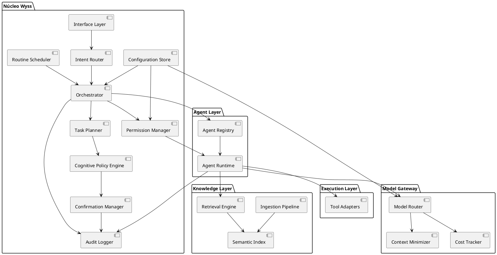

# Wyss — Diagrama de Componentes

**Versión:** 0.1

---

## 1. Componentes del sistema

```text
Wyss
├── Núcleo
│   ├── Interface Layer (CLI/chat)
│   ├── Intent Router
│   ├── Orchestrator
│   ├── Task Planner
│   ├── Cognitive Policy Engine
│   ├── Permission Manager (habilitaciones)
│   ├── Routine Scheduler
│   ├── Confirmation Manager
│   ├── Audit Logger
│   └── Configuration Store
├── Agent Layer
│   ├── Agent Base Model (plantilla)
│   ├── Agent Registry
│   └── Agent Runtime (instancias)
├── Knowledge Layer
│   ├── Ingestion Pipeline
│   ├── Semantic Index
│   ├── Retrieval Engine
│   └── Knowledge Base Store
├── Model Gateway
│   ├── Model Router
│   ├── Context Minimizer
│   └── Cost Tracker
└── Execution Layer
    ├── FileSystemAdapter
    ├── ShellAdapter
    ├── GitAdapter
    ├── CalendarAdapter
    ├── MessagingAdapter
    └── AppAdapter
```

## 2. Diagrama PlantUML



## 3. Responsabilidades por componente

| Componente | Responsabilidad única (SRP) |
|---|---|
| Interface Layer | Recibir instrucciones del owner y devolver resultados |
| Intent Router | Clasificar la intención de cada instrucción |
| Orchestrator | Coordinar: decidir quién hace qué |
| Task Planner | Convertir intención en plan explícito de pasos |
| Cognitive Policy Engine | Juzgar planes: finalidad, impacto, reversibilidad, nivel A–D |
| Permission Manager | Administrar habilitaciones agente↔BC y trabajador↔agente |
| Routine Scheduler | Disparar rutinas programadas |
| Confirmation Manager | Gestionar confirmaciones simples y fuertes |
| Audit Logger | Registrar todo evento relevante |
| Agent Registry | Catálogo de agentes: definición, estado, presupuesto |
| Agent Runtime | Ejecutar instancias de agentes en su dominio |
| Ingestion Pipeline | Escanear, extraer e indexar fuentes nuevas o modificadas |
| Semantic Index | Almacenar metadatos, texto y vectores recuperables |
| Retrieval Engine | Resolver consultas combinando metadatos + FTS + semántica |
| Model Router | Elegir modelo por costo/complejidad/riesgo/privacidad |
| Context Minimizer | Reducir y filtrar el contexto saliente; ocultar secretos |
| Cost Tracker | Medir y limitar gasto por agente y período |
| Tool Adapters | Integrar herramientas reales de forma desacoplada |
