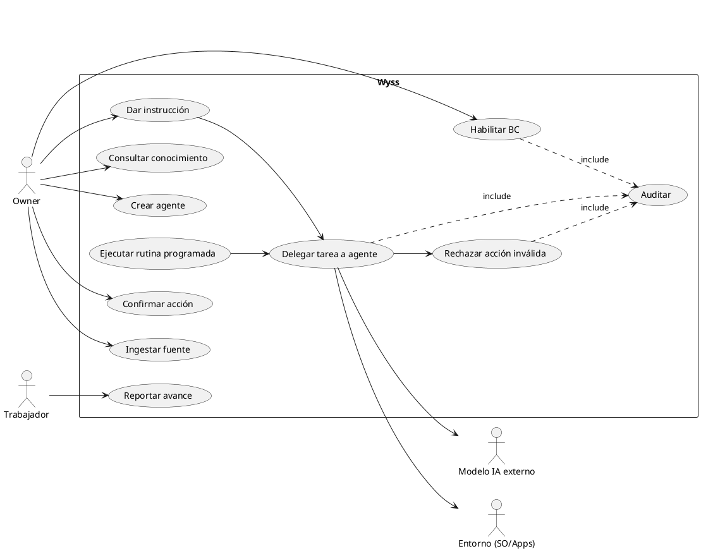
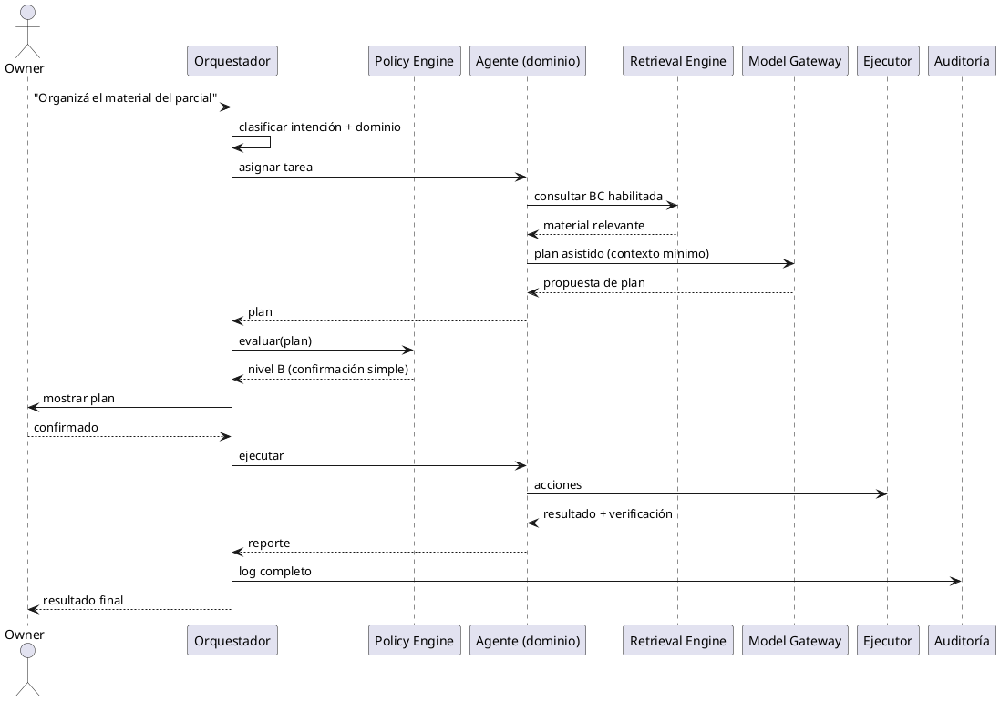
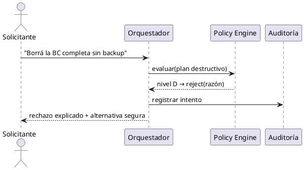
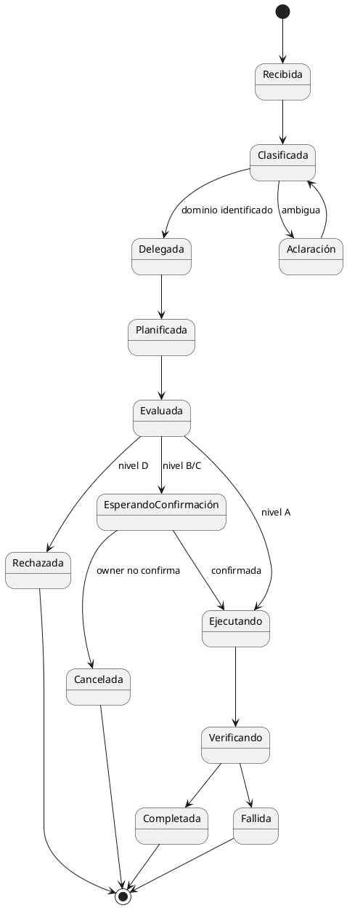
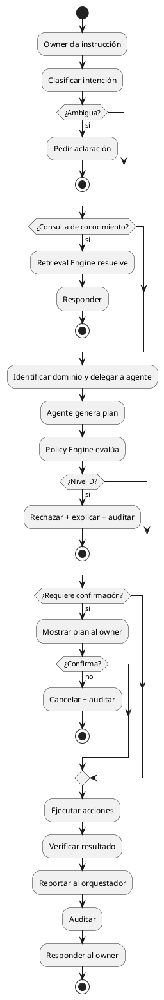
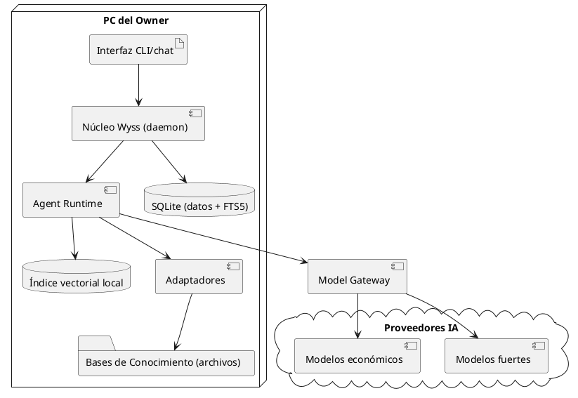
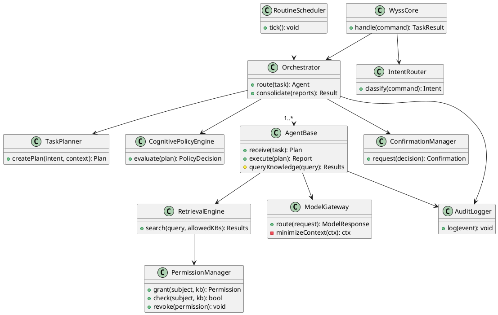

# Wyss — Diagramas UML

**Versión:** 0.1

---

## 1. Diagrama de casos de uso

## 2. Diagrama de secuencia — delegación con confirmación

## 3. Diagrama de secuencia — rechazo absoluto

## 4. Diagrama de estados de una tarea

## 5. Diagrama de actividad — flujo general

## 6. Diagrama de despliegue v0.1

## 7. Diagrama de clases preliminar

