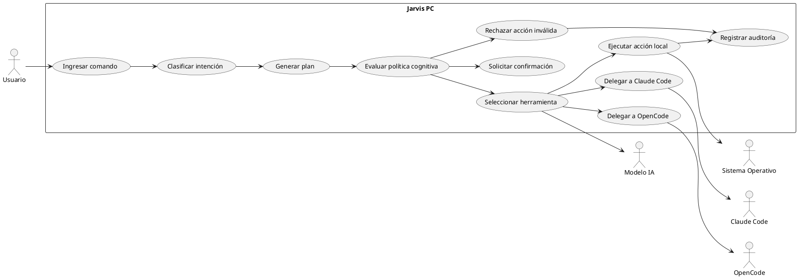
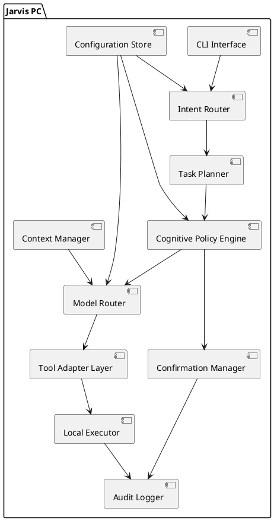
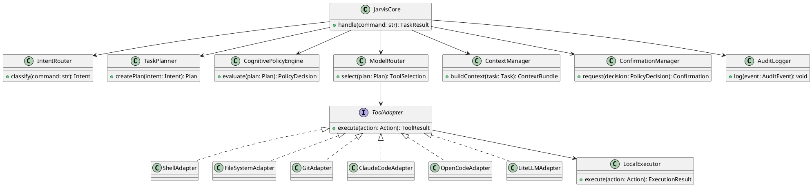
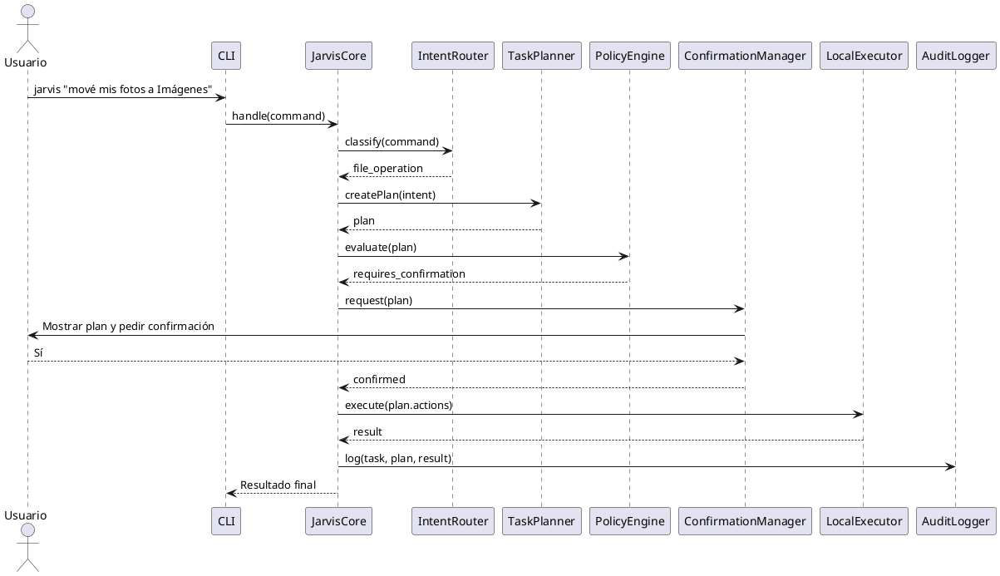
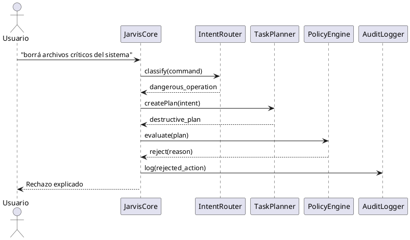
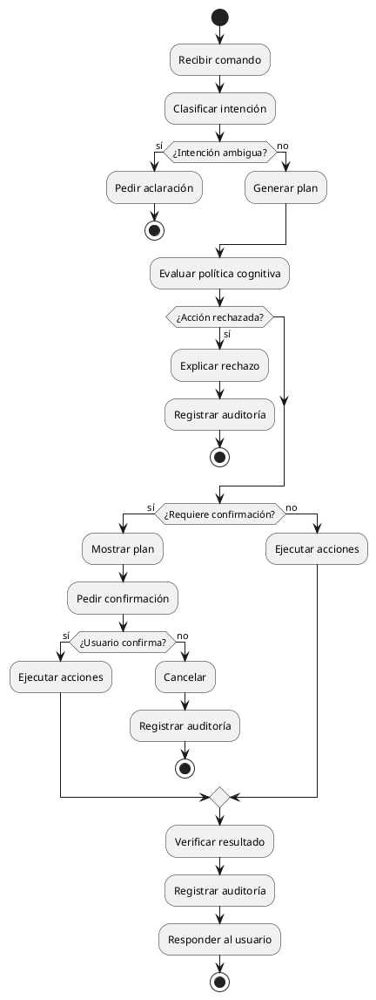
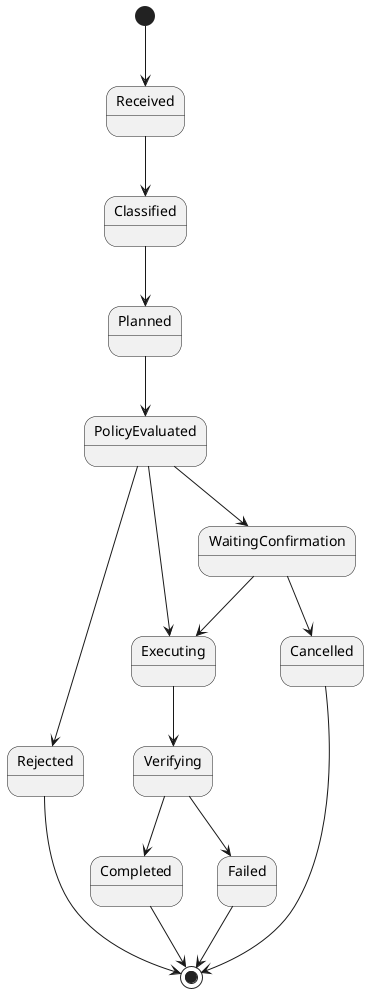
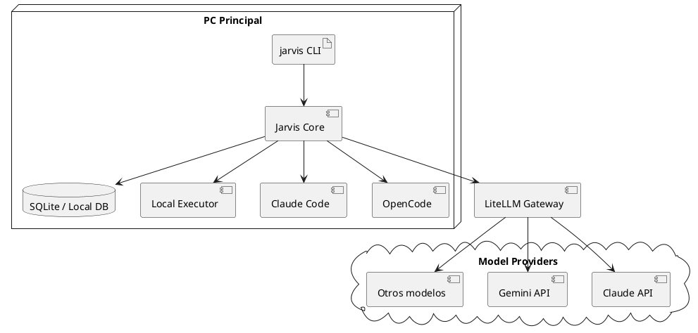

# Informe Técnico Profesional — Sistema Jarvis

**Versión:** 0.1 conceptual  
**Estado:** Documento base de arquitectura y alcance  
**Dominio inicial:** Jarvis PC  
**Evolución prevista:** PC → celular → luces/televisor → modo USB portable  
**Autor conceptual:** Ema / Santiago Wyss  

---

## 1. Resumen ejecutivo

Jarvis es un sistema de asistencia personal orientado a operar sobre el entorno digital y físico del usuario mediante una arquitectura modular, extensible y gobernada por una capa de razonamiento, planificación, confirmación y autocontrol.

El objetivo no es construir únicamente un chatbot, ni una automatización aislada, ni una simple interfaz de voz. Jarvis se define como un **agente operativo autónomo-supervisado**, capaz de comprender instrucciones de alto nivel, consultar memoria y conocimiento, seleccionar herramientas, ejecutar acciones sobre dispositivos reales y rechazar operaciones incoherentes, destructivas o contrarias a las reglas internas del sistema.

La primera fase del proyecto se concentra en **Jarvis PC**, es decir, un agente local capaz de operar sobre computadoras personales del usuario: archivos, repositorios, terminal, aplicaciones, sincronización entre máquinas, herramientas de IA como Claude Code y OpenCode, scripts locales y modelos externos a través de un gateway.

La visión completa contempla una evolución progresiva:

1. **Jarvis PC:** control operativo entre computadoras, archivos, proyectos, terminal, herramientas de desarrollo e IA.
2. **Jarvis Mobile:** interfaz móvil, voz, comandos rápidos, notificaciones y presencia del usuario.
3. **Jarvis Home:** integración con luces, televisor y dispositivos del entorno físico.
4. **Jarvis Portable USB:** nodo portable para registrar o controlar temporalmente una computadora nueva bajo pairing seguro.

La premisa arquitectónica central es:

> Jarvis puede tener acceso operativo amplio al entorno, pero sus acciones deben pasar por razonamiento, planificación, política interna, confirmación según impacto, verificación posterior y auditoría.

Esto significa que la seguridad del sistema no se basa únicamente en impedir acceso, sino en diseñar una capa cognitiva de juicio que determine si una acción tiene sentido, si es reversible, si genera pérdida de datos, si requiere confirmación o si debe ser rechazada aunque el usuario la solicite explícitamente.

---

## 2. Objetivos del sistema

### 2.1 Objetivo general

Diseñar y construir un sistema de asistencia personal modular capaz de coordinar modelos de IA, herramientas locales, automatizaciones, memoria, conocimiento y dispositivos reales para ejecutar tareas sobre el entorno del usuario con autonomía supervisada.

### 2.2 Objetivos específicos

- Permitir que el usuario interactúe con Jarvis mediante comandos naturales.
- Convertir instrucciones ambiguas o de alto nivel en planes de acción concretos.
- Seleccionar automáticamente la herramienta o modelo más conveniente según costo, complejidad, riesgo y privacidad.
- Operar sobre archivos, repositorios, terminal, aplicaciones y sincronización entre computadoras.
- Integrar Claude Code, OpenCode, modelos baratos y scripts locales como herramientas intercambiables.
- Mantener una memoria operativa sobre preferencias, dispositivos, rutas, proyectos y decisiones recurrentes.
- Consultar conocimiento estructurado y documental sin cargar todo el contexto en cada interacción.
- Solicitar confirmación antes de ejecutar acciones modificadoras, destructivas, costosas o sensibles.
- Rechazar acciones destructivas o sin finalidad legítima aunque el usuario insista.
- Registrar toda acción relevante en logs auditables.
- Preparar el sistema para su evolución hacia celular, domótica y modo portable.

---

## 3. Alcance del proyecto

### 3.1 Alcance inicial: Jarvis PC v0.1

Jarvis PC v0.1 se enfoca en el control de computadoras personales del usuario.

Incluye:

- Interfaz inicial por CLI.
- Interpretación de comandos en lenguaje natural.
- Clasificación de intención.
- Selección de herramienta/modelo.
- Ejecución de operaciones locales controladas.
- Gestión básica de archivos.
- Apertura de aplicaciones.
- Inspección de repositorios.
- Ejecución de comandos de lectura y diagnóstico.
- Integración inicial con Claude Code y OpenCode.
- Uso de modelos externos a través de LiteLLM o mecanismo equivalente.
- Registro de acciones.
- Confirmación previa para modificaciones relevantes.
- Rechazo de acciones críticas sin propósito legítimo.

### 3.2 Fuera de alcance para v0.1

No se implementa todavía:

- Aplicación móvil propia.
- Control de luces.
- Control de televisor.
- Home Assistant.
- USB portable.
- Interfaz web avanzada.
- Automatizaciones complejas con n8n.
- Entrenamiento de modelo propio.
- Control remoto sin pairing.
- Ejecución autónoma de tareas críticas sin confirmación.

### 3.3 Alcance futuro

Fases posteriores:

- Jarvis Mobile.
- Jarvis Home.
- Jarvis USB Node.
- RAG documental completo.
- Dashboard de auditoría.
- Agentes distribuidos entre varias máquinas.
- Control de dispositivos físicos.
- Integraciones con Notion, mem0, n8n, Home Assistant y servicios externos.

---

## 4. Principios de diseño

### 4.1 Jarvis no es una app aislada

Jarvis debe entenderse como una arquitectura compuesta por módulos especializados:

- Core de razonamiento.
- Memoria.
- Conocimiento.
- Model gateway.
- Adaptadores de herramientas.
- Nodos ejecutores.
- Políticas de seguridad cognitiva.
- Logs y auditoría.

### 4.2 Jarvis no reemplaza Claude Code ni OpenCode

Claude Code y OpenCode son herramientas que Jarvis puede usar.

Jarvis está por encima de ellas:

```text
Usuario → Jarvis → decide herramienta → Claude Code / OpenCode / script local / shell / API
```

### 4.3 Acceso amplio con juicio obligatorio

Requisito central:

```text
Jarvis puede tener acceso operativo total al entorno,
pero no ejecuta ciegamente todo lo que se le pide.
```

Jarvis debe evaluar:

- Intención real.
- Coherencia de la tarea.
- Impacto.
- Reversibilidad.
- Riesgo de pérdida de datos.
- Riesgo de seguridad.
- Privacidad.
- Costo de modelos.
- Necesidad de confirmación.

### 4.4 Los modelos no reciben todo el contexto

Jarvis puede conocer mucho sobre el entorno, pero debe enviar a cada modelo únicamente el contexto necesario.

Regla:

```text
Jarvis puede tener acceso amplio.
Los modelos externos reciben contexto mínimo, filtrado y pertinente.
```

### 4.5 Autonomía supervisada

Jarvis debe poder operar sin que el usuario indique cada paso, pero debe informar y pedir aprobación cuando el impacto lo amerite.

---

## 5. Arquitectura conceptual general

```text
┌──────────────────────────────────────────────────────────────┐
│                          Usuario                              │
│        CLI / voz futura / móvil / comandos rápidos             │
└─────────────────────────────┬────────────────────────────────┘
                              │
                              ▼
┌──────────────────────────────────────────────────────────────┐
│                        Jarvis Core                            │
│  - Interpretación de intención                                 │
│  - Planificación                                               │
│  - Selección de herramientas/modelos                           │
│  - Evaluación cognitiva                                        │
│  - Confirmación                                                │
│  - Auditoría                                                   │
└───────────────┬───────────────┬───────────────┬──────────────┘
                │               │               │
                ▼               ▼               ▼
      ┌────────────────┐ ┌──────────────┐ ┌──────────────────┐
      │ Memoria         │ │ Model Gateway │ │ Tool Adapters     │
      │ mem0 / DB       │ │ LiteLLM       │ │ Shell/File/Git/etc │
      └────────────────┘ └──────┬───────┘ └─────────┬────────┘
                                │                   │
                                ▼                   ▼
                       ┌─────────────────┐  ┌──────────────────┐
                       │ Claude / Gemini │  │ Jarvis Node PC    │
                       │ OpenCode models │  │ Ejecutor local    │
                       └─────────────────┘  └──────────────────┘
```

---

## 6. Arquitectura Jarvis PC v0.1

### 6.1 Componentes principales

```text
Jarvis PC v0.1
├── CLI Interface
├── Intent Router
├── Task Planner
├── Cognitive Policy Engine
├── Model Router
├── Context Manager
├── Tool Adapter Layer
├── Local Executor
├── Confirmation Manager
├── Audit Logger
└── Configuration Store
```

### 6.2 CLI Interface

Responsable de recibir instrucciones iniciales.

Ejemplos:

```bash
jarvis "abrí mi proyecto rag-corp"
jarvis "ordená esta carpeta, pero mostrame el plan primero"
jarvis "revisá este repo con modelo barato"
jarvis "si es complejo, pasalo a Claude Code"
jarvis "mové este archivo a la notebook"
```

### 6.3 Intent Router

Clasifica la tarea.

Categorías iniciales:

- `file_operation`
- `repo_task`
- `system_action`
- `model_task`
- `sync_task`
- `knowledge_query`
- `automation_task`
- `dangerous_operation`
- `ambiguous_request`

### 6.4 Task Planner

Convierte la intención en un plan explícito.

Ejemplo:

```text
Tarea: mover fotos
Plan:
1. Buscar imágenes en carpeta origen.
2. Contar archivos afectados.
3. Detectar duplicados.
4. Proponer destino.
5. Confirmar con usuario.
6. Ejecutar movimiento.
7. Verificar resultado.
8. Registrar acción.
```

### 6.5 Cognitive Policy Engine

Módulo encargado de decidir si el plan es válido.

Evalúa:

- Finalidad legítima.
- Impacto esperado.
- Reversibilidad.
- Posible pérdida de datos.
- Riesgo de seguridad.
- Exposición de información sensible.
- Costo operativo.
- Necesidad de confirmación.
- Necesidad de backup.
- Necesidad de diff.
- Necesidad de modelo fuerte.
- Si la acción debe rechazarse.

### 6.6 Model Router

Decide qué herramienta o modelo usar.

Criterios:

- Complejidad.
- Costo.
- Riesgo.
- Privacidad.
- Necesidad de razonamiento profundo.
- Tamaño del contexto.
- Tipo de salida esperada.

Opciones:

- Script local.
- Modelo barato vía OpenCode o LiteLLM.
- Claude Code.
- Modelo fuerte vía LiteLLM.
- Sin IA, solo lógica determinística.

### 6.7 Context Manager

Selecciona el contexto mínimo necesario.

Responsabilidades:

- Indexar proyectos.
- Leer estructura de carpetas.
- Seleccionar archivos relevantes.
- Evitar envío innecesario de datos privados.
- Ocultar secrets.
- Resumir contexto antes de enviarlo a modelos.
- Mantener caché local de contexto.

### 6.8 Tool Adapter Layer

Capa de adaptación entre Jarvis y herramientas externas/locales.

Adaptadores iniciales:

- `ShellAdapter`
- `FileSystemAdapter`
- `GitAdapter`
- `ClaudeCodeAdapter`
- `OpenCodeAdapter`
- `LiteLLMAdapter`
- `VSCodeAdapter`
- `SyncAdapter`
- `AuditAdapter`

### 6.9 Local Executor

Ejecuta acciones sobre la PC.

Acciones posibles:

- Crear carpetas.
- Mover archivos.
- Copiar archivos.
- Renombrar archivos.
- Abrir aplicaciones.
- Ejecutar comandos.
- Ejecutar tests.
- Leer logs.
- Lanzar herramientas externas.
- Sincronizar archivos.

### 6.10 Confirmation Manager

Gestiona confirmaciones.

Niveles:

- Sin confirmación.
- Confirmación simple.
- Confirmación fuerte.
- Rechazo absoluto.

### 6.11 Audit Logger

Registra operaciones.

Campos mínimos:

- Fecha y hora.
- Usuario.
- Máquina.
- Comando original.
- Intención detectada.
- Plan generado.
- Herramienta seleccionada.
- Confirmación recibida.
- Acciones ejecutadas.
- Resultado.
- Errores.
- Riesgo estimado.

---

## 7. Requisitos funcionales

### RF-001 — Recepción de comandos naturales

Jarvis debe permitir ingresar comandos en lenguaje natural mediante CLI en la versión inicial.

### RF-002 — Clasificación de intención

Jarvis debe clasificar cada comando en una categoría operativa.

### RF-003 — Generación de plan

Jarvis debe generar un plan antes de ejecutar acciones modificadoras.

### RF-004 — Evaluación cognitiva

Jarvis debe evaluar si el plan tiene sentido, si es seguro, si es reversible y si requiere confirmación.

### RF-005 — Selección automática de herramienta

Jarvis debe decidir si usa lógica local, script, OpenCode, Claude Code o modelo vía LiteLLM.

### RF-006 — Ejecución local

Jarvis debe ejecutar acciones locales sobre archivos, aplicaciones, repositorios y comandos permitidos.

### RF-007 — Confirmación inteligente

Jarvis debe pedir confirmación para acciones modificadoras o de impacto relevante.

### RF-008 — Rechazo de acciones inválidas

Jarvis debe rechazar acciones destructivas, incoherentes o contrarias a la política interna aunque el usuario las solicite.

### RF-009 — Auditoría

Jarvis debe registrar todas las acciones relevantes.

### RF-010 — Integración con Claude Code

Jarvis debe poder delegar tareas complejas de código a Claude Code.

### RF-011 — Integración con OpenCode

Jarvis debe poder delegar tareas simples o baratas a OpenCode/modelos económicos.

### RF-012 — Gestión de contexto

Jarvis debe seleccionar contexto mínimo y relevante para cada tarea.

### RF-013 — Operaciones entre PCs

Jarvis debe preparar soporte para sincronizar o mover archivos entre computadoras registradas.

---

## 8. Requisitos no funcionales

### RNF-001 — Seguridad cognitiva

Toda acción debe pasar por una evaluación de intención, impacto y política.

### RNF-002 — Trazabilidad

Toda acción relevante debe ser auditable.

### RNF-003 — Modularidad

Cada integración debe implementarse como adaptador desacoplado.

### RNF-004 — Extensibilidad

El sistema debe permitir agregar nuevos modelos, herramientas y dispositivos sin reescribir el core.

### RNF-005 — Privacidad

Jarvis debe minimizar el contexto enviado a modelos externos.

### RNF-006 — Costo controlado

Jarvis debe preferir modelos baratos o lógica local cuando sea suficiente.

### RNF-007 — Robustez

Jarvis debe verificar resultados posteriores a la ejecución.

### RNF-008 — Reversibilidad

Cuando sea posible, las acciones modificadoras deben tener plan de rollback o backup.

### RNF-009 — Portabilidad futura

La arquitectura debe permitir un modo portable USB en fases posteriores.

### RNF-010 — Observabilidad

El sistema debe exponer logs, métricas básicas y reportes de ejecución.

---

## 9. Casos de uso

### UC-001 — Abrir proyecto

**Actor:** Usuario  
**Descripción:** El usuario solicita abrir un proyecto conocido.  
**Flujo:**

1. Usuario ejecuta: `jarvis "abrí rag-corp"`.
2. Jarvis identifica el proyecto.
3. Jarvis localiza la ruta.
4. Jarvis abre VS Code o herramienta configurada.
5. Jarvis registra la acción.

**Confirmación:** No requerida.  
**Riesgo:** Bajo.

### UC-002 — Ordenar carpeta

**Actor:** Usuario  
**Descripción:** El usuario solicita ordenar una carpeta.  
**Flujo:**

1. Usuario solicita ordenar carpeta.
2. Jarvis inspecciona contenido.
3. Jarvis propone clasificación.
4. Jarvis informa cantidad de archivos afectados.
5. Usuario confirma.
6. Jarvis ejecuta.
7. Jarvis verifica resultado.
8. Jarvis registra acción.

**Confirmación:** Simple.  
**Riesgo:** Medio.

### UC-003 — Mover fotos

**Actor:** Usuario  
**Descripción:** Mover fotos de una carpeta a otra.  
**Flujo:**

1. Jarvis identifica archivos de imagen.
2. Cuenta archivos.
3. Detecta duplicados.
4. Propone destino.
5. Confirma con usuario.
6. Mueve sin sobrescribir.
7. Verifica conteo origen/destino.

**Confirmación:** Simple o fuerte según volumen.  
**Riesgo:** Medio.

### UC-004 — Revisar repositorio con modelo barato

**Actor:** Usuario  
**Descripción:** Revisión liviana de repo usando modelo económico.  
**Flujo:**

1. Jarvis identifica repo.
2. Lee estructura.
3. Detecta tamaño y sensibilidad.
4. Elige OpenCode/modelo barato.
5. Genera resumen o hallazgos.
6. No modifica archivos sin confirmación.

**Confirmación:** No para lectura; sí para cambios.  
**Riesgo:** Bajo/medio.

### UC-005 — Escalar tarea a Claude Code

**Actor:** Usuario/Jarvis  
**Descripción:** Jarvis detecta que una tarea excede la capacidad esperada de un modelo barato.  
**Flujo:**

1. Jarvis clasifica complejidad alta.
2. Evalúa costo.
3. Propone usar Claude Code.
4. Usuario confirma si hay costo alto.
5. Jarvis delega tarea.
6. Recibe resultado o diff.
7. Solicita aprobación para aplicar cambios.

**Confirmación:** Según costo y modificación.  
**Riesgo:** Medio.

### UC-006 — Ejecutar tests

**Actor:** Usuario  
**Descripción:** Ejecutar pruebas de un proyecto.  
**Flujo:**

1. Jarvis detecta stack.
2. Determina comando de test.
3. Ejecuta.
4. Resume resultado.
5. Guarda log.

**Confirmación:** No requerida para comandos no destructivos.  
**Riesgo:** Bajo.

### UC-007 — Instalar paquete

**Actor:** Usuario  
**Descripción:** Instalar dependencia o herramienta.  
**Flujo:**

1. Jarvis identifica paquete.
2. Evalúa origen.
3. Verifica gestor de paquetes.
4. Informa comando.
5. Solicita confirmación fuerte.
6. Ejecuta.
7. Verifica instalación.

**Confirmación:** Fuerte.  
**Riesgo:** Alto.

### UC-008 — Borrar archivos

**Actor:** Usuario  
**Descripción:** El usuario solicita borrar archivos.  
**Flujo:**

1. Jarvis identifica archivos.
2. Evalúa cantidad, tipo y ubicación.
3. Verifica si son recuperables.
4. Propone mover a papelera o backup.
5. Solicita confirmación fuerte.
6. Ejecuta solo si es razonable.

**Confirmación:** Fuerte.  
**Riesgo:** Alto.

### UC-009 — Rechazar acción destructiva

**Actor:** Usuario  
**Descripción:** El usuario solicita una acción destructiva sin finalidad legítima.  
**Ejemplo:** borrar directorios críticos del sistema.  
**Flujo:**

1. Jarvis interpreta intención.
2. Detecta destrucción del sistema.
3. Evalúa que no existe finalidad legítima.
4. Rechaza la acción.
5. Explica motivo.
6. Registra intento.

**Confirmación:** No aplica.  
**Resultado:** Rechazo absoluto.

### UC-010 — Mover archivo entre PCs

**Actor:** Usuario  
**Descripción:** Transferir archivo entre computadoras registradas.  
**Flujo:**

1. Jarvis identifica archivo origen.
2. Identifica máquina destino.
3. Valida disponibilidad.
4. Propone método de transferencia.
5. Solicita confirmación.
6. Ejecuta transferencia.
7. Verifica hash/tamaño.
8. Registra acción.

**Confirmación:** Simple o fuerte según sensibilidad.  
**Riesgo:** Medio.

---

## 10. Matriz de decisión de herramientas

| Tipo de tarea | Complejidad | Riesgo | Herramienta preferida |
|---|---:|---:|---|
| Abrir aplicación | Baja | Bajo | Local Executor |
| Listar archivos | Baja | Bajo | FileSystemAdapter |
| Crear carpeta | Baja | Bajo | FileSystemAdapter |
| Ordenar archivos | Media | Medio | Script local + confirmación |
| Resumir texto no sensible | Baja/media | Bajo | OpenCode/modelo barato |
| Revisar logs | Media | Bajo | Modelo barato |
| Refactor arquitectónico | Alta | Medio/alto | Claude Code |
| Corregir CI complejo | Alta | Medio | Claude Code |
| Instalar paquetes | Media | Alto | ShellAdapter + confirmación fuerte |
| Borrar datos | Media/alta | Alto | Confirmación fuerte / rechazo |
| Tocar configuración crítica | Alta | Alto | Confirmación fuerte / rechazo |
| Enviar secrets a modelo | N/A | Crítico | Rechazo |

---

## 11. Niveles de acción

### Nivel A — Ejecución directa

Acciones de bajo impacto:

- Abrir aplicación.
- Listar archivos.
- Buscar archivo.
- Leer estado de repo.
- Ejecutar comandos de lectura.
- Crear archivo nuevo en carpeta de trabajo.

### Nivel B — Confirmación simple

Acciones modificadoras normales:

- Mover archivos.
- Renombrar archivos.
- Ordenar carpetas.
- Modificar archivos de proyecto.
- Ejecutar herramientas de IA sobre repo.

### Nivel C — Confirmación fuerte

Acciones de alto impacto:

- Borrar archivos.
- Sobrescribir datos.
- Instalar paquetes.
- Cambiar permisos.
- Tocar servicios.
- Modificar firewall.
- Mover grandes volúmenes de datos.

### Nivel D — Rechazo absoluto

Acciones no aceptables:

- Destruir sistema operativo.
- Exfiltrar credenciales.
- Instalar malware.
- Desactivar seguridad sin motivo legítimo.
- Borrar backups críticos.
- Enviar información sensible a modelos no confiables.

---

## 12. Modelo de memoria y conocimiento

### 12.1 Tipos de memoria

```text
Memoria inmediata:
- Conversación actual
- Tarea activa
- Estado temporal

Memoria operativa:
- Preferencias del usuario
- Rutas frecuentes
- Proyectos activos
- Herramientas disponibles
- Decisiones recurrentes

Conocimiento estructurado:
- Notion
- Documentos de arquitectura
- Guías
- Roadmaps
- Apuntes

Memoria documental:
- RAG sobre archivos
- Índices vectoriales
- Resúmenes persistentes

Auditoría:
- Historial de acciones
- Decisiones
- Confirmaciones
- Errores
```

### 12.2 Regla de separación

```text
Notion guarda conocimiento humano editable.
mem0 guarda memoria operativa del agente.
RAG guarda acceso documental recuperable.
Logs guardan acciones ejecutadas.
```

---

## 13. Modelo de datos preliminar

### 13.1 Entidades principales

- User
- Device
- Project
- Task
- Plan
- Action
- ToolInvocation
- Confirmation
- AuditLog
- MemoryItem
- KnowledgeSource
- PolicyDecision

### 13.2 Modelo relacional preliminar

```text
User
- id
- name
- created_at

Device
- id
- user_id
- name
- hostname
- os_type
- trusted
- last_seen_at

Project
- id
- user_id
- name
- path
- type
- sensitivity_level

Task
- id
- user_id
- device_id
- raw_command
- intent
- status
- created_at

Plan
- id
- task_id
- summary
- risk_level
- requires_confirmation
- rejected
- reason

Action
- id
- plan_id
- type
- target
- parameters_json
- status

ToolInvocation
- id
- action_id
- tool_name
- model_name
- cost_estimate
- status

Confirmation
- id
- plan_id
- level
- prompt
- user_response
- confirmed_at

AuditLog
- id
- task_id
- event_type
- message
- metadata_json
- created_at

MemoryItem
- id
- user_id
- type
- content
- source
- created_at

KnowledgeSource
- id
- user_id
- type
- location
- indexed_at

PolicyDecision
- id
- plan_id
- decision
- risk_level
- rationale
- created_at
```

---

## 14. Diagramas UML

### 14.1 Diagrama de casos de uso



### 14.2 Diagrama de componentes



### 14.3 Diagrama de clases preliminar



### 14.4 Diagrama de secuencia — tarea con confirmación



### 14.5 Diagrama de secuencia — rechazo absoluto



### 14.6 Diagrama de actividad



### 14.7 Diagrama de estados de una tarea



### 14.8 Diagrama de despliegue v0.1



---

## 15. Seguridad cognitiva

### 15.1 Concepto

La seguridad de Jarvis no se basa únicamente en permisos técnicos tradicionales, sino en una combinación de:

- Comprensión de intención.
- Evaluación semántica.
- Políticas explícitas.
- Confirmación humana.
- Rechazo razonado.
- Auditoría.
- Verificación posterior.

### 15.2 Política de rechazo

Jarvis debe rechazar:

- Acciones destructivas sin finalidad legítima.
- Exfiltración de secretos.
- Instalación de software malicioso.
- Desactivación injustificada de medidas de seguridad.
- Borrado de backups.
- Operaciones irreversibles no justificadas.
- Acciones que contradigan el objetivo real del usuario.

### 15.3 Política de confirmación

Jarvis debe confirmar:

- Movimientos masivos de archivos.
- Borrado.
- Sobrescritura.
- Instalación de paquetes.
- Modificación de configuración del sistema.
- Envío de contexto privado a modelos externos.
- Uso de modelos caros.

### 15.4 Política de ejecución directa

Jarvis puede ejecutar directamente:

- Lecturas.
- Búsquedas.
- Apertura de aplicaciones.
- Inspección de repositorios.
- Creación de archivos nuevos no conflictivos.
- Comandos diagnósticos no destructivos.

---

## 16. Estrategia de modelos

### 16.1 Criterios de selección

Jarvis debe seleccionar modelos según:

- Costo.
- Profundidad requerida.
- Privacidad.
- Riesgo.
- Necesidad de multimodalidad.
- Tipo de tarea.
- Tamaño del contexto.

### 16.2 Reglas iniciales

```text
Tarea simple → lógica local.
Resumen barato → modelo económico.
Análisis técnico profundo → Claude Code.
Refactor crítico → Claude Code + confirmación.
Información sensible → contexto mínimo o no enviar.
Acción destructiva → evaluar/rechazar/confirmar.
```

### 16.3 Rol de LiteLLM

LiteLLM actúa como gateway para centralizar proveedores.

Beneficios:

- Un único endpoint.
- Alias de modelos.
- Cambio de proveedor sin modificar el core.
- Control de costos.
- Observabilidad futura.

---

## 17. Integración con PCs

### 17.1 PC local

La primera versión corre en una sola computadora con acceso al entorno local.

### 17.2 Varias PCs

En fases posteriores, cada computadora ejecutará un `Jarvis Node`.

Responsabilidades del nodo:

- Recibir órdenes firmadas/autorizadas.
- Ejecutar acciones locales.
- Reportar estado.
- Transferir archivos.
- Registrar auditoría local.
- Sincronizar con Jarvis Core.

### 17.3 Transferencia entre máquinas

Métodos posibles:

- Syncthing.
- SSH/SCP.
- rsync.
- Carpeta compartida.
- API propia del Jarvis Node.

La selección dependerá de seguridad, disponibilidad y tipo de archivo.

---

## 18. Roadmap

### Fase 0 — Diseño

- Definir arquitectura.
- Definir casos de uso.
- Definir modelo de seguridad cognitiva.
- Definir estructura inicial del proyecto.

### Fase 1 — Jarvis PC CLI

- CLI funcional.
- Router de intención básico.
- Planificador básico.
- Ejecutor local.
- Confirmación.
- Logs.

### Fase 2 — Integración IA

- LiteLLM.
- OpenCode.
- Claude Code.
- Model Router.
- Context Manager.

### Fase 3 — Memoria y conocimiento

- Memoria operativa.
- Índice de proyectos.
- Notion.
- RAG documental.

### Fase 4 — Multi-PC

- Jarvis Node.
- Registro de dispositivos.
- Transferencia de archivos.
- Auditoría distribuida.

### Fase 5 — Mobile

- App o interfaz móvil.
- Voz.
- Notificaciones.
- Comandos rápidos.

### Fase 6 — Home

- Luces.
- TV.
- Home Assistant.
- Escenas.

### Fase 7 — USB Portable

- Nodo portable.
- Pairing.
- Modo temporal.
- Modo permanente.

---

## 19. Riesgos del proyecto

| Riesgo | Impacto | Mitigación |
|---|---:|---|
| Ejecución destructiva accidental | Alto | Policy Engine + confirmación + rechazo |
| Filtrado de información sensible | Alto | Context Manager + redacción de secrets |
| Costos elevados de modelos | Medio | Model Router + presupuestos |
| Complejidad excesiva | Alto | Roadmap incremental |
| Dependencia de proveedor | Medio | LiteLLM + adaptadores |
| Automatizaciones opacas | Alto | Auditoría obligatoria |
| Pérdida de archivos | Alto | Dry-run + backup + confirmación |
| Mala clasificación de intención | Medio | Confirmación en ambigüedad |
| Prompt injection en documentos | Alto | Sanitización + separación datos/instrucciones |

---

## 20. Criterios de aceptación v0.1

Jarvis PC v0.1 se considera aceptable si:

- Recibe comandos por CLI.
- Clasifica al menos 5 tipos de intención.
- Genera planes legibles.
- Ejecuta acciones locales simples.
- Pide confirmación antes de modificar archivos existentes.
- Rechaza al menos una clase de acción destructiva.
- Registra auditoría básica.
- Puede abrir proyectos conocidos.
- Puede listar y ordenar carpetas en modo dry-run.
- Puede decidir entre lógica local, OpenCode y Claude Code de forma básica.

---

## 21. Definición de hecho

Una funcionalidad de Jarvis está terminada cuando:

- Tiene caso de uso documentado.
- Tiene política de riesgo definida.
- Tiene flujo feliz y flujos alternativos.
- Tiene logs.
- Tiene manejo de errores.
- Tiene confirmación si modifica estado.
- Tiene pruebas mínimas.
- Tiene documentación de usuario.
- No rompe límites de seguridad cognitiva.

---

## 22. Conclusión

Jarvis debe diseñarse como una plataforma personal de asistencia operativa, no como un chatbot ni como un script gigante.

La primera versión debe concentrarse en Jarvis PC: operar sobre computadoras, archivos, proyectos, comandos, modelos y herramientas de desarrollo. El sistema debe tener acceso amplio, pero sus acciones deben pasar por una capa de juicio interno que evalúe finalidad, impacto, riesgo y reversibilidad.

La arquitectura propuesta permite crecer de manera controlada hacia celular, domótica y modo portable sin convertir el sistema en un Frankenstein. La clave es mantener separación de responsabilidades: Jarvis Core decide, los adaptadores integran, los nodos ejecutan, los modelos razonan, la memoria contextualiza y la auditoría permite confiar en el sistema.

El principio rector del sistema es:

> Jarvis no es un usuario limitado. Jarvis es un operador con criterio.

