# 04 — Diagramas UML

## Propósito

Yo uso UML para separar cuatro preguntas: quién usa Wyss, qué partes lo forman, cómo se comunican y qué estados atraviesa una tarea. Los diagramas están en Mermaid para revisión dentro de GitHub.

## Cobertura UML 2

| Tipo | Cobertura | Aplicación |
|---|---|---|
| casos de uso | incluida | owner, automatización externa y provider |
| clases | incluida | plan, acción, política y resultados |
| objetos | incluida | propuesta pendiente concreta |
| componentes | incluida | capas y adaptadores |
| paquetes | incluida | dependencias hexagonales |
| estructura compuesta | incluida | interior del daemon |
| despliegue | incluida | PC, teléfono, provider y servicios |
| actividad | incluida | loop ask-to-audit |
| estados | incluida | ciclo de una tarea/propuesta |
| secuencia | incluida | ask y confirm |
| comunicación | incluida | mensajes entre colaboradores |
| visión general de interacción | incluida | productores de planes |
| temporal | incluida | TTL y re-evaluación |
| perfil | incluida | estereotipos de criticidad |

## 1. Casos de uso

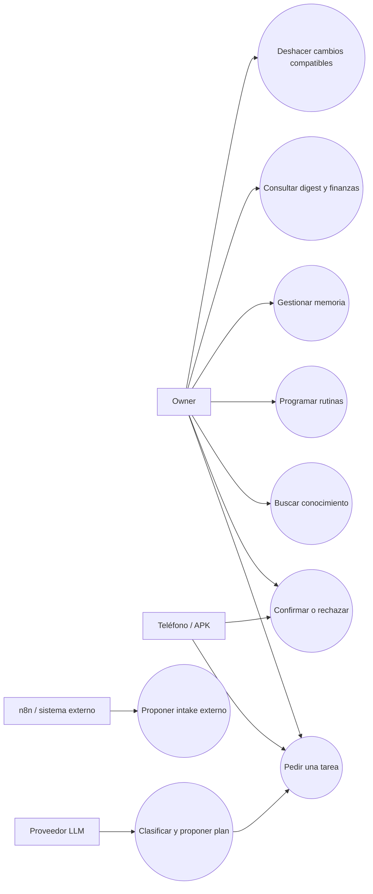

## 2. Clases de dominio

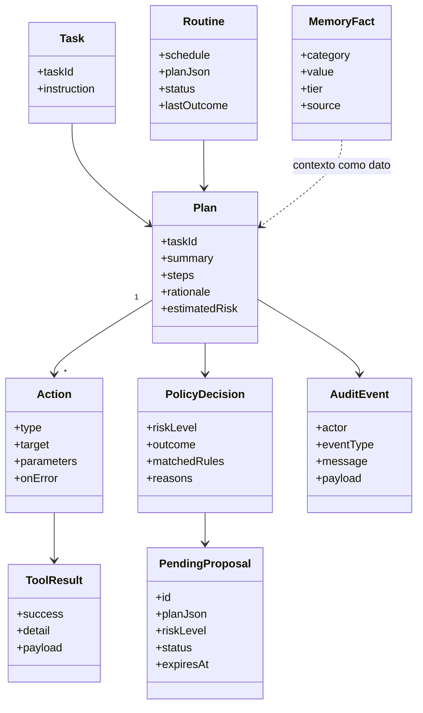

## 3. Objetos de una propuesta

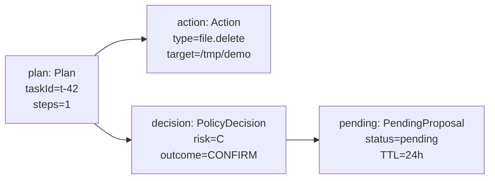

## 4. Componentes

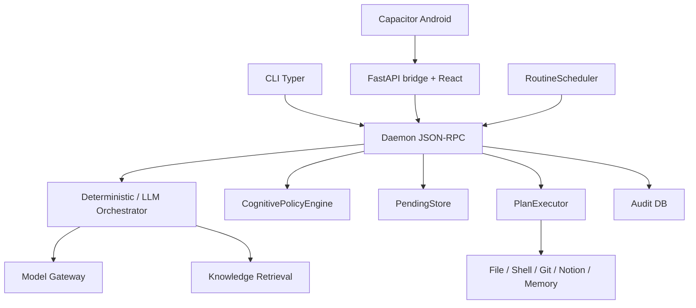

## 5. Paquetes y dependencia

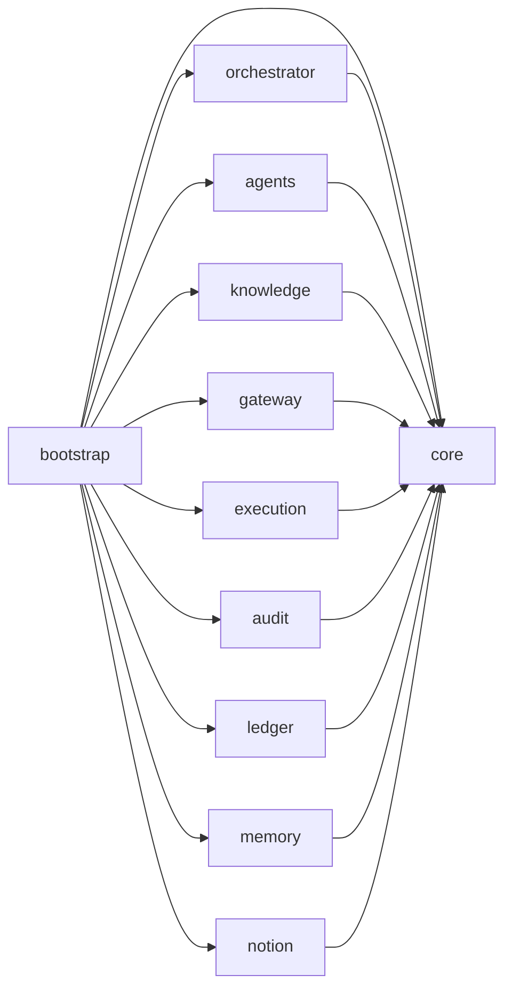

Las capas laterales no deben importarse entre sí; bootstrap las conecta.

## 6. Estructura compuesta del daemon

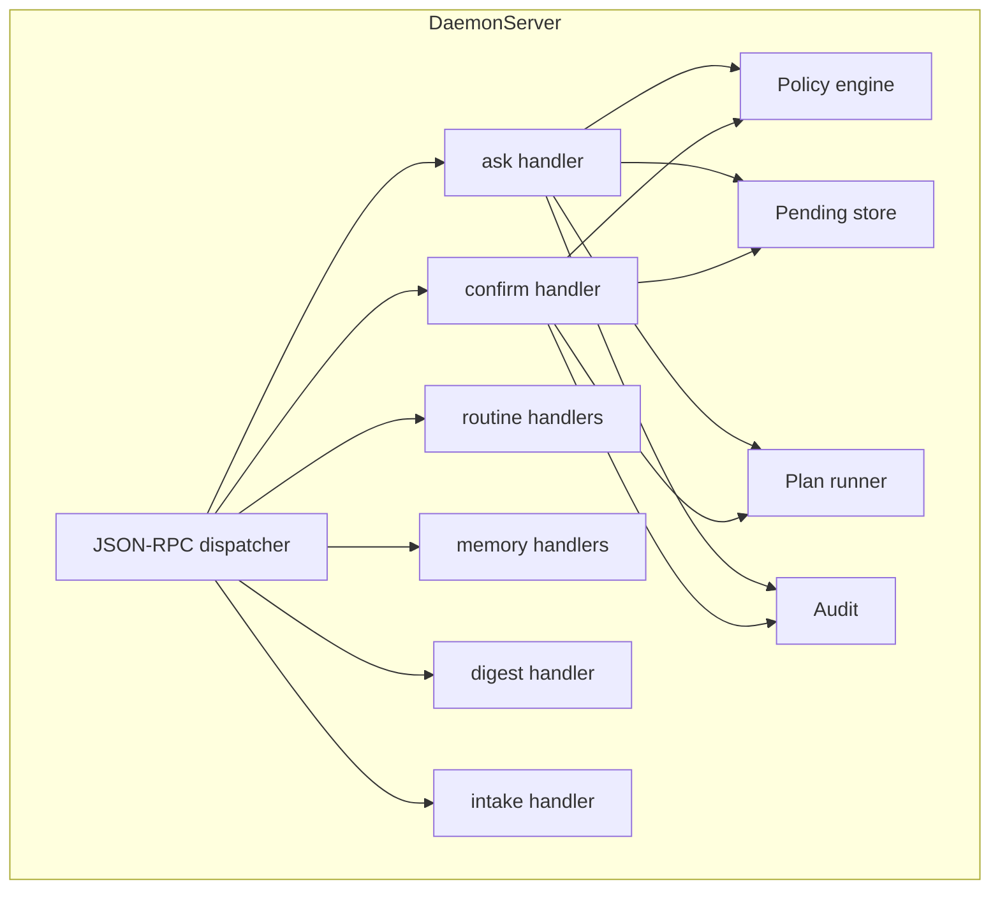

## 7. Actividad del loop principal

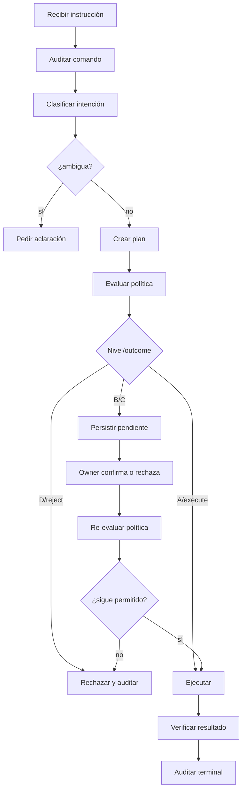

## 8. Máquina de estados de propuesta

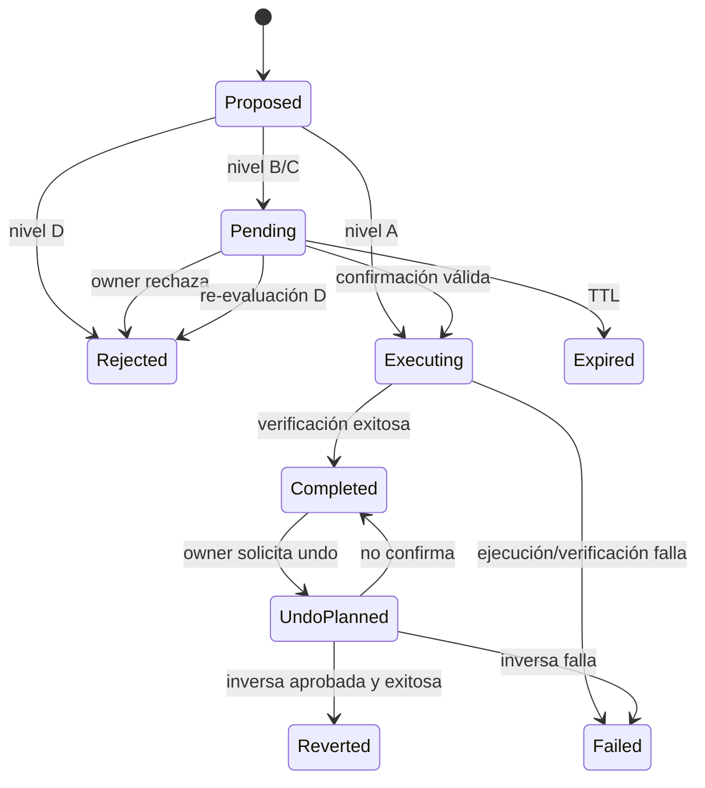

## 9. Secuencia `ask`

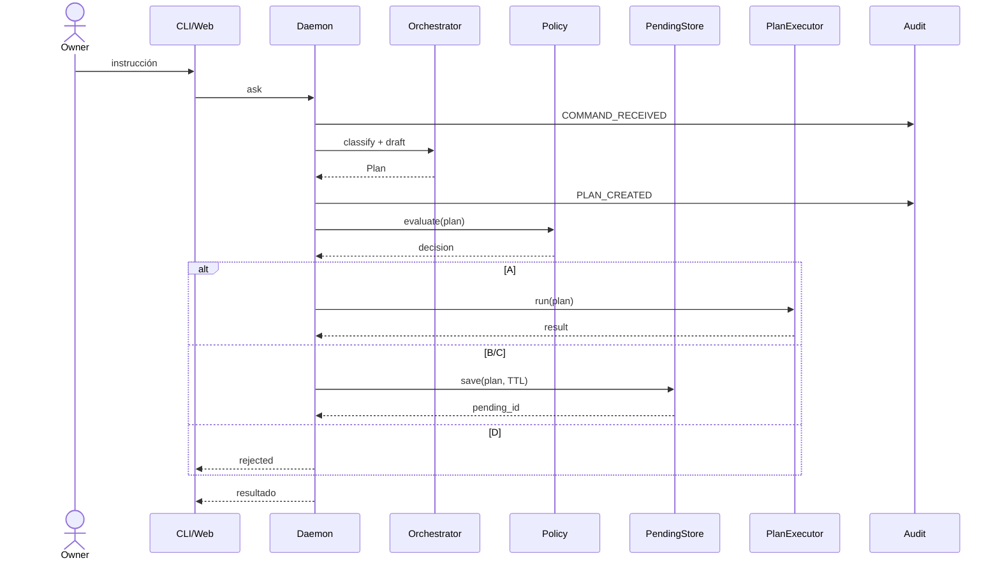

## 10. Secuencia `confirm`

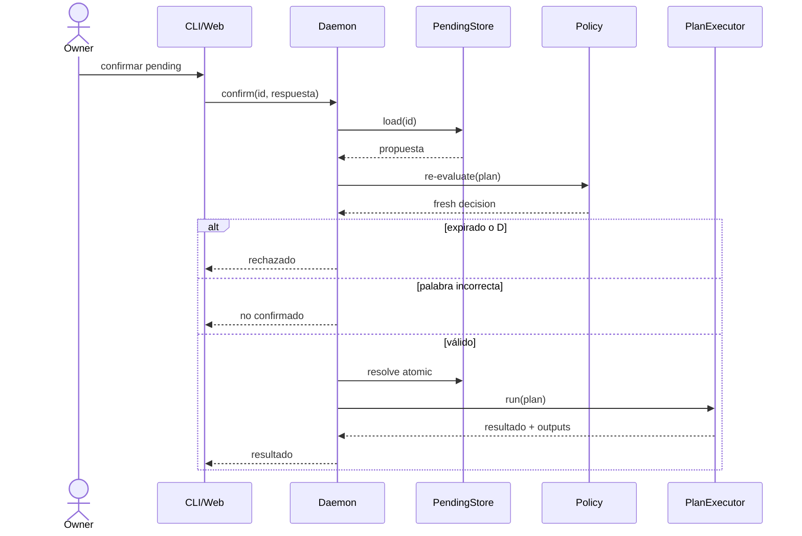

## 11. Comunicación

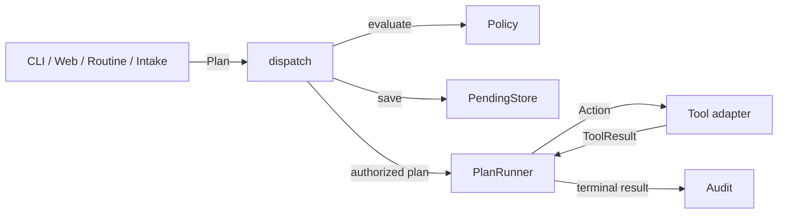

## 12. Visión general de interacción

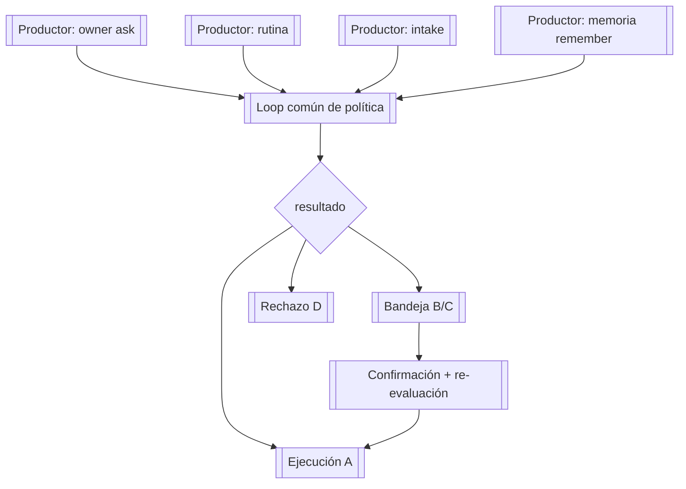

## 13. Temporal: TTL y cambio de riesgo

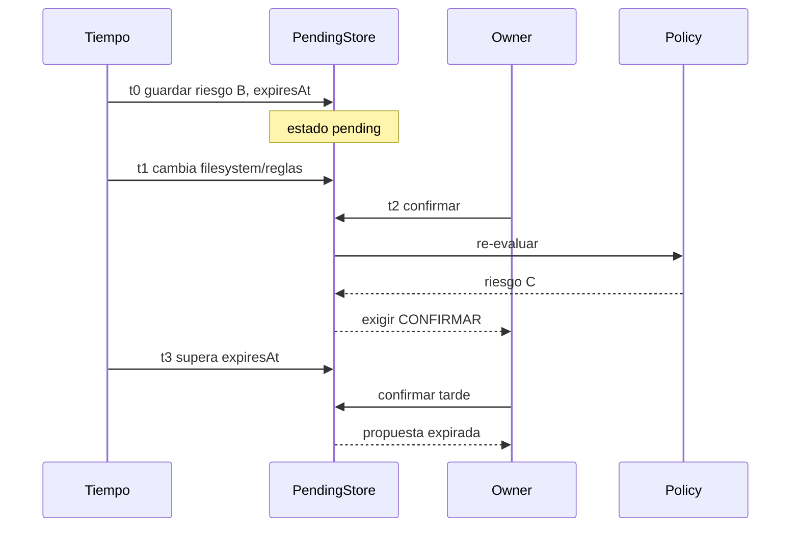

## 14. Despliegue

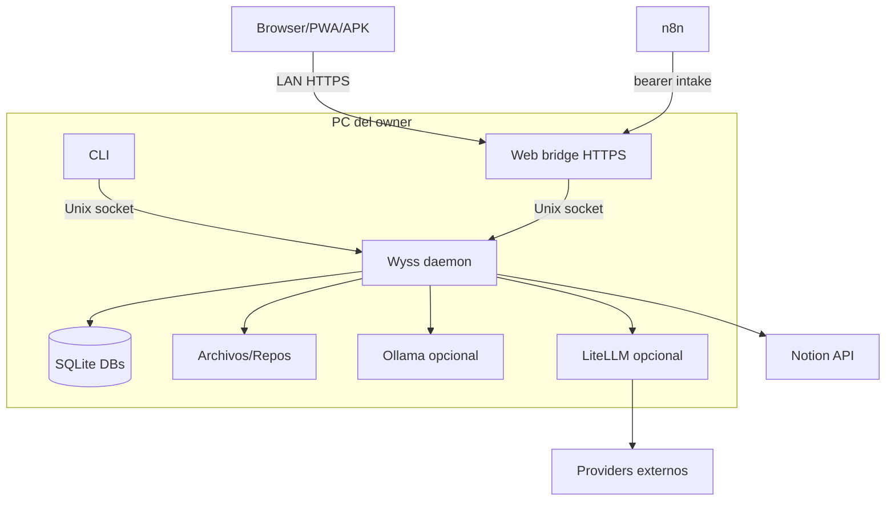

## 15. Perfil UML de seguridad

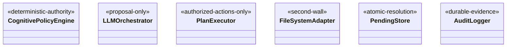

## Regla de mantenimiento

Yo actualizo estas vistas cuando cambia un actor, nivel, action type, handler, DB, provider, dispositivo o ruta de ejecución. Un cambio que crea un nuevo productor de planes debe aparecer explícitamente en los diagramas de componentes e interacción.