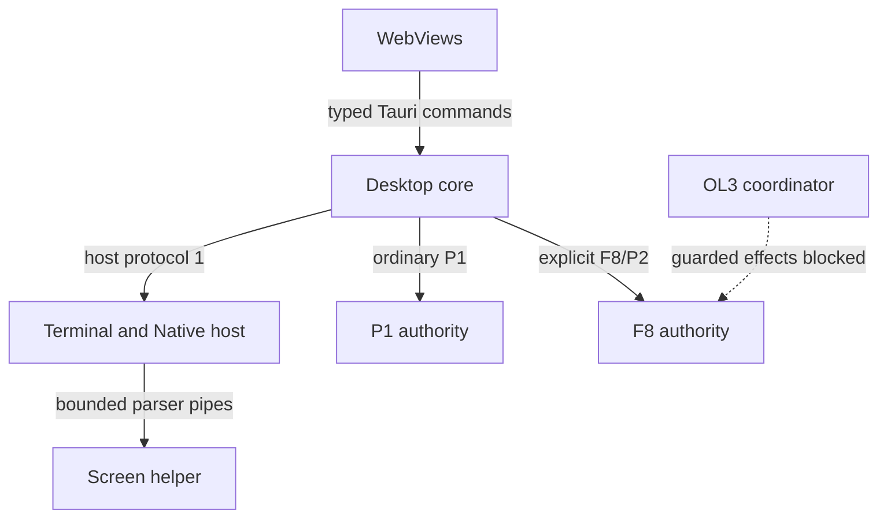

# Architecture and engineering direction

Source baseline: `bf9dc2318113bee6131e1f9690f36c266518d6fa`, reviewed on 2026-11-02.
This is a source-based architecture assessment, not a new installed-system, provider or
device qualification. [STATUS](STATUS.md) owns delivery evidence, [REQUIREMENTS](REQUIREMENTS.md)
owns target behavior, and [ROADMAP](ROADMAP.md) owns remaining changes. Existing source tests
are referenced as verification locations, not reported as newly executed passes.

## 1. Architectural position

Retain the Linux desktop, Tauri 2, Rust, Svelte 5/TypeScript, xterm with FitAddon, SQLite
and native Android baseline. The present evidence supports improving boundaries and
qualification in this implementation; it does not justify a framework, language, database
or terminal-engine rewrite. This is a project-specific engineering direction, not a claim
that a technology is universally best. Compare a replacement only against a demonstrated
requirement gap, measured cost, migration/recovery burden and realistic maintenance capacity.

The application is modular within one Cargo package, with several process roles. A module,
binary, process, Tauri permission and protected OS principal are different boundaries.
Keep that distinction when evaluating cohesion, coupling or security. Do not extract a
service/crate simply to make a diagram more layered.

## 2. Processes, composition and actual ownership

Rust paths below are relative to `src-tauri/src/`.

| Role                                 | Entry/source                                                                                        | State and effects it owns                                                                                                                                             | Important limit                                                                                                                                       |
| ------------------------------------ | --------------------------------------------------------------------------------------------------- | --------------------------------------------------------------------------------------------------------------------------------------------------------------------- | ----------------------------------------------------------------------------------------------------------------------------------------------------- |
| Desktop/core and WebViews            | `main.rs`, `desktop.rs`, `src/App.svelte`                                                           | Window composition, typed command routing and client projections. Binary extensions compose configuration, host, Native, launches, projects, credentials and Arsenal. | Frontend or desktop possession of state is not Managed authority. A Svelte view is not a separate privilege domain.                                   |
| Terminal host                        | `main.rs --wyss-host`, `host/core.rs`, `terminal/`                                                  | PTY/process handles, Native registry/profiles and delegation service; bounded rings and parser links.                                                                 | An out-of-process host can survive GUI exit. The window-local fallback cannot. Same-account socket checks are not protected human approval.           |
| Screen helper                        | `bin/wyss-screen.rs`, `screen/`                                                                     | Bounded terminal screen parsing/repaint.                                                                                                                              | Owns neither PTY nor authorization; required sandbox failure refuses the helper and leaves explicit replay degradation.                               |
| Ordinary authority                   | `bin/wyss-control.rs` without arguments, `control/`                                                 | P1 canonical SQLite state, receipts, lifecycle, leases and audit.                                                                                                     | Distinct store/socket from P2. Closing a GUI is not stop/revoke.                                                                                      |
| F8 authority                         | Same binary with explicit `--protocol 2`, `control/serve.rs`, `f8/`                                 | P2 canonical state, per-session runtimes, generations, workers and resource admission.                                                                                | Production cap one; pinned Codex Local Tools route. Schema/provider/guard support are separate admission facts.                                       |
| OL3 coordinator                      | `main.rs --wyss-orchestrator`, `orchestration/`                                                     | Finite scheduling and a separate metadata journal; asks F8 for effects.                                                                                               | Guard readiness and production execution permission remain closed; an implemented scheduler is not an admitted production pipeline.                   |
| Claude support and credential broker | `m3/`, `adapters/claude/`, `f8/claude/`, `src-tauri/claude-bridge/`, `bin/wyss-credential-agent.rs` | Qualified adapter preparation, closed-gate bridge/broker machinery and secret custody boundaries.                                                                     | Claude admission, credential delivery, independent review and provider evidence remain false in `m3/gate.rs`. Custody alone does not permit delivery. |
| Remote core and Android client       | `remote/`, `android/`                                                                               | Pairing/grant/request rules and Android input/UI state.                                                                                                               | No connected production transport; Android `RemoteGatewayClient.Unavailable` is explicitly blocked.                                                   |

The diagram shows channels and owners, not proof that every depicted capability is admitted.

Build composition is visible in [main.rs](../src-tauri/src/main.rs),
[lib.rs](../src-tauri/src/lib.rs), [Cargo features](../src-tauri/Cargo.toml) and
[desktop extensions](../src-tauri/src/desktop.rs). Configuration/Native/project modules
belong to the desktop binary rather than the library API used by the authority.
The coordinator client starts its daemon on demand when its checked socket is absent,
even for a read request; it is not an installed service or an operator-only launch path.
Starting that process does not itself admit a plan or an effect.
The [built-authority boundary test](../src-tauri/tests/authority_boundary.rs) checks the
configuration exclusion specifically; it is not a proof of every transitive dependency.
Fixture executables are feature-gated and the [packaging guard](../scripts/package-fixtures.mjs)
checks fixture markers. These are distinct checks, with distinct coverage.

## 3. Frontend permissions and trust

Actual configuration is [tauri.conf.json](../src-tauri/tauri.conf.json),
[capabilities](../src-tauri/capabilities/) and [build manifest](../src-tauri/build.rs).

| Window                | Matching capability sets       | Consequence                                                                                                                                                                                  |
| --------------------- | ------------------------------ | -------------------------------------------------------------------------------------------------------------------------------------------------------------------------------------------- |
| `main`                | `main`, `f8`, `projects`, `m3` | Receives their combined permissions. Named files do not isolate configuration from terminal or F8 views inside this window. Runtime gates still independently refuse unsupported operations. |
| `w-*` project windows | `projects`                     | Restricted project/session projection and input controls; do not grant configuration, credentials, arbitrary Native or F8 administration.                                                    |

Tauri's [capability rules](https://v2.tauri.app/security/capabilities/) combine grants
when a window matches multiple capabilities. Native confirmations, strict command DTOs,
scope validation and authority checks remain necessary; capabilities do not contain a
compromised Rust core or same-UID administrator. Production CSP permits the existing
style rules, not inline JavaScript, remote scripts, frames or arbitrary frontend OS APIs.

`orchestration_call` is registered by the desktop extension, declared in the application
manifest and granted by the `main` capability. The configured `w-*` capability does not
grant it. Actual runtime mediation remains unverified; test both main invocation and
extra-window refusal before claiming complete command permission coverage.
[ENG-01](ROADMAP.md#eng-01) tracks the remaining verification.

Separate configuration and terminal WebViews remain a target requirement, not a current
guarantee. Design their workflow/focus/data boundary before implementation; moving a
component into a different Svelte route does not meet it. Strong approval against account
compromise requires the independent OS-principal decision in [security](contracts/security.md).

## 4. State and persistence boundaries

| Data                              | Writer/owner and recovery                                                                                                                     | What is not implied                                                                                                                             |
| --------------------------------- | --------------------------------------------------------------------------------------------------------------------------------------------- | ----------------------------------------------------------------------------------------------------------------------------------------------- |
| Managed state, receipts and audit | One authority writer per store, strict schema/integrity/witness validation; consistent backup and effect-free replay.                         | Audit is not event-sourced permission or permission to repeat a dispatch.                                                                       |
| Projects/workspaces               | Separate locked CAS JSON store in `projects/store.rs`; owner reads via `projects/owner.rs`, migration and cooperative input claims.           | Selecting a project grants no lease, changes no runtime cwd and does not launch anything.                                                       |
| Native registry/profiles          | Host Native service, or the explicitly disclosed local fallback.                                                                              | PID/name/title are not stable session identity.                                                                                                 |
| Saved terminal layout             | Desktop handlers in `host/commands.rs` call `host/layout.rs`; locked, bounded, newer/corrupt-file preservation.                               | A module named host does not mean this file is written exclusively by the host process. Layout restoration cannot restart a command implicitly. |
| Configuration/custody             | Desktop configuration service owns scoped provider-file mutations and sealed restoration; Secret Service owns the custody key.                | Encryption does not protect originals, snapshots, unlocked-wallet access or arbitrary same-account processes.                                   |
| Arsenal and sync                  | Local SQLite library; immutable revisions and per-device shared-folder journals/blobs, causal reconciliation and application acknowledgments. | SQLite/WAL files are not synchronized. Trusted unsigned folder records do not authenticate an independent device principal.                     |
| Coordination                      | Separate bounded SQLite metadata journal, immutable IDs/digests and explicit uncertain recovery.                                              | No durable prompt/output or automatic external-effect replay. Restart loses volatile plans/payloads.                                            |
| Usage/screen/output               | Optional history has a separate closed gate; screen and output have bounded transient stores.                                                 | A cached observation is not account entitlement, a transcript or an execution permission.                                                       |

SQLite backup and WAL are not ordinary file-copy contracts. Use SQLite's
[online backup API](https://www.sqlite.org/backup.html) or a demonstrably consistent
offline procedure. [WAL](https://www.sqlite.org/wal.html) has one writer and host-local
coordination; it does not create multi-store transactions or a replication protocol.
Retain companion witnesses and disclose each restore's loss window. The current helper
copies companion anchor/layout separately; it does not establish a shared point-in-time
snapshot across those files. Qualification must demonstrate witness/DB consistency or
use a reviewed quiescent window, without stopping unrelated Native terminals.

## 5. Protocols, schemas and release gates

| Surface                   | Present source                                                                                                                                | Admission/compatibility rule                                                                                                                                                                                                                |
| ------------------------- | --------------------------------------------------------------------------------------------------------------------------------------------- | ------------------------------------------------------------------------------------------------------------------------------------------------------------------------------------------------------------------------------------------- |
| Terminal host protocol 1  | `host/protocol.rs`, feature list and bounded frames.                                                                                          | Negotiate the particular feature, not just a version string; incompatible hosts can remain running with unsupported controls disabled.                                                                                                      |
| P1 / schema 7             | Ordinary no-argument authority.                                                                                                               | Retain its independent writer/store while used; do not reinterpret its IDs or lease state as F8.                                                                                                                                            |
| P2 / V8                   | Existing per-session baseline; explicit creation and V7-copy migration.                                                                       | Core methods use strict P2 envelopes and fences. Codex Local Tools production route remains cap one.                                                                                                                                        |
| P2 / V9                   | Offline preparation/replay in `f8/v9.rs`; explicit `--prepare-v9-copy` CLI.                                                                   | Provider-aware schema is not Claude authentication, credential delivery or model-selection acceptance. No automatic installed migration.                                                                                                    |
| P2 / V10                  | Offline V9-copy schema preparation in `f8/v10.rs`; `PreparedApplication::new` validates V8/V9/V10 and constructs a guarded authority for V10. | No V10 preparation CLI or automatic upgrade is supplied by the current entry point. Guard import/root/claim/freshness state must reconcile. Production `managed_execution_enabled` remains false; only test code enables guarded execution. |
| Workspace-guard extension | `f8/guard_protocol.rs`, routed separately by `f8/authority.rs`.                                                                               | `authority/capabilities` and the closed orchestration methods extend P2; they do not widen the original 29-method core or P1. Ready requires guard readiness **and** managed execution enabled.                                             |

Do not confuse three different claims: code accepts a schema; an installation has adopted
that schema; a particular provider/effect is admitted. [Coordination](contracts/coordination.md)
defines the V10 dependency and recovery semantics. A resource profile's legacy
`candidate_not_production` label describes an incompletely qualified resource contract;
it is not a runtime gate or evidence that the implemented F8 entry point is absent.

## 6. Required flows and failure containment

| Flow                                | Current route                                                                                                                        | Rule / known limit                                                                                                                                                                                              |
| ----------------------------------- | ------------------------------------------------------------------------------------------------------------------------------------ | --------------------------------------------------------------------------------------------------------------------------------------------------------------------------------------------------------------- |
| Project read/attach                 | Projects client → commands/service → CAS store and checked Owner transport.                                                          | Attach-only observation never initializes/retries a host; epoch/peer/context changes refuse before sending.                                                                                                     |
| Ordinary terminal or Native command | Typed desktop command → generic HostLink → socket host or local fallback.                                                            | Generic HostLink currently reconnects and retries after `host_unavailable`, which conflates pre-send failure and lost reply. This is a confirmed replay risk for mutations, unlike the stricter Projects route. |
| Configuration apply                 | Native authoring → bound single-use plan → confirmation → identity/digest recheck → durable intent/seal → write/read-back → outcome. | Outside edits, scope changes and unsupported kinds refuse; post-dispatch uncertainty is explicit, not a claim that no write occurred.                                                                           |
| Managed action                      | Typed client → authority/generation/lease/profile checks → receipt → dispatch → correlated completion.                               | Permission/UI state cannot substitute current authority truth. Uncertain accepted effects are not submitted as new intents.                                                                                     |
| Coordinated step                    | Finite plan/review → journal/claim → F8 capability → prepared receipt → guarded commit → verification/settlement.                    | Missing guard or closed production execution blocks effects; provider completion alone cannot release a workspace claim.                                                                                        |
| Reattach after GUI exit             | Existing host identity → parser snapshot staged with token → renderer draws → one-use commit, or labeled ring replay.                | Do not write recovered bytes back to the PTY. Replay fallback may nudge PTY geometry via redraw; successful screen restore does not. Host/parser loss, logout, suspend and power loss are distinct outcomes.    |

The no-replay policy is required across effectful transports, but the generic HostLink
does not yet meet it. Prefer refusing an uncertain mutation over automatically reconnecting
and resending. Retrying known-safe reads must be an explicit allowlist; reconnecting cannot
substitute a new host epoch for the target of an already submitted mutation. This correction
is designed in [ENG-02](ROADMAP.md#eng-02); source behavior has not been changed by this review.

## 7. Improvement decisions and verification

Use [EXECUTION](EXECUTION.md) for evidence vocabulary, decision authority and model handoff.

| Decision                                                                  | Reason and verification                                                                                                                                                                               |
| ------------------------------------------------------------------------- | ----------------------------------------------------------------------------------------------------------------------------------------------------------------------------------------------------- |
| Enforce typed boundaries within the current package first.                | Existing separate state owners and binary extensions provide useful seams. Check dependency direction, command coverage and built binaries before proposing extraction.                               |
| Make every registered desktop command explicitly permissioned.            | Verify the orchestration grant at runtime for allowed main use and denied extra-window use.                                                                                                           |
| Refuse ambiguous host mutations without automatic resend.                 | Generic host retry can repeat effects; preserve existing work and test lost replies rather than assume the host died.                                                                                 |
| Retain the 4096-byte provider scratch contract and align stdout to it.    | `process_worker.rs` uses `CHUNK = 16 * 1024`; stderr's separate 4096-byte buffer does not satisfy the stdout ceiling. Reconcile source, contract and classification without silently raising a limit. |
| Keep guarded coordination unavailable until its exact prerequisites pass. | V10 support exists, but readiness/production enablement, source identity, credential/provider and review evidence cannot be inferred from fixtures.                                                   |
| Freeze measured budgets before performance acceptance.                    | M01–M33 define workloads, not accepted numbers. Measure Console, WebKit, host, authority and provider costs separately on reference devices.                                                          |

The [roadmap's engineering tasks](ROADMAP.md#engineering-corrections) contain the remaining
corrections. [Acceptance](contracts/acceptance.md) defines evidence levels and safe measurements.
Technology-specific evidence supports the interpretation above; it does not certify this
product's implementation or replace negative tests and independent security review.
