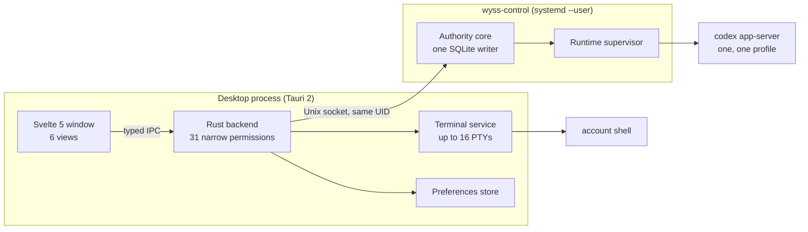

# 03 — Current state and gap analysis

What exists at `main` = `1ad90ee`, what was tested and how, and how far it is from
[02](02-REQUIREMENTS.md). Marks are those of the [index](00-INDEX.md#evidence-classes).

Five words are kept apart throughout: **implemented** (code exists), **tested** (an automated
test holds it), **exercised** (a person or a recorded session ran it on the real machine),
**documented** (a document describes it) and **proposed** (a design only).

## 1. The system as built

| Part                | Where                                  | Size (lines of Rust, tests excluded) `[R]` |
| ------------------- | -------------------------------------- | ------------------------------------------ |
| Authority and store | `src-tauri/src/control/`               | about 8,900                                |
| Codex adapter       | `src-tauri/src/adapters/codex/`        | about 6,300                                |
| Contracts           | `src-tauri/src/contracts/`             | about 2,900                                |
| Desktop commands    | `src-tauri/src/desktop/`, `desktop.rs` | about 2,900                                |
| Sessions, turns     | `src-tauri/src/sessions/`, `turns/`    | about 2,600                                |
| Authority lifecycle | `src-tauri/src/lifecycle/`             | about 1,600                                |
| Terminal            | `src-tauri/src/terminal/`              | about 1,100                                |
| Preferences         | `src-tauri/src/settings/`              | about 690                                  |
| Frontend            | `src/`                                 | 59 files                                   |

## 2. Capability by capability

| Capability                                        | Implemented | Tested (automated)           | Exercised on the real machine `[O]`                      | Evidence `[R]`                                   |
| ------------------------------------------------- | ----------- | ---------------------------- | -------------------------------------------------------- | ------------------------------------------------ |
| Shell in a PTY                                    | Yes         | Yes, with real PTYs          | Yes: commands, exit codes, 300 lines of output           | `terminal/worker.rs:79-82`; ADR 0005             |
| Tabs, up to 16                                    | Yes         | Yes                          | Two tabs on two PTYs                                     | `terminal/contracts.rs:4`; ADR 0007              |
| PTY follows the window                            | Yes         | Yes                          | Yes; the shell starts at its final size, no later resize | `src/lib/features/terminal/controller.ts:84-88`  |
| Keyboard with an input method active              | Yes         | No                           | Yes, physical keyboard, `ibus typing-booster`            | —                                                |
| Panes, search, layout restore                     | No          | —                            | —                                                        | ADR 0007 `:86-88` defers them                    |
| Preferences (font, scrollback, cursor, …)         | Yes         | Yes                          | Yes, including persistence across restart                | `settings/store.rs`; ADR 0026                    |
| Authority installed and started by the product    | Yes         | Yes, private service manager | Yes; survives the window; Retry restarts it              | `lifecycle/`; ADR 0025                           |
| Managed session: prepare, activate, resume, close | Yes         | Yes                          | Yes, with Codex 0.159.0                                  | `sessions/`; ADRs 0020, 0021                     |
| Inference turn                                    | Yes         | Yes, with a fixture          | Yes: one real turn                                       | ADR 0015                                         |
| Local Tools: proposal, approve, deny              | Yes         | Yes, with a fixture          | Yes: a file created on approval, none on denial          | ADRs 0016, 0023                                  |
| Cancel a running turn                             | Yes         | Yes                          | Yes                                                      | ADR 0022                                         |
| Events view                                       | Yes         | Yes                          | Yes                                                      | ADR 0024                                         |
| Default window 1440×810, one product name         | Yes         | Yes                          | Yes                                                      | `tauri.conf.json:17-19`; `tests/package.test.ts` |
| Status of the three services at any width         | Yes         | Yes (rule test)              | Yes, in a nested display                                 | `src/app.css`; `tests/view-visibility.test.ts`   |

Automated totals last seen `[O]`: frontend 584 tests passing on `df6b35b`; the Rust suite, lint,
type check and credential scan passing on `1ad90ee`. Not re-run for this set.

## 3. Hard limits of what is built

Each is a deliberate decision recorded in an ADR, not an accident.

| #   | Limit                                                                          | Evidence `[R]`                                                 | Blocks                            |
| --- | ------------------------------------------------------------------------------ | -------------------------------------------------------------- | --------------------------------- |
| L1  | One managed runtime, in one profile, for one workspace                         | `control/runtime.rs:84-98`; ADR 0012 `:8`                      | FR-MAN-08                         |
| L2  | One managed turn at a time in the whole authority                              | `control/turn_store.rs:204-206`; ADR 0015 `:9-10`              | FR-MAN-08                         |
| L3  | Managed Inference refuses to start while any external Codex hook is enabled    | `adapters/codex/safety.rs:328-348`; ADR 0015 `:138-147`        | FR-MAN-07, FR-HRS-02 for Codex    |
| L4  | Managed Local Tools loads none of the user's configuration                     | `adapters/codex/probe/isolation.rs:428-505`; ADR 0016 `:43-46` | By design; must be said in the UI |
| L5  | The window cannot name an executable, arguments, an environment or a path      | ADR 0005 `:49-51`, `:141`; ADR 0021 `:94-96`                   | Shapes FR-NAT-01                  |
| L6  | Terminals belong to the window: closing it ends them; nothing of them persists | ADR 0005; README `:178-179`, `:188-189`                        | FR-TERM-10, FR-TERM-11, FR-REM-03 |
| L7  | The only agent is Codex, and only managed                                      | ADR 0012 `:44-45` ("Only codex/codex is supported")            | FR-ADP-01, FR-MAN-09              |
| L8  | The authority speaks only over a private Unix socket to the same user          | ADR 0011 `:13-14`                                              | FR-REM-01                         |
| L9  | One platform: Linux with `systemd --user`; Local Tools also needs `bwrap` 0.11 | ADR 0025; ADR 0016 `:63-65`                                    | FR-DIST-05                        |
| L10 | No installer, nothing signed, nothing published                                | ADR 0027                                                       | FR-DIST-03                        |
| L11 | The model of a session is not shown; the catalogue is only counted             | `authority/view.rs:33`, `:98`                                  | FR-MOD-02, FR-MOD-04              |
| L12 | No performance figure exists                                                   | No benchmark in the repository                                 | NFR-PERF-*                        |

## 4. What the owner's environment looks like

Observed on 2026-10-12 by reading structure only, no values `[O]`. It is the first test case
for the configuration engine, and the source of several of its rules.

| Fact                                                                                                       | Consequence for the design                                                |
| ---------------------------------------------------------------------------------------------------------- | ------------------------------------------------------------------------- |
| Claude Code 2.1.296, Codex 0.159.0, OpenCode 1.19.0 installed; Hermes not                                  | Order of adapters (D9); Hermes is documentary until installed             |
| `~/.claude/settings.json`: JSON, mode 0600, 9 hook commands in 3 events, 17 skills switched off, 8 plugins | The richest real case; no per-hook switch exists (06 §3.1)                |
| `~/.claude.json`: 112 KB, rewritten by Claude Code itself; holds user MCP servers and sign-in state        | Provider-owned: never edited directly (07 §4.4)                           |
| `~/.claude/CLAUDE.md` is a symbolic link to `AGENTS.md`                                                    | Links are followed to a regular file, never replaced (07 §4.3)            |
| `~/.codex/config.toml`: TOML, 631 lines, 34 comment lines                                                  | Edits must keep comments and layout (07 §5.3)                             |
| `~/.codex/hooks.json` holds empty lists; `[hooks.state]` holds six trust records                           | The hooks were emptied for managed Inference (L3); trust is never written |
| `~/.codex/AGENTS.md` is produced by a generator of the owner's                                             | Generated files are read only (07 §4.3)                                   |
| `/etc/codex/requirements.toml` pins `[features] hooks = true`                                              | System policy is shown, obeyed and never bypassed (10 §5)                 |
| `~/.claude/` is replicated between two computers by Syncthing                                              | Outside changes are normal; conflict copies exist (16 §2)                 |
| `~/.config/opencode/opencode.jsonc`: JSONC, two plugins                                                    | JSONC editing arrives with OpenCode (F4a)                                 |

## 5. Gap analysis

For each area: what is required, what exists, and the distance.

| Area                        | Required (02)                     | Exists                              | Gap                                                          | Closed by  |
| --------------------------- | --------------------------------- | ----------------------------------- | ------------------------------------------------------------ | ---------- |
| Terminal basics             | FR-TERM-01, 02, 04 to 07, 09      | Yes                                 | Unmeasured; no test of full-screen programs or of throughput | P1         |
| Terminal product features   | FR-TERM-03, 08, 10                | No                                  | Panes, search, layout restore                                | T1, T2     |
| Native agent sessions       | FR-NAT-01 to 11                   | By hand only                        | No launcher, no registry, no supervision, no observability   | F3a, F3b   |
| Configuration: read         | FR-CFG-01 to 04, 11 to 14, 16     | No                                  | The whole inventory, the view, outside-change detection      | F1         |
| Configuration: change       | FR-CFG-05, 07 to 10, 15           | No                                  | Mutation pipeline, restoration, history, undo                | F2a, F2b   |
| Configuration: author       | FR-CFG-06, FR-HRS-04              | No                                  | Creating and editing, with a contract for executable content | F5         |
| Codex hooks with Inference  | FR-MAN-07                         | Conflict (L3)                       | Research, a security ADR, then implementation                | F1b, G-INF |
| Profiles                    | FR-PRF-01 to 09                   | No                                  | Whole subsystem                                              | F3c, F5    |
| Models                      | FR-MOD-01 to 10                   | A count of models                   | Catalogue, configured, observed, selection                   | F6a, F6b   |
| Other agents: configuration | FR-ADP-01 for OpenCode and Hermes | No                                  | Two adapters                                                 | F4a, F4b   |
| Other agents: managed       | FR-MAN-09                         | No                                  | Execution adapters, each with its own safety contract        | F11b       |
| Parallel managed work       | FR-MAN-08                         | L1, L2                              | A redesign of runtime ownership inside the authority         | F8         |
| Handoff                     | FR-SES-04, 05                     | No                                  | A package format and its review                              | F11a       |
| Persistence of terminals    | FR-TERM-11                        | L6                                  | PTYs owned by a host process                                 | F9         |
| Remote                      | FR-REM-01 to 09                   | L8                                  | Host service, identity, pairing, clients                     | F10a, F10b |
| Wyss Agent                  | FR-AGT-02, 03                     | The original Wyss exists apart (17) | A comparison, then a decision                                | F12        |
| Distribution                | FR-DIST-02 to 06                  | L9, L10                             | A new decision and its phase                                 | F13        |
| Performance                 | NFR-PERF-01 to 11                 | L12                                 | A baseline, then budgets, then work where numbers point      | P1         |

## 6. What the earlier documents asked for and the code did not do

Recorded so that the history is not rewritten. Full reconciliation: [21](21-ADR-RECONCILIATION.md).

| Document                          | Asked for                                                                                 | What happened                                                                                                                      |
| --------------------------------- | ----------------------------------------------------------------------------------------- | ---------------------------------------------------------------------------------------------------------------------------------- |
| Research report, 2026-10-01       | Prototype five hard assumptions before any console; Wyss as a kernel that hosts providers | The console was built first; the authority realises part of the kernel idea for Codex only                                         |
| Same, §11                         | One canonical state projected into each provider's configuration, with drift detection    | Never built. The owner has since decided the opposite direction: the provider's file is the truth and Wyss reads it (D2, ADR 0028) |
| Base specification v0.1, Sprint 2 | A process supervisor, launch profiles, a generic CLI adapter                              | Never built. It is FR-NAT-01 to 09 and returns as F3                                                                               |
| Same, Sprint 3                    | Codex, Claude Code and OpenCode adapters together                                         | Codex only, and in depth                                                                                                           |
| Same, Sprints 7 to 9              | Skills, rules, permissions and presets made visible                                       | Never built. It is the central feature now (F1 to F5)                                                                              |
| Vision report, 2026-10-12         | States Codex was untested with a real provider and an initial-resize defect existed       | Both superseded the same day: real turns were run; the defect was a wrong diagnosis `[O]`                                          |

## 7. Not verified in this pass

| Item                                                | How to verify (not run)                                    |
| --------------------------------------------------- | ---------------------------------------------------------- |
| The suites still pass on `df6b35b`                  | `npm run check`, `npm run check:rust`                      |
| The working tree holds nothing but this set         | `git status`                                               |
| The installed application is the build of `1ad90ee` | Compare the package manifest with the build of that commit |
| Line counts in §1                                   | Count again; they were taken on 2026-10-12 from `1ad90ee`  |
