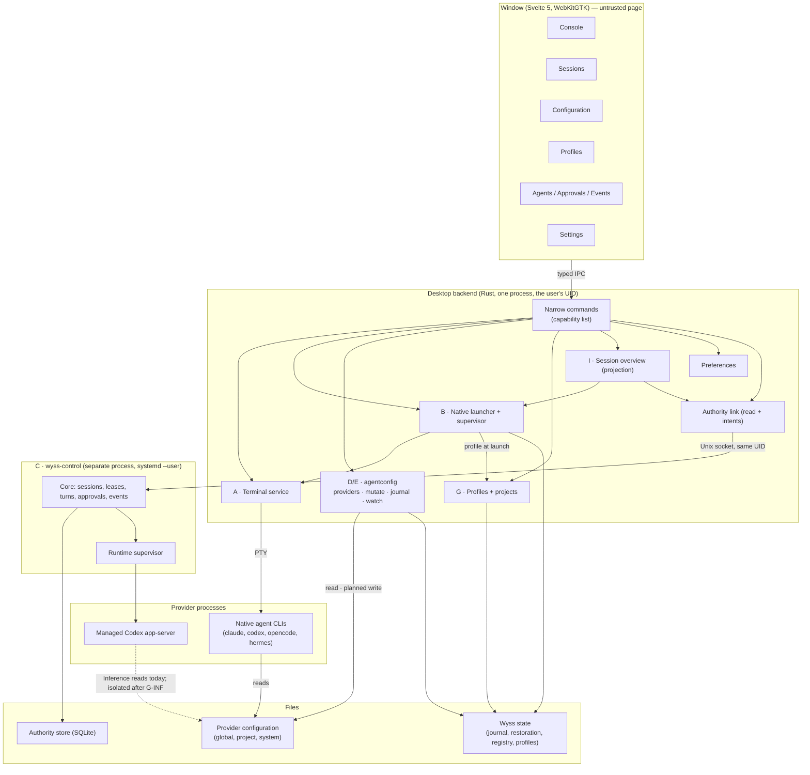
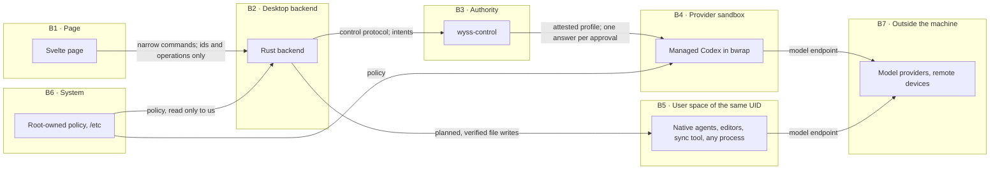

# 04 — Target architecture

> **2026-10-22 consolidation:** this document retains dated design/evidence and detailed
> contracts. Its present-tense status/decision tables describe their stated baseline,
> not necessarily current implementation. Read the [current product set](../product/README.md),
> [verified gaps](../product/implementation-status.md) and [requirement crosswalk](../product/traceability.md)
> first. F8 is active P2/V8, ADR0051 Accepted, cap1; P1 remains available. New product
> direction does not supersede accepted security ADRs or turn proposed tests into PASS.

The whole system, divided into the seventeen domains A to Q, with the boundaries between them.
Depth is in documents 05 to 18; this one holds the picture, the decisions that shape it and one
card per domain. Everything not marked `[R]` is `[P]` (proposed).

## 1. Component architecture

Future, not drawn above: a host service that owns terminals and serves remote devices (N,
[16](16-MULTI-DEVICE-AND-REMOTE.md)).

## 2. Trust boundaries

| Boundary | What crosses                                                 | What is assumed about the far side                                                                               | Status                                    |
| -------- | ------------------------------------------------------------ | ---------------------------------------------------------------------------------------------------------------- | ----------------------------------------- |
| B1 → B2  | Item identifiers, operations, text the user typed for a turn | The page may be compromised: it never names a path, a file's content, a command or an environment                | `[R]` for today's commands; extended by D |
| B2 → B3  | The control protocol, unchanged                              | The backend is a client; it decides nothing about managed work (ADR 0002)                                        | `[R]`                                     |
| B3 → B4  | A fixed argv, a private home, one credential descriptor      | The provider binary is trusted to enforce its sandbox (ADR 0018 `:123-127`)                                      | `[R]`                                     |
| B2 ↔ B5  | Reads and planned writes of provider files; PTY bytes        | **No boundary.** Any process of the user can edit the same files and reach the same socket (ADR 0018 `:110-121`) | `[R]`                                     |
| B6 → all | Policy files                                                 | Read, obeyed, never written, never bypassed                                                                      | `[P]`                                     |
| B7       | Remote devices: nothing today                                | Future: authenticated devices with scoped grants (16)                                                            | `[P]`                                     |

Honest reading: the security of the configuration subsystem is protection of the user from a
compromised page and from his own slips. It is not protection from another program of his.

## 3. Architecture design decisions

| ID    | Decision                                                                                                                                                                                                                                              | Alternatives considered                                                | Why                                                                                                                                                 | Consequences                                                                                                     | Status                                                      |
| ----- | ----------------------------------------------------------------------------------------------------------------------------------------------------------------------------------------------------------------------------------------------------- | ---------------------------------------------------------------------- | --------------------------------------------------------------------------------------------------------------------------------------------------- | ---------------------------------------------------------------------------------------------------------------- | ----------------------------------------------------------- |
| AD-01 | Two execution planes, never shown as one                                                                                                                                                                                                              | Everything managed; native only                                        | The owner's workflow is native; the built security is managed; merging hides what is enforced                                                       | Every view carries a plane marker                                                                                | D1 `[R]`                                                    |
| AD-02 | The configuration subsystem is a library in the desktop backend, outside the authority                                                                                                                                                                | Inside `wyss-control`; a separate service                              | Keeps the trusted base small; reuses `settings/store.rs`; no gain in privilege separation at the same UID                                           | Must be movable behind a host service later                                                                      | D2 `[R]`                                                    |
| AD-03 | The provider's file is the only truth. Wyss keeps no second copy of configuration that agents would have to obey                                                                                                                                      | A canonical Wyss state projected into providers (research report §11)  | The owner requires that a change be real outside Wyss and that outside changes be seen                                                              | No "drift from canonical"; instead "changed outside since last seen"                                             | `[P]`, follows ADR 0028                                     |
| AD-04 | Typed adapters per provider behind one presentation contract                                                                                                                                                                                          | One universal configuration schema                                     | Providers differ in format, scope, reload and trust; a universal schema invents equivalences                                                        | The window renders capabilities, not assumptions                                                                 | D2, D9 `[R]`                                                |
| AD-05 | Optimistic concurrency: a plan is bound to a content hash; a provider's file is replaced by an atomic exchange of names followed by a settling time (07 §5.4)                                                                                         | Locking provider files; writing in place; a plain rename over the file | Providers take no locks; an in-place write can be read half done; a plain rename can destroy a provider's concurrent write unseen                   | One ordering cannot be prevented, only seen and reported; no mutation on a filesystem without an atomic exchange | `[P]`; corrects ADR 0028 §8, which needs a decision (DN-21) |
| AD-06 | Outside changes are noticed through inotify on the containing directories, with a bounded rescan as fallback                                                                                                                                          | Periodic polling of every file; a third-party watcher crate            | A rename replaces the inode, so the directory is what must be watched; `nix` already provides inotify                                               | Overflow and invalidation must degrade to a rescan (07 §7)                                                       | D6 `[R]` for the dependency; design `[P]`                   |
| AD-07 | Risk is classified and enforced in the backend; a risky change needs a native dialog                                                                                                                                                                  | Confirmation in the page                                               | The page cannot be trusted to assert a confirmation                                                                                                 | A second dialog surface (GTK) besides the folder chooser                                                         | D4 `[R]`                                                    |
| AD-08 | A native agent is started from a closed catalogue resolved in the backend                                                                                                                                                                             | The window sends a command line; the Console types text into a shell   | ADR 0005 forbids the first; the second is unobservable and injectable                                                                               | Needs its own ADR before F3a                                                                                     | `[P]`                                                       |
| AD-09 | A native agent is started through the user's interactive shell, which then replaces itself with the agent                                                                                                                                             | Spawning the agent directly as the PTY's child                         | Only the shell's start-up files give the agent the environment the user gets by hand                                                                | Per-shell start recipes; a fallback with a stated difference (05 §4.3)                                           | `[P]`, `[N]` per shell                                      |
| AD-10 | A session profile is applied at start by the provider's own mechanism and never rewrites a global file                                                                                                                                                | Swapping global files per session                                      | Two sessions cannot share one global file and differ                                                                                                | Independence is only as strong as each provider's mechanism (09 §3)                                              | ADR 0028 §4 `[R]`                                           |
| AD-11 | Configuration history is its own journal, apart from the authority's stream                                                                                                                                                                           | Appending to the authority's stream                                    | The authority must not learn of user configuration; its stream is the record of managed execution                                                   | Two timelines in the window                                                                                      | D8 `[R]`                                                    |
| AD-12 | A disabled entry stays restorable by the first of four rungs that applies: the provider's own switch; kept inside the provider's own file where that is verified; removed and sealed in the protected restoration vault (27); temporarily unavailable | A private copy in clear; a sidecar file; refusing for good             | The owner's policy of 2026-10-12 and his decision of 2026-10-13: a protected private backup is allowed, with security controls and informed consent | On the third rung the Console is the only holder of that entry, on one computer: a lost vault or key loses it    | ADR 0029, **Proposed** (DN-01)                              |
| AD-13 | Managed Inference is to be decoupled from the user's hooks by an isolated home                                                                                                                                                                        | An explicit trade; leaving the conflict                                | The owner wants both his hooks in native Codex and managed Inference                                                                                | Research first; an ADR of its own; nothing changes until then (10 §5)                                            | D7 `[R]`, design `[P]`                                      |
| AD-14 | The session overview is a projection over two owners; no merged store                                                                                                                                                                                 | One table holding native and managed sessions                          | ADR 0002: managed identity belongs to the authority                                                                                                 | The overview can be partly unavailable (authority down) and still show native sessions                           | `[P]`                                                       |
| AD-15 | Remote access goes through a host service with device identities, over a private network, never the Unix socket                                                                                                                                       | Exposing the control socket; SSH only; a relay in the cloud            | Local daemons on TCP are a known attack surface (research report, finding 8); the socket trusts the UID                                             | Terminals must be owned by the host service first (16 §4)                                                        | `[P]`                                                       |
| AD-16 | A model is shown as "used" only when the provider reported it for that turn                                                                                                                                                                           | Showing the configured default as the model in use                     | The configured default is not what ran                                                                                                              | Until F6a the model of a turn is "not reported"                                                                  | `[P]`                                                       |
| AD-17 | No change of terminal technology before a measured baseline                                                                                                                                                                                           | Adopting another renderer or emulator now                              | No number exists; a rewrite without one cannot be judged                                                                                            | P1 runs early and in parallel                                                                                    | `[P]`                                                       |
| AD-18 | Every store is its own versioned file with its own owner                                                                                                                                                                                              | One database for all Wyss state                                        | Different owners, different lifetimes, different sensitivity                                                                                        | Several small migrations instead of one                                                                          | `[P]`                                                       |

## 4. Constraints and who enforces them

| ID   | Constraint                                                                                       | Enforced by                                                                                   | Verified by                                              | Status                    |
| ---- | ------------------------------------------------------------------------------------------------ | --------------------------------------------------------------------------------------------- | -------------------------------------------------------- | ------------------------- |
| C-01 | The page supplies no executable, argument, environment or path                                   | Command DTOs that reject unknown fields; the capability list                                  | `tests/terminal-view.test.ts` (list is exact); DTO tests | `[R]`, extended per phase |
| C-02 | The authority never reads or writes user configuration                                           | `agentconfig` is not reachable from the `wyss-control` binary                                 | A build-graph test (TS-SEC-03)                           | `[P]`                     |
| C-03 | The configuration subsystem cannot reach the control socket or the authority's store             | It does not depend on `control::client` or `control::paths`                                   | The same test, other direction                           | `[P]`                     |
| C-04 | At most one managed turn                                                                         | The authority: a partial unique index and one writer (`turn_store.rs:204-206`)                | Existing Rust suite                                      | `[R]`                     |
| C-05 | Managed Inference runs only with zero enabled external hooks                                     | `adapters/codex/safety.rs:328-348`                                                            | Existing Rust suite                                      | `[R]`                     |
| C-06 | At most 16 terminals; 64 KiB of queued output; 4 KiB per write; sizes 1 to 512                   | `terminal/contracts.rs:4-8`, `:17-23`                                                         | Existing Rust suite                                      | `[R]`                     |
| C-07 | No secret value reaches the page                                                                 | Redaction at the adapter boundary, before any projection is built                             | A corpus test per provider (TS-SEC-01)                   | `[P]`                     |
| C-08 | A provider's trust record is never written                                                       | The adapter's write set excludes it; the planner rejects a plan that touches it               | TS-CFG-14                                                | `[P]`                     |
| C-09 | A source classed as system, provider-owned or generated is never written                         | The planner: such a source has no write capability                                            | TS-CFG-09                                                | `[P]`                     |
| C-10 | A write goes only to a file the adapter itself derived, on a trusted path                        | A closed list per adapter; the path rules of `control/paths.rs:20-44` applied to it           | TS-FS-01 to 06                                           | `[P]`                     |
| C-11 | Every read is bounded: file size, entry count, nesting depth, link hops                          | Limits in each adapter                                                                        | TS-CFG-05                                                | `[P]`                     |
| C-12 | The Console takes no key the terminal's program would otherwise receive, except a documented few | The shell of the window; README `:180` today ("No global terminal shortcuts are intercepted") | TS-UX-03                                                 | `[R]` today               |
| C-13 | Nothing that decides anything is a preference                                                    | The preference type has no place for it (ADR 0026 `:38-39`)                                   | `settings` tests                                         | `[R]`                     |

## 5. Domain cards

Each card answers the same questions. "Detail" names the document that goes further.

### A — Native terminal subsystem (detail: 05)

| Aspect             | Content                                                                                                                                                                                                           |
| ------------------ | ----------------------------------------------------------------------------------------------------------------------------------------------------------------------------------------------------------------- |
| Responsibility     | Run the user's shell in a PTY and draw it. Nothing about agents.                                                                                                                                                  |
| State owned        | Live PTYs and their buffers (backend); tabs, focus, scroll (page). None of it durable `[R]`. Layout to restore: a file of its own, T2 `[P]`.                                                                      |
| Interface          | Seven commands: create, write, read output, resize, close, status, plus application info `[R]` (ADR 0005 `:138-140`).                                                                                             |
| Allowed            | Start the account's shell; carry bytes both ways; resize; close.                                                                                                                                                  |
| Prohibited         | Choosing a program, arguments or environment from the page (C-01); interpreting what is typed.                                                                                                                    |
| Errors             | Closed codes: `invalid_dimensions`, `invalid_cwd`, `spawn_failed`, `write_failed`, `resize_failed`, `busy`, `limit_reached`, `operation_timeout`, `close_timeout`, `input_limit` `[R]` (`controller.ts:291-302`). |
| Lifecycle, failure | starting → running → exited or failed → closed; no respawn `[R]`. A window crash ends its terminals (L6).                                                                                                         |
| Security boundary  | B1 → B2. The shell runs with the user's full rights: the terminal contains nothing.                                                                                                                               |
| Persistence        | None today.                                                                                                                                                                                                       |
| Concurrency        | One worker per PTY; output in acknowledged batches (credit); a 32-operation admission bound `[R]`.                                                                                                                |
| Observability      | State of the active terminal in the top bar `[R]`. Resource use: P1.                                                                                                                                              |
| Tests              | Real PTYs in the Rust suite `[R]`; full-screen programs, throughput and latency: 20 §4, not written.                                                                                                              |
| Compatibility      | `TERM=xterm-256color` `[R]`. Any change of renderer is gated by AD-17.                                                                                                                                            |

### B — Native agent launcher and supervisor (detail: 05)

| Aspect             | Content                                                                                                                                   |
| ------------------ | ----------------------------------------------------------------------------------------------------------------------------------------- |
| Responsibility     | Start an installed agent's CLI in a terminal, know its process, record its life. `[P]` whole card.                                        |
| State owned        | The registry of native sessions: agent, project, profile, start, end, exit code, last known state.                                        |
| Interface          | `IF-NATIVE`: list catalogue, start (agent id, project id, profile id), list sessions, forget session. No command text anywhere.           |
| Allowed            | Start an executable found by the adapter's discovery; pass arguments and variables the backend derived from a profile; observe the child. |
| Prohibited         | Mediating, approving or containing; answering a provider prompt for the user; killing by PID (only closing the session's own terminal).   |
| Errors             | `agent_not_installed`, `agent_version_unverified`, `project_invalid`, `profile_not_applicable`, `spawn_failed`, `limit_reached`.          |
| Lifecycle, failure | `SM-NATIVE` (05 §5). A crash of the window ends the session with it until F9.                                                             |
| Security boundary  | None added: the agent runs as the user, with the user's rights (B5). Said in the UI (FR-NAT-11).                                          |
| Persistence        | Registry file, versioned, bounded in entries and age.                                                                                     |
| Concurrency        | Bounded by the terminal limit (C-06).                                                                                                     |
| Observability      | Lifecycle entries; processor and memory per session read from the process tree.                                                           |
| Tests              | A fake agent executable; exit codes; environment derivation; per-shell start recipes.                                                     |
| Compatibility      | Needs an ADR extending 0005 to 0007 (21). Discovery differs per provider (06).                                                            |

### C — Secure managed execution authority (detail: 10)

| Aspect             | Content                                                                                                                                       |
| ------------------ | --------------------------------------------------------------------------------------------------------------------------------------------- |
| Responsibility     | Own managed sessions, leases, turns, approvals and their audit; supervise the managed runtime `[R]`.                                          |
| State owned        | Everything canonical about managed work, in one SQLite store with one writer `[R]`.                                                           |
| Interface          | Control protocol v1 over a private Unix socket, same UID (`SO_PEERCRED`) `[R]`.                                                               |
| Allowed            | Exactly its typed methods; start its one runtime with a fixed argv.                                                                           |
| Prohibited         | Reading or writing user configuration (C-02); accepting an executable, argv or environment from a client `[R]`.                               |
| Errors             | Closed control errors, e.g. `InvalidTransition`, `ActiveTurnExists`, `UnsafePath` `[R]`.                                                      |
| Lifecycle, failure | A user service; restarted a bounded number of times; a stop is respected `[R]` (ADR 0025). A crash makes running turns `indeterminate` `[R]`. |
| Security boundary  | B2 → B3 and B3 → B4. No protection against another process of the same user `[R]`.                                                            |
| Persistence        | Schema version 7, transactional migrations, no downgrade `[R]`.                                                                               |
| Concurrency        | One writer; one runtime; one turn (C-04).                                                                                                     |
| Observability      | The durable event stream; `audit/read`, `audit/watch` `[R]`.                                                                                  |
| Tests              | The Rust suite: migrations, crash matrix, sabotage, isolation `[R]`.                                                                          |
| Compatibility      | Codex 0.159.0 is the version with evidence; others fail closed `[R]` (ADR 0015 `:40`). Future extensions: F8, F11b, each with its own ADR.    |

### D — Global and project configuration manager (detail: 07)

| Aspect             | Content                                                                                                                                                                                                                                                                                         |
| ------------------ | ----------------------------------------------------------------------------------------------------------------------------------------------------------------------------------------------------------------------------------------------------------------------------------------------- |
| Responsibility     | Discover, read, project, plan, write and observe the real configuration of each provider. `[P]`                                                                                                                                                                                                 |
| State owned        | Nothing of the configuration itself (AD-03). It owns its journal and its last-seen index; neither holds the content of an entry.                                                                                                                                                                |
| Interface          | `IF-CONFIG`: inventory, changes since, plan, apply, history, undo, export, import (07 §8).                                                                                                                                                                                                      |
| Allowed            | Read the sources an adapter derived; write a planned change to a user-owned source.                                                                                                                                                                                                             |
| Prohibited         | Any path from outside; writing system, provider-owned or generated sources (C-09); writing trust records (C-08); running a provider.                                                                                                                                                            |
| Errors             | Closed words: `source_missing`, `source_unreadable`, `source_malformed`, `source_too_large`, `source_untrusted_path`, `changed_outside`, `conflict_copy_present`, `not_supported`, `unverified_version`, `confirmation_required`, `blocked_managed_inference`, `write_failed`, `verify_failed`. |
| Lifecycle, failure | Lives with the desktop process; a failure of one source disables that source only (NFR-REL-04).                                                                                                                                                                                                 |
| Security boundary  | B1 → B2 for requests; B2 ↔ B5 for files.                                                                                                                                                                                                                                                        |
| Persistence        | 14 §3: journal and last-seen index; each versioned.                                                                                                                                                                                                                                             |
| Concurrency        | AD-05; one lock per target among the Console's own writers.                                                                                                                                                                                                                                     |
| Observability      | Its history view; counters of rescans, overflows and refused plans.                                                                                                                                                                                                                             |
| Tests              | Fixtures per provider; adversarial filesystem tests; 20 §3.                                                                                                                                                                                                                                     |
| Compatibility      | Every capability is tied to the provider version it was seen on (NFR-MNT-01).                                                                                                                                                                                                                   |

### E — Rules, hooks and skills management (detail: 08)

| Aspect              | Content                                                                                                           |
| ------------------- | ----------------------------------------------------------------------------------------------------------------- |
| Responsibility      | The meaning of each action on each kind of entry, per provider. A layer of D, not a separate process. `[P]`       |
| State owned         | None beyond D's.                                                                                                  |
| Interface           | Operations of `IF-CONFIG` specialised per kind: `disable`, `enable`, `restore`, later `create`, `edit`, `delete`. |
| Allowed, prohibited | As D; in addition no command text from the page until F5's contract exists.                                       |
| Errors              | D's, plus `entry_gone`, `entry_changed`, `duplicate_entry`, `restore_conflict`, `trust_pending`.                  |
| Lifecycle           | `SM-ENTRY` (08 §2).                                                                                               |
| Security boundary   | A hook is executable content: class `executes_code`.                                                              |
| Tests               | One table of action × provider × outcome (20 §3.4).                                                               |

### F — Agent adapters (detail: 06)

| Aspect         | Content                                                                                                                                     |
| -------------- | ------------------------------------------------------------------------------------------------------------------------------------------- |
| Responsibility | Two families: **configuration adapters** (inside D) and **execution adapters** (inside C; ADR 0008 `[R]`). They share vocabulary, not code. |
| State owned    | None.                                                                                                                                       |
| Interface      | `IF-CONFIG-ADAPTER` (06 §4) `[P]`; the execution contracts of ADR 0008 `[R]`.                                                               |
| Prohibited     | Claiming a capability without evidence; turning "observed" into "enforced" `[R]` (ADR 0008 `:14-15`).                                       |
| Compatibility  | A version table per provider; unknown is not supported `[R]`.                                                                               |

### G — Profile and workspace management (detail: 09)

| Aspect         | Content                                                                                                                             |
| -------------- | ----------------------------------------------------------------------------------------------------------------------------------- |
| Responsibility | Named working configurations for sessions; known projects and their defaults. `[P]`                                                 |
| State owned    | The profile store and the project list.                                                                                             |
| Interface      | `IF-PROFILE`: list, get, create from template, update (new version), restore version, export, import, resolve for (agent, project). |
| Prohibited     | Holding a secret; granting anything on import; rewriting a global file.                                                             |
| Errors         | `profile_invalid`, `profile_cycle`, `profile_not_applicable`, `profile_version_missing`.                                            |
| Persistence    | One file per profile, versioned by content; bounded history.                                                                        |
| Tests          | Resolution and inheritance as pure functions.                                                                                       |

### H — Model discovery and configuration (detail: 12)

| Aspect         | Content                                                                                                                         |
| -------------- | ------------------------------------------------------------------------------------------------------------------------------- |
| Responsibility | Show catalogues, configured models and the model a provider reports, at the grain it reports it (12 §1.1); later, choose. `[P]` |
| State owned    | None new: catalogues belong to runtimes, configuration to provider files, observations to whoever ran the turn.                 |
| Prohibited     | Inferring the model in use from a default (AD-16); presenting a listing as an entitlement `[R]` (ADR 0012).                     |
| Compatibility  | Showing an observed model for managed turns changes the authority's projection: its own ADR (F6a).                              |

### I — Session lifecycle management (detail: 05, 09, 10)

| Aspect         | Content                                                                        |
| -------------- | ------------------------------------------------------------------------------ |
| Responsibility | One overview of all sessions; the state machines of each kind.                 |
| State owned    | None: a projection over B (native) and C (managed) (AD-14).                    |
| Failure        | Authority unreachable: managed part shows unavailable; native part unaffected. |
| Tests          | Projection with each owner absent, stale and inconsistent.                     |

### J — Observability and audit (detail: 14)

| Aspect         | Content                                                                                                                                   |
| -------------- | ----------------------------------------------------------------------------------------------------------------------------------------- |
| Responsibility | Three records kept apart: the authority's stream `[R]`, the configuration journal `[P]`, the native session log `[P]`; and notifications. |
| Prohibited     | A secret in any of them (NFR-SEC-04); merging them into one stream (AD-11).                                                               |
| Persistence    | Each bounded; the authority's by its own rules; the other two by count and age.                                                           |

### K — Security and permissions (detail: 11)

| Aspect         | Content                                                                                              |
| -------------- | ---------------------------------------------------------------------------------------------------- |
| Responsibility | Cross-cutting: the capability list, risk classification, native confirmation, redaction, path trust. |
| Owner          | Managed authorisation: the authority, alone `[R]`. Configuration safeguards: the backend (D4).       |
| Tests          | 20 §5.                                                                                               |

### L — Data persistence and recovery (detail: 14)

| Aspect         | Content                                                                                                                   |
| -------------- | ------------------------------------------------------------------------------------------------------------------------- |
| Responsibility | One owner per store; atomic replacement everywhere; versioned formats; bounded retention.                                 |
| Stores         | Authority database `[R]`; preferences `[R]`; journal, restoration, last-seen, registry, profiles, projects, layout `[P]`. |

### M — Multi-computer synchronisation and portability (detail: 16)

| Aspect         | Content                                                                                     |
| -------------- | ------------------------------------------------------------------------------------------- |
| Responsibility | Behave correctly when provider files are replicated by a tool the Console does not control. |
| Prohibited     | Replicating anything by itself; assuming Syncthing (FR-SYNC-04).                            |

### N — Future remote control transport (detail: 16)

| Aspect         | Content                                                                                                      |
| -------------- | ------------------------------------------------------------------------------------------------------------ |
| Responsibility | Let an authenticated device reach a computer's terminals, sessions and approvals. Not built; not authorised. |
| Depends on     | Host-owned terminals (F9); AD-15; several ADRs.                                                              |

### O — Future Wyss Agent integration (detail: 17)

| Aspect         | Content                                                                                |
| -------------- | -------------------------------------------------------------------------------------- |
| Responsibility | None in the Console beyond treating it as one more provider. Decision deferred to F12. |

### P — Distribution, installation and updates (detail: 18)

| Aspect         | Content                                                                     |
| -------------- | --------------------------------------------------------------------------- |
| Responsibility | Today: the directory package `[R]` (ADR 0027). Future: a separate decision. |

### Q — Performance and resource management (detail: 15)

| Aspect         | Content                                                                       |
| -------------- | ----------------------------------------------------------------------------- |
| Responsibility | Budgets, benchmark procedures, instrumentation; every bound in C-06 and C-11. |
| State owned    | Benchmark results, kept outside the product.                                  |

## 6. What changes in the repository, by phase

A map for a reader who will implement. Nothing here exists yet except where marked `[R]`.

| Path                                                           | Purpose                                                   | First phase |
| -------------------------------------------------------------- | --------------------------------------------------------- | ----------- |
| `src-tauri/src/agentconfig/model.rs`                           | Sources, items, states, capabilities, errors              | F1          |
| `src-tauri/src/agentconfig/providers/claude.rs`, `codex.rs`    | Discovery and read                                        | F1          |
| `src-tauri/src/agentconfig/watch.rs`                           | Observation of outside changes                            | F1          |
| `src-tauri/src/desktop/agentconfig.rs`                         | The narrow commands                                       | F1          |
| `src/lib/features/configuration/`                              | The view                                                  | F1          |
| `src-tauri/src/agentconfig/mutate.rs`, `journal.rs`            | Plans, the replacement protocol, history                  | F2a         |
| `src-tauri/src/native/`                                        | Catalogue, launch, registry, observation                  | F3a, F3b    |
| `src-tauri/src/profiles/`                                      | Profiles and projects                                     | F3c         |
| `src-tauri/src/agentconfig/providers/opencode.rs`, `hermes.rs` | Further adapters                                          | F4a, F4b    |
| `src-tauri/src/adapters/codex/`, `control/`                    | Unchanged `[R]` until G-INF, F6a, F8, each by its own ADR | —           |
