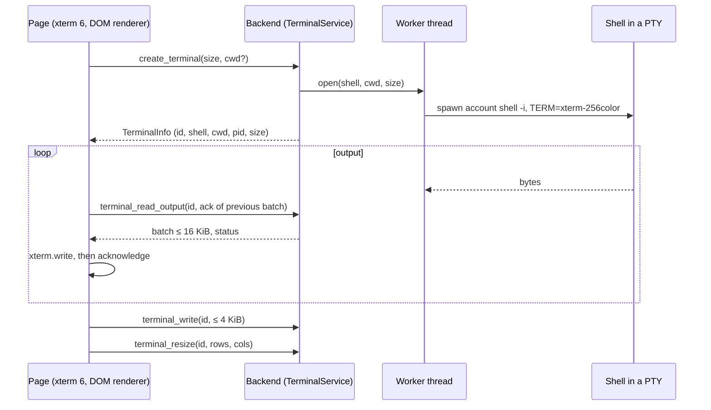

# 05 — Terminal and native sessions

> **2026-10-22 consolidation:** this document retains dated design/evidence and detailed
> contracts. Its present-tense status/decision tables describe their stated baseline,
> not necessarily current implementation. Read the [current product set](../product/README.md),
> [verified gaps](../product/implementation-status.md) and [requirement crosswalk](../product/traceability.md)
> first. F8 is active P2/V8, ADR0051 Accepted, cap1; P1 remains available. New product
> direction does not supersede accepted security ADRs or turn proposed tests into PASS.

Domains A (terminal) and B (native launcher and supervisor) of
[04](04-TARGET-ARCHITECTURE.md). The canonical specification of the terminal workspace and of
native agent sessions for the final product. [13](13-UX-UI-SPECIFICATION.md) owns the screens
and the words; this document owns the behaviour, the state, the contracts and the tests behind
them. Where the two disagree on behaviour, this document rules; on wording, 13 rules.

Sections 1 and 3 describe what is built `[R]` (ADRs 0005 to 0007). Everything else is `[P]`:
nothing of it is built, run or reviewed, and the parts that extend ADRs 0005 to 0007 need an ADR
of their own before any of it is written ([21](21-ADR-RECONCILIATION.md)): one for the terminal
workspace (T1, T2; a small one, 19 §4) and the launcher ADR (F3a; DN-02, DN-20).

**Revision of 2026-10-13 (third pass).** Sections 10 to 21 were added: the workspace model and
its split tree, focus, resize and PTY size, the key map, search and scrollback, titles and
indicators, layout persistence, crash recovery, the launch contract for the launcher ADR,
performance, accessibility and security. Section 4.4 was corrected against 09 §3.1 (contradiction
C1 of [31](31-PLANNING-COVERAGE-AUDIT.md)). By the author of the set; **unreviewed**.

The principle throughout: a native agent is the agent's own command-line program running in a
real terminal, exactly as the user would run it by hand. The Console starts it, shows it and
reports on it. It never reimplements it as a chat panel, never reads or rewrites what it prints,
never types into it on its own, and never contains it.

## 1. The terminal as built



| Property                | Value                                                                                                                                                          | Evidence `[R]`                                           |
| ----------------------- | -------------------------------------------------------------------------------------------------------------------------------------------------------------- | -------------------------------------------------------- |
| PTY library             | `portable-pty` 0.9.0, default features off                                                                                                                     | ADR 0005 `:9-10`; `Cargo.toml:27`                        |
| Renderer                | `@xterm/xterm` 6.0.0, DOM renderer, `addon-fit` 0.11.0 only                                                                                                    | ADR 0006 `:9-12`                                         |
| Shell                   | Account shell by UID, then `$SHELL`, then `/bin/sh`; started with `-i`, directly                                                                               | ADR 0005 `:49-53`                                        |
| Environment             | The desktop process's own, plus `TERM=xterm-256color`                                                                                                          | ADR 0006 `:25-27`; `terminal/worker.rs:82`               |
| Limits                  | 16 terminals, counting starting and exited-undrained ones; 64 KiB output held; 16 KiB per batch; 4 KiB per write; 8 queued commands; 1 to 512 rows and columns | `terminal/contracts.rs:4-8`, `:19`; ADR 0005             |
| Input queue in the page | 64 KiB; overflow fails the terminal visibly                                                                                                                    | `src/lib/features/terminal/controller.ts:14`, `:155-158` |
| Flow control            | The next batch is released only after the page acknowledged the previous one. Empty pulls back off from 20 ms to 320 ms                                        | `controller.ts:229-230`; ADR 0006                        |
| Hidden terminals        | Keep consuming output under the same flow control; take no user input; are not fitted                                                                          | ADR 0007; `renderer.ts:54`                               |
| Initial size            | The page fits first and creates the PTY with that size; 80×24 only if created hidden                                                                           | `controller.ts:84-88`                                    |
| Resize                  | Coalesced over 60 ms; one resize in flight plus the latest desired size                                                                                        | ADR 0006; `controller.ts:119`                            |
| Close                   | Input stops; SIGHUP to the foreground and shell process groups; SIGKILL after 500 ms; close waits at most 2 s (`close_timeout`)                                | ADR 0005                                                 |
| Exit                    | The tab keeps the final screen and its state; nothing is respawned                                                                                             | README `:175-176`; ADR 0007                              |
| Scrollback              | A preference, 500 to 50,000 lines, default 5,000; in the renderer's memory only                                                                                | `settings/model.rs:12`, `:104`                           |
| Font size               | A preference, 10 to 24, default 16                                                                                                                             | `settings/model.rs:11`                                   |
| Keys                    | No terminal shortcut is intercepted                                                                                                                            | README `:180`                                            |
| Persistence             | None: tabs, identities and scrollback are lost at restart                                                                                                      | README `:178-179`; ADR 0007                              |

### 1.1 Terminal state machine (SM-TERMINAL) `[R]`, with its guards and failures

The states are those of ADR 0005 and 0007. The guard and failure columns are added by this pass
from those ADRs (26 §3 listed them as missing).

| From     | To       | Initiator       | Guard                                                                             | Side effect                                                            | On failure                                                                            |
| -------- | -------- | --------------- | --------------------------------------------------------------------------------- | ---------------------------------------------------------------------- | ------------------------------------------------------------------------------------- |
| —        | starting | User or restore | Fewer than 16 resources admitted; creation not already in progress for this panel | Panel created; one backend `create_terminal` admitted                  | `limit_reached`: no panel, existing terminals intact                                  |
| starting | running  | Backend         | Spawn succeeded; the renderer attached                                            | Output loop starts; input accepted                                     | → failed (`spawn_failed`, `invalid_cwd`, `invalid_dimensions`, `internal_pty`)        |
| starting | closing  | User            | —                                                                                 | Input stopped; a late TerminalId is closed once                        | —                                                                                     |
| running  | exited   | The shell       | Child reaped                                                                      | Input stops; at most 16 more reads drained; final screen and code kept | Bytes beyond the drain budget are discarded and marked truncated                      |
| running  | failed   | Backend, page   | An I/O error, an ambiguous IPC failure, input over the 64 KiB bound               | Input and output stop; the backend resource is closed                  | —                                                                                     |
| running  | closing  | User            | —                                                                                 | Input stops; SIGHUP to both groups; SIGKILL at 500 ms                  | —                                                                                     |
| exited   | closing  | User            | —                                                                                 | Remaining buffered output discarded                                    | —                                                                                     |
| failed   | closing  | User            | —                                                                                 | —                                                                      | —                                                                                     |
| closing  | closed   | Backend         | Child reaped within 2 s                                                           | Slot released; a small tombstone kept (128 at most)                    | `close_timeout`: the resource stays tracked and is reaped later; `close_failed` shown |
| closed   | —        | —               | —                                                                                 | —                                                                      | —                                                                                     |

Guards that hold in every state: no write is accepted outside `running`; there is no automatic
transition back to `starting`; a TerminalId is never reused for another resource.

## 2. Terminal features to add

| ID  | Feature              | Requirement | Design                                                                                                                                             | Phase |
| --- | -------------------- | ----------- | -------------------------------------------------------------------------------------------------------------------------------------------------- | ----- |
| TF1 | Panes                | FR-TERM-03  | A tab holds a tree of splits; each leaf is one pane with one terminal. The limit of 16 counts terminals, ended ones included (§10, §11)            | T1    |
| TF2 | Search in scrollback | FR-TERM-08  | xterm's search add-on, loaded on first use; plain text, case and whole word; a match list (§13). The add-on needs approval as a dependency (DN-04) | T1    |
| TF3 | Keyboard map         | FR-UX-02    | One leader chord for Console actions; everything else goes to the program (C-12); one action registry for keys and palette (§12)                   | T1    |
| TF4 | Layout restore       | FR-TERM-10  | A small versioned file: tabs, splits, titles, working directories, remembered agents. Shells are new; scrollback is not kept (§15)                 | T2    |
| TF5 | Titles               | FR-TERM-10  | From the program's own title sequence, bounded and sanitised; the user can pin one (§14)                                                           | T1    |
| TF6 | Host-owned terminals | FR-TERM-11  | PTYs move to a host process that outlives the window (16 §4); needs its own ADR (DN-05). Out of this document's scope beyond §16.4                 | F9    |

The leader chord itself is not chosen: OQ-14 and DN-39.

## 3. What a terminal does not do

It does not parse what is typed, does not know what program runs inside it beyond the process
observations of §6, and does not keep what was printed. Those belong to domain B, and only for
sessions the Console itself started, except the foreground observation of §6.1, which applies to
every pane and stores nothing.

## 4. Native agent launcher

The launch contract that the launcher ADR must decide is §17; this section is its summary.

### 4.1 The catalogue

A closed list, compiled in, of the agents the Console can start. Each entry is supplied by that
agent's configuration adapter (06):

| Field            | Example for Claude Code                                       | Who supplies it                            |
| ---------------- | ------------------------------------------------------------- | ------------------------------------------ |
| `agent_id`       | `claude_code`                                                 | Compiled in                                |
| Executable name  | `claude`                                                      | Compiled in                                |
| Discovery        | Absolute `PATH` entries, a regular executable, links resolved | The rule of ADR 0010 `:8-11` `[R]`, reused |
| Version probe    | `--version`, bounded, in its own owned process                | As ADR 0012 `:108-109` `[R]`               |
| Launch arguments | Derived from the profile (09 §3), never from the page         | Backend                                    |
| Launch variables | A closed set per provider (06 §3)                             | Backend                                    |

The page sends identifiers only: agent, project, profile, a placement and a size (§17.2).
Nothing else (C-01).

### 4.2 Start request (IF-NATIVE.start)

| Aspect     | Definition                                                                                                                                                                                                                                                                               |
| ---------- | ---------------------------------------------------------------------------------------------------------------------------------------------------------------------------------------------------------------------------------------------------------------------------------------- |
| Input      | `agent_id` (from the catalogue), `project_id` (a folder the user chose in the native dialog in this run, or a known project), `profile_id` or none, `placement` (§17.2), terminal size                                                                                                   |
| Output     | A native session: `native_session_id`, the pane and terminal it runs in, agent, version, project, profile and its version, start time                                                                                                                                                    |
| Permission | None beyond the user's own. No lease, no approval: the session is not managed (FR-NAT-11). A launch that leaves out a control or adds executable content takes the native dialog (09 §3.2)                                                                                               |
| Validation | Agent installed and its version known to the adapter; project exists and is a directory; profile resolves for this agent (SM-LAUNCH, 09 §3.3); the placement exists; terminal limit not reached                                                                                          |
| Errors     | `agent_not_installed`, `agent_version_unverified` (a warning the user can accept for a native start, never for a mutation), `project_invalid`, `profile_not_applicable`, `placement_invalid`, `limit_reached`, `spawn_failed`, `runtime_dir_unavailable`; and those of SM-LAUNCH (09 §9) |
| Versioning | The request carries a schema version; unknown fields are rejected                                                                                                                                                                                                                        |
| Limits     | One start at a time; bounded by C-06                                                                                                                                                                                                                                                     |

### 4.3 How the process is started (AD-09)

The agent must get the environment the user gets when typing the command: `PATH` additions and
variables set by the shell's start-up files. Three ways were considered:

| Way                                                                               | Environment equals the user's   | Process known                          | Verdict                                                  |
| --------------------------------------------------------------------------------- | ------------------------------- | -------------------------------------- | -------------------------------------------------------- |
| Spawn the agent directly as the PTY's child                                       | No: start-up files are not read | Yes                                    | Fallback only, with the difference stated in the session |
| Type the command into a running shell                                             | Yes                             | No: the Console sees only a shell      | Rejected: unobservable; mixes with what the user types   |
| Start the interactive shell with a command that replaces it by the agent (`exec`) | Yes                             | Yes: the PTY's child becomes the agent | **Chosen**, subject to DN-02                             |

The recipe contract is in §17.4. When the agent exits, the pane shows its final screen and exit
code, as it does for a shell. A pane offers "Open a shell here" and "Start again"; neither runs
by itself, and the Console never restarts an agent on its own (§15.3; DN-36).

### 4.4 Lifecycle of a launch

Corrected on 2026-10-13 (31, C1). An earlier version wrote generated profile files "under Wyss
state". That contradicted 09 §3.1, 11 §5.5 and 14 §3, which rule: a file that holds no entry of
the user's configuration lives in a per-session directory of the per-login runtime directory;
a file that would hold copied entries is **unavailable until DN-20 is decided**, and if allowed
is memory-only or in that runtime directory; **never** under the Console's state directory or a
provider's directory, and never built from the vault.

```mermaid
sequenceDiagram
  participant U as User
  participant P as Page
  participant B as Backend (native)
  participant A as Config adapter
  participant G as Profiles (SM-LAUNCH)
  participant D as Native dialog
  participant T as Terminal service
  U->>P: Start Claude Code on project X with profile Review, in a new pane
  P->>B: start(agent, project, profile, placement, size)
  B->>A: discover + version
  A-->>B: executable, version, capability set
  B->>G: resolve(profile, agent, project) at revision r
  G-->>B: launch plan: arguments, variables, files to generate, three lists, class
  alt left-out set changed since last confirmed, or executable content added
    B->>D: confirmation (ND-12): what is left out, what is added, still in force
    D-->>B: accepted, or refused (nothing started)
  end
  B->>B: revision still r? else launch_plan_stale and resolve again
  B->>B: generate per-session files in $XDG_RUNTIME_DIR/wyss-console/sessions/<id>/ (0700, files 0600), only kinds 09 §3.1 allows
  B->>T: open terminal with recipe(shell, argv as words, closed variable set)
  T-->>B: terminal id, pid
  B->>B: registry: session = running; identity check (§17.5)
  B-->>P: session + warnings
  loop while running and the overview is visible
    B->>B: observe the process tree: alive, cpu, memory
  end
  T-->>B: child exited (code or signal)
  B->>B: registry: session = exited; per-session directory removed
```

## 5. Native session state machine (SM-NATIVE)

| State        | Meaning                                                |
| ------------ | ------------------------------------------------------ |
| requested    | A start passed SM-LAUNCH and is being opened           |
| running      | The agent's process is alive in its terminal           |
| exited       | The process ended; its code or signal is known         |
| lost         | The Console restarted and cannot say what became of it |
| failed_start | The process never ran                                  |
| forgotten    | The user removed the record                            |

| From      | To           | Initiator       | Guard                                                          | Side effect                                                                                            | On failure                                    |
| --------- | ------------ | --------------- | -------------------------------------------------------------- | ------------------------------------------------------------------------------------------------------ | --------------------------------------------- |
| —         | requested    | User            | §4.2 validation; SM-LAUNCH reached `starting` (09 §3.3)        | Registry entry written, with profile version and the keyed digest of the confirmed left-out set if any | Nothing written; error to the user            |
| requested | running      | Backend         | Terminal opened, child alive                                   | Start time, pid observed (not stored as identity); identity check started (§17.5)                      | → failed_start                                |
| requested | failed_start | Backend         | Spawn, recipe or profile preparation failed                    | Generated files of the attempt removed; the pane shows the error and stays until closed                | —                                             |
| running   | exited       | The process     | Child reaped                                                   | Exit code or signal and end time recorded; per-session directory removed                               | Removal failed: retried at next start (§16.2) |
| running   | lost         | Console restart | The registry says running and no terminal of this run holds it | Marked at next start; never assumed exited; never re-associated with a process found later             | —                                             |
| any final | forgotten    | User            | Not running                                                    | Registry entry removed                                                                                 | —                                             |

A PID is an observation and never an identity (as ADR 0012 `:19-20` `[R]` says for the managed
runtime). A session is identified by its own UUID. Closing an agent's pane while it runs is an
ordinary close (§1.1): the agent receives SIGHUP and the session becomes `exited` with that
signal, not `lost`.

Recovery: after a crash of the window, every session that was `running` becomes `lost`. Until
F9 its terminal died with the window; its process received SIGHUP from the kernel when the
master side closed, unless it had detached itself (§16.3). The state says "lost" and not
"exited" because the Console did not see it end.

## 6. Supervision and observability

| Observed                      | How                                                                                            | Limits and honesty                                                                                                              |
| ----------------------------- | ---------------------------------------------------------------------------------------------- | ------------------------------------------------------------------------------------------------------------------------------- |
| Alive, exit code or signal    | The terminal worker reaps its own child `[R]`                                                  | Exact                                                                                                                           |
| Processor and memory          | The process tree below the session's child, read from `/proc`                                  | Sampled on demand and while the overview is visible; never at rest (NFR-PERF-03)                                                |
| What the agent is doing       | **Not observed** in the native plane unless the provider exposes a supported interface (06 §3) | Shown as "not observable"                                                                                                       |
| Model in use                  | Only if the provider reports it by a supported means (12 §4)                                   | Otherwise "configured: X; in use: not reported"                                                                                 |
| The pane's foreground program | §6.1                                                                                           | An observation, never stored                                                                                                    |
| Agents started by hand        | The user's processes whose executable matches a catalogue entry                                | Best effort; labelled "started outside the Console"; no configuration is attributed to them beyond "the global one, presumably" |

The Console adds no hook to a provider's configuration in order to observe a native session.
Doing so would change the very configuration it reports on. If a provider offers a status
interface that needs configuration, enabling it is the user's explicit change, made through the
configuration engine like any other.

### 6.1 The foreground program of a pane

The backend can read the PTY's foreground process group (`portable-pty` gives access to it,
ADR 0005) and the executable of its leader from `/proc`. It is read on three occasions only:
when the user closes a pane or the window (to say what is running, §11.6, §16.1), when a pane
gains focus while the Sessions overview or the pane's detail is visible, and when strict mode
asks (28 §5.1). It is never sampled on a timer while nothing is shown.

| Found                                                    | Shown                                                                                                                                   |
| -------------------------------------------------------- | --------------------------------------------------------------------------------------------------------------------------------------- |
| The shell itself                                         | Nothing                                                                                                                                 |
| Another program                                          | Its executable name, in the close confirmation                                                                                          |
| A catalogue agent, in a plain terminal                   | The pane marker "Claude Code, started by hand" (FR-NAT-10). It is **not** a native session: no profile, no registry entry, no lifecycle |
| Unreadable (permission, a process that exited meanwhile) | "Not known"                                                                                                                             |

### 6.2 Native readiness synchronization

The Native overview uses one heartbeat every 2 seconds for sessions and live storage readiness.
Readiness checks do not depend on a session transition: another window may end and forget a
session between reads. With responsive IPC, a degraded store is reflected within one interval
plus the response time. If its confirmation remains pending at the next heartbeat, M9 becomes
unconfirmed and OpenCode/Hermes cannot start or restart. Pending background reads are coalesced;
a stalled read does not create a request on every heartbeat. A read begun before trust was
withdrawn cannot restore ready with a late reply: one fresh confirmation follows its completion.
A current confirmation already requested after that withdrawal may succeed even if it is slow;
this prevents an endless confirmation loop. Check again can supersede a stalled
confirmation, and double clicks on a pending check are coalesced.

Every local session mutation invalidates earlier readiness and session reads at entry and exit.
Start, Restart, Stop and removal reconcile both views after success or failure, once concurrent
mutations finish. Their errors take precedence over secondary read failures. A failed Start
never implies that no process exists and never triggers an automatic retry. Only a current
valid backend confirmation removes M9 uncertainty; legacy admission remains the backend's
decision. Initial loading and explicit readiness refreshes use the same readiness generations.
Read failures retain uncertainty rather than claiming storage degradation.

Hiding the overview removes its readiness heartbeat. The existing session-only background poll
continues every 4 seconds while something runs, without resource sampling; no poll remains when
hidden and idle. Showing the overview withdraws the cached confirmation and reads both views.
Disposal removes the heartbeat and invalidates pending responses, which cannot publish or start
follow-up requests. Already sent IPC cannot be cancelled; its late answer is ignored.

Discovery (`native_launcher`) reads providers, versions, capabilities and the project catalogue
only at initial load (including an explicit retry after a failed load), folder selection or a
project-default change. Start/Restart/Stop reconciliation, RefreshLauncher, Check again,
visibility changes and session endings use `native_readiness`; none rediscovers providers.
A catalogue response cannot overwrite the independently sequenced storage confirmation.

`native_readiness` is additive to protocol 1 (`native_readiness_v1`). It reads the current
backend's optional M9 registry and sticky write-failure flag on every request, with a nonblocking
store lock. It performs no filesystem I/O, provider discovery, version/update checks or process
creation. Contention is a failed check, not evidence of degraded storage. The client uses only
its attached host: it never initializes, reconnects, retries or spawns a host for this read.
Session polling, including the legacy fallback, also uses the attached-only transport so a
heartbeat cannot restart a missing host. Initial discovery attaches before either periodic
resource is first read. User execution commands retain their existing connection behavior.
Full discovery releases storage/registry locks before probing versions, so an explicit slow
discovery cannot block concurrent readiness. An older host returning `unknown_op` becomes `host_outdated`, with no discovery fallback and
M9 unconfirmed/blocked. Missing/malformed answers also fail closed. Claude/Codex legacy
admission is unchanged. Existing clients continue using the unchanged launcher operations.

Backend `storage_unavailable` blocks M9 until that backend really reports `ready`. A failed
M9 write remains sticky for the service lifetime; repairing files alone does not clear it.
Reopening the backend after repair revalidates the store. Readiness never performs repair or
claims filesystem writability before a write. Initial catalogue failure has no heartbeat;
Try again explicitly reloads the initial data after a valid readiness check.

The steady visible budget is one session read and one lightweight readiness read per 2 seconds,
independent of session count, with **zero external processes and zero version probes from
readiness**. Mutation/finalization confirmations are additional. At most one background read
per resource is pending; a slow current confirmation follows the existing freshness contract.
`tests/native-readiness-cost.test.ts` exercises 30 intervals (60 simulated seconds) through the
actual desktop client with counted fake executables. Rust command tests independently exercise
the production host/command path and count fake-provider invocations, including backend reopen
and recovery; 30 local socket checks have a 2-second aggregate fixture budget. This is a local
fixture budget, not a promise about a saturated installed host. The existing timer, sequencing,
Stop, uncertain Start/Restart and view suites remain part of the contract.

## 7. Interfaces of domains A and B

### 7.1 Terminal service (IF-TERMINAL)

The seven commands of ADR 0005 `[R]` are unchanged. Added, all `[P]`, all taking identifiers:

| Operation              | Input                                                                                                      | Output                                                            | Errors                                                                           |
| ---------------------- | ---------------------------------------------------------------------------------------------------------- | ----------------------------------------------------------------- | -------------------------------------------------------------------------------- |
| `create_terminal` (v2) | Size; and one of: no folder (home), `inherit_from` a TerminalId, a `project_id`, or `restore_slot` (§15.3) | As today                                                          | As today; `inherit_unavailable` (falls back to home only after the user is told) |
| `terminal_foreground`  | TerminalId                                                                                                 | The shell, an executable name, a catalogue agent id, or not known | `unknown_terminal`                                                               |
| `terminal_list`        | —                                                                                                          | The live TerminalIds this window owns, with state and size        | —                                                                                |

The `cwd` string the page may send today `[R]` stays for plain terminals only: the page can type
`cd` into any terminal anyway (ADR 0030). A split's folder is resolved by the backend from the
shell's `/proc/<pid>/cwd` (`inherit_from`), and an agent's from its project; neither takes a path
from the page.

### 7.2 Native sessions (IF-NATIVE)

| Operation   | Input                  | Output                                                | Errors                             |
| ----------- | ---------------------- | ----------------------------------------------------- | ---------------------------------- |
| `catalogue` | —                      | Agents: id, name, installed, version, verified or not | —                                  |
| `start`     | §4.2                   | Session                                               | §4.2                               |
| `sessions`  | A cursor, a limit ≤ 50 | Sessions with state, newest first                     | `registry_unreadable`              |
| `session`   | Session id             | One session with resource sample                      | `unknown_session`                  |
| `forget`    | Session id             | —                                                     | `unknown_session`, `still_running` |

There is deliberately no `stop` and no `signal`: a native session is ended by closing its pane,
which the terminal service already does and bounds.

### 7.3 Layout store (IF-LAYOUT)

| Operation     | Input                                                                                                | Output                                                     | Errors                                                          |
| ------------- | ---------------------------------------------------------------------------------------------------- | ---------------------------------------------------------- | --------------------------------------------------------------- |
| `layout_load` | —                                                                                                    | The layout of §15.1 with folders replaced by restore slots | `layout_unreadable`, `layout_newer_version`                     |
| `layout_save` | The tree, pane ids, pinned titles (≤ 64 characters), and per pane a TerminalId or a remembered agent | Saved revision                                             | `layout_invalid`, `layout_write_failed`, `layout_newer_version` |

The page never sends a folder to the layout store. The backend resolves each pane's folder from
its live terminal when it saves, and returns opaque restore slots when it loads.

## 8. Failure handling

| Failure                                                    | Behaviour                                                                                                  |
| ---------------------------------------------------------- | ---------------------------------------------------------------------------------------------------------- |
| The agent is not installed                                 | The catalogue shows it as absent; no start is offered                                                      |
| The agent's version is one the adapter has no evidence for | Start is allowed after a visible warning; configuration mutations stay refused (FR-ADP-04)                 |
| The profile cannot be applied by this provider             | The start is refused with the list of what cannot be applied; nothing is half applied                      |
| The shell has no start recipe                              | Fallback start, with the session marked "environment may differ from your shell's"                         |
| The per-login runtime directory is missing                 | A profile that needs a generated file is refused (`runtime_dir_unavailable`); "As configured" still starts |
| The window crashes                                         | Sessions become `lost`; per-session directories of dead sessions are removed at next start (§16.2)         |
| The project folder disappears while running                | Nothing is done; the overview shows the folder as missing                                                  |
| The registry cannot be read                                | Native sessions cannot be listed (`registry_unreadable`); terminals and managed sessions are unaffected    |
| The rest                                                   | §11.6 (panes), §15.4 (layout), §16 (crashes)                                                               |

## 9. Testing

Specified in 20 §4: TS-TERM-01 to 26 and TS-NAT-01 to 16. Unit: the split tree as a pure model
under random operation sequences; focus and geometry as pure functions; the key dispatcher;
title sanitisation; layout migration; catalogue discovery against a fake `PATH`; argument and
variable derivation; each shell recipe against a fake agent that prints its arguments and
environment. Integration: real PTYs for size propagation, exit and close; the layout store under
interruption; the registry after a simulated crash. Nested display: keyboard conflicts with the
input method on; journeys J1, J2, J8, J21, J22 of 13. Real agents only with the owner's
authorisation (DN-24).

## 10. The workspace model

### 10.1 Entities and identities

| Entity            | Identity                          | Owner                                          | Lives                         |
| ----------------- | --------------------------------- | ---------------------------------------------- | ----------------------------- |
| Workspace         | One per window                    | The page's workspace manager (ADR 0007)        | Memory; layout file (§15)     |
| Tab               | `tab_id`, a UUID                  | The workspace manager                          | Memory; layout file           |
| Split             | Position in the tree; no identity | The workspace manager                          | Memory; layout file           |
| Pane              | `pane_id`, a UUID                 | The workspace manager                          | Memory; layout file           |
| Terminal resource | `TerminalId` `[R]`                | The backend terminal service                   | Memory of the desktop process |
| Console session   | `ConsoleSessionId` `[R]`          | The workspace manager; one per pane's terminal | Memory                        |
| Native session    | `native_session_id`               | The native registry (§5)                       | Registry file (14 §3)         |

A pane holds at most one terminal resource at a time. A terminal never moves to another pane. A
pane whose terminal ended may be given a **new** terminal by an explicit act ("Open a shell
here", "Start again"); its old terminal is closed first and its final screen is discarded. No
identity is reused: a pane keeps its `pane_id`, and the new terminal and, for an agent, the new
native session have new ones.

### 10.2 The split tree

A tab's content is a tree:

```text
Node  = Leaf(pane_id) | Split(orientation, [(Node, weight)], at least two children)
orientation = row (children side by side) | column (children stacked)
```

Invariants, held after every operation and by every layout that is loaded:

| ID  | Invariant                                                                                                                            |
| --- | ------------------------------------------------------------------------------------------------------------------------------------ |
| TI1 | A tab has a root; a tab whose last pane closes is closed                                                                             |
| TI2 | Every split has at least two children                                                                                                |
| TI3 | No split has a child split of the same orientation: such a child is merged into its parent, its children taking shares of its weight |
| TI4 | Weights are positive integers summing to 10,000 within each split                                                                    |
| TI5 | Pane ids are unique in the workspace; every pane is in exactly one tab                                                               |
| TI6 | A non-empty tab has exactly one focused pane; a non-empty workspace has exactly one active tab                                       |
| TI7 | At most one pane per tab is zoomed; zoom never changes the tree                                                                      |
| TI8 | Depth at most 8; terminals in the workspace, ended ones included, at most 16 (C-06; ADR 0005, 0007)                                  |
| TI9 | The tree is the only source of geometry: no pane has a size of its own except what §11.2 computes from the tree and the container    |

### 10.3 Operations

| Operation               | Precondition                                                                               | Effect                                                                                                                                                                                                                                                  | Focus after                                       | Refused with                                   |
| ----------------------- | ------------------------------------------------------------------------------------------ | ------------------------------------------------------------------------------------------------------------------------------------------------------------------------------------------------------------------------------------------------------- | ------------------------------------------------- | ---------------------------------------------- |
| New tab                 | Fewer than 16 terminals                                                                    | A tab with one pane and a new shell in the home folder, or in the focused pane's folder when asked ("New tab here")                                                                                                                                     | The new pane                                      | `limit_reached`                                |
| Split right, split down | Fewer than 16 terminals; depth below 8; both halves at least the minimum pane size (§11.2) | The focused leaf becomes a split of the right orientation, or a sibling is inserted after it if the parent already has that orientation; the focused pane's weight is halved; the new pane's shell starts in the focused pane's folder (`inherit_from`) | The new pane                                      | `limit_reached`, `too_deep`, `no_room`         |
| Close pane              | §11.6                                                                                      | The leaf is removed; its weight is given to its siblings in proportion to theirs; TI2 and TI3 restored by merging                                                                                                                                       | §11.1                                             | —                                              |
| Close tab               | §11.6 for every pane                                                                       | Every pane closed                                                                                                                                                                                                                                       | The tab to the right, else to the left (ADR 0007) | —                                              |
| Focus in a direction    | —                                                                                          | §11.1                                                                                                                                                                                                                                                   | —                                                 | Nothing in that direction: no change, no sound |
| Resize                  | The pane has a sibling across the divider in that direction                                | One cell per step moves the divider; both sides stay at least the minimum                                                                                                                                                                               | Unchanged                                         | At the minimum: no change                      |
| Equalise                | —                                                                                          | Every split of the focused pane's ancestors gets equal weights                                                                                                                                                                                          | Unchanged                                         | —                                              |
| Zoom, unzoom            | The tab has more than one pane                                                             | The focused pane fills the tab; others are hidden, not closed                                                                                                                                                                                           | Unchanged                                         | —                                              |
| Move pane to a new tab  | The tab has more than one pane                                                             | The pane leaves its tree (as close, without closing the terminal) and becomes a new tab's root                                                                                                                                                          | The moved pane                                    | —                                              |
| Swap with the next pane | The pane has a sibling                                                                     | Two leaves exchange places; weights stay with the places                                                                                                                                                                                                | Unchanged                                         | —                                              |
| Reorder tabs            | —                                                                                          | By keyboard or by dragging; order is part of the layout                                                                                                                                                                                                 | Unchanged                                         | —                                              |

Every operation is a pure function of the tree and the focused pane, then one effect on the
backend (create or close a terminal) at most. If that effect fails, the tree is not changed: a
failed split leaves no empty pane; a failed close leaves the pane, marked failed.

Not offered: input sent to several panes at once. It is not a requirement, and it would need its
own decision because it multiplies whatever is typed into agents.

## 11. Focus, geometry, PTY size, zoom and close

### 11.1 Focus

| Rule                                                                                                                                                                                                                                       |
| ------------------------------------------------------------------------------------------------------------------------------------------------------------------------------------------------------------------------------------------ |
| Keys go to the focused pane of the active tab, and to nothing else. Input already queued for a terminal is never redirected to another (ADR 0007)                                                                                          |
| Each tab keeps a history of focused panes. When the focused pane closes, focus goes to the most recently focused pane still present; with none, to the first leaf in tree order                                                            |
| Focus in a direction: from the focused pane's rectangle, the candidates are the panes that touch its edge in that direction; the one with the largest shared edge wins, ties by most recently focused, then top, then left. No wrap-around |
| A click in a pane focuses it; the click is also given to the program if it reports the mouse                                                                                                                                               |
| Opening the palette, search, a sheet or a native dialog takes focus; closing it returns focus to the pane that had it, if still present; otherwise §11.1's second rule                                                                     |
| Switching tabs restores that tab's focused pane. The window regaining focus restores the last focused element                                                                                                                              |
| A hidden pane (another tab, or behind a zoom) never takes keys; its program still gets its protocol replies (ADR 0007)                                                                                                                     |

### 11.2 Geometry

The page computes every pane's rectangle from the tab's container and the tree; the backend never
computes geometry.

| Item              | Rule `[P]`                                                                                                                                                                                                                                                                                                                                |
| ----------------- | ----------------------------------------------------------------------------------------------------------------------------------------------------------------------------------------------------------------------------------------------------------------------------------------------------------------------------------------- |
| Divider           | 6 px, a target of at least 24 px for the pointer; part of neither pane                                                                                                                                                                                                                                                                    |
| Pane header       | One line, shown only when the tab has several panes or the pane runs an agent (13 S1)                                                                                                                                                                                                                                                     |
| Cells             | Rows and columns = floor of the pane's content size over the cell size the renderer measures; the remainder is padding at the bottom and right                                                                                                                                                                                            |
| Distribution      | Each child's share is its weight over 10,000 of the split's size minus dividers; rounding remainders go to the last child                                                                                                                                                                                                                 |
| Minimum pane      | 20 columns × 5 rows. Splitting below it is refused (`no_room`)                                                                                                                                                                                                                                                                            |
| Below the minimum | When the container shrinks so far that a pane would fall below the minimum, the tab enters **constrained display**: only the focused pane is shown, at full size, with a switcher in its header. The tree and the weights are untouched; the hidden panes keep their last PTY size. Leaving constrained display refits every visible pane |

### 11.3 PTY size

| Rule                                                                                                                                                                                                                  |
| --------------------------------------------------------------------------------------------------------------------------------------------------------------------------------------------------------------------- |
| PS1. Every **visible** pane's PTY has the size of its drawn grid, within one coalescing period (60 ms) and one round trip after the last geometry change. This is FR-TERM-05 extended to panes                        |
| PS2. A hidden pane (another tab, behind a zoom, constrained display) keeps its last size; it is refitted when it becomes visible, before it takes keys                                                                |
| PS3. Each terminal has its own coalescing (ADR 0006): one resize in flight and the latest desired size. Dragging a divider sends at most one resize per pane per 60 ms, and the final size always after the drag ends |
| PS4. Sizes are clamped to 1 to 512 rows and columns (ADR 0005); a pane whose grid would exceed 512 is padded                                                                                                          |
| PS5. A new pane's terminal is created at its computed size, so that the first byte the shell prints is at the final size (as built for tabs)                                                                          |
| PS6. A font-size change refits every visible pane; hidden ones on becoming visible                                                                                                                                    |

The program is told of a size change by the kernel (`SIGWINCH`) when the backend resizes the PTY;
the Console sends nothing else. Full-screen programs redraw themselves.

### 11.4 Zoom

Zoom shows the focused pane over the whole tab. The others are hidden (PS2) and keep running.
Focusing another pane by keyboard while zoomed unzooms first. A zoomed tab says so in its pane
header ("zoomed: 3 panes"). Zoom is saved with the layout.

### 11.5 Pane lifecycle (SM-PANE)

| From             | To         | Initiator                       | Guard                                                                           | Side effect                                                                                                   | On failure                                                                      |
| ---------------- | ---------- | ------------------------------- | ------------------------------------------------------------------------------- | ------------------------------------------------------------------------------------------------------------- | ------------------------------------------------------------------------------- |
| —                | `pending`  | Restore (§15.3)                 | The pane is in a tab that is not active; fewer than 16 terminals counted        | No process; the pane shows its folder and markers                                                             | —                                                                               |
| —                | `starting` | User; restore of the active tab | §10.3's preconditions for the operation                                         | One `create_terminal` (or `start`, §17) at the computed size (PS5)                                            | The pane is not added; the refusal's sentence                                   |
| `pending`        | `starting` | Its tab is first shown          | Fewer than 16 terminals; its folder still exists                                | As above                                                                                                      | Folder gone: home and its sentence. Limit: the pane stays `pending` and says so |
| `starting`       | `live`     | Backend                         | SM-TERMINAL `running`                                                           | Input accepted if focused and visible                                                                         | —                                                                               |
| `starting`       | `ended`    | Backend                         | SM-TERMINAL `failed`                                                            | The error's sentence; the pane stays                                                                          | —                                                                               |
| `live`           | `ended`    | The program, backend            | SM-TERMINAL `exited` or `failed`                                                | Final screen kept; a native session becomes `exited`                                                          | —                                                                               |
| `ended`          | `starting` | User only                       | "Open a shell here" or "Start again" (§17 for an agent); limit not reached      | The old terminal is closed first, its final screen discarded; a new terminal and, for an agent, a new session | The pane stays `ended`; the refusal's sentence                                  |
| any but `closed` | `closing`  | User                            | §11.6's confirmation when a program other than a shell runs                     | SM-TERMINAL `closing`; the tree updated at once (§10.3)                                                       | —                                                                               |
| `closing`        | `closed`   | Backend                         | SM-TERMINAL `closed`, or `close_timeout` (the resource stays tracked, ADR 0005) | The pane is gone; the slot counts until reaped                                                                | —                                                                               |

Orthogonal flags: focused, visible, zoomed, `agent` (a native session runs or ran here),
`remembered_agent` (restored from the layout, §15.3). No transition leaves `ended` without the
user. A `pending` pane counts against the limit of 16 only once it starts.

### 11.6 Close

| Case                                                              | Behaviour                                                                                                                                   |
| ----------------------------------------------------------------- | ------------------------------------------------------------------------------------------------------------------------------------------- |
| The pane's foreground program is its shell, or the pane has ended | Closed at once                                                                                                                              |
| Another program runs in it                                        | One confirmation in the page naming it (§6.1): "vim is running in this pane. Close it?"                                                     |
| A native agent runs in it                                         | The same, naming the agent and its project. The session becomes `exited` with the signal                                                    |
| A tab or the window with several running programs                 | One confirmation that names how many and which agents. Cancelling closes nothing                                                            |
| Close fails (`close_timeout`)                                     | The pane is removed from the tree; the resource stays tracked and counts against the limit until reaped (ADR 0005); the sentence of 13 §9.1 |

## 12. Keyboard, key map and palette

### 12.1 Rules

| #   | Rule                                                                                                                                                                                                                                           |
| --- | ---------------------------------------------------------------------------------------------------------------------------------------------------------------------------------------------------------------------------------------------- |
| KR1 | With focus in a terminal, every key goes to its program, except the leader chord and, if DN-39 adopts them, a documented few direct chords (C-12)                                                                                              |
| KR2 | No key is taken without a way to send it: pressing the leader twice sends the leader chord itself to the program                                                                                                                               |
| KR3 | Never taken, in any mode: unmodified keys, Shift+key, Ctrl+letter, Alt+letter, Escape, Tab, Shift+Tab, Enter, Backspace, the function keys, the arrows with or without Ctrl or Alt, and any chord the input method or the desktop uses (§12.4) |
| KR4 | No key is interpreted while the input method is composing (`isComposing`) or while a dead key is pending                                                                                                                                       |
| KR5 | Every Console action has an identifier, a label, a scope and an availability rule in **one action registry**; the key map and the palette are two views of it, so no action is reachable by one and not the other                              |
| KR6 | Remapping is a preference; a remap that falls in KR3 or collides with another action is refused with its reason                                                                                                                                |

### 12.2 The leader

The model, a prefix chord or direct chords or both, is DN-39. This section specifies the prefix,
which every alternative of DN-39 keeps.

| State     | Enters when                      | Next key                                                                                                                                                                                                                                                    | Leaves to    |
| --------- | -------------------------------- | ----------------------------------------------------------------------------------------------------------------------------------------------------------------------------------------------------------------------------------------------------------- | ------------ |
| idle      | —                                | The leader chord: → pending; anything else goes to the program                                                                                                                                                                                              | pending      |
| pending   | The leader was pressed           | A mapped key: the action runs. The leader again: the chord is sent to the program. Escape: nothing. An unmapped key: nothing, and the indicator says "No action for that key". **Nothing pressed in pending reaches the program**, except the leader itself | idle; repeat |
| repeat    | A repeatable action ran (resize) | The same key within 1 s repeats it; any other key leaves repeat and is handled as in idle                                                                                                                                                                   | idle         |
| (timeout) | 1.5 s in pending                 | —                                                                                                                                                                                                                                                           | idle         |

While pending, a small indicator in the focused pane's corner reads "Leader" and lists the next
keys after 0.5 s; it is announced to assistive technology once. The leader works the same outside
the terminal, in every view.

### 12.3 The key map

Keys after the leader, proposed; the leader itself is OQ-14.

| Action                                                                               | Key after leader                 | Scope       |
| ------------------------------------------------------------------------------------ | -------------------------------- | ----------- |
| Command palette                                                                      | Space                            | Everywhere  |
| New tab; new tab in this folder                                                      | t; Shift+T                       | Console     |
| Split right; split down                                                              | \| (or v); - (or s)              | Pane        |
| Close pane                                                                           | x                                | Pane        |
| Focus left, down, up, right                                                          | arrows, or h j k l               | Pane        |
| Resize                                                                               | Shift+arrows (repeatable)        | Pane        |
| Zoom, unzoom                                                                         | z                                | Pane        |
| Equalise                                                                             | =                                | Tab         |
| Swap with next pane; move to new tab                                                 | o; !                             | Pane        |
| Next tab; previous tab; tab 1 to 9                                                   | n; p; 1 to 9                     | Console     |
| Search in scrollback                                                                 | /                                | Pane        |
| Copy selection; paste                                                                | c; v                             | Pane        |
| Clear scrollback                                                                     | Shift+K                          | Pane        |
| Rename (pin title); unpin                                                            | r; Shift+R                       | Tab or pane |
| Start agent                                                                          | a                                | Console     |
| Open a shell here; Start again                                                       | Enter; Shift+Enter               | Ended pane  |
| Larger text; smaller; reset                                                          | +; -; 0 (temporary, this window) | Console     |
| Leave the terminal to the navigation; from anywhere else, return to the focused pane | Tab                              | Everywhere  |
| Go to a view                                                                         | g, then the view's letter        | Everywhere  |

Outside the terminal, ordinary keys work as in any application (Tab, arrows, Enter, Escape), and
F6 cycles the regions (navigation, view, detail). Inside the terminal F6 belongs to the program.

### 12.4 Conflicts

What each class of program or system already uses, and therefore what the leader must not be.
Evidence is `[D]` from each program's documentation where marked; the rest is common knowledge to
be confirmed under OQ-14 and OQ-45.

| Class                                             | Uses                                                                                                                           | Consequence                                                                                                                                    |
| ------------------------------------------------- | ------------------------------------------------------------------------------------------------------------------------------ | ---------------------------------------------------------------------------------------------------------------------------------------------- |
| Shell line editors (readline, zle, fish)          | Ctrl+letter, Alt+letter, Ctrl+arrows, Alt+arrows                                                                               | KR3                                                                                                                                            |
| Full-screen programs (vim, emacs, less, htop, mc) | Function keys; Ctrl+Space (emacs set-mark); Ctrl+letter; mouse                                                                 | Ctrl+Space excluded; function keys excluded                                                                                                    |
| Multiplexers (tmux, screen)                       | Ctrl+B, Ctrl+A as prefixes                                                                                                     | Excluded; a multiplexer inside a pane keeps working                                                                                            |
| Agent command-line programs                       | Escape, Ctrl+C, Ctrl+D, Shift+Tab, Ctrl+R, Ctrl+O, Enter with modifiers `[N]` per provider and version                         | KR3; each provider's documented bindings are listed in its adapter's notes before T1 (06 §3)                                                   |
| Input methods (fcitx5, IBus)                      | Ctrl+Space, Ctrl+Shift, Super+Space for switching; composition sequences                                                       | Excluded; KR4                                                                                                                                  |
| The desktop (the owner's is KDE Plasma)           | Meta+any, Alt+Tab, Alt+F2, Alt+Space, Ctrl+Alt+T, Ctrl+F1 to F4, Ctrl+Alt+Delete; the window manager sees them before the page | Excluded; a chord the desktop takes never reaches the Console and is reported by OQ-14's check                                                 |
| Keyboard layouts with AltGr                       | Right Alt is Ctrl+Alt on some layouts and stacks                                                                               | Ctrl+Alt chords excluded                                                                                                                       |
| Encoding                                          | In the legacy encoding a terminal sends, Ctrl+Shift+letter is the same byte as Ctrl+letter                                     | A Ctrl+Shift chord taken by the Console costs the program nothing it could receive, unless the renderer supports a richer key protocol (OQ-45) |

Candidates that survive the table: Ctrl+Shift with a letter, a digit or Space. Which one is free
on the owner's desktop with the input method on is OQ-14. If the user's own setup takes the chosen
one, remapping (KR6) is the answer, not a second built-in chord.

### 12.5 The palette

Under the leader, then Space (13 S12). It lists every action of the registry with its key, the
views, the sessions, the projects, the configuration entries, the profiles and the kept entries,
by name. It filters as the user types, by words in any order. Enter runs an action or goes to an
item; Escape returns focus to where it was (§11.1). An action that needs further input opens its
own sheet (Start agent opens S3). The palette never sends text to a terminal and never runs a
command line.

### 12.6 Mouse

Click focuses; drag on a divider resizes; double-click on a divider equalises that split.
Selection follows the renderer: a program that reports the mouse receives it, and Shift with the
mouse selects text instead `[N]` for the exact modifier in this renderer and web view (OQ-45).
Middle-click paste of the primary selection depends on the web view `[N]`. No context menu takes
the right button from a program that reports the mouse.

## 13. Search, filtering, scrollback, selection and clipboard

| Subject                 | Specification                                                                                                                                                                                                                                                                                                 |
| ----------------------- | ------------------------------------------------------------------------------------------------------------------------------------------------------------------------------------------------------------------------------------------------------------------------------------------------------------- |
| Scrollback              | Per terminal, in the renderer's memory only, bounded by the preference (500 to 50,000 lines `[R]`). Never sent to the backend, never written, never logged (A8). Cleared by the user's action or by the program's own clear sequence                                                                          |
| Search                  | In the focused pane: plain text, case sensitive or not, whole word or not. Results: the count, previous, next, all matches highlighted in the visible part. The search add-on is loaded on first use (TF2) and costs nothing before it                                                                        |
| Filtering               | "List matches" shows up to 1,000 matching lines, each with its line number and its text cut to 200 characters, in a panel beside the search bar; choosing one scrolls there. The list lives in the page's memory while the bar is open and is dropped when it closes                                          |
| New output while open   | The count is marked "out of date", and Enter refreshes it. The search does not run again on every batch                                                                                                                                                                                                       |
| Alternate screen        | A full-screen program has no scrollback; search covers the screen only and says so                                                                                                                                                                                                                            |
| Regular expressions     | Not offered: a pattern run on the page's thread over 50,000 lines cannot be bounded in time. Revisited if search moves off that thread                                                                                                                                                                        |
| Selection, copy         | By the renderer; copy by the key map or the system's usual chord where DN-39 allows it. Nothing is copied by itself                                                                                                                                                                                           |
| Paste                   | Into the focused pane only. Bracketed paste is honoured when the program asks for it, which is how a shell or an agent tells a paste from typing. A paste larger than the 64 KiB input bound fails visibly and sends nothing (FR-TERM-07). A preference, off by default, asks before a paste of several lines |
| Clipboard from programs | An escape sequence by which a program writes the clipboard (OSC 52) is **ignored**, and one that reads it is never answered: an agent's output must not be able to plant or read clipboard content. No clipboard permission is added (ADR 0006)                                                               |
| Links                   | Hyperlinks printed by a program are shown and not opened: the window has no opener permission `[R]`. "Copy link" is offered                                                                                                                                                                                   |
| Bell                    | Marks the tab (§14); no sound by default; at most one mark per second per pane                                                                                                                                                                                                                                |

## 14. Titles, identification and indicators

### 14.1 Titles

| Priority | Source                                      | Rule                                                                                                                                           |
| -------- | ------------------------------------------- | ---------------------------------------------------------------------------------------------------------------------------------------------- |
| 1        | Pinned by the user                          | At most 64 characters; kept in the layout                                                                                                      |
| 2        | An agent session: "<agent> · <project>"     | From the registry, not from the program                                                                                                        |
| 3        | The program's title sequence (OSC 0, OSC 2) | Untrusted text: control characters and bidirectional overrides removed, at most 64 characters, rendered as text (U15). Not saved in the layout |
| 4        | "Terminal N" `[R]`                          | Monotonic per window (ADR 0007)                                                                                                                |

The plane badge, the agent's name in an agent pane and every marker are drawn **outside** the
title and never derived from it: a program cannot make a pane look managed, verified or
Console-started by printing a title.

### 14.2 Indicators on a tab and a pane header

| Indicator                      | When                                                        | Cleared                           |
| ------------------------------ | ----------------------------------------------------------- | --------------------------------- |
| Activity                       | Output arrived in a hidden pane                             | When the pane is shown            |
| Bell                           | The program rang                                            | When the pane is shown            |
| Exited (code N), Failed        | §1.1                                                        | When the pane is closed or reused |
| **Native** and the agent       | The pane runs or ran a native session                       | With the pane                     |
| Started by hand                | §6.1 found a catalogue agent                                | When it is no longer found        |
| Remembered: <agent>, <profile> | §15.3                                                       | Start again, or dismiss           |
| Profile: N controls left out   | 09 §3.2                                                     | With the session                  |
| Stale                          | A configuration change the provider does not reload (07 §6) | With the session                  |
| Not verified with this version | 06 §6.1                                                     | With the session                  |
| Environment may differ         | The fallback start of §4.3                                  | With the session                  |
| Process not identified         | §17.5                                                       | With the session                  |
| Zoomed, constrained            | §11.4, §11.2                                                | When it ends                      |

Each indicator is a word and a shape (13 §1.1). The tab shows the strongest of its panes'.

## 15. Layout persistence and workspace restoration

### 15.1 The layout file

One file in the Console's state directory, `layout.json` (14 §3), mode 0600, written beside and
renamed, the directory flushed.

| Field        | Content                                                                                                                                                      |
| ------------ | ------------------------------------------------------------------------------------------------------------------------------------------------------------ |
| `version`    | Schema version, an integer                                                                                                                                   |
| `saved_at`   | Time                                                                                                                                                         |
| `active_tab` | A tab id                                                                                                                                                     |
| `tabs[]`     | Id, order, pinned title, the tree (§10.2), focused pane, zoomed pane                                                                                         |
| `panes[]`    | Id, pinned title, folder (canonical, resolved by the backend), and, for a pane that ran an agent, `remembered`: agent id, project id, profile id and version |

Never in it: scrollback, screen content, program titles, command lines, environment, process ids,
the left-out set of a profile or any confirmation. What it holds that is the user's: folder paths
and pinned titles, which are as private as the state directory (whose placement is DN-31; the file
holds no configuration content and no secret).

Saved when the layout changes, after 1 s without further change, and at a graceful exit; never on
a timer. A save that fails leaves the previous file and says once, "The layout could not be
saved."

### 15.2 Versions and migration

| Situation                                             | Behaviour                                                                                                                                                                                                        |
| ----------------------------------------------------- | ---------------------------------------------------------------------------------------------------------------------------------------------------------------------------------------------------------------- |
| An older version                                      | Migrated in memory by a tested step per version (FR-DAT-03); written in the new version only after the workspace has been restored from it; the old file kept once as `layout.v<n>.json`                         |
| A newer version                                       | Not read and **not overwritten** (14 §3): the window starts with one terminal, says "The layout was saved by a newer version of Wyss Console and was left as it is.", and does not save a layout during this run |
| Unreadable or invalid                                 | Renamed aside with the time, never deleted; one terminal; "The saved layout could not be read. It was set aside." Invalid parts are not repaired by guess                                                        |
| Valid but violating TI1 to TI9                        | Normalised: empty splits removed, same-orientation children merged, weights rescaled, depth beyond 8 flattened                                                                                                   |
| More than 16 panes                                    | The first 16 in tab order are restored; the others are dropped from the layout, and the user is told how many                                                                                                    |
| A folder that no longer exists                        | That pane starts in the home folder: "The folder of this terminal no longer exists." (13 J22)                                                                                                                    |
| A remembered project or profile that no longer exists | The pane is a plain shell; the marker says what was remembered and that it is gone                                                                                                                               |

### 15.3 Restoring, and DN-36

Restoring is a preference, on by default: "Restore tabs and panes at start". The active tab's panes
start their shells at once; other tabs' panes are `pending` and start when their tab is first
shown, so that a large workspace does not delay the first prompt (M01, M21). A pending pane's
folder is checked when it starts.

What a pane that ran an agent comes back as is **DN-36, the owner's decision**. The alternatives,
with what each does at start and on the user's act:

| Alt. | At start                                                                                                                                 | On the user's act                                                                                                                                            | Risk                                                                                                                                                |
| ---- | ---------------------------------------------------------------------------------------------------------------------------------------- | ------------------------------------------------------------------------------------------------------------------------------------------------------------ | --------------------------------------------------------------------------------------------------------------------------------------------------- |
| (a)  | A fresh shell in the same folder. The pane is marked "Remembered: Claude Code, profile Review" with **Start again** and Dismiss          | Start again opens the launcher (13 S3) prefilled with agent, project and profile, and runs the **whole** of SM-LAUNCH against the configuration as it is now | None added: nothing is started without the act; the profile's risk is evaluated afresh; a confirmation is asked again whenever 09 §3.2 asks for one |
| (b)  | A fresh shell; nothing remembered                                                                                                        | —                                                                                                                                                            | None; the user retypes or relaunches                                                                                                                |
| (c)  | The agent started again by itself                                                                                                        | —                                                                                                                                                            | **Rejected by this design**: an agent started without an act, possibly with a profile that leaves out controls; it contradicts §4.3 and 09 §3.2     |
| (d)  | As (a), plus one sheet at start listing every remembered agent pane with a checkbox each, **unchecked by default**, and "Start selected" | Each selected start runs SM-LAUNCH one after the other; a confirmation is asked per launch where due                                                         | As (a); one more screen at start                                                                                                                    |

**Recommended: (a).** (d) is an acceptable variant if the owner prefers resuming many agents at
once.

What restoring never does, under every alternative:

| Rule                                                                                                                                                                                                                                             |
| ------------------------------------------------------------------------------------------------------------------------------------------------------------------------------------------------------------------------------------------------ |
| No agent is started without the user's act                                                                                                                                                                                                       |
| No approval, confirmation or left-out-set digest is taken from the layout. 09 §3.2 keeps its own record, and that record only spares a dialog when the left-out set computed **now** is the one confirmed before; it never spares the evaluation |
| A remembered profile version that changed or was deleted is said so, and Start again uses the current version or refuses                                                                                                                         |
| A remembered session is not a native session: it has no registry entry until it is started; the old session stays `exited` or `lost` in the registry                                                                                             |
| The agent's own conversation is not resumed by the Console. If the provider offers its own resume command, the user types it (DN-38's reasoning applies)                                                                                         |

### 15.4 Failures of the layout store

`layout_unreadable`, `layout_newer_version`, `layout_invalid` and `layout_write_failed` are closed
words with sentences in 13 §9.1. None of them stops the terminal: at worst the window starts with
one terminal, as today.

## 16. Crashes, restarts, detached processes and recovery

### 16.1 Events

| Event                                                         | Terminals                                                                                          | Native sessions                                                       | Layout                                    |
| ------------------------------------------------------------- | -------------------------------------------------------------------------------------------------- | --------------------------------------------------------------------- | ----------------------------------------- |
| A program in a pane crashes                                   | The shell stays; nothing for the Console to do                                                     | An agent that crashes: `exited` with its code or signal               | —                                         |
| The shell exits                                               | `ended` with the code; final screen kept                                                           | —                                                                     | —                                         |
| A terminal fails (I/O, input bound)                           | `ended`, failed, with its sentence                                                                 | The session `exited` if the process was reaped, else its state stands | —                                         |
| Graceful window close                                         | If programs other than shells run: one confirmation (§11.6). Then every terminal closed (ADR 0005) | Running sessions `exited` with SIGHUP                                 | Saved first                               |
| The page is lost (the web view's renderer crashes or reloads) | The backend still holds the PTYs; §16.4                                                            | Unchanged                                                             | Reloaded from the file                    |
| The desktop process crashes                                   | Every PTY's master closes; the kernel sends SIGHUP to each foreground process group                | `running` → `lost` at next start                                      | The last saved file                       |
| The computer stops                                            | As above                                                                                           | As above                                                              | As above; the file is whole by its rename |

### 16.2 At the next start

In this order, none of it before the first prompt is drawn except reading the layout file: the
layout is read and the active tab started; the registry marks `running` sessions `lost`; the
per-session directories of sessions no longer running are removed from the runtime directory
(a missing runtime directory, after a logout, means there is nothing to remove); lost sessions
enter the attention list (13 §2.4).

### 16.3 Detached processes

A program that detached itself from the terminal (a daemon, `nohup`, `setsid`, a server an agent
started in the background) is outside the Console's reach by design: closing a pane or the window
signals the terminal's process groups only (ADR 0005), and the Console never searches for or kills
other processes. It does not claim they ended. After a restart such a process may be found again
only as "started outside Wyss Console" (§6) if it is a catalogue agent; it is never re-associated
with a lost session.

### 16.4 Losing the page without losing the process `[P]`

ADR 0007 makes all workspace state volatile and gives no way back after a reload. The final
product adds one: when the page starts and the backend reports live terminals of this window
(`terminal_list`), the workspace manager rebuilds the tabs from the layout file and re-attaches
each pane to its TerminalId instead of creating a new terminal. What was drawn is gone: the screen
is rebuilt from the bytes still held in the 64 KiB ring, then the program redraws on a resize the page sends on re-attaching (PS1). While no page reads them, a terminal's ring fills and its program blocks on output,
which is the transport's backpressure, not a loss. How the web view behaves on a renderer crash,
and whether the backend survives it, is OQ-46. This needs the terminal workspace ADR.

## 17. The launch contract (input to the launcher ADR: DN-02, DN-20)

This section is what the launcher ADR has to decide or confirm. It decides nothing: DN-02 and
DN-20 stay Proposed, and no ADR is accepted by it.

### 17.1 Five things kept apart

| Concern                             | What it is                                                                                | Who owns it                       | What it is not                                                                                   |
| ----------------------------------- | ----------------------------------------------------------------------------------------- | --------------------------------- | ------------------------------------------------------------------------------------------------ |
| Native provider invocation          | The agent's own program, run as the user in a PTY, with its own permissions and prompts   | The launcher (this document)      | Managed, mediated, approved or contained (FR-NAT-11)                                             |
| Wyss-managed execution              | Codex under `wyss-control`, with leases and approvals                                     | The authority (10)                | Reachable from the launcher: no launch path creates or resumes a managed session                 |
| Profile resolution                  | A pure function from profile, agent, project and the configuration now to a launch plan   | Profiles (09 §4.2)                | A permission; a stored approval                                                                  |
| Security warnings and confirmation  | The native dialog when a launch leaves out a control or adds executable content (09 §3.2) | The backend (11 §4)               | An approval of what the agent will do: the agent's own prompts happen in its terminal, unchanged |
| Session state against process state | The registry's record (SM-NATIVE) against what the kernel says (alive, code, foreground)  | The registry; the terminal worker | Interchangeable: the record never claims more than was observed                                  |

### 17.2 Request

| Field        | Type                                                                                                                         | Rule                                               |
| ------------ | ---------------------------------------------------------------------------------------------------------------------------- | -------------------------------------------------- |
| `schema`     | Integer                                                                                                                      | Unknown fields rejected                            |
| `agent_id`   | From the catalogue                                                                                                           | Installed                                          |
| `project_id` | A known project, or one chosen in the native folder dialog in this run                                                       | Exists and is a directory                          |
| `profile_id` | A profile, a template, or none ("As configured")                                                                             | Resolves for this agent (SM-LAUNCH)                |
| `overrides`  | A model identifier from the agent's catalogue or the profile's choices, where the agent has a start flag with evidence (F6b) | Makes a temporary profile (09 §1); never free text |
| `placement`  | New tab · split right or down of a pane id · an ended pane id                                                                | The pane exists, and the split fits (§10.3)        |
| `size`       | Rows, columns                                                                                                                | 1 to 512                                           |

No path, command, argument, variable or value travels in the request (C-01; TS-NAT-05).

### 17.3 Generated files (09 §3.1; DN-20)

| Kind of file                                                                       | Allowed                                                                                                                                                          | Where                                                                                                                                  | Removed                                                          |
| ---------------------------------------------------------------------------------- | ---------------------------------------------------------------------------------------------------------------------------------------------------------------- | -------------------------------------------------------------------------------------------------------------------------------------- | ---------------------------------------------------------------- |
| Holds no entry of the user's configuration                                         | Yes                                                                                                                                                              | `$XDG_RUNTIME_DIR/wyss-console/sessions/<native_session_id>/`, directory 0700, files 0600, ancestors checked by the path rule (CTL-10) | At exit, at `failed_start`, and at the next start of the Console |
| Would hold copied entries (hooks, MCP definitions)                                 | **Not until DN-20.** Then only one of: memory-only, handed over by an inherited descriptor (if OQ-34 shows the provider reads it), or the same runtime directory | As left                                                                                                                                | As left                                                          |
| Anywhere under the Console's state directory, the vault, or a provider's directory | **Never**                                                                                                                                                        | —                                                                                                                                      | —                                                                |

Without `$XDG_RUNTIME_DIR`, a launch that needs a file is refused (`runtime_dir_unavailable`);
"As configured" needs none and still starts.

### 17.4 The start recipe

The shell's start-up files run, then the shell replaces itself with the agent. A recipe is a fixed
script text per shell family plus the agent's resolved path and arguments as **separate argument
words**, never interpolated into the script. Proposed, all `[N]` until OQ-07's fixture tests:

| Family   | Argument vector                                                                       |
| -------- | ------------------------------------------------------------------------------------- |
| sh, dash | `sh -i -c 'exec "$0" "$@"' <agent> <arg>…`                                            |
| bash     | `bash -i -c 'exec "$0" "$@"' <agent> <arg>…`                                          |
| zsh      | `zsh -i -c 'exec "$0" "$@"' <agent> <arg>…`                                           |
| fish     | `fish -i -c 'exec $argv' -- <agent> <arg>…`                                           |
| Other    | The fallback: the agent spawned directly; the session marked "environment may differ" |

Environment: the desktop process's own, `TERM=xterm-256color`, and the closed set of variables the
profile resolves to (06 §3). **No variable naming the Console is added**, so that the agent's
environment equals a hand-typed start (AC-F3a-01).

Open in the recipe, for the ADR: whether `-i` start-up files that print or prompt are acceptable;
whether a login shell (`-l`) is wanted for parity with the user's terminal emulator; how an alias
or function of the same name is reported (24, RV-14).

### 17.5 Knowing the process

After the exchange of the shell for the agent the PTY's child is the agent. The backend checks,
within a bounded time proposed at 2 s, that `/proc/<pid>/exe` is the resolved executable, or, for
an agent that is a script, that the interpreter runs the resolved path. If not, the session is
`running` with "Process not identified": the start recipe may have failed (`command not found` in
the user's start-up files exits with 127) or the program re-executed itself. The registry records
what it saw, never a guess.

### 17.6 What the ADR must state, as a checklist

| Item                                                                                            | Source         |
| ----------------------------------------------------------------------------------------------- | -------------- |
| The mechanism of §4.3 and the recipes of §17.4, with their fixture tests (OQ-07)                | DN-02          |
| The request of §17.2 and the C-01 rule for it                                                   | DN-02          |
| The generated files of §17.3                                                                    | DN-20; 09 §3.1 |
| When a launch is confirmed: the rule of 09 §3.2, its native dialog ND-12, and its refusals      | DN-20; DN-22   |
| What the native dialog is said to protect (ADR 0030)                                            | DN-22          |
| SM-LAUNCH and SM-NATIVE as the states, with their guards                                        | 09 §3.3; §5    |
| The identity check of §17.5                                                                     | DN-02          |
| What is never done: a managed session from the launcher; an automatic start; text from the page | §17.1; DN-36   |
| Acceptance: AC-F3a-01 to 03, AC-F3c-01 to 03                                                    | 19 §3          |

### 17.7 Several agents, orchestration and models

Several native sessions run side by side as independent panes (09 §6). Automatic coordination of
agents beyond a reviewed handoff is **not decided** (DN-15; 31 §7, Q2); nothing in this design
prevents it or assumes it: an orchestrator would start sessions through this same contract and
the same confirmations. Choosing a model at start is §17.2's `overrides`; switching it in a
running session is DN-38, open, and this document does not narrow it.

## 18. Performance and resources

Every number is a proposal until P1 measures it. These metrics are defined, with their procedures and
budgets, in [15 §2 to §4](15-PERFORMANCE-ENGINEERING.md), which rules where the two differ. What
this design added to 15 §2:

| ID  | Metric                       | Definition                                                                    | Proposed budget                                                                                                                                   |
| --- | ---------------------------- | ----------------------------------------------------------------------------- | ------------------------------------------------------------------------------------------------------------------------------------------------- |
| M20 | Divider drag                 | Resize requests per pane per second while dragging; frames dropped            | At most one per 60 ms; M11 under 100 ms                                                                                                           |
| M21 | Restore                      | Time to the first prompt with a saved layout of 16 panes in 4 tabs            | M01 plus at most 10 %                                                                                                                             |
| M22 | Search                       | Time to count matches in 50,000 lines                                         | Under 200 ms, on the page's thread                                                                                                                |
| M23 | Idle terminals               | Wake-ups per second and M03 with 16 terminals open and idle, hidden and shown | M03 with 16 idle terminals ≤ 1 % of one core; wake-ups and calls reported. The built transport polls an idle terminal every 320 ms (15 §6, PR-01) |
| M24 | Scrollback memory, all panes | M12 summed over 16 panes at 5,000 and at 50,000 lines                         | Reported; a global cap is decided from it                                                                                                         |

Design rules that hold whatever the numbers: hidden panes draw nothing and are not fitted; the
search add-on and the palette's index load on first use; the foreground and the process tree are
read on the occasions of §6.1 only; the layout is saved on change, not on a timer; restored panes
of hidden tabs start when shown.

Terminal output transport is not "work of a hidden view": a hidden terminal must keep reading its
program's output, or the program blocks (ADR 0007). The rule of 13 U13 applies to views, and the
cost of that reading is M23.

## 19. Accessibility and keyboard-only use

| Need                              | Specification                                                                                                                                           |
| --------------------------------- | ------------------------------------------------------------------------------------------------------------------------------------------------------- |
| Every action from the keyboard    | KR5: the registry has a key or a palette entry for every action, including split, resize, zoom and close                                                |
| Leaving and entering the terminal | Leader then Tab leaves the terminal for the navigation; the same from anywhere else returns to the focused pane; F6 cycles regions outside the terminal |
| Knowing where focus is            | On focus change between panes, one announcement: "Pane 2 of 3, Claude Code, project wyss-console"; a focus border with a non-colour form                |
| Pointer-only actions              | None: dividers have keyboard resize; drag reorder has keyboard reorder                                                                                  |
| Reading the terminal              | The renderer's screen-reader mode as a preference; whether it works through the web view is OQ-44                                                       |
| Text size                         | The font preference (10 to 24 `[R]`) and a temporary zoom under the leader                                                                              |
| Motion                            | None under reduced motion; the leader indicator does not animate                                                                                        |
| Contrast                          | The renderer's minimum contrast of 4.5 `[R]`; indicators per 13 §5                                                                                      |

## 20. Security boundaries

| Boundary                | Rule                                                                                                                                                                                          |
| ----------------------- | --------------------------------------------------------------------------------------------------------------------------------------------------------------------------------------------- |
| Page → terminal service | Identifiers, sizes and input bytes. A new split or tab names its folder by reference (§7.1). Input from the page to a terminal is accepted as today: the page can type, which ADR 0030 states |
| Page → launcher         | §17.2: identifiers only                                                                                                                                                                       |
| Program → page          | Bytes rendered by the renderer; titles sanitised; hyperlinks not opened; clipboard sequences ignored; nothing interpreted as an instruction to the Console (U15)                              |
| Terminal content        | Never persisted, logged, put in a diagnostic or in the layout (A8; NFR-SEC-04)                                                                                                                |
| Native session          | Contained by nothing (T-18). Every launch surface says so (13 S3)                                                                                                                             |
| Detached processes      | Not tracked, not killed (§16.3)                                                                                                                                                               |
| Remembered agents       | Grant nothing (§15.3)                                                                                                                                                                         |
| Key map and palette     | Run registry actions only; never send text to a terminal                                                                                                                                      |

## 21. Decisions and evidence this domain still needs

| Item  | What                                                                                                                                                              | Kind                                           |
| ----- | ----------------------------------------------------------------------------------------------------------------------------------------------------------------- | ---------------------------------------------- |
| DN-02 | The launcher's mechanism, in an ADR (§17)                                                                                                                         | Owner, Proposed                                |
| DN-20 | Profiles that leave out controls; generated files (§17.3)                                                                                                         | Owner, Proposed                                |
| DN-36 | What a restored agent pane becomes (§15.3)                                                                                                                        | Owner, open                                    |
| DN-39 | The key model: a prefix, direct chords, or both (§12.2)                                                                                                           | Owner, open                                    |
| DN-04 | The search add-on as a dependency                                                                                                                                 | Owner, Proposed                                |
| OQ-07 | The start recipes, with a fake agent                                                                                                                              | Fixture test, in F3a                           |
| OQ-14 | A free leader chord with the owner's input method and desktop                                                                                                     | A trial in the nested display, when authorised |
| OQ-44 | Screen-reader support through the web view                                                                                                                        | Documentation, then a trial                    |
| OQ-45 | What key events and encodings the renderer and the web view deliver (Ctrl+Shift chords, composition, a richer key protocol, Shift-selection with mouse reporting) | Documentation, then a trial                    |
| OQ-46 | What happens to the backend and the page when the web view's renderer crashes or reloads                                                                          | Documentation, then a trial                    |
| OQ-17 | M20 to M24                                                                                                                                                        | P1                                             |
| —     | A terminal workspace ADR (T1, T2, §16.4) and the launcher ADR (F3a)                                                                                               | Owner                                          |

## 22. Owner-selected terminal and workspace directions (2026-10-13)

Target-only overlay; the preceding candidate architecture is not automatically accepted.
The owner selected: DN-36=D (reattach surviving sessions, opt-in assisted restart of
missing agents), DN-39=C (leader plus safe remappable direct shortcuts), DN-40=C
(preserve already-retained scrollback at a global admission threshold), DN-46=B
(owner-enabled lingering) and DN-47=B (faithful screen-state reattachment).
Design consequences, negative cases and tests are in
[32](32-OWNER-PRODUCT-DIRECTIONS-2026-10-13.md),
[33](33-CROSS-DOMAIN-RECONCILIATION.md),
[35](35-HOST-REMOTE-AND-MOBILE-DELTA.md),
[02 §4](02-REQUIREMENTS.md) and [20 §14](20-VERIFICATION-AND-ACCEPTANCE.md).

A byte-ring-only reattach as previously proposed is **insufficient as
final-product acceptance** for DN-47=B unless reference tests independently
prove the same fidelity. A long-lived escape parser must not be added without
a separate hardening/isolation review. DN-40=C does not furnish an absolute
memory cap; process, screen, ring and backlog budgets need measured limits.
No new terminal transport, PTY backend or other functionality is authorised.
