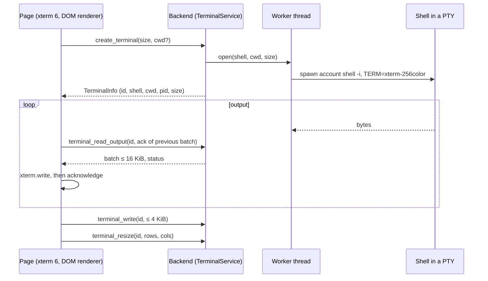
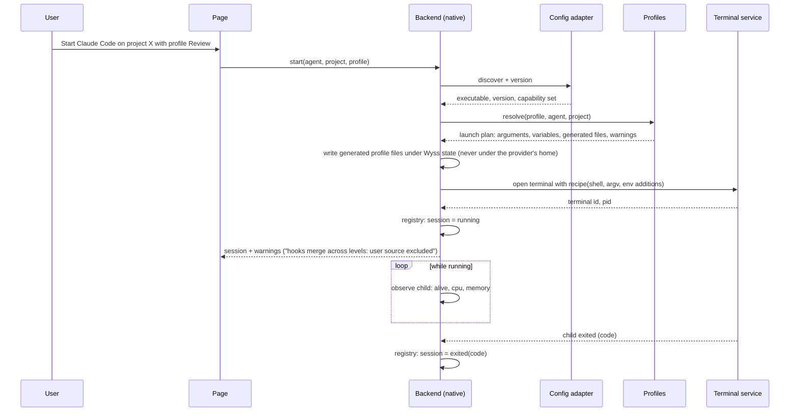

# 05 — Terminal and native sessions

Domains A (terminal) and B (native launcher and supervisor) of
[04](04-TARGET-ARCHITECTURE.md). Sections 1 to 3 describe what is built `[R]` and its planned
growth; sections 4 to 7 are entirely `[P]` and need an ADR of their own before any of it is
written (it extends ADRs 0005 to 0007, see [21](21-ADR-RECONCILIATION.md)).

## 1. The terminal as built

| Property                | Value                                                                                                             | Evidence `[R]`                                           |
| ----------------------- | ----------------------------------------------------------------------------------------------------------------- | -------------------------------------------------------- |
| PTY library             | `portable-pty` 0.9.0, default features off                                                                        | ADR 0005 `:9-10`; `Cargo.toml:27`                        |
| Renderer                | `@xterm/xterm` 6.0.0, DOM renderer, `addon-fit` 0.11.0 only                                                       | ADR 0006 `:9-12`                                         |
| Shell                   | Account shell by UID, then `$SHELL`, then `/bin/sh`; started with `-i`, directly                                  | ADR 0005 `:49-53`                                        |
| Environment             | The desktop process's own, plus `TERM=xterm-256color`                                                             | ADR 0006 `:25-27`; `terminal/worker.rs:82`               |
| Limits                  | 16 terminals; 64 KiB output held; 16 KiB per batch; 4 KiB per write; 8 queued commands; 1 to 512 rows and columns | `terminal/contracts.rs:4-8`, `:19`                       |
| Input queue in the page | 64 KiB; overflow fails the terminal visibly                                                                       | `src/lib/features/terminal/controller.ts:14`, `:155-158` |
| Flow control            | The next batch is released only after the page acknowledged the previous one                                      | `controller.ts:229-230`                                  |
| Initial size            | The page fits first and creates the PTY with that size; 80×24 only if created hidden                              | `controller.ts:84-88`                                    |
| Exit                    | The tab keeps the final screen; nothing is respawned                                                              | README `:175-176`                                        |
| Persistence             | None: tabs, identities and scrollback are lost at restart                                                         | README `:178-179`                                        |

### 1.1 Terminal state machine (SM-TERMINAL) `[R]`

| State    | Enters when              | Leaves to                                                                         |
| -------- | ------------------------ | --------------------------------------------------------------------------------- |
| starting | The tab is created       | running (spawn succeeded); failed (spawn or IPC failed)                           |
| running  | The shell is alive       | exited (shell ended); failed (I/O error, input over limit); closing (user closed) |
| exited   | The shell ended          | closing (user closed)                                                             |
| failed   | An error occurred        | closing; the backend resource is closed automatically                             |
| closing  | Close was asked          | closed; failed (`close_failed`)                                                   |
| closed   | The resource is released | —                                                                                 |

Guards: no write is accepted outside `running`. Side effect of leaving `running`: the input
queue is dropped. There is no automatic transition back to `starting`.

## 2. Terminal features to add

| ID  | Feature              | Requirement | Design                                                                                                     | Phase |
| --- | -------------------- | ----------- | ---------------------------------------------------------------------------------------------------------- | ----- |
| TF1 | Panes                | FR-TERM-03  | A tab holds a tree of splits; each leaf is one terminal with its own PTY. The limit of 16 counts leaves    | T1    |
| TF2 | Search in scrollback | FR-TERM-08  | xterm's search addon, loaded on first use so that it costs nothing at rest; needs approval as a dependency | T1    |
| TF3 | Keyboard map         | FR-UX-02    | One leader chord for Console actions; everything else goes to the terminal (C-12)                          | T1    |
| TF4 | Layout restore       | FR-TERM-10  | A small versioned file: tabs, splits, titles, working directories. Shells are new; scrollback is not kept  | T2    |
| TF5 | Titles               | FR-TERM-10  | From the program's own title sequence, bounded and sanitised; the user can pin one                         | T1    |
| TF6 | Host-owned terminals | FR-TERM-11  | PTYs move to a host process that outlives the window (16 §4); needs its own ADR                            | F9    |

Open for TF3: which chord. A candidate that most terminal programs leave free is
`Ctrl+Shift+<key>`; it must be checked against the input method in use and the desktop's own
shortcuts `[N]` (OQ-14).

## 3. What a terminal does not do

It does not parse what is typed, does not know what program runs inside it and does not keep
what was printed. Those belong to domain B, and only for sessions the Console itself started.

## 4. Native agent launcher

### 4.1 The catalogue

A closed list, compiled in, of the agents the Console can start. Each entry is supplied by that
agent's configuration adapter (06):

| Field            | Example for Claude Code                                       | Who supplies it                            |
| ---------------- | ------------------------------------------------------------- | ------------------------------------------ |
| `agent_id`       | `claude_code`                                                 | Compiled in                                |
| Executable name  | `claude`                                                      | Compiled in                                |
| Discovery        | Absolute `PATH` entries, a regular executable, links resolved | The rule of ADR 0010 `:8-11` `[R]`, reused |
| Version probe    | `--version`, bounded, in its own owned process                | As ADR 0012 `:108-109` `[R]`               |
| Launch arguments | Derived from the profile (09 §3), never from the page         | Backend                                    |
| Launch variables | A closed set per provider (06 §3)                             | Backend                                    |

The page sends three identifiers: agent, project, profile. Nothing else (C-01).

### 4.2 Start request (IF-NATIVE.start)

| Aspect     | Definition                                                                                                                                                                                               |
| ---------- | -------------------------------------------------------------------------------------------------------------------------------------------------------------------------------------------------------- |
| Input      | `agent_id` (from the catalogue), `project_id` (a folder the user chose in the native dialog in this run, or a known project), `profile_id` or none, terminal size                                        |
| Output     | A native session: `native_session_id`, the terminal it runs in, agent, version, project, profile, start time                                                                                             |
| Permission | None beyond the user's own. No lease, no approval: the session is not managed (FR-NAT-11)                                                                                                                |
| Validation | Agent installed and its version known to the adapter; project exists and is a directory; profile resolves for this agent; terminal limit not reached                                                     |
| Errors     | `agent_not_installed`, `agent_version_unverified` (a warning the user can accept for a native start, never for a mutation), `project_invalid`, `profile_not_applicable`, `limit_reached`, `spawn_failed` |
| Versioning | The request carries a schema version; unknown fields are rejected                                                                                                                                        |
| Limits     | One start at a time; bounded by C-06                                                                                                                                                                     |

### 4.3 How the process is started (AD-09)

The agent must get the environment the user gets when he types the command himself: `PATH`
additions and variables set by his shell's start-up files. Three ways were considered:

| Way                                                                               | Environment equals the user's   | Process known                          | Verdict                                                  |
| --------------------------------------------------------------------------------- | ------------------------------- | -------------------------------------- | -------------------------------------------------------- |
| Spawn the agent directly as the PTY's child                                       | No: start-up files are not read | Yes                                    | Fallback only, with the difference stated in the session |
| Type the command into a running shell                                             | Yes                             | No: the Console sees only a shell      | Rejected: unobservable; mixes with what the user types   |
| Start the interactive shell with a command that replaces it by the agent (`exec`) | Yes                             | Yes: the PTY's child becomes the agent | **Chosen**                                               |

The third needs one start recipe per shell family, each passing the arguments as separate
words and never as text to be parsed. The recipes for `sh`, `bash`, `zsh` and `fish` are to be
written and tested in F3a; none is verified `[N]` (OQ-07). A shell the Console has no recipe
for falls back to the first way.

When the agent exits, the terminal shows its final screen and exit code, as it does for a
shell today. A session can offer "open a shell here" as a new terminal; it never restarts the
agent by itself.

### 4.4 Lifecycle of a launch

## 5. Native session state machine (SM-NATIVE)

| State        | Meaning                                                |
| ------------ | ------------------------------------------------------ |
| requested    | A start was accepted and is being prepared             |
| running      | The agent's process is alive in its terminal           |
| exited       | The process ended; the code is known                   |
| lost         | The Console restarted and cannot say what became of it |
| failed_start | The process never ran                                  |
| forgotten    | The user removed the record                            |

| From      | To           | Initiator       | Guard                                         | Side effect                                       | On failure                         |
| --------- | ------------ | --------------- | --------------------------------------------- | ------------------------------------------------- | ---------------------------------- |
| —         | requested    | User            | §4.2 validation                               | Registry entry written                            | Nothing written; error to the user |
| requested | running      | Backend         | Terminal opened, child alive                  | Start time, pid observed (not stored as identity) | → failed_start                     |
| requested | failed_start | Backend         | Spawn or profile preparation failed           | Generated files of the attempt removed            | —                                  |
| running   | exited       | The process     | Child reaped                                  | Exit code and end time recorded                   | —                                  |
| running   | lost         | Console restart | The registry says running, no terminal exists | Marked at next start; never assumed exited        | —                                  |
| any final | forgotten    | User            | Not running                                   | Registry entry removed                            | —                                  |

A PID is an observation and never an identity (as ADR 0012 `:19-20` `[R]` says for the managed
runtime). A session is identified by its own UUID.

Recovery: after a crash of the window, every session that was `running` becomes `lost`. Until
F9 its process is dead, because the terminal died with the window (L6); the state says "lost"
and not "exited" because the Console did not see it end.

## 6. Supervision and observability

| Observed                | How                                                                                            | Limits and honesty                                                                                                              |
| ----------------------- | ---------------------------------------------------------------------------------------------- | ------------------------------------------------------------------------------------------------------------------------------- |
| Alive, exit code        | The terminal worker reaps its own child `[R]`                                                  | Exact                                                                                                                           |
| Processor and memory    | The process tree below the session's child, read from `/proc`                                  | Sampled on demand and while the overview is visible; never at rest (NFR-PERF-03)                                                |
| What the agent is doing | **Not observed** in the native plane unless the provider exposes a supported interface (06 §3) | Shown as "not observable"                                                                                                       |
| Model in use            | Only if the provider reports it by a supported means (12 §4)                                   | Otherwise "configured: X; in use: not reported"                                                                                 |
| Agents started by hand  | The user's processes whose executable matches a catalogue entry                                | Best effort; labelled "started outside the Console"; no configuration is attributed to them beyond "the global one, presumably" |

The Console adds no hook to a provider's configuration in order to observe a native session.
Doing so would change the very configuration it reports on. If a provider offers a status
interface that needs configuration, enabling it is the user's explicit change, made through the
configuration engine like any other.

## 7. Interfaces of domain B

| Operation (IF-NATIVE) | Input                  | Output                                                | Errors                             |
| --------------------- | ---------------------- | ----------------------------------------------------- | ---------------------------------- |
| `catalogue`           | —                      | Agents: id, name, installed, version, verified or not | —                                  |
| `start`               | §4.2                   | Session                                               | §4.2                               |
| `sessions`            | A cursor, a limit ≤ 50 | Sessions with state, newest first                     | —                                  |
| `session`             | Session id             | One session with resource sample                      | `unknown_session`                  |
| `forget`              | Session id             | —                                                     | `unknown_session`, `still_running` |

There is deliberately no `stop` and no `signal`: a native session is ended by closing its
terminal, which the terminal service already does and bounds.

## 8. Failure handling

| Failure                                                    | Behaviour                                                                                  |
| ---------------------------------------------------------- | ------------------------------------------------------------------------------------------ |
| The agent is not installed                                 | The catalogue shows it as absent; no start is offered                                      |
| The agent's version is one the adapter has no evidence for | Start is allowed after a visible warning; configuration mutations stay refused (FR-ADP-04) |
| The profile cannot be applied by this provider             | The start is refused with the list of what cannot be applied; nothing is half applied      |
| The shell has no start recipe                              | Fallback start, with the session marked "environment may differ from your shell's"         |
| The window crashes                                         | Sessions become `lost`; generated profile files of dead sessions are removed at next start |
| The project folder disappears while running                | Nothing is done; the overview shows the folder as missing                                  |

## 9. Testing

Unit: catalogue discovery against a fake `PATH`; argument and variable derivation as pure
functions; each shell recipe against a fake agent that prints its arguments and environment.
Integration: start, exit with several codes, start failure, registry after a simulated crash.
Manual: journeys J2 and J8 of [13](13-UX-UI-SPECIFICATION.md). Details: 20 §4.
