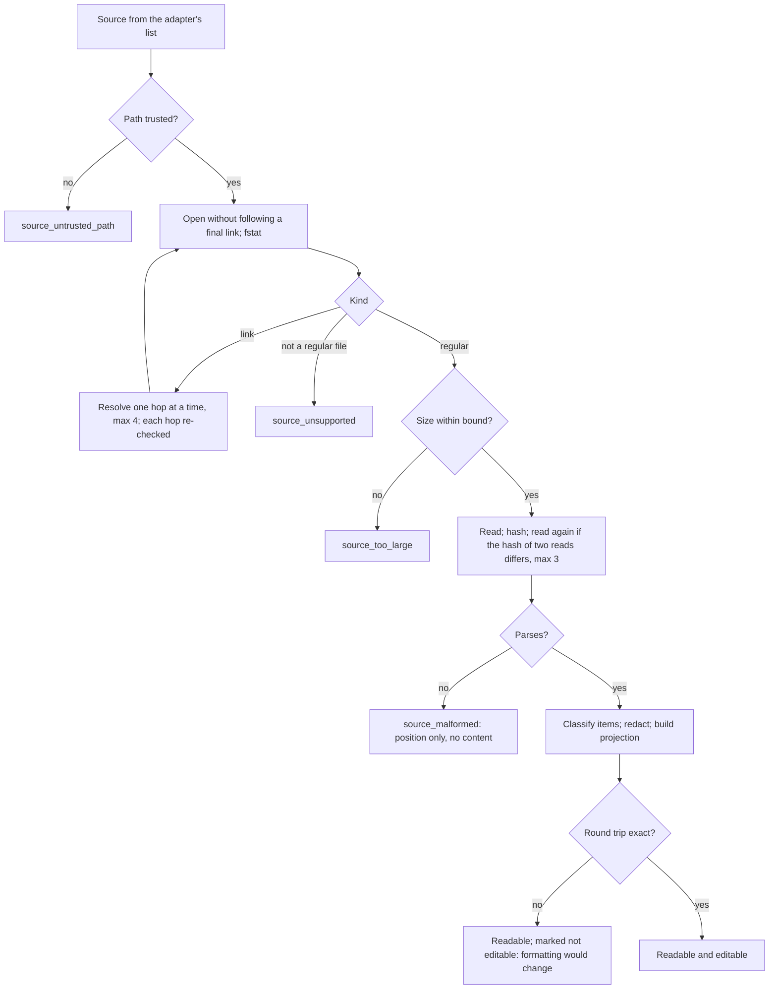
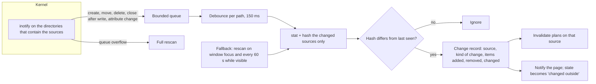

# 07 — Configuration engine

Domain D of [04](04-TARGET-ARCHITECTURE.md): the central feature. How the real configuration
of each provider is discovered, read, shown, changed and watched. All `[P]` unless marked.
What each action means for each kind of entry is in [08](08-RULES-HOOKS-SKILLS-MCP.md).

## 1. Principles

| #   | Principle                                                                                              | From                   |
| --- | ------------------------------------------------------------------------------------------------------ | ---------------------- |
| E1  | The provider's file is the truth. The engine keeps no configuration of its own that an agent must obey | AD-03                  |
| E2  | Reading comes before writing: F1 reads everything and writes nothing                                   | ADR 0028 roadmap `[R]` |
| E3  | A change is planned as a pure function, shown, confirmed, and only then written                        | ADR 0028 §5 `[R]`      |
| E4  | A file is edited only if parsing and writing it back unchanged reproduces it byte for byte             | ADR 0028 §5 `[R]`      |
| E5  | A file that changed since it was read is never overwritten                                             | D5 `[R]`               |
| E6  | A successful write proves the file, not the agent                                                      | Owner                  |
| E7  | What is unknown is shown as unknown                                                                    | Owner                  |
| E8  | The page names nothing: it points at items the backend showed it                                       | C-01                   |

## 2. Scopes

| Scope     | What it is                               | Where it lives                           | Who it affects                                        | Written by the Console                            |
| --------- | ---------------------------------------- | ---------------------------------------- | ----------------------------------------------------- | ------------------------------------------------- |
| System    | Policy of root or of an organisation     | The provider's system files              | Every user and session on the machine                 | Never (C-09)                                      |
| Global    | The user's configuration of an agent     | The provider's real user files           | Every session of that agent, in or out of the Console | Yes, by plan                                      |
| Project   | A repository's configuration of an agent | The provider's real files in the project | Sessions of that agent in that project                | Yes, by plan                                      |
| Session   | What one session should run with         | A profile, applied at start (09)         | That session only                                     | The profile store, never a provider's global file |
| Generated | A file another tool produces             | Wherever that tool writes                | As its target scope                                   | Never                                             |

### 2.1 Precedence

Precedence is the provider's, not ours; the engine reports it and does not reimplement it
beyond what the provider documents.

| Provider    | Order, highest first                                                                          | Evidence |
| ----------- | --------------------------------------------------------------------------------------------- | -------- |
| Claude Code | managed > `--settings` > project local > shared project > user. Hooks **merge** across levels | `[D]`    |
| Codex       | CLI and `-c` > project > profile > user; system requirements constrain all of them            | `[D]`    |
| OpenCode    | managed > inline content > `.opencode` > project > `OPENCODE_CONFIG` > global > remote        | `[D]`    |
| Hermes      | Not established                                                                               | `[N]`    |

Consequences the interface must state: in Claude Code a project cannot remove a user hook, it
can only add; in Codex a system requirement can make a user setting ineffective; a project's
Codex configuration counts only if the project is trusted.

### 2.2 Conflicts between scopes

| Situation                                                  | Shown as                                                                                                |
| ---------------------------------------------------------- | ------------------------------------------------------------------------------------------------------- |
| The same setting at two scopes                             | Both, with the one the provider documents as winning marked "takes precedence (documented)"             |
| A user setting that a system requirement overrides         | "Declared: X. Constrained by system policy"                                                             |
| A project file present but the project not trusted (Codex) | "Present, not loaded: project not trusted" where trust can be read; otherwise "load state not verified" |
| A setting whose resolution is not documented               | Both values, "resolution not verified"                                                                  |

## 3. Three states

| State                  | Question                            | Source                                                                    |
| ---------------------- | ----------------------------------- | ------------------------------------------------------------------------- |
| **Persisted**          | What does the file say?             | The adapter's `read`                                                      |
| **Provider-effective** | What did the provider resolve?      | A provider interface, where one exists and may be used; otherwise unknown |
| **Session-effective**  | What is each running session using? | The session registry (05 §5) and the provider's reload rule (06 §2)       |

For every element the engine computes a small record:

| Field       | Values                                                                                                                                                                                                              |
| ----------- | ------------------------------------------------------------------------------------------------------------------------------------------------------------------------------------------------------------------- |
| `persisted` | `present_enabled`, `present_disabled`, `absent`, `parked` (taken out by the Console and kept), `unreadable`                                                                                                         |
| `effective` | `verified_enabled`, `verified_disabled`, `documented` (derived from documented precedence, not observed), `not_verifiable`                                                                                          |
| `sessions`  | Per session: `using` (observed), `documented_using` (the provider documents that it reloads; not observed for this session), `not_using`, `stale` (started before a change the provider does not reload), `unknown` |
| `as_of`     | When the persisted state was last read, and the content hash it was read from                                                                                                                                       |

How each is discovered, per provider:

| Element          | Persisted                           | Provider-effective, Claude Code                              | Provider-effective, Codex                                                   | Session-effective                                                                                                                               |
| ---------------- | ----------------------------------- | ------------------------------------------------------------ | --------------------------------------------------------------------------- | ----------------------------------------------------------------------------------------------------------------------------------------------- |
| Hook             | Parse of the settings or hooks file | `documented` at best; `/status` is interactive `[N]` (OQ-05) | `hooks/list` reports it `[R]`, but needs a Codex process: not in F1 (DN-10) | Claude Code: documents a reload `[D]` → `documented_using` after a change, never `using` without an observation (OQ-28). Codex: `unknown` `[N]` |
| Rule file        | The file exists and is read         | `documented`                                                 | `documented`; project files depend on trust                                 | `unknown` unless the provider reports loaded instructions                                                                                       |
| Skill            | Directory plus the override map     | `documented`                                                 | `documented`                                                                | `unknown`                                                                                                                                       |
| MCP server       | Its entry                           | `documented`                                                 | `config/read` reports it `[R]`; same limit as hooks                         | `unknown`                                                                                                                                       |
| Model preference | The setting                         | `documented`                                                 | `documented`                                                                | Read once at start `[D]` for Claude Code → `stale` after a change                                                                               |

`documented` is drawn differently from `verified` (FR-UX-03): it is a deduction from the
provider's manual, not an observation.

## 4. Discovery and reading

### 4.1 Discovery

Each adapter derives its closed list of sources from: the user's home, the provider's
documented relocation variable if it is set in the Console's own environment, the provider's
system directory, and the project folder if one is selected. Nothing else. A project is one the
user chose in the native dialog or one already known (09 §5).

### 4.2 Reading



| Rule                               | Detail                                                                                                                                                                                                   |
| ---------------------------------- | -------------------------------------------------------------------------------------------------------------------------------------------------------------------------------------------------------- |
| Path trust                         | The rules of `control/paths.rs:20-44` `[R]`, applied to the provider's directory: no ancestor writable by another user. A provider directory that is group-writable is reported, read, and never written |
| Bounds (C-11)                      | Proposed: 4 MiB per file, 4,096 items per source, depth 32, 4 link hops, 2,048 files per directory listing. Final values are set with the fixtures (OQ-22)                                               |
| A file read while being written    | Two reads with different hashes are retried; after three, `source_unreadable` (temporary)                                                                                                                |
| Unknown fields                     | Kept untouched and counted; never dropped, never interpreted                                                                                                                                             |
| A file of a newer provider version | Read as far as it parses; items the adapter does not know are listed as "unknown to this version of Wyss Console"                                                                                        |

What F1-PR1 implements of the table above (`src-tauri/src/agentconfig/`, in the desktop
binary and not in the library the authority links):

- **Approved roots.** The reader is built from an `ApprovedRoots` list that an adapter
  derives (4.1) and takes no other path. A path, and every place a link leads to, outside
  the list is refused as `source_untrusted_path` (`outside_roots`) before anything is
  opened or stat-ed, so the answer is not an oracle for what exists elsewhere. A link
  between two approved roots is followed; the list decides, not the link.
- **Credentials.** The final name is judged on every hop (`auth.json`, `.env*`,
  `.credentials*`, keys and the like; a Markdown or text note called `secrets` is not a
  credential store). A directory named `.ssh`, `.gnupg`, `.aws` or `secrets` _below_ a
  root is never read or listed; the names above the root do not count.
- **Descriptors.** Each directory is opened below the one before it without following a
  link and judged by its descriptor, so a file or directory swapped for a link after it
  was judged is not followed. A group-writable place is read and never writable; one
  anyone can write is refused.
- **Bounds.** `Bounds::PROPOSED` plus a hard ceiling on each, enforced by `Bounds::new`:
  the elements bound (262,144 keys and values, counted from the document's structure
  before it is parsed) is new, and arithmetic at the edge of the integers saturates.
  Values stay open under OQ-22.

What F1-PR2 adds (`agentconfig/claude.rs`, `codex.rs`, `inventory.rs`): `inventory(env,
bounds)` derives each provider's approved roots from an `Environment` (home, the
relocation variables, the selected project, `/etc`), reads the sources of 06 §3 and returns
`Inventory { sources, items, truncated }`. A source is reported as read (with digest, trust
and the count of entries it could not place), absent, a project not trusted by Codex, or
failed with a closed word. An item carries kind, redacted name and detail, persisted state,
effective state (`documented` for Claude Code hooks and models, `not_verifiable` for what
only a running provider could confirm and for every Codex item, DN-10), the writability
class and, for a rule file, its digest and never its text. Items beyond the items bound are
dropped and `truncated` says so.

### 4.3 Links and generated files

A link is followed to a regular file owned by the user; the inventory shows both the link and
its target, and any write goes to the target, by the target's own class. A link is never
replaced by a file: a rename over the link's name would do exactly that, so the rename is done
on the target's path.

A generated file is read only. The inventory says "produced by another tool" and, when the
file carries a marker, which one.

### 4.4 Provider-owned files

`~/.claude.json` and files like it are read through a bounded projection that extracts only
the configuration the adapter names (MCP server names and their non-secret fields) and nothing
else of the file. They are never written. A change to what they hold goes through the
provider's own command (`by_provider_writer`), which is a provider process: therefore not in F1
and not before the ADR that allows the desktop to run one (DN-13).

## 5. Changing a configuration

### 5.1 The lifecycle

Discovery → parsing → normalisation → validation → projection → change request →
authorisation → restoration record → conflict check → atomic persistence → verification →
effective-state observation → interface update → history → optional rollback.

```mermaid
sequenceDiagram
  participant U as User
  participant P as Page
  participant E as Engine
  participant A as Adapter
  participant D as Native dialog
  participant F as Provider file
  participant J as Journal + restoration store
  U->>P: Disable hook H (global, Claude Code)
  P->>E: plan(item H, disable)
  E->>F: read current bytes (hash h0)
  E->>A: plan(disable, H, bytes)
  A-->>E: new bytes, diff, risk, restoration record, reload rule
  E->>A: managed_effect(plan)
  E-->>P: plan id, redacted diff, risk, affected sessions, warnings
  U->>P: Confirm
  P->>E: apply(plan id)
  alt risk is weakens_security or executes_code
    E->>D: native confirmation (what, where, effect)
    D-->>E: accepted or refused
  end
  E->>E: take the lock of this target
  E->>F: read again; hash must equal h0
  alt hash differs
    E-->>P: changed_outside (nothing written)
  else same
    E->>J: write restoration record (if the operation needs one)
    E->>F: write new file beside it, flush, rename over, flush directory
    E->>F: read back; A.verify
    E->>J: journal entry (item, operation, h0, h1, outcome)
    E-->>P: applied; per-session effect
  end
```

### 5.2 Stages, and where providers differ

| Stage                       | Common behaviour                                                    | Claude Code                                              | Codex                                                                                            |
| --------------------------- | ------------------------------------------------------------------- | -------------------------------------------------------- | ------------------------------------------------------------------------------------------------ |
| Normalisation               | Items get stable identifiers: source + kind + a content-derived key | A hook is identified by event, matcher and handler bytes | A hook by the identifier `hooks/list` uses, if readable from the file `[N]`; else as Claude Code |
| Validation                  | The operation is one the adapter declares for this version          | —                                                        | Enabling a hook is refused by G-INF (10 §5)                                                      |
| Authorisation               | Risk class decides the confirmation (11 §4)                         | —                                                        | —                                                                                                |
| Restoration record          | Only for `by_removal` operations                                    | Needed for hooks                                         | Not needed where a native switch exists                                                          |
| Persistence                 | New file, same directory, same mode and owner; rename               | JSON, two-space layout preserved by round trip           | TOML edited in place of structure, comments kept                                                 |
| Verification                | Re-read and `verify`                                                | The entry is absent or present as intended               | The switch has the intended value                                                                |
| Effective-state observation | The provider's reload rule                                          | Reloaded by the provider `[D]`                           | `unknown` `[N]` (OQ-03); a changed hook also needs the provider's own review `[D]`               |

### 5.3 Formats

| Format                | How it is edited                                                         | Risk held by E4                                                                                     |
| --------------------- | ------------------------------------------------------------------------ | --------------------------------------------------------------------------------------------------- |
| JSON                  | Parsed with key order kept; written with the layout the file already has | A file with unusual layout fails the round trip and becomes read only, instead of being reformatted |
| TOML                  | A format-preserving document model; only the touched key changes         | Same                                                                                                |
| JSONC                 | A syntax-tree edit that keeps comments (OpenCode, F4a)                   | Same                                                                                                |
| YAML                  | Not edited; the provider's writer is used (Hermes, F4b)                  | —                                                                                                   |
| Markdown instructions | The whole file is the unit; no partial edit before F5                    | —                                                                                                   |

### 5.4 Atomic persistence

The discipline `settings/store.rs` already follows `[R]`: a new file under a name nothing else
uses, in the same directory; flushed; renamed over the old one; the directory flushed. The new
file gets the old one's mode and owner. If any step before the rename fails, the old file is
untouched and the temporary one is removed. Temporary files of an interrupted write are removed
at start by their exact name pattern, as the installer does (ADR 0025 `:166-170`) `[R]`.

### 5.5 Concurrency and conflict

| Situation                                                       | Behaviour                                                                                                                                                                                                                                                                                                                                                                                                                                                                                                                                                                                                                                    |
| --------------------------------------------------------------- | -------------------------------------------------------------------------------------------------------------------------------------------------------------------------------------------------------------------------------------------------------------------------------------------------------------------------------------------------------------------------------------------------------------------------------------------------------------------------------------------------------------------------------------------------------------------------------------------------------------------------------------------- |
| The file changed between plan and apply                         | `changed_outside`; nothing written; the page is offered a new plan on the current content                                                                                                                                                                                                                                                                                                                                                                                                                                                                                                                                                    |
| Two windows of the Console apply to the same file               | A per-target advisory lock that dies with its holder serialises them; the second re-checks the hash                                                                                                                                                                                                                                                                                                                                                                                                                                                                                                                                          |
| The provider writes between the last hash check and the rename  | Cannot be excluded: providers take no lock. Two outcomes. If the provider's write lands **after** the rename, read-back differs from the plan; the journal records `verify_failed` and the user is told what the file now holds. If it lands **before** the rename, the rename replaces it: the provider's change is lost and read-back still matches the plan, so nothing in this design detects it. The interval, as drawn in §5.1, holds the writes and flushes of the restoration record and of the new file: milliseconds, not measured `[N]`. Narrowing and detection are proposed in 24, RV-03 (OQ-31) and must be settled before F2a |
| A conflict copy of the file exists (`*.sync-conflict-*`)        | `conflict_copy_present`; mutation of that file is refused until the copy is gone                                                                                                                                                                                                                                                                                                                                                                                                                                                                                                                                                             |
| The file disappeared                                            | `source_missing`; a plan against it is void                                                                                                                                                                                                                                                                                                                                                                                                                                                                                                                                                                                                  |
| A plan was confirmed and the application closed before applying | Plans live in memory only; nothing is applied later                                                                                                                                                                                                                                                                                                                                                                                                                                                                                                                                                                                          |

### 5.6 Plan state machine (SM-PLAN)

| State       | Enters when                       | Leaves to                                                                              |
| ----------- | --------------------------------- | -------------------------------------------------------------------------------------- |
| drafted     | `plan` returned                   | confirmed (user); expired (60 s, or the source changed); discarded (user)              |
| confirmed   | The user confirmed in the page    | authorising (risk needs the native dialog); applying (it does not)                     |
| authorising | The native dialog is open         | applying (accepted); discarded (refused or closed)                                     |
| applying    | The lock is held                  | applied; refused (`changed_outside`, `conflict_copy_present`); failed (`write_failed`) |
| applied     | Written and verified              | —                                                                                      |
| unverified  | Written, read-back does not match | — (recorded; the user is shown the actual content)                                     |

A plan is single use. `apply` on any state but `confirmed` is rejected.

### 5.7 Rollback

Undo is a new plan, built from the journal entry and, where the operation needed one, the
restoration record. It is subject to the same checks. It is exact when the file's hash still
equals the hash recorded after the change; otherwise the restoration is planned against the
current content and shown as a merge the user confirms (08 §6).

## 6. Dynamic changes: what "applied" means

| Change                        | Claude Code                        | Codex                                | OpenCode | Shown to the user as                                                                                       |
| ----------------------------- | ---------------------------------- | ------------------------------------ | -------- | ---------------------------------------------------------------------------------------------------------- |
| Hook removed or restored      | Reloaded in running sessions `[D]` | Not documented `[N]`                 | `[N]`    | "Applied to the file. Running sessions: documented as adopted, not verified (Claude Code) / not confirmed" |
| Hook content changed          | Reloaded `[D]`                     | Skipped until trusted in Codex `[D]` | `[N]`    | Codex: "Pending your review in Codex"                                                                      |
| Permissions                   | Reloaded `[D]`                     | `[N]`                                | `[N]`    | —                                                                                                          |
| Model, effort                 | Only at session start `[D]`        | `[N]`                                | `[N]`    | "Applies to new sessions. N running sessions keep the previous one"                                        |
| Skill switched                | `[N]`                              | `[N]`                                | `[N]`    | "Applied to the file. Effect on running sessions not confirmed"                                            |
| MCP server switched           | `[N]`                              | `[N]`                                | `[N]`    | Same                                                                                                       |
| Anything in a session profile | Fixed at start by definition       | Same                                 | Same     | "This session keeps the profile it started with"                                                           |

A global change affects every session that shares the file. Before applying, the plan lists
them: sessions the Console started (with their profiles, since a profile that excludes the user
source is unaffected) and, as a count, agents it detects running outside it.

A session that started before a change the provider does not reload is `stale`. Stale sessions
are marked in the overview until they end; the Console never restarts them.

## 7. Observing outside changes



| Requirement of the owner                  | How it is met                                                                                                                                      |
| ----------------------------------------- | -------------------------------------------------------------------------------------------------------------------------------------------------- |
| Edits by an external editor               | Close-after-write and move-into events on the directory                                                                                            |
| Atomic replacement                        | Watching the directory, not the file: a rename brings a new inode under the same name                                                              |
| A link whose target changes               | The link's directory and the target's directory are both watched; a change of the link itself re-resolves it                                       |
| Creation and deletion                     | Directory events; a source that does not exist yet has its parent watched, up to the first directory that exists                                   |
| Updates by a replication tool             | They are atomic replacements; conflict copies are creations of a recognisable name                                                                 |
| No excessive polling                      | No timer runs while the window is hidden; the fallback rescan runs only while the Configuration view is visible                                    |
| Not re-reading everything                 | Only the sources under a changed path are hashed again                                                                                             |
| Watcher invalidation, overflow            | An overflow, a removed watched directory or a failed watch triggers one full rescan and a re-arm; the view shows "re-synchronised"                 |
| Temporary read error against real removal | A missing file is confirmed by a second look after 300 ms before it is reported as removed; an unreadable one is `source_unreadable`, not `absent` |
| No stale verified state                   | Every state carries `as_of`; a source not confirmed for longer than the fallback period is drawn as "last seen at …"                               |

Limits declared rather than hidden: inotify does not report changes on some network and
overlay filesystems `[N]`; the per-user watch limit can be exhausted, in which case the engine
falls back to rescans and says so; behaviour under the replication tool's own temporary files
is to be confirmed with fixtures (OQ-13).

### 7.1 Source state machine (SM-SOURCE)

| State           | Meaning                          | Leaves to                                          |
| --------------- | -------------------------------- | -------------------------------------------------- |
| unknown         | Not read yet                     | current, missing, unreadable, malformed, untrusted |
| current         | Read; hash known; watch armed    | changed_outside (event), stale (watch lost)        |
| changed_outside | A different hash was seen        | current (re-read and projected)                    |
| stale           | The watch is not reliable        | current (rescan)                                   |
| missing         | Confirmed absent                 | current (created)                                  |
| unreadable      | Permission or I/O error          | current (readable again)                           |
| malformed       | Does not parse                   | current (fixed outside)                            |
| untrusted       | Path rules failed                | current (after the user fixes permissions outside) |
| conflicted      | A conflict copy exists beside it | current (copy removed)                             |

The Console never resolves `malformed`, `untrusted` or `conflicted` by itself.

## 8. Interface to the page (IF-CONFIG)

| Operation          | Input                                                           | Output                                                                    | Permission                                | Errors                                                                                               |
| ------------------ | --------------------------------------------------------------- | ------------------------------------------------------------------------- | ----------------------------------------- | ---------------------------------------------------------------------------------------------------- |
| `inventory`        | Provider id, scope, project id or none, revision the caller has | Sources with state; items with the three states; capabilities; `revision` | Read                                      | `provider_unknown`, `project_unknown`                                                                |
| `changes`          | Revision the caller has                                         | Change records since then, or "reload" if too old                         | Read                                      | —                                                                                                    |
| `plan`             | Item id, operation                                              | Plan id, redacted diff, risk, affected sessions, managed effect, expiry   | Read (pure)                               | `not_supported`, `unverified_version`, `blocked_managed_inference`, `source_*`                       |
| `apply`            | Plan id                                                         | Outcome, new revision, per-session effect                                 | Write; native dialog if the risk requires | `confirmation_required`, `changed_outside`, `conflict_copy_present`, `write_failed`, `verify_failed` |
| `history`          | A cursor, a limit ≤ 50                                          | Journal entries, newest first                                             | Read                                      | —                                                                                                    |
| `undo`             | Journal entry id                                                | A plan (then `apply`)                                                     | Read (pure)                               | `not_undoable`, `restore_conflict`                                                                   |
| `export`, `import` | A restoration record id; a file chosen in a native dialog       | A file written where the user chose; or a plan to restore                 | Native dialog always                      | `import_invalid`                                                                                     |

Every request and answer has a schema version and rejects unknown fields, as the existing
commands do `[R]`. Limits: 256 items per page of inventory, diffs of at most 64 KiB, at most
eight drafted plans at once. F1 ships `inventory` and `changes` only.

## 9. Storage owned by the engine

Detailed in [14 §3](14-DATA-PERSISTENCE-AND-RECOVERY.md). In short: a journal (no content, no
secret), a restoration store (subject to DN-01), a last-seen index (hashes and, subject to
DN-01, restorable entries). All under the Console's private state directory, never in a
provider's directory.

## 10. Testing

Fixtures per provider and version: valid, empty, missing, malformed, unknown fields, oversized,
link, link swapped during a read, unreadable, replaced atomically, edited during a read,
generated, conflict copy. Each fixture has an expected inventory stored beside it. Mutation
tests add: round-trip refusal, changed between plan and apply, interrupted before and after the
rename, verification failure. No test touches a real provider directory (NFR-MNT-03). Full
list: 20 §3.
