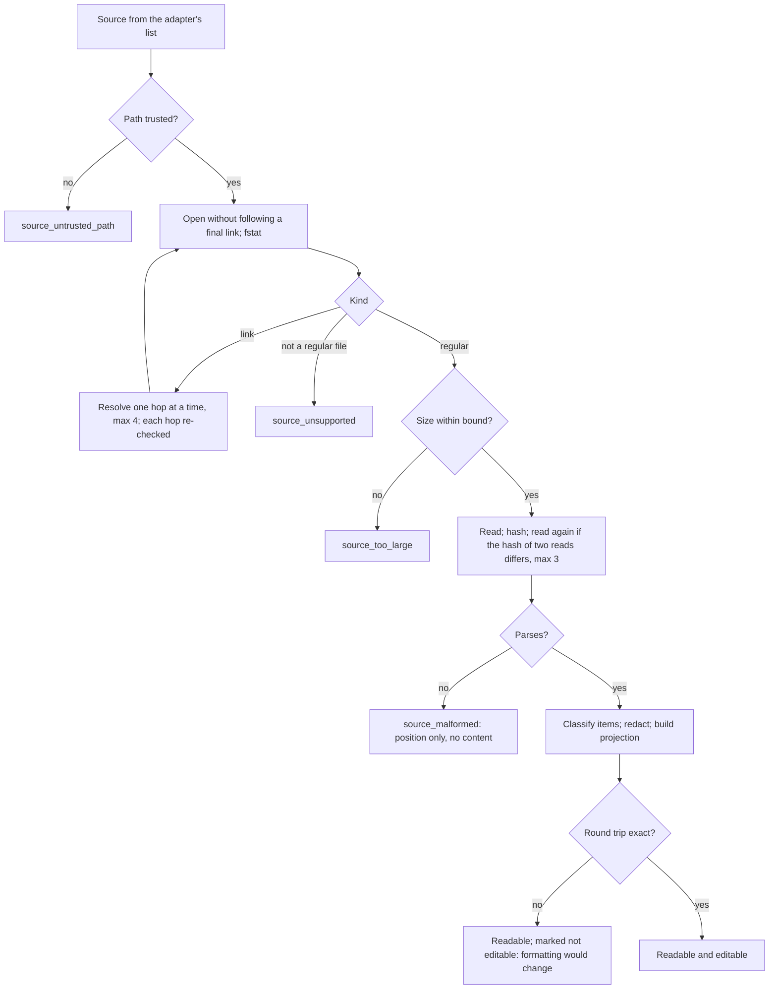
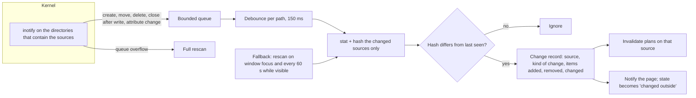

# 07 — Configuration engine

Domain D of [04](04-TARGET-ARCHITECTURE.md): the central feature. How the real configuration
of each provider is discovered, read, shown, changed and watched. All `[P]` unless marked.
What each action means for each kind of entry is in [08](08-RULES-HOOKS-SKILLS-MCP.md).

## 1. Principles

| #   | Principle                                                                                              | From                   |
| --- | ------------------------------------------------------------------------------------------------------ | ---------------------- |
| E1  | The provider's file is the truth. The engine keeps no configuration of its own that an agent must obey | AD-03                  |
| E2  | Reading comes before writing: F1 reads everything and writes nothing                                   | ADR 0028 roadmap `[R]` |
| E3  | A change is planned as a pure function, shown, confirmed, and only then written                        | ADR 0028 §5 `[R]`      |
| E4  | A file is edited only if parsing and writing it back unchanged reproduces it byte for byte             | ADR 0028 §5 `[R]`      |
| E5  | A file that changed since it was read is never overwritten                                             | D5 `[R]`               |
| E6  | A successful write proves the file, not the agent                                                      | Owner                  |
| E7  | What is unknown is shown as unknown                                                                    | Owner                  |
| E8  | The page names nothing: it points at items the backend showed it                                       | C-01                   |

## 2. Scopes

| Scope     | What it is                               | Where it lives                           | Who it affects                                        | Written by the Console                            |
| --------- | ---------------------------------------- | ---------------------------------------- | ----------------------------------------------------- | ------------------------------------------------- |
| System    | Policy of root or of an organisation     | The provider's system files              | Every user and session on the machine                 | Never (C-09)                                      |
| Global    | The user's configuration of an agent     | The provider's real user files           | Every session of that agent, in or out of the Console | Yes, by plan                                      |
| Project   | A repository's configuration of an agent | The provider's real files in the project | Sessions of that agent in that project                | Yes, by plan                                      |
| Session   | What one session should run with         | A profile, applied at start (09)         | That session only                                     | The profile store, never a provider's global file |
| Generated | A file another tool produces             | Wherever that tool writes                | As its target scope                                   | Never                                             |

### 2.1 Precedence

Precedence is the provider's, not ours; the engine reports it and does not reimplement it
beyond what the provider documents.

| Provider    | Order, highest first                                                                          | Evidence |
| ----------- | --------------------------------------------------------------------------------------------- | -------- |
| Claude Code | managed > `--settings` > project local > shared project > user. Hooks **merge** across levels | `[D]`    |
| Codex       | CLI and `-c` > project > profile > user; system requirements constrain all of them            | `[D]`    |
| OpenCode    | managed > inline content > `.opencode` > project > `OPENCODE_CONFIG` > global > remote        | `[D]`    |
| Hermes      | Not established                                                                               | `[N]`    |

Consequences the interface must state: in Claude Code a project cannot remove a user hook, it
can only add; in Codex a system requirement can make a user setting ineffective; a project's
Codex configuration counts only if the project is trusted.

### 2.2 Conflicts between scopes

| Situation                                                  | Shown as                                                                                                |
| ---------------------------------------------------------- | ------------------------------------------------------------------------------------------------------- |
| The same setting at two scopes                             | Both, with the one the provider documents as winning marked "takes precedence (documented)"             |
| A user setting that a system requirement overrides         | "Declared: X. Constrained by system policy"                                                             |
| A project file present but the project not trusted (Codex) | "Present, not loaded: project not trusted" where trust can be read; otherwise "load state not verified" |
| A setting whose resolution is not documented               | Both values, "resolution not verified"                                                                  |

## 3. Three states

| State                  | Question                            | Source                                                                    |
| ---------------------- | ----------------------------------- | ------------------------------------------------------------------------- |
| **Persisted**          | What does the file say?             | The adapter's `read`                                                      |
| **Provider-effective** | What did the provider resolve?      | A provider interface, where one exists and may be used; otherwise unknown |
| **Session-effective**  | What is each running session using? | The session registry (05 §5) and the provider's reload rule (06 §2)       |

For every element the engine computes a small record:

| Field       | Values                                                                                                                                                                                                                                                                                                     |
| ----------- | ---------------------------------------------------------------------------------------------------------------------------------------------------------------------------------------------------------------------------------------------------------------------------------------------------------- |
| `persisted` | `present_enabled`, `present_disabled`, `absent`, `kept_disabled` (disabled by the Console and kept inside the provider's own file; ADR 0029, proposed), `unreadable`. An entry this computer holds in its vault is `absent` from the file, and is shown as `vault_disabled` from the vault's index (08 §2) |
| `effective` | `verified_enabled`, `verified_disabled`, `documented` (derived from documented precedence, not observed), `not_verifiable`                                                                                                                                                                                 |
| `sessions`  | Per session: `using` (observed), `documented_using` (the provider documents that it reloads; not observed for this session), `not_using`, `stale` (started before a change the provider does not reload), `unknown`                                                                                        |
| `as_of`     | When the persisted state was last read, and the content hash it was read from                                                                                                                                                                                                                              |

How each is discovered, per provider:

| Element          | Persisted                           | Provider-effective, Claude Code                              | Provider-effective, Codex                                                   | Session-effective                                                                                                                               |
| ---------------- | ----------------------------------- | ------------------------------------------------------------ | --------------------------------------------------------------------------- | ----------------------------------------------------------------------------------------------------------------------------------------------- |
| Hook             | Parse of the settings or hooks file | `documented` at best; `/status` is interactive `[N]` (OQ-05) | `hooks/list` reports it `[R]`, but needs a Codex process: not in F1 (DN-10) | Claude Code: documents a reload `[D]` → `documented_using` after a change, never `using` without an observation (OQ-28). Codex: `unknown` `[N]` |
| Rule file        | The file exists and is read         | `documented`                                                 | `documented`; project files depend on trust                                 | `unknown` unless the provider reports loaded instructions                                                                                       |
| Skill            | Directory plus the override map     | `documented`                                                 | `documented`                                                                | `unknown`                                                                                                                                       |
| MCP server       | Its entry                           | `documented`                                                 | `config/read` reports it `[R]`; same limit as hooks                         | `unknown`                                                                                                                                       |
| Model preference | The setting                         | `documented`                                                 | `documented`                                                                | Read once at start `[D]` for Claude Code → `stale` after a change                                                                               |

`documented` is drawn differently from `verified` (FR-UX-03): it is a deduction from the
provider's manual, not an observation.

## 4. Discovery and reading

### 4.1 Discovery

Each adapter derives its closed list of sources from: the user's home, the provider's
documented relocation variable if it is set in the Console's own environment, the provider's
system directory, and the project folder if one is selected. Nothing else. A project is one the
user chose in the native dialog or one already known (09 §5).

### 4.2 Reading



| Rule                               | Detail                                                                                                                                                                                                                     |
| ---------------------------------- | -------------------------------------------------------------------------------------------------------------------------------------------------------------------------------------------------------------------------- |
| Path trust                         | The rules of `control/paths.rs:20-44` `[R]`, applied to the provider's directory: no ancestor writable by another user. A provider directory that is group-writable is reported, read, and never written                   |
| Identity                           | A source is opened relative to a descriptor of its validated directory. What was opened is what is read and hashed, and its device and inode are what a later write compares against. A path is not resolved a second time |
| Bounds (C-11)                      | Proposed: 4 MiB per file, 4,096 items per source, depth 32, 4 link hops, 2,048 files per directory listing. Final values are set with the fixtures (OQ-22)                                                                 |
| A file read while being written    | Two reads with different hashes are retried; after three, `source_unreadable` (temporary)                                                                                                                                  |
| Unknown fields                     | Kept untouched and counted; never dropped, never interpreted                                                                                                                                                               |
| A file of a newer provider version | Read as far as it parses; items the adapter does not know are listed as "unknown to this version of Wyss Console"                                                                                                          |

### 4.3 Links and generated files

A link is followed to a regular file owned by the user; the inventory shows both the link and
its target, and any write goes to the target, by the target's own class. A link is never
replaced by a file: a rename over the link's name would do exactly that, so the rename is done
on the target's path.

A generated file is read only. The inventory says "produced by another tool" and, when the
file carries a marker, which one.

### 4.4 Provider-owned files

`~/.claude.json` and files like it are read through a bounded projection that extracts only
the configuration the adapter names (MCP server names and their non-secret fields) and nothing
else of the file. They are never written. A change to what they hold goes through the
provider's own command (`by_provider_writer`), which is a provider process: therefore not in F1
and not before the ADR that allows the desktop to run one (DN-13).

## 5. Changing a configuration

### 5.1 The lifecycle

Discovery → parsing → normalisation → validation → projection → change request →
authorisation → write-ahead intent → safe replacement (§5.4) → settling → verification →
effective-state observation → interface update → history → optional rollback.

```mermaid
sequenceDiagram
  participant U as User
  participant P as Page
  participant E as Engine
  participant A as Adapter
  participant D as Native dialog
  participant F as Provider file
  participant J as Journal
  U->>P: Disable entry H
  P->>E: plan(item H, disable)
  E->>F: read current bytes (hash h0)
  E->>A: plan(disable, H, bytes)
  A-->>E: new bytes, diff, risk, reload rule, how H stays restorable
  E->>A: managed_effect(plan)
  E-->>P: plan id, redacted diff, risk, affected sessions, warnings
  U->>P: Confirm
  P->>E: apply(plan id)
  alt risk is weakens_security or executes_code
    E->>D: native confirmation (what, where, effect)
    D-->>E: accepted or refused
  end
  E->>E: take the lock of this target; check it can be replaced safely, that no known session of the agent is active, and that the vault is ready
  E->>J: intent (item, operation, keyed digests of the file before and as planned)
  E->>E: write the new content to an unnamed file in the private transaction directory, flush
  E->>F: open the target once; hash through that descriptor must equal h0
  alt hash differs
    E->>J: outcome not_applied
    E-->>P: changed_outside (nothing written)
  else same
    E->>F: exchange the target's name with the transaction name, atomically
    E->>F: the displaced file must be the one just checked, unchanged
    E->>F: settle: the old file keeps its name in the transaction directory for the bounded settling time
    E->>F: read back; A.verify
    E->>J: outcome (applied, lost_race, superseded_outside, conflict_preserved, recovery_incident)
    E-->>P: outcome; per-session effect
  end
```

### 5.2 Stages, and where providers differ

| Stage                        | Common behaviour                                                                                                                                                                       | Claude Code                                                                                                                                     | Codex                                                                                            |
| ---------------------------- | -------------------------------------------------------------------------------------------------------------------------------------------------------------------------------------- | ----------------------------------------------------------------------------------------------------------------------------------------------- | ------------------------------------------------------------------------------------------------ |
| Normalisation                | Items get identifiers: source + kind + a keyed digest of the entry (ADR 0029 §2)                                                                                                       | A hook is identified by event, matcher and handler bytes                                                                                        | A hook by the identifier `hooks/list` uses, if readable from the file `[N]`; else as Claude Code |
| Validation                   | The operation is one the adapter declares for this version                                                                                                                             | —                                                                                                                                               | Individual hook switches are subject to DN-19 and G-INF (10 §5)                                  |
| Authorisation                | Risk class decides the confirmation (11 §4)                                                                                                                                            | —                                                                                                                                               | —                                                                                                |
| Keeping the entry restorable | The ladder of ADR 0029 §3 (proposed): native switch; else in the provider's own file where verified; else removed and sealed in the protected vault (27); else temporarily unavailable | No per-hook switch `[D]`. In place: **unverified**. The vault: designed, not built. Until one of them is available the operation is unavailable | Native switch where its storage is known (OQ-01)                                                 |
| Persistence                  | §5.4                                                                                                                                                                                   | JSON, layout preserved by round trip                                                                                                            | TOML edited in place of structure, comments kept                                                 |
| Verification                 | Re-read and `verify`                                                                                                                                                                   | The entry is in the intended state                                                                                                              | The switch has the intended value                                                                |
| Effective-state observation  | The provider's reload rule                                                                                                                                                             | A reload is documented `[D]`, not observed (OQ-28)                                                                                              | `unknown` `[N]` (OQ-03); a changed hook also needs the provider's own review `[D]`               |

### 5.3 Formats

| Format                | How it is edited                                                         | Risk held by E4                                                                                                                                                                                        |
| --------------------- | ------------------------------------------------------------------------ | ------------------------------------------------------------------------------------------------------------------------------------------------------------------------------------------------------ |
| JSON                  | Parsed with key order kept; written with the layout the file already has | A file with unusual layout fails the round trip and becomes read only, instead of being reformatted. Whether that is acceptable as the permanent answer, or an edit by byte ranges is needed, is OQ-29 |
| TOML                  | A format-preserving document model; only the touched key changes         | Same                                                                                                                                                                                                   |
| JSONC                 | A syntax-tree edit that keeps comments (OpenCode, F4a)                   | Same                                                                                                                                                                                                   |
| YAML                  | Not edited; the provider's writer is used (Hermes, F4b)                  | —                                                                                                                                                                                                      |
| Markdown instructions | The whole file is the unit; no partial edit before F5                    | —                                                                                                                                                                                                      |

### 5.4 Safe replacement of a provider's file (SM-WRITE)

**This is the one normative description of how the Console writes a provider's file directly.**
Every other document refers to it. It is a **design candidate**: nothing of it is built, none
of it was run, and decision DN-21 stays technically unverified. Where a provider has its own
verified writer for a setting, that writer is preferred and this protocol is not used.
It is also **not available**: direct writes are offered only after the preservation of a
possible conflict has passed its technical validation (decision DN-28, a gate that is closed
today; [30](30-TECHNICAL-VALIDATION-PLAN.md)). A switch in the window that makes the Console
itself rewrite a provider's JSON or TOML file is a direct write and goes through this protocol;
it is not a provider-native operation (the owner's decision of 2026-10-13).

The problem. A provider takes no lock and may write its own configuration file at any moment
(a permission accepted "always", an option changed in its menu). A hash check followed by a
rename leaves an interval in which the provider's write is replaced by the Console's and
nothing notices; and a provider that writes the old file in place while it is being replaced
writes into a file that is about to disappear. **Reading the file back afterwards detects
neither case.** ADR 0028 §8 says it does; that sentence is wrong (ADR 0030, proposed).

**This race is not solved here, and cannot be.** No protocol on an ordinary filesystem stops a
writer that does not cooperate. The protocol makes the orderings it can observe end in a named
outcome with no version destroyed, and it does not observe all of them: the ones it cannot see,
and what can be lost in them, are listed at the end of this section and classified in
[28](28-CONCURRENCY-AND-FILESYSTEM-INTEGRITY.md). **It does not promise that no data is lost,
and it does not detect every concurrent write.** An ordinary rename is never used, as a first
choice or as a fallback. All of this section is `[P]`; the facts it rests on are `[N]`.

Invariants.

- **W1.** The Console removes a name only after verifying, through an open descriptor, that the
  file under it holds either the bytes the Console itself staged or exactly the content the
  plan was computed from. Anything else it finds is kept and reported.
- **W2.** A copy in clear made by this protocol exists only in the private transaction
  directory, never in a provider's directory, and none is left there once the operation has
  reached a final outcome. The one exception is a recovery incident (below): an unexpected
  failure after the mutation, declared as an incident and never used as a way to keep a version.

The private transaction directory. One directory of the Console, `txn/` under its private
state directory: mode 0700, every ancestor checked by the path rule (CTL-10), used through one
descriptor. It must be on the **same filesystem** as the target, because the exchange is made
between the target's name and a name in this directory. It is refused, and with it every direct
write to that target, if it is on another filesystem, if it fails the path rule, or if its
place does not meet the criterion of 27 §9.1. That criterion is **open** (DN-31): a
replication marker in an ancestor is not proof of replication, an ignore rule is not a
guarantee, and the home subvolume of the owner's computers is snapshotted (30 §6). Until it is
decided there is no direct write. Nothing is ever staged, named or kept beside the provider's
file.

Identity. The target's directory is opened once. Every later step (check, exchange,
verification, release) is done relative to that descriptor and to the descriptor of the
transaction directory, and the device and inode of what was checked are compared again at every
step. A path is never resolved twice.

Digests. h0 is the digest of the file the plan was computed from; hp the digest of the planned
file. In memory they are plain hashes. **Wherever a file digest is written to a store it is a
keyed digest** (14 §3.2): an unkeyed digest of a whole file would let someone who knows the
rest of the file confirm a guess at a short secret in it.

| State             | What happens                                                                                                                                                                                                                                                                                                                                                                                                                                                                                              | Guard                                                                                                                                                                                                                                                                                                                                                                                                                                                                                                                                                                                                                                                                                                                      | Leaves to                                                                                                                                                           | On failure                                                                                                                                                                                                                                                                                                                                                                          |
| ----------------- | --------------------------------------------------------------------------------------------------------------------------------------------------------------------------------------------------------------------------------------------------------------------------------------------------------------------------------------------------------------------------------------------------------------------------------------------------------------------------------------------------------- | -------------------------------------------------------------------------------------------------------------------------------------------------------------------------------------------------------------------------------------------------------------------------------------------------------------------------------------------------------------------------------------------------------------------------------------------------------------------------------------------------------------------------------------------------------------------------------------------------------------------------------------------------------------------------------------------------------------------------- | ------------------------------------------------------------------------------------------------------------------------------------------------------------------- | ----------------------------------------------------------------------------------------------------------------------------------------------------------------------------------------------------------------------------------------------------------------------------------------------------------------------------------------------------------------------------------- |
| `preparing`       | The per-target lock is taken on the target's directory (it serialises the Console's own processes only). The directory is opened and its ancestors checked through it. The transaction directory is checked. The vault is made ready: its key is obtained and held for the operation, and **a sealed placeholder of the file's size, with no content, is written and verified**, so that the key, the storage and the space a conflicting version would need are shown to work before anything is changed | The source is of class `user` or `project`; a regular file with exactly one hard link, no access-control list, no extended attribute or security label the writer cannot carry, not immutable; if it is reached through a link, §4.3 allows writing it; the filesystem offers an atomic exchange of two names in two directories and unnamed temporary files (probed once per filesystem and per start); the transaction directory passes its checks and is on the same mount; **no known session of that provider is active** (strict mode, 28 §5.1); **the vault is ready, consent for a conflicting version is on record and the placeholder verified** (27); no intent is open for this source; the journal can append | `intent_recorded`                                                                                                                                                   | `refused`: `source_unsupported`, `no_atomic_exchange`, `no_private_transaction_dir`, `provider_session_active`, `conflict_preservation_unavailable`, `repair_pending`, `journal_unavailable`. Nothing was touched                                                                                                                                                                   |
| `intent_recorded` | An intent entry is appended and flushed: operation identifier, item, source identity, the keyed digests of the file before and as planned, the transaction name                                                                                                                                                                                                                                                                                                                                           | —                                                                                                                                                                                                                                                                                                                                                                                                                                                                                                                                                                                                                                                                                                                          | `staged`                                                                                                                                                            | `refused`: `journal_unavailable`                                                                                                                                                                                                                                                                                                                                                    |
| `staged`          | The new content is written to an **unnamed** temporary file in the transaction directory, given the target's mode and owner, and flushed. It has no name: a stop here leaves nothing                                                                                                                                                                                                                                                                                                                      | Mode and owner could be set as the target's                                                                                                                                                                                                                                                                                                                                                                                                                                                                                                                                                                                                                                                                                | `checked`                                                                                                                                                           | Outcome `failed`; nothing on disk                                                                                                                                                                                                                                                                                                                                                   |
| `checked`         | The target is opened once, without following a link. Its device, inode and content hash are taken through that descriptor. Strict mode is checked again                                                                                                                                                                                                                                                                                                                                                   | Hash equals h0; no known session of the provider is active                                                                                                                                                                                                                                                                                                                                                                                                                                                                                                                                                                                                                                                                 | `exchanged`                                                                                                                                                         | Hash differs: outcome `not_applied` (`changed_outside`). A session appeared: `not_applied` (`provider_session_active`). Nothing on disk                                                                                                                                                                                                                                             |
| `exchanged`       | The staged file is given the operation's name in the transaction directory, and in the next call that name and the target's name are exchanged atomically: the target's name now holds the new content, the transaction name the old file. Both directories are flushed                                                                                                                                                                                                                                   | Both calls succeed                                                                                                                                                                                                                                                                                                                                                                                                                                                                                                                                                                                                                                                                                                         | `verifying`                                                                                                                                                         | The transaction name, if it was created, is removed; outcome `failed`                                                                                                                                                                                                                                                                                                               |
| `verifying`       | The file now under the transaction name is examined                                                                                                                                                                                                                                                                                                                                                                                                                                                       | It is the same device and inode as the descriptor of `checked`, and its content still hashes to h0                                                                                                                                                                                                                                                                                                                                                                                                                                                                                                                                                                                                                         | `settling`. **The old file keeps its name**                                                                                                                         | It is another file, or it changed: the provider wrote between the check and the exchange → `rolling_back`                                                                                                                                                                                                                                                                           |
| `settling`        | For the settling time, which has a fixed ceiling, the target's name is watched and the old file is re-read under its name                                                                                                                                                                                                                                                                                                                                                                                 | At the end: the old file still hashes to h0; the target still hashes to hp; no process of the user holds the old file open                                                                                                                                                                                                                                                                                                                                                                                                                                                                                                                                                                                                 | `releasing`                                                                                                                                                         | The old file changed: a provider wrote it in place → `rolling_back`. **A process still holds the old file open at the ceiling → `rolling_back`**: the Console withdraws its own change instead of releasing a file someone may still write. The target was replaced by someone else: `superseded_outside`, and the old file is released if it is still h0, otherwise → `preserving` |
| `rolling_back`    | The two names are exchanged back: **the same old file** is the target again, and a provider still writing it writes the target. Then the file under the transaction name is verified to be the Console's own staged content and removed                                                                                                                                                                                                                                                                   | The target is still the Console's staged inode with hash hp. At most three attempts, each verified like the first                                                                                                                                                                                                                                                                                                                                                                                                                                                                                                                                                                                                          | Outcome `lost_race`: the target holds the provider's version. Entered from the ceiling: outcome `not_applied` (`file_held_open`), and the target holds what it held | The target changed again: nothing more is exchanged → `preserving`                                                                                                                                                                                                                                                                                                                  |
| `preserving`      | Reached only when the target was replaced by a third version **and** the old file was written by someone: that version exists nowhere else. It is sealed in the vault as a `conflict_version` record, in the space the placeholder reserved; the record is read back and verified; only then is the transaction name removed                                                                                                                                                                              | The record verifies (27 §8.1)                                                                                                                                                                                                                                                                                                                                                                                                                                                                                                                                                                                                                                                                                              | Outcome `conflict_preserved`                                                                                                                                        | Sealing fails although it was prepared: **an unexpected failure after the mutation**. Outcome `recovery_incident` (below). The engine does not report success, does not destroy the version, sets no time after which it would, and does not treat the private directory as protection                                                                                              |
| `releasing`       | The transaction name is removed: W1 holds, the file under it was verified to be h0. Both directories are flushed                                                                                                                                                                                                                                                                                                                                                                                          | —                                                                                                                                                                                                                                                                                                                                                                                                                                                                                                                                                                                                                                                                                                                          | `applied`                                                                                                                                                           | The name cannot be removed: outcome `applied`, marked `cleanup_pending`; start-up repair removes it                                                                                                                                                                                                                                                                                 |
| `applied`         | Read back, `verify`, outcome entry appended and flushed                                                                                                                                                                                                                                                                                                                                                                                                                                                   | —                                                                                                                                                                                                                                                                                                                                                                                                                                                                                                                                                                                                                                                                                                                          | —                                                                                                                                                                   | Read-back does not verify: outcome `unverified`; the user is shown what the file holds. The outcome cannot be appended: the intent stays open, the source is blocked for mutation, and repair records the outcome later (14 §4)                                                                                                                                                     |

Order of flushes: intent; staged content; both directories after the exchange; the vault
record, when one is made, before its transaction name is removed; outcome. An outcome is never
written before the directories are flushed.

Outcomes, all journalled and all shown to the user in plain words:

| Outcome              | The target holds         | The Console's change                                                                       | The provider's change                                                                                                                                                       | The user is offered                                                                                                       |
| -------------------- | ------------------------ | ------------------------------------------------------------------------------------------ | --------------------------------------------------------------------------------------------------------------------------------------------------------------------------- | ------------------------------------------------------------------------------------------------------------------------- |
| `applied`            | The planned content      | In place. Not the same as "in force" (§6)                                                  | None was seen                                                                                                                                                               | —                                                                                                                         |
| `not_applied`        | What it held             | Not written                                                                                | Kept                                                                                                                                                                        | Prepare again on the current content                                                                                      |
| `lost_race`          | The provider's version   | Not in place                                                                               | Kept                                                                                                                                                                        | Prepare again                                                                                                             |
| `superseded_outside` | Whatever replaced it     | Unknown until re-read: the engine re-reads and says whether the planned effect still holds | Kept                                                                                                                                                                        | Prepare again if the effect is gone                                                                                       |
| `conflict_preserved` | The latest version found | Not in place                                                                               | Kept; another version is sealed in the vault                                                                                                                                | See both; make one of them the file; nothing is merged for him                                                            |
| `recovery_incident`  | The latest version found | Not in place                                                                               | Kept in the target. Another version is held as recovery evidence, in clear, in the transaction directory: disclosed as a confidentiality risk and as a risk to that version | A controlled recovery: try sealing again; see the version; save it where he chooses; delete it. Nothing happens by itself |
| `unverified`         | Not what was planned     | Unknown                                                                                    | Unknown                                                                                                                                                                     | The current content, and prepare again                                                                                    |
| `failed`             | What it held             | Not written                                                                                | Kept                                                                                                                                                                        | The error word                                                                                                            |

**Recovery incident.** This is not a way of preserving a version; it is what the engine does
when preserving one has failed. The owner's decision of 2026-10-13 (DN-28) fixes its contract.

| The engine                                                                                                                                                                                                                                                                           |
| ------------------------------------------------------------------------------------------------------------------------------------------------------------------------------------------------------------------------------------------------------------------------------------ |
| Enters it only after an **unexpected failure after the mutation**: sealing was prepared and verified before the write, and it failed all the same                                                                                                                                    |
| Never reports success. The operation's outcome is `recovery_incident`, shown as a failure                                                                                                                                                                                            |
| Blocks every further write to that source that could conflict with it                                                                                                                                                                                                                |
| Preserves all the recovery evidence it has, exactly as it is: the version in the private transaction directory, the open intent, the journal entries, the placeholder and any record. **Nothing is destroyed by the passing of time**, and nothing is destroyed by the engine at all |
| Discloses both risks, in a native dialog at once and at every start: a copy of a configuration file is in clear in the Console's private directory, which is **not** equivalent to encryption; and a version of the file is at risk of not being recoverable                         |
| Requires a controlled recovery: sealing tried again when the user asks, after the cause is removed; or his own explicit act on the version, each in a native dialog: see it, save it where he chooses, or delete it knowing it is the only copy                                      |

**DN-28 is a technical gate, and it is closed.** Direct writes by this protocol are not
offered until the path that preserves a possible conflict has been designed in full and
validated ([30](30-TECHNICAL-VALIDATION-PLAN.md)). Where that path cannot be established on a
filesystem, a custody or a provider, the mechanism stays unavailable there. The design does not
claim that no copy in clear and no loss can both be guaranteed where the environment does not
support both: a recovery incident is the admission that, in that moment, they were not.

Copies in clear that this protocol makes. Replacing a file without destroying what it replaces
needs the old file to stay reachable under a name, so that the same file can be put back; that
is why a transient copy is indispensable, and it is the only reason. The exception that allows
it, and its conditions, are in ADR 0029 §1 (proposed).

| File                                     | Where                     | Exists                                                                                                                  | Mode and owner                                                      | After a stop of the process                                                                                               |
| ---------------------------------------- | ------------------------- | ----------------------------------------------------------------------------------------------------------------------- | ------------------------------------------------------------------- | ------------------------------------------------------------------------------------------------------------------------- |
| The staged new content, unnamed          | The transaction directory | While it is written and flushed                                                                                         | The target's, set before it has any name                            | Gone                                                                                                                      |
| The staged new content, named            | The transaction directory | From its naming to the exchange: one call to the next                                                                   | The target's                                                        | Left; examined and removed by start-up repair (14 §4)                                                                     |
| The old file, under the transaction name | The transaction directory | From the exchange to the end of settling, never past the ceiling                                                        | Its own, unchanged; reachable only through a directory of mode 0700 | Left; examined by start-up repair. **If the Console is never started again it stays**, in the Console's private directory |
| The version of a recovery incident       | The transaction directory | From an unexpected sealing failure until it is sealed or the user resolves it. No timeout: the engine never destroys it | Its own                                                             | Kept                                                                                                                      |

None of these is ever in a provider's directory, so a replication tool that watches that
directory sees one replacement of the file and no extra name. That is a property of where the
files are put; it is not a claim that a short-lived file would go unseen.

What this protocol does **not** achieve:

| Limit                                                                                                                  | Why                                                                                                                                              | What is done instead                                                                                                                                                                                                                                                                                                        |
| ---------------------------------------------------------------------------------------------------------------------- | ------------------------------------------------------------------------------------------------------------------------------------------------ | --------------------------------------------------------------------------------------------------------------------------------------------------------------------------------------------------------------------------------------------------------------------------------------------------------------------------- |
| A provider that read the file before the exchange and writes its own version back later replaces the Console's change  | It never looked at the new content. A provider that keeps its settings in memory and writes them out on its own schedule does exactly this `[N]` | The watcher sees an outside change; the engine checks whether the last applied operation still holds and, if not, records `reverted_outside`, tells the user and offers to apply again. **Seen only while the Console runs, or at its next start**                                                                          |
| A provider that keeps the old file open and writes it after it was released loses that write, **and nothing shows it** | The old file has no name any more                                                                                                                | The settling time and its ceiling are chosen from measurement (OQ-31). Before release the user's processes are checked for one that still has the file open; if one does at the ceiling, the Console's own change is rolled back instead of the file being released `[N]`. A process the check does not find is not covered |
| A version delivered by the other computer replaces the target at any moment                                            | Replication has no local process to see                                                                                                          | An outside change, when the Console next observes the file                                                                                                                                                                                                                                                                  |
| A second exchange (rollback) races like the first                                                                      | The provider can write again                                                                                                                     | Bounded attempts, then `preserving`: the version is sealed and the user decides                                                                                                                                                                                                                                             |
| On a filesystem without an atomic exchange, without unnamed temporary files, or with no private transaction directory  | —                                                                                                                                                | No direct write there. **Never a plain rename**                                                                                                                                                                                                                                                                             |
| Two provider processes that overwrite each other                                                                       | Not the Console's writes                                                                                                                         | Nothing                                                                                                                                                                                                                                                                                                                     |

Not verified, and required before F2a (OQ-31): that an atomic exchange of two names in two
directories of one filesystem and unnamed temporary files are available on the owner's
filesystems and through the library in use; that an unnamed file can be given a name without
extra privilege; that the transaction directory and the owner's configuration are on one
filesystem; how each provider writes its files (in place or by replacement, from a fresh read
or from memory); the interval between `checked` and `exchanged`; a settling time, and a
ceiling for it, that cover the provider's observed write.

### 5.5 Concurrency and conflict

| Situation                                                                       | Behaviour                                                                                                                                                                                                                                                                                                                                                        |
| ------------------------------------------------------------------------------- | ---------------------------------------------------------------------------------------------------------------------------------------------------------------------------------------------------------------------------------------------------------------------------------------------------------------------------------------------------------------- |
| The file changed between plan and apply                                         | `not_applied` (`changed_outside`); nothing written; the page is offered a new plan on the current content                                                                                                                                                                                                                                                        |
| Two windows of the Console apply to the same file                               | The per-target lock serialises them; the second finds a different hash and is `not_applied`                                                                                                                                                                                                                                                                      |
| A known session of the provider is active                                       | `provider_session_active`: refused (strict mode, 28 §5.1)                                                                                                                                                                                                                                                                                                        |
| The vault is locked, absent or without its key                                  | Every direct write is refused: `conflict_preservation_unavailable`. Reading, the inventory, the detection of outside changes and the history are not affected (27 §5.7)                                                                                                                                                                                          |
| An earlier write to this source is unfinished and needs the vault to be checked | `repair_pending`: this source is blocked for mutation; its records and files are kept as they are; reading goes on                                                                                                                                                                                                                                               |
| The provider writes around the Console's write                                  | §5.4: the orderings the Console can observe end in a named outcome. **Two cannot be observed, and a change can be lost in them without anything showing it**: a write into the old file after it was released (28 §4.1, case 4), and a replacement while the Console is not running, seen only at its next observation (28 §5, L2 and L5). None can be prevented |
| A conflict copy of the file exists (`*.sync-conflict-*`)                        | `conflict_copy_present`; mutation of that file is refused until the copy is gone; the view names the copy and says that resolving it is done outside. Only the conflict names of recognised replication tools are seen (OQ-13); a tool that resolves a conflict by itself leaves nothing to see                                                                  |
| The file disappeared                                                            | `source_missing`; a plan against it is void                                                                                                                                                                                                                                                                                                                      |
| A plan was confirmed and the application closed before applying                 | Plans live in memory only; nothing is applied later                                                                                                                                                                                                                                                                                                              |
| The application stopped during §5.4                                             | Start-up repair from the intent entry, the target and the transaction directory (14 §4)                                                                                                                                                                                                                                                                          |

### 5.6 Plan state machine (SM-PLAN)

Times are measured on a monotonic clock.

| State         | Enters when                                                                                                                                        | Guard                       | Leaves to                                                                                                                      | On failure                                                                                                                                |
| ------------- | -------------------------------------------------------------------------------------------------------------------------------------------------- | --------------------------- | ------------------------------------------------------------------------------------------------------------------------------ | ----------------------------------------------------------------------------------------------------------------------------------------- |
| `drafted`     | `plan` returned                                                                                                                                    | At most eight drafted plans | `confirmed` (user); `expired` (60 s, or the source changed); `discarded` (user)                                                | —                                                                                                                                         |
| `confirmed`   | The user confirmed in the page                                                                                                                     | The plan is not expired     | `authorising` (the risk class needs the native dialog); `applying` (it does not)                                               | Expired: `expired`                                                                                                                        |
| `authorising` | The native dialog is open. It shows the plan the backend computed, and its acceptance is valid for that plan identifier and that content hash only | One dialog at a time        | `applying` (accepted); `discarded` (refused, closed, the window closed, or five minutes passed)                                | The dialog cannot be shown: `discarded` with `dialog_unavailable`; nothing written. Every refusal is journalled, identifiers only         |
| `applying`    | SM-WRITE runs. A change of the source seen by the watcher meanwhile is SM-WRITE's business and never a second plan                                 | —                           | `applied`, `not_applied`, `lost_race`, `superseded_outside`, `conflict_preserved`, `recovery_incident`, `unverified`, `failed` | As SM-WRITE. A stop of the process: start-up repair (14 §4); a state that repair cannot name is kept as it is and reported, never guessed |
| final states  | —                                                                                                                                                  | —                           | —                                                                                                                              | —                                                                                                                                         |

A plan is single use. `apply` on any state but `confirmed` is rejected.

### 5.7 Rollback

Undo is a new plan, built from the journal entry and from wherever the disabled entry is: the
provider's file itself on rungs 1 and 2, its vault record on rung 3 (27 §8). It is subject to the same checks and the same SM-WRITE.
It is exact when the file's hash still equals the hash recorded after the change; otherwise the
inverse is planned against the current content and shown as a diff the user confirms (08 §6).
An operation whose effect was already undone from outside has nothing to undo, and says so.

## 6. Dynamic changes: what "applied" means

| Change                        | Claude Code                        | Codex                                | OpenCode | Shown to the user as                                                                                       |
| ----------------------------- | ---------------------------------- | ------------------------------------ | -------- | ---------------------------------------------------------------------------------------------------------- |
| Hook removed or restored      | Reloaded in running sessions `[D]` | Not documented `[N]`                 | `[N]`    | "Applied to the file. Running sessions: documented as adopted, not verified (Claude Code) / not confirmed" |
| Hook content changed          | Reloaded `[D]`                     | Skipped until trusted in Codex `[D]` | `[N]`    | Codex: "Pending your review in Codex"                                                                      |
| Permissions                   | Reloaded `[D]`                     | `[N]`                                | `[N]`    | —                                                                                                          |
| Model, effort                 | Only at session start `[D]`        | `[N]`                                | `[N]`    | "Applies to new sessions. N running sessions keep the previous one"                                        |
| Skill switched                | `[N]`                              | `[N]`                                | `[N]`    | "Applied to the file. Effect on running sessions not confirmed"                                            |
| MCP server switched           | `[N]`                              | `[N]`                                | `[N]`    | Same                                                                                                       |
| Anything in a session profile | Fixed at start by definition       | Same                                 | Same     | "This session keeps the profile it started with"                                                           |

A global change affects every session that shares the file. Before applying, the plan lists
them: sessions the Console started (with their profiles, since a profile that excludes the user
source is unaffected) and, as a count, agents it detects running outside it.

A session that started before a change the provider does not reload is `stale`. Stale sessions
are marked in the overview until they end; the Console never restarts them.

## 7. Observing outside changes



| Requirement of the owner                  | How it is met                                                                                                                                      |
| ----------------------------------------- | -------------------------------------------------------------------------------------------------------------------------------------------------- |
| Edits by an external editor               | Close-after-write and move-into events on the directory                                                                                            |
| Atomic replacement                        | Watching the directory, not the file: a rename brings a new inode under the same name                                                              |
| A link whose target changes               | The link's directory and the target's directory are both watched; a change of the link itself re-resolves it                                       |
| Creation and deletion                     | Directory events; a source that does not exist yet has its parent watched, up to the first directory that exists                                   |
| Updates by a replication tool             | They are atomic replacements; conflict copies are creations of a recognisable name                                                                 |
| No excessive polling                      | No timer runs while the window is hidden; the fallback rescan runs only while the Configuration view is visible                                    |
| Not re-reading everything                 | Only the sources under a changed path are hashed again                                                                                             |
| Watcher invalidation, overflow            | An overflow, a removed watched directory or a failed watch triggers one full rescan and a re-arm; the view shows "re-synchronised"                 |
| Temporary read error against real removal | A missing file is confirmed by a second look after 300 ms before it is reported as removed; an unreadable one is `source_unreadable`, not `absent` |
| No stale verified state                   | Every state carries `as_of`; a source not confirmed for longer than the fallback period is drawn as "last seen at …"                               |

Limits declared rather than hidden: inotify does not report changes on some network and
overlay filesystems `[N]`; the per-user watch limit can be exhausted, in which case the engine
falls back to rescans and says so; behaviour under the replication tool's own temporary files
is to be confirmed with fixtures (OQ-13).

### 7.1 Source state machine (SM-SOURCE)

| State           | Meaning                          | Leaves to                                          |
| --------------- | -------------------------------- | -------------------------------------------------- |
| unknown         | Not read yet                     | current, missing, unreadable, malformed, untrusted |
| current         | Read; hash known; watch armed    | changed_outside (event), stale (watch lost)        |
| changed_outside | A different hash was seen        | current (re-read and projected)                    |
| stale           | The watch is not reliable        | current (rescan)                                   |
| missing         | Confirmed absent                 | current (created)                                  |
| unreadable      | Permission or I/O error          | current (readable again)                           |
| malformed       | Does not parse                   | current (fixed outside)                            |
| untrusted       | Path rules failed                | current (after the user fixes permissions outside) |
| conflicted      | A conflict copy exists beside it | current (copy removed)                             |

The Console never resolves `malformed`, `untrusted` or `conflicted` by itself.

### 7.2 Bounds, degraded mode, and the Console's own writes

Every number is a proposal to be fixed by measurement at the bound (15, M16 and M19; OQ-22).

| Subject                                                             | Rule `[P]`                                                                                                                                                                                                                                                                               |
| ------------------------------------------------------------------- | ---------------------------------------------------------------------------------------------------------------------------------------------------------------------------------------------------------------------------------------------------------------------------------------- |
| Watched directories                                                 | At most 512, counted across all providers. Only the selected project is watched besides the global sources                                                                                                                                                                               |
| Event queue                                                         | At most 4,096 pending events, coalesced per path. Events are filtered by name before they are queued, so a directory that also holds unrelated, frequently written files costs one comparison per event                                                                                  |
| Rescans                                                             | At most one runs at a time; at most one full rescan every 10 s; a rescan hashes at most 64 MiB, and sources beyond that are marked "not confirmed" and taken first by the next one                                                                                                       |
| Fallback rescan while visible                                       | Size, times and inode are compared first; a file is hashed when one differs, and every source is hashed at least once per focus so that a change that kept all four is still found                                                                                                       |
| Degraded mode                                                       | Entered when the kernel refuses a watch, the queue overflows twice within a minute, or the watch bound is reached. The view says "Changes are checked every N seconds, not as they happen", every state shows its age, and mutations stay available because each one re-reads its target |
| A source that turns empty or unparsable after having been `current` | Held as "changing" for a bounded time (2 s, re-armed by further events, at most 10 s) before any item is reported as removed: an editor that truncates and rewrites must not produce a false "removed"                                                                                   |
| A projected, provider-owned file                                    | Change is judged on the hash of the projection, not of the file, so that a provider rewriting its own counters produces no change record                                                                                                                                                 |
| The Console's own write                                             | The events of SM-WRITE are recognised by the names and hashes of the intent in progress and are not reported as outside changes                                                                                                                                                          |
| A full rescan while events arrive                                   | Events are queued and applied after it; the inventory's revision moves once                                                                                                                                                                                                              |
| While the window is hidden                                          | No timer and no rescan. Watches stay armed; their events are coalesced and read when the window is shown                                                                                                                                                                                 |

Acceptance of these bounds is by measurement: idle cost with every watch armed, and recovery
from a storm of events at the queue's capacity (TS-LONG-02, run at the bounds).

## 8. Interface to the page (IF-CONFIG)

| Operation   | Input                                                           | Output                                                                    | Permission                                                                                       | Errors                                                                                                                                                                                                                                                                                                                                                                                        |
| ----------- | --------------------------------------------------------------- | ------------------------------------------------------------------------- | ------------------------------------------------------------------------------------------------ | --------------------------------------------------------------------------------------------------------------------------------------------------------------------------------------------------------------------------------------------------------------------------------------------------------------------------------------------------------------------------------------------- |
| `inventory` | Provider id, scope, project id or none, revision the caller has | Sources with state; items with the three states; capabilities; `revision` | Read                                                                                             | `provider_unknown`, `project_unknown`                                                                                                                                                                                                                                                                                                                                                         |
| `changes`   | Revision the caller has                                         | Change records since then, or "reload" if too old                         | Read                                                                                             | —                                                                                                                                                                                                                                                                                                                                                                                             |
| `plan`      | Item id, operation                                              | Plan id, redacted diff, risk, affected sessions, managed effect, expiry   | Read (pure)                                                                                      | `not_supported`, `unverified_version`, `unavailable_no_safe_restore`, `blocked_managed_inference`, `source_*`, `too_many_plans`                                                                                                                                                                                                                                                               |
| `apply`     | Plan id                                                         | One outcome of SM-WRITE, new revision, per-session effect                 | Write; native dialog if the risk requires, and always when the plan seals a vault record (27 §6) | `confirmation_required`, `dialog_unavailable`, `plan_expired`, `conflict_copy_present`, `source_unsupported`, `no_atomic_exchange`, `no_private_transaction_dir`, `provider_session_active`, `conflict_preservation_unavailable`, `journal_unavailable`; and the outcomes `not_applied`, `lost_race`, `superseded_outside`, `conflict_preserved`, `recovery_incident`, `unverified`, `failed` |
| `history`   | A cursor, a limit ≤ 50                                          | Journal entries, newest first                                             | Read                                                                                             | —                                                                                                                                                                                                                                                                                                                                                                                             |
| `undo`      | Journal entry id                                                | A plan (then `apply`)                                                     | Read (pure)                                                                                      | `not_undoable`, `restore_conflict`                                                                                                                                                                                                                                                                                                                                                            |

Every request and answer has a schema version and rejects unknown fields, as the existing
commands do `[R]`. Limits: 256 items per page of inventory, diffs of at most 64 KiB, at most
eight drafted plans at once. F1 ships `inventory` and `changes` only.

A plan or an application that needs the protected vault adds the errors of IF-VAULT
([27 §6](27-PROTECTED-RESTORATION-VAULT.md)): `consent_required`, `vault_locked`,
`vault_no_custody`, `vault_key_missing`, `vault_full`, `entry_too_large`, `storage_failed`,
`seal_unverified`. Each of them is raised before the provider's file is touched. The vault's
own operations (list, restore, reveal, delete, rotate, export, import) are that interface, not
this one. Export and import of held entries (FR-CFG-15) are designed there and not offered in
the first vault phase (DN-29).

## 9. Storage owned by the engine

Detailed in [14 §3](14-DATA-PERSISTENCE-AND-RECOVERY.md). A journal of intents and outcomes and
a last-seen index, both holding identifiers, hashes and times and **no content of any entry**
(ADR 0029 §2, proposed). And, apart from them, the protected restoration vault
([27](27-PROTECTED-RESTORATION-VAULT.md)): the one store that may hold the content of an entry,
encrypted, after consent, for the entries disabled on the third rung. All of it lives under the
Console's private state directory, never in a provider's directory.

## 10. Testing

Fixtures per provider and version: valid, empty, missing, malformed, unknown fields, oversized,
link, link swapped during a read, unreadable, replaced atomically, edited during a read,
generated, conflict copy. Each fixture has an expected inventory stored beside it. Mutation
tests add: round-trip refusal, changed between plan and apply, interrupted before and after the
rename, verification failure. No test touches a real provider directory (NFR-MNT-03). Full
list: 20 §3.
