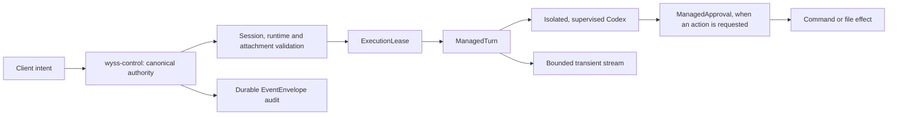

# 10 — Managed runtime and security

Domain C of [04](04-TARGET-ARCHITECTURE.md). Sections 1 to 4 describe the authority as built
`[R]`; nothing in them is changed by this set. Section 5 is the complete design of research
phase F1b. Section 6 lists future extensions, each of which needs its own ADR.

## 1. What the managed plane is



The chain is ADR 0018's (`0018:13-25`) `[R]`: every link belongs to the authority.

## 2. Security guarantees, as built

Each has a boundary of [04 §2](04-TARGET-ARCHITECTURE.md) and a way it is verified. This set
preserves all of them (FR-SEC-07).

| ID    | Guarantee                                                                                                           | Boundary | Enforced in                                                  | Verified by `[R]`                                      |
| ----- | ------------------------------------------------------------------------------------------------------------------- | -------- | ------------------------------------------------------------ | ------------------------------------------------------ |
| SG-01 | Only the authority allocates managed identities and commits control state                                           | B2 → B3  | `control/store.rs`; one SQLite writer (ADR 0011)             | Rust suite: storage and transition tests               |
| SG-02 | Execution is denied by default; a turn needs an active lease with the exact scope and an expiry of at most one hour | B3       | `control/leases.rs`, `control/gate.rs` (ADR 0013)            | Rust suite: gate and expiry tests                      |
| SG-03 | In Inference the model is offered no tool; any observed action or server request contains the runtime               | B3 → B4  | `adapters/codex/safety.rs`, supervisor (ADR 0015)            | Rust suite with a fixture; real turn `[O]`             |
| SG-04 | Inference starts only with zero enabled external hooks; unknown enablement is a rejection                           | B3       | `safety.rs:328-348`                                          | Rust suite                                             |
| SG-05 | Local Tools runs on a private Codex home in a namespace: no user configuration, rule, hook or MCP server            | B3 → B4  | `probe/isolation.rs` (ADR 0016 `:43-46`)                     | Rust suite with `bwrap`; real turns `[O]`              |
| SG-06 | In Local Tools nothing runs without an Accept the authority committed; the action is revalidated first              | B3       | `control/mediation.rs`, `turn_approvals.rs` (ADR 0016)       | Rust suite; approve and deny on the real machine `[O]` |
| SG-07 | The profile is proved again before readiness, every conversation, every turn and every Accept                       | B3 → B4  | Supervisor attestation (ADR 0016 `:60-65`)                   | Rust suite                                             |
| SG-08 | One credential crosses: a validated open descriptor of the user's `auth.json`; never read, copied or logged         | B3 → B4  | `probe/isolation.rs:123`, `:300`, `:471` (ADR 0018)          | Rust suite                                             |
| SG-09 | A state change whose audit record cannot be written is rolled back                                                  | B3       | ADR 0011 `:21-24`                                            | Rust suite: sabotage tests                             |
| SG-10 | Closing, crashing or restarting the window grants, revokes and changes nothing                                      | B2 → B3  | ADR 0002 `:50-51`; the authority is a separate service       | Lifecycle tests; exercised `[O]`                       |
| SG-11 | The desktop installs only the authority whose SHA-256 it was built with, from a place nobody else can write         | B2       | `lifecycle/install.rs`, `control/paths.rs` (ADR 0025)        | Rust suite; refusal seen on the real machine `[O]`     |
| SG-12 | No client can supply an executable, arguments, an environment, a workspace override or a tool                       | B2 → B3  | Typed protocol; unknown fields reject (ADR 0011, 0012, 0014) | Rust suite                                             |

What the core does **not** protect against, in its own words: another client of the same user,
another process of the same user, a compromised user (`0018:118-121`) `[R]`. The provider's
binary is trusted to enforce its own sandbox (`0018:123-127`) `[R]`.

## 3. State machines of the managed plane `[R]`

Recorded here for the reader; the ADRs are the source and rule where this summary differs.

| Object   | States                                                                                                                            | Notes                                                                                          |
| -------- | --------------------------------------------------------------------------------------------------------------------------------- | ---------------------------------------------------------------------------------------------- |
| Session  | `prepared` → `closed`                                                                                                             | Revision 1, then 2; closing cannot be undone (ADR 0011, 0020)                                  |
| Binding  | `unbound`, `creating`, `indeterminate`, `bound_detached`, `bound_attached`                                                        | One permanent Codex thread per session (ADR 0014); attachment is in memory and lost on restart |
| Runtime  | Desired: `running`, `stopped` (durable). Actual: `stopped`, `starting`, `initializing`, `ready`, `stopping`, `failed` (in memory) | One generation, one profile, one workspace (ADR 0012, 0016)                                    |
| Lease    | `active` → `revoked` or `expired`                                                                                                 | Scopes `session_create`, `session_resume`, `turn_start`; 1 to 3,600 s (ADR 0013 `:24-31`)      |
| Turn     | `starting` → `running` → `completed`, `interrupted`, `failed` or `indeterminate`                                                  | One at a time globally; a crash makes a running turn `indeterminate` (ADR 0015)                |
| Approval | Pending, then one decision: accept, decline or cancel; or it expires                                                              | One at a time; revalidated before the answer (ADR 0016). Expiry seen at five minutes `[O]`     |

### 3.1 Approval lifecycle

```mermaid
sequenceDiagram
  participant M as Model (in Codex)
  participant C as Codex runtime
  participant W as wyss-control
  participant D as Desktop
  participant U as User
  M->>C: wants to run a command
  C->>W: requestApproval (command, cwd)
  W->>W: validate: complete, confined to the workspace
  W->>W: commit ManagedApproval = pending (+ event)
  D->>W: read pending approvals
  W-->>D: the approval
  D-->>U: card: command, directory, deadline
  U->>D: Approve / Deny
  D->>W: respond (approval, revision, decision, intent id)
  W->>W: re-attest profile; re-validate action
  W->>W: commit decision (+ event)
  W->>C: exactly one answer
  C->>M: result
```

## 4. How the managed plane and the configuration engine relate

| Fact                                                                                                                                                                                                                                               | Consequence for the interface                                                                              |
| -------------------------------------------------------------------------------------------------------------------------------------------------------------------------------------------------------------------------------------------------- | ---------------------------------------------------------------------------------------------------------- |
| Local Tools loads none of the user's configuration (SG-05)                                                                                                                                                                                         | Wherever configuration is shown: "Managed Local Tools sessions do not use this"                            |
| Inference reads the user's real Codex configuration and requires zero hooks (SG-04)                                                                                                                                                                | On Codex hooks: "Managed Inference needs all of these disabled" with the current state                     |
| Inference passes `features.hooks=false` among fixed overrides (`0015:40-55`); a system requirement that pins hooks on defeats that, so definitions are counted (`0015:145-146`)                                                                    | The owner's machine has such a requirement `[O]`: the count is what protects it                            |
| The authority answers one generic code when Inference is not provable (`safety.rs:86`)                                                                                                                                                             | The desktop adds the cause when it knows it: enabled hooks declared (ADR 0028 §6)                          |
| The authority must not learn of user configuration (C-02)                                                                                                                                                                                          | The cause is computed in the desktop from the configuration engine; no control method is added             |
| Inference turns every MCP server of the user's Codex configuration off by name. More than 64 servers, or a name outside letters, digits, `_` and `-` or longer than 64, makes the profile unprovable (`safety.rs:78`, `:91-121`, `:197-199`) `[R]` | The prediction of managed effect covers MCP entries too, not only hooks (24, RV-08)                        |
| The hook check also fails on more than 64 hook sources or more than 256 definitions, **even if all are disabled** (`safety.rs:333-349`) `[R]`                                                                                                      | The same prediction counts sources and definitions                                                         |
| The desktop's prediction reads files; the authority's check reads the live runtime's answer                                                                                                                                                        | The desktop's result is always shown as "predicted", never as the authority's reason (24, RV-17)           |
| Managed Inference uses none of the user's Codex hooks and none of his MCP servers: every hook must be disabled and every server is switched off for that runtime (`safety.rs:222-224`, `:328-352`) `[R]`                                           | The view says so beside them. Nobody is to expect his global hooks or MCP servers inside a managed session |

## 5. F1b — Managed Inference independent of the user's hooks

Research and security design. **Nothing here is to be implemented or run under the present
authorisation.** Decision D7 names the goal; this section is the plan to find out whether it
can be met safely.

### 5.1 Goal and non-goals

Goal: native Codex runs the owner's real global hooks **and** a managed Inference turn
completes, with every guarantee of §2 intact and no fallback that weakens a check.

Not goals: changing what Inference may do; making hooks run inside managed Inference;
bypassing a system policy; changing Local Tools.

### 5.2 What is known

| #   | Fact                                                                                                                                                         | Evidence                  |
| --- | ------------------------------------------------------------------------------------------------------------------------------------------------------------ | ------------------------- |
| K1  | Inference inherits the user's environment and Codex configuration                                                                                            | `[R]` ADR 0012 `:111-113` |
| K2  | It already passes `-c features.hooks=false`, one of a fixed list of feature overrides                                                                        | `[R]` ADR 0015 `:40-62`   |
| K3  | A system requirement can pin `features.hooks = true`; the owner's does                                                                                       | `[D]`; `[O]`              |
| K4  | User hooks live in `~/.codex/hooks.json` or `[hooks]` in `~/.codex/config.toml`; project hooks load only if the project is trusted                           | `[D]`                     |
| K5  | Project trust is recorded in the user's `config.toml` (`[projects]`)                                                                                         | `[O]`                     |
| K6  | `CODEX_HOME` relocates Codex's state                                                                                                                         | `[D]`                     |
| K7  | Local Tools already runs with a private `CODEX_HOME`, the user's home hidden, an authority-owned `/etc/codex`, and one credential descriptor, inside `bwrap` | `[R]` ADR 0016 `:37-65`   |
| K8  | Codex 0.159.0 refreshes its token by writing `auth.json` in place and has no other non-interactive way to share a login                                      | `[R]` README `:725-727`   |
| K9  | System requirements can define managed hooks of their own                                                                                                    | `[D]`                     |
| K10 | The check counts enabled hook definitions of any source and rejects unknown enablement                                                                       | `[R]` `safety.rs:327-348` |

### 5.3 Candidate designs

| ID  | Design                                                              | Hooks seen by Inference                                                                              | Credential                                                                                                                  | System policy                                                  | New requirement on the host                      |
| --- | ------------------------------------------------------------------- | ---------------------------------------------------------------------------------------------------- | --------------------------------------------------------------------------------------------------------------------------- | -------------------------------------------------------------- | ------------------------------------------------ |
| I1  | Private `CODEX_HOME` by environment only, no namespace              | None of the user's (K4, K6); managed ones if the administrator defined any (K9)                      | **Problem**: the private home has no `auth.json`. A link to the user's file may be replaced by Codex's own write (K8) `[N]` | Obeyed unchanged                                               | None                                             |
| I2  | Inference inside the same namespace as Local Tools, with zero tools | None of the user's; none of the system's, because `/etc/codex` is replaced inside the namespace (K7) | Solved as today (SG-08)                                                                                                     | **Replaced inside the namespace**, as Local Tools already does | `bwrap` 0.11 becomes necessary for Inference too |
| I3  | Keep the user's home; neutralise hooks by override                  | Depends on policy                                                                                    | As today                                                                                                                    | A pinned `hooks = true` defeats it (K2, K3)                    | None                                             |
| I4  | Namespace as I2, but with the host's `/etc/codex` left visible      | None of the user's; the system's managed hooks stay                                                  | As I2                                                                                                                       | Obeyed                                                         | `bwrap`                                          |

I3 is what exists and is why the conflict exists. The research compares I1, I2 and I4.

### 5.4 The question of system policy

An isolated home does not override `/etc/codex/requirements.toml`, and must not.

| Case                                                                              | I1 and I4 (policy visible)                                                                                                                          | I2 (policy replaced in the namespace) |
| --------------------------------------------------------------------------------- | --------------------------------------------------------------------------------------------------------------------------------------------------- | ------------------------------------- |
| Policy pins the hooks engine on, defines no managed hook (the owner's case `[O]`) | The engine is on, zero definitions exist → the existing check passes unchanged `[N]` (to be measured, E2)                                           | Passes                                |
| Policy defines managed hooks                                                      | Definitions exist → the check fails → Inference is **unavailable**, correctly: an administrator required hooks and Inference cannot run them safely | Passes, by not seeing the policy      |
| Policy sets `allow_managed_hooks_only`                                            | No effect on the result above                                                                                                                       | Not seen                              |

I2 makes an administrator's policy invisible to managed Inference. Local Tools already does
this by an accepted decision (ADR 0016), on a machine where the administrator and the user are
the same person. For Inference it would be a new instance of the same choice and has to be
made explicitly, not inherited. **Recommended order of preference: I4, then I1, then I2**; I4
keeps the policy in force and reuses the proven credential path.

If the owner's own policy ever defines managed hooks, managed Inference would be unavailable
under I1 and I4. That is the correct outcome and the interface must say why. The supported
alternatives then are: remove the managed hook from the policy (the administrator's act, never
the Console's), or accept I2 by its own decision.

### 5.5 Experiments

To be run later, with authorisation, on a throwaway home and a throwaway project, never on the
owner's configuration. Each has a control that must fail.

| ID  | Question                                                                               | Method                                                                                                                                                                                                                 | Pass                                                                                           | Control that must fail                      |
| --- | -------------------------------------------------------------------------------------- | ---------------------------------------------------------------------------------------------------------------------------------------------------------------------------------------------------------------------- | ---------------------------------------------------------------------------------------------- | ------------------------------------------- |
| E1  | Does a private `CODEX_HOME` hide the user's hooks?                                     | A user home with one enabled hook; start the App Server with a private home; `hooks/list`                                                                                                                              | Zero entries                                                                                   | Same without the private home: one entry    |
| E2  | With `hooks = true` pinned by policy and a private home, does the existing check pass? | As E1 plus a requirements file pinning the engine on                                                                                                                                                                   | `zero_external_hooks` passes on the real answer                                                | Add a managed hook to the policy: it fails  |
| E3  | Can the credential be provided without a namespace (I1)?                               | Private home with a link to the credential; force a token refresh                                                                                                                                                      | The user's file is updated in place; the link is still a link                                  | — (if the link is replaced, I1 is rejected) |
| E4  | Does a trusted project's `.codex` reach Inference under a private home?                | A project with a hook, trusted in the user's home, not in the private one                                                                                                                                              | Not loaded                                                                                     | Trusted in the private home: loaded         |
| E5  | Does every other attestation of ADR 0015 still hold?                                   | The full preflight on the isolated start                                                                                                                                                                               | Every reflected setting as today; zero tools; zero MCP                                         | A catalogue with a tool: refused            |
| E6  | Does a real Inference turn complete, and a resumed one?                                | One turn, one resume                                                                                                                                                                                                   | Completed; the stored thread is found again                                                    | —                                           |
| E7  | Where do threads live, and are existing bindings still resumable?                      | Compare thread storage under the user's home and the private one                                                                                                                                                       | A stated answer; a migration rule or a stated break                                            | —                                           |
| E8  | Under I4, do the namespace and the visible policy coexist?                             | Local Tools' launcher with `/etc/codex` left visible                                                                                                                                                                   | The runtime reports the host's requirements                                                    | —                                           |
| E9  | Does the result hold for every source of policy and every form of MCP configuration?   | The matrix: user file, system requirements, any remotely managed requirements the provider supports `[N]`, managed hooks, `allow_managed_hooks_only`; MCP servers declared in each place and form the provider accepts | For every cell: the attestation of ADR 0015 holds, or Inference is unavailable with its reason | A cell with a managed hook: unavailable     |

E7 matters for compatibility: today's Inference threads are in the user's Codex home (K1). A
private home means existing managed sessions' threads are elsewhere. Either the binding rule of
ADR 0014 gets a documented break for sessions bound before the change, or the old threads are
made reachable read-only. This is a change to stored semantics and is why the result must be an
ADR.

### 5.6 The security contract to be written

The ADR that follows F1b must state, at least:

1. Which home, which `/etc/codex`, which environment variables and which working directory
   Inference gets, each fixed by the authority and none by a client.
2. That zero tools, zero MCP servers, zero enabled hooks and the fixed overrides are attested
   exactly as today, before readiness and before every turn.
3. How the credential crosses, with the same properties as SG-08, or why not.
4. That there is no fallback: if the isolated start cannot be proven, Inference is unavailable.
   It never retries on the user's home.
5. What happens to sessions bound before the change.
6. Which host requirements are added, and what the window says where they are missing.
7. Which system-policy cases make Inference unavailable, and the text shown.
8. That the Console's block on enabling Codex hooks is lifted only after this ships.
9. The matrix of E9 as a table of supported and unsupported cells, for the exact runtime
   version. No design that hides host policy from Inference is adopted without its own
   explicit, accepted decision.

### 5.7 Acceptance tests for the later implementation

| ID         | Test                                                                                                    |
| ---------- | ------------------------------------------------------------------------------------------------------- |
| AC-GINF-01 | With an enabled user hook in the real-shaped fixture home, a managed Inference turn completes           |
| AC-GINF-02 | The same hook runs in a native Codex session started in the same fixture                                |
| AC-GINF-03 | Every isolation and sabotage test of the existing suite passes unchanged                                |
| AC-GINF-04 | Removing the isolation (a deliberate regression) makes AC-GINF-01 fail with `inference_safety_unproven` |
| AC-GINF-05 | A system policy that defines a managed hook makes Inference unavailable, and the window says why        |
| AC-GINF-06 | No path exists by which Inference starts on the user's home after a failed isolated start               |
| AC-GINF-07 | A session bound before the change behaves as the ADR states                                             |
| AC-GINF-08 | Only after these pass does the configuration engine offer "enable" on a Codex hook                      |

### 5.8 If it cannot be done safely

The gate stays. The supported alternatives, each the owner's to choose: keep Codex hooks
disabled and use Claude Code for hook-driven work; use managed Local Tools, which is already
independent of user hooks (SG-05), for managed Codex work that needs tools; or reconsider the
explicit trade that D7 set aside.

### 5.9 What interacts, and must be studied together (DN-19)

Until gate G-INF is resolved and separately approved, the Console shows the state of each Codex
hook where it can be read, changes none of them, says why, changes nothing in the authority and
adds no weaker way for Inference to start. The goal is unchanged: native Codex with the owner's
real hooks, and managed Inference working beside it.

A private home is not, by itself, proof of anything. Each subject below can defeat a design
that handles the others.

| Subject                      | What is known                                                                                                     | What a design must establish                                                                                                       | Experiment |
| ---------------------------- | ----------------------------------------------------------------------------------------------------------------- | ---------------------------------------------------------------------------------------------------------------------------------- | ---------- |
| `CODEX_HOME`                 | It relocates Codex's state (K6)                                                                                   | That user hooks, user MCP servers and user profiles are then really absent, not merely unlisted                                    | E1, E4     |
| System-enforced policy       | A requirement can pin the hooks engine on and can define managed hooks (K3, K9). It is read from outside the home | That a private home neither hides nor bypasses it, unless hiding it is decided explicitly (§5.4)                                   | E2, E8, E9 |
| Hook enablement              | The check counts enabled definitions of any source and rejects an unknown state (K10)                             | That the count is taken on the isolated runtime's own answer, with no change to the check                                          | E2, E5     |
| Hook and source limits       | More than 64 sources or 256 definitions fail the check even when every hook is disabled (§4)                      | That a user with many hooks is no longer made unprovable by them once Inference does not see them                                  | E1, E5     |
| MCP configuration and limits | Every server is switched off by name; more than 64, or a name outside the allowed form, is unprovable (§4)        | The same for servers: none seen, in every place and form the provider accepts                                                      | E9         |
| Authentication               | The credential is refreshed by writing `auth.json` in place (K8); a private home has none                         | A way for the credential to cross with the properties of SG-08, or a namespace as Local Tools has                                  | E3, E8     |
| Trust by hash                | Project trust is recorded in the user's `config.toml` (K5); the schema of the hook state is not known (OQ-20)     | That nothing in the isolated home is taken as trusted because the user's home trusted it, and that no trust record is ever written | E4         |
| Existing attestations        | Every reflected property of ADR 0015 is proven before readiness and before each turn                              | That each one still holds on the isolated start, unchanged, and that a failed isolated start never falls back to the user's home   | E5, E6     |
| Stored sessions              | Today's Inference threads live in the user's home (K1)                                                            | What happens to bindings made before the change (ADR 0014)                                                                         | E7         |

None of these experiments is authorised. Lifting the block on a Codex hook is acceptance test
AC-GINF-08 and follows all the others.

## 6. Future extensions of the managed plane

None is designed in detail here; each needs an ADR, a safety contract and evidence.

| Extension                                  | Requirement | What it would change                                                                                                                                                       | Main risk                                                                                               |
| ------------------------------------------ | ----------- | -------------------------------------------------------------------------------------------------------------------------------------------------------------------------- | ------------------------------------------------------------------------------------------------------- |
| Observed model per turn in the projection  | FR-MOD-04   | The authority's view (ADR 0019); the adapter already normalises an observed model (`adapters/codex/normalize.rs:197-211`) but it is dropped before the control plane `[R]` | A new field in a strict contract                                                                        |
| Several runtimes or turns                  | FR-MAN-08   | Runtime ownership (ADR 0012), the one-turn index (ADR 0015)                                                                                                                | Every attestation is per generation; cost and contention                                                |
| A managed profile that admits chosen rules | —           | The private home's content                                                                                                                                                 | Anything loaded becomes part of what must be attested                                                   |
| A second managed agent                     | FR-MAN-09   | A new execution adapter and its isolation                                                                                                                                  | A provider without an equivalent of the App Server's attestation cannot be managed to the same standard |

## 7. What must be re-verified when the provider changes

Managed execution accepts Codex 0.159.0 only (ADR 0015 `:40`) `[R]`. A new version needs: the
protocol schema compared, the override list re-derived, the attestation re-run on the real
binary, and the acceptance run of ADR 0018 repeated. Until then it fails closed. The
configuration adapter's evidence for Codex is separate (06 §6): reading files of a newer Codex
does not make it manageable.
