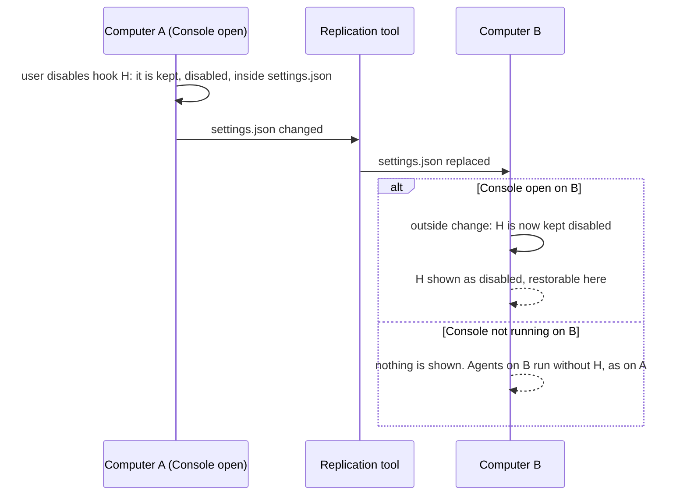
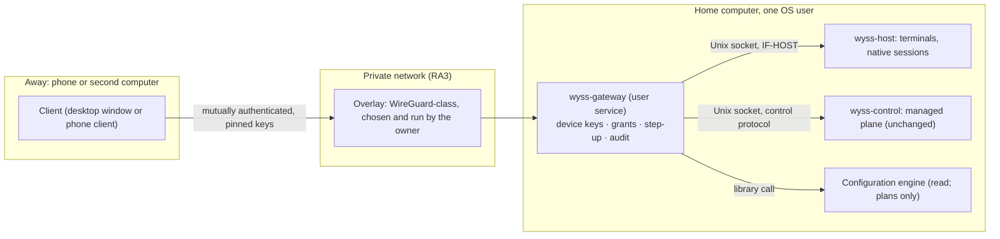

# 16 — Multi-device and remote

> **2026-10-22 consolidation:** this document retains dated design/evidence and detailed
> contracts. Its present-tense status/decision tables describe their stated baseline,
> not necessarily current implementation. Read the [current product set](../product/README.md),
> [verified gaps](../product/implementation-status.md) and [requirement crosswalk](../product/traceability.md)
> first. F8 is active P2/V8, ADR0051 Accepted, cap1; P1 remains available. New product
> direction does not supersede accepted security ADRs or turn proposed tests into PASS.

Domains M (several computers) and N (remote control) of [04](04-TARGET-ARCHITECTURE.md), with the
host-owned terminals (F9) that remote access needs.

**Revision of 2026-10-13 (fifth planning pass).** The first version stated requirements and
options. This one specifies the final-product design:

- the host service (§4);
- the alternatives of DN-05 (§5.1);
- device identity, pairing, revocation and recovery (§5.2);
- remote grants and their limits (§5.3);
- several computers (§2.4, §2.5);
- a dedicated threat model (§7);
- the mobile client's screens (§8);
- tests and acceptance, specified in 20.

It was written by the author of the set and is **unreviewed**.

**Status.**

- Sections 3 to 8 are a design for phases F9, F10a and F10b. They are not authorised.
- Every architectural choice in them is a **recommendation**. The owner decides it (DN-05, DN-44
  to DN-48).
- Each phase needs its own ADR first (§11).
- Nothing here was run: no service, listener, tunnel or device.
- Everything is `[P]` unless marked.

## 1. Two different things, and one that is not part of this product

| Topic                        | What it is                                                                     | Exists today                                                                                        |
| ---------------------------- | ------------------------------------------------------------------------------ | --------------------------------------------------------------------------------------------------- |
| **Replicated configuration** | Provider files copied between computers by a tool the Console does not control | Yes: the owner uses Syncthing on the home directory `[O]` (30 §6)                                   |
| **Remote control**           | Using one computer's terminals, sessions and approvals from another device     | No. The authority speaks only over a private Unix socket to the same user `[R]` (ADR 0011 `:13-14`) |
| Remote desktop               | Controlling a computer's graphical session                                     | The owner has a remote-desktop system of their own `[O]`                                            |

The first two are independent. The first must be handled correctly from F1. The second is phases
F9 and F10.

**Remote desktop is not part of Wyss Console:**

- Remote terminal access is not a remote desktop. Remote control here means terminals, sessions,
  agents and approvals, never the screen.
- The owner's remote-desktop system stays an **independent product**. Wyss Console does not
  replace it, does not use it as a transport, does not start it, and does not depend on it.
- Neither product's security rests on the other.

## 2. Several computers

### 2.1 What replication looks like to the Console

| Event from the replication tool                                    | Seen as                                                | Handling                                                                                          |
| ------------------------------------------------------------------ | ------------------------------------------------------ | ------------------------------------------------------------------------------------------------- |
| A file replaced by a newer copy                                    | An atomic replacement: a new inode under the same name | An outside change (07 §7)                                                                         |
| A file deleted on the other computer                               | A deletion                                             | Confirmed after a short delay, then reported                                                      |
| A conflict copy created (`<name>.sync-conflict-<date>-<id>.<ext>`) | A new file with a recognisable name                    | The source becomes `conflicted`; mutations blocked; both files named (FR-SYNC-02)                 |
| The tool's own temporary files                                     | Short-lived files with the tool's prefix               | Ignored by name pattern; the pattern list is configurable and not Syncthing-specific (FR-SYNC-04) |
| A burst of many files                                              | Many events                                            | Debounced; an overflow falls back to one rescan                                                   |

The Console does not know which tool is at work, or whether any is. It recognises conflict copies
by a list of patterns shipped with defaults for common tools and extensible by the user. The exact
patterns are `[N]` (OQ-13).

### 2.2 The case of the second computer

The Console's own state is per computer and must never be replicated (ADR 0028 §7) `[R]`.

**What is known on the owner's computers (corrects C7):**

- The state directory sits under a replicated folder whose root is the whole home directory.
- It is named by an ignore rule in an ignore file that each computer keeps for itself `[O]`
  (30 §6, TV-19).
- **An ignore rule is evidence, not proof** that the directory is never replicated. A rule can be
  edited, replaced or reset, and a second tool or a new folder share is not bound by it (TV-29,
  not authorised).
- The same directory is also inside filesystem snapshots (30 §6).
- Where the state directory, the vault and the transaction directory may be is **DN-31,
  unresolved**.

Rungs of ADR 0029 (proposed):

- **Rungs 1 and 2:** the state holds no configuration content, and nothing about a disabled entry
  depends on it.
- **Rung 3:** the state holds the entry, sealed in the protected vault
  ([27](27-PROTECTED-RESTORATION-VAULT.md)), and the two computers stop being symmetric.

The diagram is the case of rungs 1 and 2. On rung 3, B receives a file without H, shows it as
removed outside, and cannot restore it: only A can (27 §9.2).

| Case                                                    | What B can do                                                                                                                                                                                                                                                                                                                   |
| ------------------------------------------------------- | ------------------------------------------------------------------------------------------------------------------------------------------------------------------------------------------------------------------------------------------------------------------------------------------------------------------------------- |
| An entry disabled on A and kept in the file             | Restore it on B: the entry is in the file B received. Nothing has to be exported                                                                                                                                                                                                                                                |
| An entry disabled on A with a native switch             | The same: the switch is in the file                                                                                                                                                                                                                                                                                             |
| An entry disabled on A into A's vault (rung 3)          | Nothing: B sees it removed from outside and says it can be restored on the computer that disabled it. An encrypted export from A is designed and not offered at first (§2.3)                                                                                                                                                    |
| An entry removed on A by hand, in an editor             | B sees it removed from outside. It is not restorable from the Console, unless the user had chosen to keep a recovery copy of that entry: then the computer that holds the copy, and only that one, can recover it (27 §3.6)                                                                                                     |
| Restored on B                                           | The file changes on A through replication; A sees the entry enabled                                                                                                                                                                                                                                                             |
| Both computers changed the same file while disconnected | If the replication tool leaves a conflict copy that the Console recognises, the Console there blocks mutations of that file until the user resolves it, and says that this is done outside. A tool that settles the conflict by itself leaves nothing to recognise: the Console sees an outside change and nothing more (OQ-13) |
| A change made on A is replaced by B's older version     | A sees an outside change that undid its last operation and says so: "your change was replaced by a version from another computer"; applying it again is offered                                                                                                                                                                 |
| The user wants the hook off on A and on on B            | Not possible while the file is replicated: it is one file. The Console says so; a session profile (09) is the way to differ per session, and an exclusion in the replication tool is the way to differ per computer                                                                                                             |
| The provider on B is another version than on A          | The kept form must be tolerated by both: check V7 of ADR 0029 §5. The Console on A cannot see B's version; it reminds the user when the file is known to change from outside                                                                                                                                                    |

What the Console on A can never know is which sessions on B adopted a change. It says "this file
may be used on other computers; their sessions are not visible here" whenever it has seen a
conflict copy or an outside change it did not cause.

### 2.3 Export and import of held entries

**On rungs 1 and 2**, a disabled entry travels with its file and nothing needs exporting.

**On rung 3** it does not travel: the vault is per computer and is never replicated. ADR 0028 §7
and FR-CFG-15 ask for a disabled entry to be carried to the other computer by an explicit act.
That is designed as an encrypted export and import of vault records
([27 §9.3](27-PROTECTED-RESTORATION-VAULT.md)):

- a file sealed under a passphrase the user types;
- authenticated as a whole;
- imported as untrusted executable content, shown whole before any restoration.

It is **not offered in the first vault phase** (DN-29). This pass does not change that.

- The replication tool's own history of versions, and filesystem snapshots, are not a recovery
  mechanism of this design. They may hold an entry or not; the Console neither reads them nor
  counts on them.
- A remote device sees at most the metadata of what a host holds (§5.3). Restoring, showing,
  exporting and deleting held entries are not remote capabilities (27 §9.4; CTL-38).
- Session profiles keep their own export and import (09 §4.5); they hold references and no entry.

### 2.4 What differs between the owner's two computers

Each computer runs its own Console, its own authority, and (from F9) its own host service. Nothing
below is shared except what the replication tool copies.

| Aspect                         | Per computer, never shared                                                                                                                                                                                       | What the Console does                                                                                                                                                                                                     |
| ------------------------------ | ---------------------------------------------------------------------------------------------------------------------------------------------------------------------------------------------------------------- | ------------------------------------------------------------------------------------------------------------------------------------------------------------------------------------------------------------------------- |
| Provider installations         | Which agents are installed, and their versions. Two of the owner's files are already kept per computer by ignore rules (`~/.codex/config.toml`, `~/.claude.json`, `~/.claude/settings.local.json`) `[O]` (30 §6) | Each Console reads its own installations. Evidence is per version (06 §6). A file valid for the version on A may be read by an older or newer version on B; the Console on A cannot see B's version and does not claim to |
| Configuration files            | Files outside replication differ by design. Replicated files are the same bytes only after the tool has copied them                                                                                              | Each file is read as it is on this computer. Two computers are never merged into one view                                                                                                                                 |
| Native session registry        | Per computer, in the host's state (from F9) or the desktop's (before)                                                                                                                                            | A remote client sees one host's registry at a time (S15). Sessions of A are never listed as B's                                                                                                                           |
| Protected restoration vault    | Per computer (27 §9.2). Its key is in that computer's keyring                                                                                                                                                    | **No global or shared vault is created**, by replication or by any remote path. Export between computers stays deferred (DN-29)                                                                                           |
| Keyrings and security contexts | Different keyring implementations and versions: KWallet 6.30.0 on Acer, 6.31.0 on Santiago-PC `[O]` (30 §6). Different system policies under `/etc`, not replicated `[O]`                                        | A security context is never assumed equal on the other computer. Each Console states its own                                                                                                                              |
| Device registry and grants     | Per host gateway (§5.2)                                                                                                                                                                                          | A device paired with A is not paired with B. Pairing is per host                                                                                                                                                          |
| Audit                          | The authority's stream, the configuration journal and the gateway's journal are each per computer                                                                                                                | Never merged across computers (AD-11)                                                                                                                                                                                     |

### 2.5 Concurrency and stale observations across computers

Rules that hold in every phase:

1. **The replication tool is not transactional storage.**
   - It copies files when it sees them, in its own order, with its own conflict rule.
   - The Console never uses it to carry state between its own instances.
   - It never relies on it for ordering, atomicity or delivery.
   - It never writes a file in order to signal another computer.
2. **An observation is as of its read.**
   - Every value shown carries the time it was read (12 §1.6; 07 §7).
   - A plan made on A against a file is checked again against the file's identity and bytes at
     write time (07 §5.4). If replication changed the file meanwhile, the plan is refused as
     stale (`plan_expired`).
3. **Direct writes to a provider's file stay blocked** until the write protocol is unblocked
   (L1, L2, L5; DN-21; DN-31). Nothing in this document unblocks them. A remote request cannot
   cause one either (§5.3).
4. **A concurrent change on two computers** is resolved by the replication tool, or left as a
   conflict copy. The Console shows what it can recognise (§2.1) and never arbitrates.
5. **No cross-computer locking.** A computer cannot know whether the other one is about to write.
   The Console says so where it matters (§2.2) and does not pretend to coordinate.

## 3. Remote control: what is wanted

The owner's scenario `[O]`:

- The desktop stays on at home.
- From the university, a phone or another computer, the owner:
  - sees projects and processes;
  - gives objectives to agents;
  - reads results;
  - approves or denies actions;
  - reconnects later.

The work belongs to the computer that runs it, not to the screen that shows it.

This needs, in order:

1. Terminals and native sessions that do not belong to a window (F9, §4).
2. A way for another device to reach a computer, with per-device identity and grants (F10a, §5).
3. A phone client (F10b, §8).

## 4. The host service (F9)

### 4.1 Ownership and lifecycle

| Element          | Design                                                                                                                                                                                                                                                                                                                                                                                 |
| ---------------- | -------------------------------------------------------------------------------------------------------------------------------------------------------------------------------------------------------------------------------------------------------------------------------------------------------------------------------------------------------------------------------------- |
| What it is       | `wyss-host`, a user-level process that owns PTYs, their child process groups, the bounded scrollback of each, and the native session registry. Recommended shape: HS1 (§5.1)                                                                                                                                                                                                           |
| What it is not   | Not the authority. It holds no lease, approval or managed state, and never connects to the managed runtime (AD-15). Not a network service: it listens on one Unix socket only, never on a network interface. Not a terminal emulator for the page: it moves bytes                                                                                                                      |
| Who runs it      | The user's service manager (`systemd --user`, AS4), as a user unit, started on demand when the window first needs a terminal. The window can also run without it (fallback below)                                                                                                                                                                                                      |
| Its clients      | The desktop window; from F10a, the gateway (§5). Each is a client over the same local protocol (§4.4). ADR 0002 allowed for this: terminal resources "may temporarily live in-process during terminal-only sprints" `[R]` (`0002:28-46`)                                                                                                                                               |
| When it stops    | (a) only after 60 seconds with no live PTY, no active/paused/waiting/recovering OL3 run and no required client (coordinator renewable keepalive); (b) on an explicit stop from the local window, after the confirmation of 05 §11.6 listing running programs; (c) when the user's service manager stops, at logout, unless the owner enables lingering (DN-46); (d) on a crash (§4.11) |
| Fallback         | If the host service cannot start, the window offers its in-process terminals as today (ADR 0005), each marked "This terminal closes with the window". Never silently: the user sees which kind each terminal is                                                                                                                                                                        |
| Native behaviour | Programs run in real PTYs with real process groups, exactly as in the window today (05 §1). Nothing is simulated: no chat transcript stands in for a terminal, and an agent's terminal is the agent's own terminal user interface                                                                                                                                                      |

### 4.2 Identities

| Identity          | Issued by             | Lifetime                                                                                  | Rule                                                                                                                                                                                     |
| ----------------- | --------------------- | ----------------------------------------------------------------------------------------- | ---------------------------------------------------------------------------------------------------------------------------------------------------------------------------------------- |
| `HostInstanceId`  | The host, at start    | One run of the host process                                                               | Fresh UUID per start. A client that sees a new one knows every terminal of the old instance ended                                                                                        |
| `TerminalId`      | The host              | The terminal's life; never reused                                                         | UUID. Valid only with the `HostInstanceId` that issued it. Not a capability: knowing it grants nothing, because every operation also needs an attachment and the client's rights (§4.4)  |
| `NativeSessionId` | The host's registry   | Durable record (05 §5)                                                                    | UUID, as 05 §5 defines it; the registry moves from the desktop to the host in F9 (14 §3 changes owner, not content). A PID is an observation, never an identity                          |
| `ClientId`        | The client            | One process of the client; reused on reconnect                                            | Informational, as the authority's client instance UUID (ADR 0011). **Not** proof of anything                                                                                             |
| `ConnectionId`    | The host              | One socket connection                                                                     | Fresh per accept                                                                                                                                                                         |
| `AttachmentId`    | The host              | One client's attachment to one terminal, until detach, expiry, revocation or terminal end | Fresh UUID with an `epoch` counter (§4.6). Every input, read and resize names it                                                                                                         |
| `Principal`       | The connecting client | Per attachment                                                                            | `local_window` or `device:<DeviceId>` stamped by the gateway. Used for attribution and for the input and resize rules. It is a same-user claim, **not** an authorisation boundary (§4.4) |

### 4.3 PTY creation, supervision and termination

Everything of ADR 0005 and 05 §1 carries over unchanged unless stated here:

- creation from a canonical existing directory, never a fallback;
- `portable-pty` on Unix;
- SIGHUP to the foreground and shell groups on close, SIGKILL after 500 ms, reaping, `close_timeout`;
- tombstones of closed terminals (at most 128).

| Event                                  | Host                                                                                                                          | Clients                                                                                |
| -------------------------------------- | ----------------------------------------------------------------------------------------------------------------------------- | -------------------------------------------------------------------------------------- |
| `terminal.create`                      | Validates (§4.4), spawns the shell or the native start recipe (05 §17), registers the terminal and, for an agent, the session | The creating client receives the TerminalId and an interactive attachment              |
| The child exits                        | Reaps it; keeps the scrollback and final screen; state `exited` with code or signal; for an agent, the session `exited`       | Every attachment receives the end; input is refused (`terminal_not_running`)           |
| `terminal.close` by an entitled client | ADR 0005 close: input stops, SIGHUP, escalation, reap, buffers released                                                       | Every attachment ends with `terminal_closed` and the closing principal                 |
| The last client detaches               | **Nothing.** The terminal keeps running and its output keeps being drained into scrollback (§4.8)                             | —                                                                                      |
| Host stop, graceful                    | Closes every terminal as above, then marks running agent sessions `exited` (SIGHUP)                                           | `host_stopping` and then the connection closes                                         |
| Host crash                             | Masters close; the kernel sends SIGHUP to foreground groups; nothing is reaped by the host                                    | The connection drops. At the next start, running sessions become `lost` (05 §5; §4.11) |

A detached process (05 §16.3) stays outside the host's reach, exactly as it is outside the
window's today.

### 4.4 Local IPC protocol and authorisation (IF-HOST)

**Transport:**

- A Unix stream socket `$XDG_RUNTIME_DIR/wyss-console/host.sock`, mode 0600, in a 0700 directory.
- Peer credentials are checked against the host's effective UID before any frame is read. The
  client checks the server the same way.
- Stale-socket recovery follows ADR 0011's rules `[R]`.
- No other listener exists.

**Framing:**

- Length-prefixed frames of at most 80 KiB.
- **Control frames** are strict JSON: `schema_version`, a UUID `request_id`, `method`, typed
  `params`; unknown fields are rejected.
- **Output frames** are binary: TerminalId, AttachmentId, the first and last stream offset, the
  bytes. The JSON integer-per-byte encoding of ADR 0005 does not cross this socket.

**Authorisation:**

- The boundary is the **same OS user**, as for the authority (ADR 0011: "a local access boundary,
  not protection from a compromised" same-user process).
- Any process of the user may connect and do anything a client may. This adds no capability: such
  a process can already run commands as the user.
- **Remote grants are enforced by the gateway, not by the host (§5.3).** The host records the
  principal the gateway names, and applies the input and resize rules by principal. It does not
  treat the claim as proof.

| Operation                | Input                                                                                                                                                                                                                      | Output                                                                                         | Who may                                                            | Errors                                                                                                |
| ------------------------ | -------------------------------------------------------------------------------------------------------------------------------------------------------------------------------------------------------------------------- | ---------------------------------------------------------------------------------------------- | ------------------------------------------------------------------ | ----------------------------------------------------------------------------------------------------- |
| `hello`                  | Protocol version; client kind (`window`, `gateway`); ClientId                                                                                                                                                              | HostInstanceId; protocol; limits (§4.12)                                                       | Any same-UID peer                                                  | `host_version_mismatch`, `too_many_clients`                                                           |
| `terminal.list`          | Cursor, limit ≤ 64                                                                                                                                                                                                         | Terminals: id, state, title (sanitised, 05 §14), size, attachment count, input owner principal | Any client                                                         | —                                                                                                     |
| `terminal.create`        | Project id or a canonical directory chosen by the user; size (1 to 512); shell, or a native start request (05 §17.2)                                                                                                       | TerminalId; an interactive AttachmentId                                                        | `window`; `gateway` only for a device with `terminal.write` (§5.3) | `cwd_invalid`, `spawn_failed`, `too_many_terminals`, `budget_exhausted`, IF-NATIVE's errors (05 §4.2) |
| `terminal.attach`        | TerminalId; mode `view` or `interactive`; size if interactive; `resume_from` offset or null                                                                                                                                | AttachmentId, epoch; PTY size; retained offset range; input owner                              | Any client; the gateway checks `terminal.read` or `terminal.write` | `unknown_terminal`, `too_many_attachments`                                                            |
| `terminal.read`          | AttachmentId; acknowledgement of the last batch                                                                                                                                                                            | An output frame, an end, or a `gap` (§4.8)                                                     | The attachment's holder                                            | `attachment_expired`, `stale_ack`                                                                     |
| `terminal.input.claim`   | AttachmentId (interactive)                                                                                                                                                                                                 | Granted with a new epoch, or refused with the current owner                                    | §4.6                                                               | `input_claim_refused`, `not_interactive`                                                              |
| `terminal.write`         | AttachmentId, host/terminal generation, gateway instance, input claim epoch, monotonic batch sequence, request ID and 1–4,096 bytes; writer receipt with exact accepted-byte count or `outcome_unknown` on ambiguous write | Accepted                                                                                       | The current input owner, with its current epoch                    | `not_input_owner`, `stale_epoch`, `input_saturated`, `terminal_not_running`                           |
| `terminal.input.release` | AttachmentId                                                                                                                                                                                                               | —                                                                                              | The owner                                                          | —                                                                                                     |
| `terminal.resize`        | AttachmentId; rows, columns (1 to 512)                                                                                                                                                                                     | The size now in force                                                                          | §4.7                                                               | `not_size_owner` (the size is unchanged), `rate_limited`                                              |
| `terminal.detach`        | AttachmentId                                                                                                                                                                                                               | —                                                                                              | The holder                                                         | —                                                                                                     |
| `terminal.close`         | TerminalId                                                                                                                                                                                                                 | Closed, or `close_timeout`                                                                     | `window`; `gateway` only for a device with `terminal.write`        | `already_closed`, `close_timeout`                                                                     |
| `native.*`               | IF-NATIVE of 05 §7.2, unchanged                                                                                                                                                                                            | As there                                                                                       | `window`; the gateway for `sessions.read` (read operations only)   | As there                                                                                              |
| `watch`                  | A cursor                                                                                                                                                                                                                   | Changes to the terminal list and session states, without content                               | Any client                                                         | `cursor_expired`                                                                                      |
| `host.stop`              | —                                                                                                                                                                                                                          | Stopping                                                                                       | `window` only                                                      | —                                                                                                     |

A protocol violation closes the connection: a malformed frame, an unknown field, a frame over
the bound, or a write on an attachment of another connection.

### 4.5 Attaching, detaching, reconnecting; several viewers

- Several clients may attach to one terminal: the window on this computer, a second window, and
  devices through the gateway. At most **8 attachments per terminal** and **32 per connection**.
- An attachment is `view` or `interactive`. A `view` attachment never writes and never resizes.
- **Reconnecting** is a new connection and new attachments. A client that knows the last offset
  it rendered passes it as `resume_from`:
  - If that offset is still retained, the host sends from there.
  - If not, the host sends a `gap` and the oldest retained offset (§4.8).
  - Nothing a disconnected client sent is replayed (§4.6).
- **Two windows** (on one computer, or one local and one remote) are independent views. Moving
  between them changes nothing in the terminal except through the input and size rules below
  (FR-SES-03).

### 4.6 Input ownership

One writer per terminal at a time, so that two keyboards never interleave bytes.

| Rule | Content                                                                                                                                                                                                                                                                                             |
| ---- | --------------------------------------------------------------------------------------------------------------------------------------------------------------------------------------------------------------------------------------------------------------------------------------------------- |
| IO1  | A terminal has at most one **input owner**: an interactive attachment, with an `epoch` that increases at every change of owner                                                                                                                                                                      |
| IO2  | The creator of a terminal is its first owner                                                                                                                                                                                                                                                        |
| IO3  | A **local** claim (principal `local_window`) is granted at once, pre-empting any remote owner. The person at the computer can always take the keyboard back                                                                                                                                         |
| IO4  | A **remote** claim is granted only if there is no owner, or the owner has sent nothing for 10 seconds, or the owner releases. While a remote principal owns input, every local view of that terminal shows "Typing from <device>" with a one-key "Take back"                                        |
| IO5  | A write must carry the owner's current epoch. A write with an older epoch is refused (`stale_epoch`). This is how keystrokes queued before a change of owner, or before a disconnect, are discarded and never replayed                                                                              |
| IO6  | A write is applied whole or refused whole (1 to 4,096 bytes). The per-terminal input bound of ADR 0006 (64 KiB including the write in flight) applies across all writers. Saturation refuses (`input_saturated`) and does not close the terminal, unlike today's in-window rule; the client is told |
| IO7  | Ownership ends on release, detach, attachment expiry, revocation of the device, or the terminal's end                                                                                                                                                                                               |
| IO8  | Paste from a remote client uses bracketed paste when the program enabled it, exactly as the local renderer does. A multi-line paste from a phone needs a confirmation on the phone ("Send 12 lines?")                                                                                               |

### 4.7 Resize ownership

A PTY has one size. Clients differ.

| Rule | Content                                                                                                                                                                                     |
| ---- | ------------------------------------------------------------------------------------------------------------------------------------------------------------------------------------------- |
| RZ1  | The **input owner sets the size**. The client that types sees the layout the program draws for it                                                                                           |
| RZ2  | With no input owner, the most recently attached **interactive** local attachment sets it. A `view` attachment never resizes: a phone that only watches never shrinks the desktop's terminal |
| RZ3  | Every other attachment renders at the PTY's size. Wider: blank margin. Narrower: horizontal scrolling or a fitted font in the client. It is told the size and that it is not the owner      |
| RZ4  | Resizes are coalesced and applied at most once per 50 ms per terminal; over-frequent requests get `rate_limited`, and the last one in a window wins                                         |
| RZ5  | A change of owner applies the new owner's size at once, so the program redraws for it (SIGWINCH). This is also how an attach after a gap gets a correct screen (§4.8)                       |

### 4.8 Output, acknowledgement and scrollback

| Element        | Design                                                                                                                                                                                                                                                                                                                                                                             |
| -------------- | ---------------------------------------------------------------------------------------------------------------------------------------------------------------------------------------------------------------------------------------------------------------------------------------------------------------------------------------------------------------------------------- |
| Draining       | The host reads every PTY continuously into that terminal's **scrollback ring**, whether or not anyone is attached. An agent left working while nobody watches does not block on its output. For host-owned terminals this **replaces** the window's rule that a full ring stops reading (ADR 0005; 05 §16.4), which stays true of in-window terminals (C16)                        |
| The ring       | Bytes with a monotonic 64-bit offset. Default 1 MiB per terminal; a preference from 256 KiB to 8 MiB. One total budget across terminals (default 64 MiB). When the total is reached, the rings of terminals with no attachment shrink first, down to 256 KiB, then new terminals are refused (`budget_exhausted`). Its relation to DN-40's global bound is stated in that decision |
| Reading        | Per attachment, a pull with acknowledgement, as ADR 0005 and 0006 define it for one consumer: at most **4 unacknowledged batches** of at most 16 KiB each. A slow client holds its own credit only; it never slows the program or another client                                                                                                                                   |
| Falling behind | When an attachment's next offset has left the ring, the host sends `gap(from, to)` and continues from the oldest retained offset. The client shows "Output skipped while you were away (N KiB)", resets its parser state, and, if interactive and owner, sends its size so the program redraws (RZ5). It never claims the screen is complete before that                           |
| Content        | Never interpreted by the host: no parsing, no decoding, no search. Escape sequences reach each client unchanged; each client's renderer applies 05 §13 and §14 (OSC 52 refused, titles sanitised). The host-side screen model is DN-47                                                                                                                                             |
| Persistence    | **None.** Scrollback is terminal content (A8) and lives only in the host's memory. It ends with the terminal or the host. It is never written to disk, logged, or sent to the gateway's journal                                                                                                                                                                                    |

### 4.9 Slow, disconnected and malicious clients

| Client behaviour                                           | Host response                                                                                                                                         |
| ---------------------------------------------------------- | ----------------------------------------------------------------------------------------------------------------------------------------------------- |
| Slow reader                                                | Bounded by its own 4 batches; falls behind; receives a `gap` (§4.8)                                                                                   |
| Silent connection                                          | A heartbeat every 15 s in each direction. After 45 s without a frame, the connection is closed and its attachments expire; input ownership ends (IO7) |
| Disconnected mid-write                                     | The write is applied whole or not at all (IO6); nothing is retried by the host                                                                        |
| Flooding input                                             | Bounded by IO6 and by at most 8 pending requests per connection; beyond that, `rate_limited`                                                          |
| Resize storm                                               | RZ4                                                                                                                                                   |
| Malformed or oversized frames, unknown fields, bad offsets | The connection is closed (`protocol_violation`), and a closed word with the ClientId is recorded in the host's diagnostics                            |
| Many connections                                           | At most 16 client connections; then `too_many_clients`                                                                                                |
| A compromised same-user client                             | Not contained: it is the user (§4.4). The host limits only the resources it can exhaust                                                               |

### 4.10 What is persistent and what is not

| Durable (host state directory, per computer, never replicated; its placement waits for DN-31) | Volatile (memory only)                                                                                                                     |
| --------------------------------------------------------------------------------------------- | ------------------------------------------------------------------------------------------------------------------------------------------ |
| The native session registry (05 §5; 14 §3), moved from the desktop                            | PTYs, rings, attachments, input owners, epochs, HostInstanceId, connection state                                                           |
| The host's diagnostics, closed words only                                                     | Scrollback (§4.8)                                                                                                                          |
| —                                                                                             | Layout stays the window's (05 §15): it names TerminalIds with their HostInstanceId and falls back to new shells when that instance is gone |

### 4.11 Start, restart, crash and shutdown

| Situation            | Behaviour                                                                                                                                                                                                                                                                                                    |
| -------------------- | ------------------------------------------------------------------------------------------------------------------------------------------------------------------------------------------------------------------------------------------------------------------------------------------------------------ |
| First start          | Socket activation or an explicit start by the window. A lock beside the socket ensures one instance; a second instance exits                                                                                                                                                                                 |
| Start after any stop | New HostInstanceId. Old PTY master is lost; OS child exit must be **observed**, not inferred. Detached descendants may still exist as `ORPHANS_POSSIBLE`. Clients say "Terminal service restarted; the PTY is gone, other processes may still be running." Duplicate launches blocked pending reconciliation |
| Crash                | Restart attempts bounded by the manager; on exhaustion expose `HOST_UNAVAILABLE`. PTY loss may send SIGHUP to foreground jobs but **does not prove every descendant terminated**. Do not offer an automatic replacement while effects are ambiguous                                                          |
| Upgrade              | The host is replaced only when it has no terminal, or after the user confirms closing them (as the authority's `update pending` `[R]`). Keeping PTYs across a restart by handing their descriptors to the service manager is OQ-52, not designed                                                             |
| Logout               | As the user's service manager decides (DN-46). Without lingering, terminals end at logout as they would with the window                                                                                                                                                                                      |
| Graceful stop        | `host.stop` from the window, with 05 §11.6's confirmation; or idle exit (§4.1)                                                                                                                                                                                                                               |

### 4.12 Resource limits and performance constraints

All are proposals until measured (15). Metrics for the host are to be added to 15 when F9 is
planned (X13).

| Resource             | Bound                                                                                                                                     |
| -------------------- | ----------------------------------------------------------------------------------------------------------------------------------------- |
| Terminals per host   | 64 (the window today: 16, ADR 0007)                                                                                                       |
| Scrollback           | §4.8: 1 MiB default each, 64 MiB total                                                                                                    |
| Clients, attachments | 16 connections; 8 attachments per terminal; 32 per connection                                                                             |
| Frames               | 80 KiB; 8 pending requests per connection                                                                                                 |
| Idle cost            | No wake-up while no PTY produces output and no client sends: the host waits on descriptors, with no polling timer (cf. OQ-48)             |
| Added latency        | Keystroke to PTY and output to client through the host: no worse than the in-window path by more than the budget set for M03 and M05 (15) |
| Memory floor         | To be measured; the host has no web view and no renderer                                                                                  |

### 4.13 State machines

**SM-HOST**

| From     | To       | Trigger                              | Guard                                                                                                                             | Side effect                                                                      | On failure                                      |
| -------- | -------- | ------------------------------------ | --------------------------------------------------------------------------------------------------------------------------------- | -------------------------------------------------------------------------------- | ----------------------------------------------- |
| absent   | starting | Activation                           | Lock free; directories pass the path rule                                                                                         | New HostInstanceId                                                               | → absent; the window offers in-window terminals |
| starting | ready    | Registry read, socket bound          | —                                                                                                                                 | Running sessions of earlier instances → `lost`                                   | → failed                                        |
| ready    | draining | `host.stop`, idle exit, service stop | Idle exit: no PTY, no active/paused/waiting/recovering pipeline and no required client for 60 s (renewable coordinator keepalive) | New attachments refused                                                          | —                                               |
| draining | stopped  | Every terminal closed                | —                                                                                                                                 | Socket removed                                                                   | Close timeouts recorded; stops anyway after 5 s |
| ready    | failed   | Crash                                | —                                                                                                                                 | PTY ownership lost; child/descendant status UNKNOWN until independently observed | Restart policy (§4.11)                          |

**SM-HTERM**

| From     | To       | Trigger                     | Guard                   | Side effect                                     |
| -------- | -------- | --------------------------- | ----------------------- | ----------------------------------------------- |
| —        | starting | `terminal.create`           | §4.4 validation; budget | —                                               |
| starting | running  | Spawned                     | —                       | Creator is input owner                          |
| starting | failed   | Spawn or recipe failed      | —                       | `spawn_failed`; kept until closed               |
| running  | exited   | Child reaped                | —                       | Input refused; scrollback kept                  |
| running  | closing  | `terminal.close`, host stop | Entitled client         | ADR 0005 close sequence                         |
| closing  | closed   | Reaped or timed out         | —                       | Tombstone; `close_timeout` if the kernel delays |
| exited   | closed   | `terminal.close`            | —                       | Ring released                                   |

**SM-ATTACH**

| From     | To       | Trigger                              | Side effect                                     |
| -------- | -------- | ------------------------------------ | ----------------------------------------------- |
| —        | attached | `terminal.attach`                    | Reading from `resume_from` or the oldest offset |
| attached | lagging  | Next offset left the ring            | `gap` sent; continues from the oldest offset    |
| lagging  | attached | Client acknowledged the gap          | —                                               |
| any live | detached | `terminal.detach`                    | Input ownership released                        |
| any live | expired  | Heartbeat lost                       | As detached                                     |
| any live | revoked  | The gateway ends the device's access | As detached; the gateway records it             |
| any live | ended    | The terminal closed                  | —                                               |

### 4.14 Closed words of IF-HOST

Their sentences are in 13 §9.6:

- `host_unavailable`, `host_restarted`, `host_version_mismatch`, `too_many_clients`;
- `unknown_terminal`, `terminal_not_running`, `terminal_closed`, `cwd_invalid`, `spawn_failed`;
- `too_many_terminals`, `budget_exhausted`, `too_many_attachments`, `attachment_expired`;
- `stale_ack`, `not_interactive`, `input_claim_refused`, `not_input_owner`, `stale_epoch`,
  `input_saturated`;
- `not_size_owner`, `rate_limited`, `already_closed`, `close_timeout`, `cursor_expired`,
  `protocol_violation`.

## 5. Remote architecture (F10)

### 5.1 Alternatives (DN-05)

**DN-05 is the owner's.** The recommendation below selects nothing and accepts no ADR.

**Service shape**

| Option                                                    | Security                                                                                                      | Resource and maintenance cost                                            | Portability                                 | Deployment                         | Failure and recovery                                                         | Validated without remote infrastructure |
| --------------------------------------------------------- | ------------------------------------------------------------------------------------------------------------- | ------------------------------------------------------------------------ | ------------------------------------------- | ---------------------------------- | ---------------------------------------------------------------------------- | --------------------------------------- |
| **HS1** A separate user service `wyss-host` (recommended) | Same-user boundary like the authority; small, no network code; the authority's trusted base untouched (AD-15) | One more process and protocol; little idle cost if event-driven          | Any Linux with a user service manager (AS4) | A user unit installed with the app | A crash ends its terminals only; the window and the authority are unaffected | Fully: it is local                      |
| HS2 The desktop process stays alive without a window      | No new socket                                                                                                 | Keeps a web view's process set alive (OQ-47); unclear "closed" semantics | As the desktop                              | None                               | A crash of the interface takes the terminals                                 | Fully                                   |
| HS3 A role of `wyss-control`                              | **Rejected**: puts PTY and byte handling inside the authority's trusted base (AD-15)                          | —                                                                        | —                                           | —                                  | A terminal fault could reach leases and approvals                            | —                                       |
| HS4 A terminal multiplexer (tmux-class) as backend        | Its own socket and permissions, outside our contracts                                                         | A dependency (DN-04); its control protocol is text to parse              | Wide                                        | The user's installation            | Mature; but its sessions are not ours to identify or bound                   | Fully                                   |
| HS5 A system service                                      | **Rejected**: privilege it does not need                                                                      | —                                                                        | —                                           | Root                               | —                                                                            | —                                       |

**Reachability**

| Option                                                                                         | Security                                                                                                                                                                                                        | Cost                                                   | Portability                                   | Deployment complexity                     | Failure and recovery                                               | Validated without remote infrastructure                                                                       |
| ---------------------------------------------------------------------------------------------- | --------------------------------------------------------------------------------------------------------------------------------------------------------------------------------------------------------------- | ------------------------------------------------------ | --------------------------------------------- | ----------------------------------------- | ------------------------------------------------------------------ | ------------------------------------------------------------------------------------------------------------- |
| RA0 None: F9 only                                                                              | Nothing exposed                                                                                                                                                                                                 | None                                                   | —                                             | None                                      | —                                                                  | Everything                                                                                                    |
| RA1 SSH to the home computer; the client tunnels the gateway's socket                          | Proven authentication; no new listener if an SSH server already runs. SSH's own keys are the device identity, so a stolen SSH key is full shell access regardless of grants                                     | Low                                                    | Desktops yes; phones only with an SSH client  | An SSH server reachable (overlay or port) | SSH's                                                              | Over loopback                                                                                                 |
| RA2 A gateway listening on the home LAN only                                                   | No third party; but the LAN is shared with other devices and is not trusted. Application-level mutual authentication is the whole defence                                                                       | Low                                                    | Wide                                          | Firewall rule for the LAN                 | Unreachable away from home: **does not meet the owner's scenario** | Over loopback and a local network namespace                                                                   |
| **RA3** A private overlay plus the gateway bound only to the overlay's interface (recommended) | Nothing on the public Internet. The overlay authenticates nodes and encrypts; the gateway authenticates devices and enforces grants **on top**, so neither layer substitutes for the other                      | The overlay is the owner's to run; the gateway is ours | Overlay clients exist for desktops and phones | Moderate: an overlay set up once (OQ-18)  | If the overlay is down, remote is down; local use is unaffected    | The gateway's protocol entirely, over loopback or a network namespace; the overlay itself is not ours to test |
| RA4 A relay service in the cloud, end-to-end encrypted                                         | A third party in the path and an Internet-facing service to secure                                                                                                                                              | A service to run, pay for and patch                    | Wide                                          | High                                      | Relay outage = no remote                                           | Partly                                                                                                        |
| RA5 The original Wyss mobile bridge as it is                                                   | **Rejected as is**: plain HTTP on the LAN, a bearer token in a URL, pairing held in memory `[R]` (`wyss-agent-legacy/docs/mobile/WYSS_MOBILE_BRIDGE_MVP.md:22-27, :43-44, :90`). A source of ideas only (17 §5) | —                                                      | —                                             | —                                         | —                                                                  | —                                                                                                             |
| — The owner's remote-desktop system                                                            | **Out of scope**: a separate product (§1)                                                                                                                                                                       | —                                                      | —                                             | —                                         | —                                                                  | —                                                                                                             |

**Recommendation**

- **Service shape:** HS1.
- **Reachability:** RA3, with RA1 as an acceptable interim for desktop-to-desktop use.
- **Reasons:**
  - Nothing is exposed to the public Internet.
  - The authority is unchanged.
  - Identity and grants stay ours, above a network layer the owner controls.
- **What it costs:**
  - The owner sets up and maintains an overlay. Whether that is acceptable is OQ-18.
  - Two identity layers must be kept apart: overlay membership is **never** treated as device
    authorisation.

**Identity layers** (none substitutes for another):

| Layer                          | Proves                                         | Does not prove                           |
| ------------------------------ | ---------------------------------------------- | ---------------------------------------- |
| OS user (same UID)             | A local process is the user's                  | Which program, or which person           |
| Overlay node key (RA3)         | The packet came from a node of the overlay     | Which device, which grants, which person |
| Device key (§5.2)              | The request came from an enrolled device       | That its owner holds it now              |
| Step-up signature (§5.2)       | The device's user-presence key was used now    | That the host verified a biometric       |
| Local native confirmation (ND) | Someone at the host's desktop session chose it | Anything about a remote device           |

### 5.2 Device identity, pairing and authorisation

#### 5.2.1 Keys and channel

| Element              | Design                                                                                                                                                                                                                                                                                                                         |
| -------------------- | ------------------------------------------------------------------------------------------------------------------------------------------------------------------------------------------------------------------------------------------------------------------------------------------------------------------------------ |
| Host key             | The gateway's identity key pair, made at first enablement, per computer. Private key in the user's keyring when one answers (as DN-25 for the vault), otherwise a 0600 file in the gateway's state directory. That directory's placement waits for DN-31                                                                       |
| Device keys          | Two key pairs made **on the device**, non-exportable where the platform allows. A **connection key**, usable without a fresh unlock. A **presence key**, usable only after the platform's user-presence check (OQ-53). Algorithm: one the device's hardware keystore supports (P-256 is common); fixed in the ADR              |
| Channel              | Mutually authenticated, forward-secret encryption with **pinned** keys and no certificate authority: TLS 1.3 with raw public keys or self-signed certificates checked by pin, or a Noise-class handshake. The construction is the ADR's to fix. Requirement: the channel exposes a binding value that step-up signatures cover |
| What is not identity | A device name, an IP address, LAN or overlay membership, a previously shown QR code, an expired grant                                                                                                                                                                                                                          |

#### 5.2.2 Pairing (first device and every later one)

The host is the root of trust. Pairing starts only at the host's keyboard, in the local window,
and there is no remote path to it. Before the first enrolment the gateway does not listen at all.

1. **Offer.** The owner chooses Devices → Pair. The gateway creates an offer:
   - offer id;
   - a one-time secret of at least 128 bits;
   - the host key's fingerprint;
   - the gateway's overlay address;
   - an expiry of 5 minutes;
   - single use.

   The window shows it as a QR code, and as a short code for typing.

2. **The QR path.** It carries the full secret and the host fingerprint. The device:
   - checks the host key against the fingerprint;
   - proves the secret by a MAC over the handshake transcript and its two public keys.
3. **The short-code path.** A short code is guessable. It is used only through a
   password-authenticated key exchange (PAKE, SPAKE2- or CPace-class), so it cannot be guessed
   offline. Each offer allows **3 attempts**, then dies.
4. **Comparison.** Both screens show a 6-digit value derived from the transcript. The device also
   sends a proposed name and its platform, both treated as untrusted text.
5. **Consumption.** The offer is consumed at the first attempt that proves the secret, whatever
   happens next.
6. **Confirmation.** The host shows ND-13, a native dialog:
   - the device name as text;
   - both fingerprints;
   - the comparison value;
   - the grants asked (default profile LP1, §5.3);
   - the expiry.
7. **Enrolment.** Only on confirmation: the device becomes `active` with its grants, and pins the
   host key. Refusal, timeout or a closed dialog enrol nothing. An audit record is kept either way.

**SM-PAIR**

| From      | To        | Trigger                                     | Guard                                 |
| --------- | --------- | ------------------------------------------- | ------------------------------------- |
| —         | offered   | Pair, at the host                           | Local window; native dialog available |
| offered   | proved    | Secret proved                               | Within expiry; attempts < 3           |
| offered   | dead      | Expiry; 3 failures; cancelled               | —                                     |
| proved    | confirmed | ND-13 accepted                              | Comparison value shown on both        |
| proved    | dead      | ND-13 refused or not answered in 2 minutes  | —                                     |
| confirmed | —         | The device is enrolled (SM-DEVICE `active`) | —                                     |

#### 5.2.3 Devices: enrolment, naming, revocation, loss, rotation, recovery

**SM-DEVICE**

| State     | Meaning                                                                                                                                 |
| --------- | --------------------------------------------------------------------------------------------------------------------------------------- |
| active    | Enrolled; requests checked against its grants                                                                                           |
| suspended | Unseen for 30 days, or its grants all expired; it can connect only to see "Renew at the host"                                           |
| suspect   | 5 failed step-up signatures in 10 minutes, or a request with a reused nonce: every grant is held until the owner reviews it at the host |
| revoked   | Final. Its keys are refused forever; its record and fingerprints stay for audit                                                         |

| From            | To        | Trigger                                                                                                | Effect                                                                                                                  |
| --------------- | --------- | ------------------------------------------------------------------------------------------------------ | ----------------------------------------------------------------------------------------------------------------------- |
| active          | suspended | Inactivity; all grants expired                                                                         | Connections closed                                                                                                      |
| suspended       | active    | Renewed at the host                                                                                    | —                                                                                                                       |
| active          | suspect   | §5.2.5 thresholds                                                                                      | Attachments ended; input released                                                                                       |
| suspect         | active    | Owner's review at the host                                                                             | —                                                                                                                       |
| any but revoked | revoked   | Revoke at the host; revoke from another device with `devices.revoke` (§5.3); the device revokes itself | **At once:** its connections and attachments end, every later request is refused, and the event is recorded (FR-REM-08) |

| Topic                                        | Design                                                                                                                                                                                                                                                                                                                                                           |
| -------------------------------------------- | ---------------------------------------------------------------------------------------------------------------------------------------------------------------------------------------------------------------------------------------------------------------------------------------------------------------------------------------------------------------- |
| Naming                                       | The device proposes a name; the owner may change it at the host. A name is a label: shown with the fingerprint wherever it matters, never used to decide anything                                                                                                                                                                                                |
| Lost or stolen device                        | Revoke it at the host, or from another enrolled device that holds `devices.revoke`. Until then, grant expiry and inactivity bound the exposure. A thief with the unlocked phone can use the connection key (sessions and output the device was granted); the presence key still needs the platform's user check. "Revoke every device" is one action at the host |
| Device key rotation                          | The device makes new keys and sends a rotation request signed by the old and the new keys over an authenticated channel. The gateway swaps them atomically and keeps the old fingerprints in history. Refused in `suspect`                                                                                                                                       |
| Host key rotation                            | The gateway makes a new key and signs it with the old. Devices accept the new pin when shown that signature, for 30 days of overlap. A device offline longer is paired again. A suspected host-key compromise means revoking every device and pairing again                                                                                                      |
| Recovery after losing the only paired device | There is no remote recovery and no recovery code. The owner pairs a new device at the host's keyboard. Away from home without another paired device, remote access is unavailable until then. Pairing two devices is the recommended practice                                                                                                                    |

#### 5.2.4 Grants: creation, expiration, renewal

| Rule | Content                                                                                                                                                                                                                                                                                                                                                                                                                                                                                                                                                                                      |
| ---- | -------------------------------------------------------------------------------------------------------------------------------------------------------------------------------------------------------------------------------------------------------------------------------------------------------------------------------------------------------------------------------------------------------------------------------------------------------------------------------------------------------------------------------------------------------------------------------------------- |
| GR1  | Grants are created and widened **only at the host**, in the local window. A grant above LP1 is confirmed in a native dialog that names what it allows (13 S16)                                                                                                                                                                                                                                                                                                                                                                                                                               |
| GR2  | Each grant has an expiry. **Unprivileged eligibility grants** may have longer TTLs (read/watch 90/30 days; other non-shell grants subject to review). The previously proposed **7-day `terminal.write` grant is NOT accepted** as an unattended shell grant. Distinguish (i) paired-device eligibility, (ii) a time-bounded LP4 privilege, (iii) a fresh exclusive **input claim**, and (iv) separate absent-host entitlement. No LP4 default lifetime or absent-host operation is accepted before DN-44 security decision/ADR. A 15-minute maximum input claim is only a planning candidate |
| GR3  | Renewal happens at the host only. The device sees "expires in 3 days" from 3 days before                                                                                                                                                                                                                                                                                                                                                                                                                                                                                                     |
| GR4  | A device may narrow its own grants at any time; it can never widen them                                                                                                                                                                                                                                                                                                                                                                                                                                                                                                                      |
| GR5  | Grants are checked on **every request**, not once per connection (FR-REM-08, FR-SEC-09)                                                                                                                                                                                                                                                                                                                                                                                                                                                                                                      |

**SM-GRANT:** `active` → `expiring` (3 days before expiry) → `expired`; any state → `revoked`.
`expiring` or `expired` → `active` by renewal at the host.

#### 5.2.5 Requests, replay, staleness, sessions, failures

| Element                | Design                                                                                                                                                                                                                                                                                                                                                                                                                                                                                                                                                                                                                                                             |
| ---------------------- | ------------------------------------------------------------------------------------------------------------------------------------------------------------------------------------------------------------------------------------------------------------------------------------------------------------------------------------------------------------------------------------------------------------------------------------------------------------------------------------------------------------------------------------------------------------------------------------------------------------------------------------------------------------------ |
| Request identity       | Each request has a UUID `request_id`. Gateway in-memory cache may reject duplicates **only within the same process instance** and while the bounded entry survives. No guarantee of durable exactly-once shell effects: on cache eviction, gateway/host crash, partial input or uncertain ACK, return `outcome_unknown` and never automatically retry terminal bytes. A distinct `gateway_instance_id` invalidates old input claims; typed managed intents require a **stable client intent ID** passed unchanged into `wyss-control` durable receipts, not a freshly generated ID on retry. The exact terminal-writer ledger and ACK contract remain OPEN (ER-03) |     |
| Step-up                | For `approvals.respond`, `terminal.write` claims, `managed.turns`, `config.request` and `devices.revoke`. The gateway issues a single-use challenge (expiry 60 s). The device signs it with the presence key, together with: the channel binding value; `request_id`; the canonical bytes of the request; and the object it acts on, with its revision (for an approval, its id and revision)                                                                                                                                                                                                                                                                      |
| Stale requests         | An approval already decided, expired or changed since it was shown is refused (`stale_request`), and the device is shown the current state. A terminal write with an old epoch is refused (IO5). A configuration plan that went stale is refused by the engine (07 §5.4)                                                                                                                                                                                                                                                                                                                                                                                           |
| Delayed commands       | Nothing is queued across a disconnect. A client must not send keystrokes typed while disconnected; if it does, they carry a dead epoch and are refused                                                                                                                                                                                                                                                                                                                                                                                                                                                                                                             |
| Remote sessions        | A connection session lasts at most 12 hours, and ends after 30 minutes idle. Reconnecting is a new handshake. Attachments resume by offset (§4.5)                                                                                                                                                                                                                                                                                                                                                                                                                                                                                                                  |
| Authentication failure | An unknown key is refused at the handshake. Refusals are rate-limited per source address, with backoff to one attempt per minute, and recorded **in aggregate** (counts per hour), so a flood cannot fill the journal. A pairing offer dies after 3 failures. Step-up failures lead to `suspect` (SM-DEVICE)                                                                                                                                                                                                                                                                                                                                                       |

#### 5.2.6 Audit and attribution

- **The gateway keeps its own append-only journal**, separate from the authority's stream and from
  the configuration journal (AD-11).
- **Each record holds:**
  - time;
  - DeviceId and key fingerprint;
  - connection id and `request_id`;
  - grant used;
  - operation;
  - target identifiers;
  - outcome as a closed word.
- **It never holds** terminal bytes, keystrokes (only a byte count), configuration content, vault
  content, or names that come from files.
- **Bounds:** 90 days or 16 MiB, whichever comes first. A full journal refuses new remote requests
  rather than dropping records (`audit_unavailable`).
- **Attribution in the authority:** the authority records the gateway as the client of an intent,
  as it records the window, and learns nothing about devices (ADR 0011 unchanged). The device is
  attributed by matching the gateway record to the authority's receipt by `request_id`.

#### 5.2.7 Closed words of the gateway (IF-REMOTE)

Sentences in 13 §9.7: `pairing_expired`, `pairing_failed`, `pairing_refused`, `host_key_mismatch`,
`device_unknown`, `device_revoked`, `device_suspended`, `device_suspect`, `grant_missing`,
`grant_expired`, `step_up_required`, `step_up_failed`, `stale_request`, `audit_unavailable`,
`rate_limited`.

### 5.3 Remote grants and their limits

| Grant               | Allows                                                                                                                                                                  | What it exposes                                                                           | Step-up           | In LP                                        |
| ------------------- | ----------------------------------------------------------------------------------------------------------------------------------------------------------------------- | ----------------------------------------------------------------------------------------- | ----------------- | -------------------------------------------- |
| `sessions.read`     | The host's native sessions and terminals: state, agent, sanitised title, project name, start and end times; never output                                                | Which projects exist and what runs                                                        | —                 | LP1–LP4                                      |
| `managed.read`      | The authority's read methods as the window uses them: managed sessions, turns, approvals pending and decided, Events view                                               | What the window shows of managed work, including the approval's command and file change   | —                 | LP1–LP4                                      |
| `approvals.respond` | The authority's existing `respond` intent, for one approval at a time                                                                                                   | The decision itself                                                                       | Every response    | LP2, LP4                                     |
| `managed.turns`     | Start and cancel managed turns through the authority's existing intents; leases and approvals apply unchanged                                                           | Prompts sent to the managed agent                                                         | Every start       | LP4                                          |
| `terminal.read`     | `view` attachments: output and retained scrollback                                                                                                                      | **Everything printed in a terminal**, including secrets an agent or the user printed (A8) | —                 | LP3, LP4                                     |
| `terminal.write`    | Interactive attachments, input claims, `terminal.create` and `terminal.close`, starting native sessions                                                                 | **The OS user's whole account** (below)                                                   | Every input claim | LP4                                          |
| `config.read`       | Inventory metadata: providers, scopes, entry kinds, names and states, outcomes; never file content or values                                                            | Which hooks, rules and servers exist                                                      | —                 | Add-on                                       |
| `config.request`    | Prepare a plan (07 §5) that **waits at the host** for the user's native confirmation there. It never applies remotely, and never while direct writes are blocked (§2.5) | The plan's summary                                                                        | Every request     | Add-on (DN-45)                               |
| `vault.metadata`    | Kept entries' metadata as 27 allows. Never restore, reveal, export or delete (CTL-38)                                                                                   | That an entry is held, its kind and date                                                  | —                 | Add-on                                       |
| `devices.revoke`    | Revoke another enrolled device of the same host                                                                                                                         | A thief could revoke the owner's other devices (denial of service), never enrol or widen  | Every revocation  | Add-on                                       |
| Future privileged   | Pairing from remote, widening grants, configuring the host or the gateway, a vault operation, unlocking anything                                                        | —                                                                                         | —                 | **Not offered**; each needs its own decision |

**`terminal.write` is the user's account.** It must be said plainly. A client with it can:

- type any command as the user;
- read and change any file the user can: provider credentials (A1), configuration (A2, A3) and the
  vault's files;
- use the keyring while it is unlocked;
- start agents with any flags;
- edit the gateway's own device registry, to enrol a device the owner never saw;
- stop the authority.

Every restriction of the other grants is therefore **void for a client that also holds
`terminal.write`**:

- `config.request` does not contain it: it can write the file directly.
- `vault.metadata` does not contain it: it can read the vault's files, and possibly the key.
- The managed plane's approvals do not contain it: it can run the provider itself, outside the
  managed plane.

Grant separation protects only against a client that **lacks** `terminal.write`. Even
`terminal.read` is not harmless: terminal output can contain secrets.

**Least-privilege profiles**

| Profile            | Grants                                                       | For                                                                                       | Residual risk if the device is compromised                                                                                                                                                           |
| ------------------ | ------------------------------------------------------------ | ----------------------------------------------------------------------------------------- | ---------------------------------------------------------------------------------------------------------------------------------------------------------------------------------------------------- |
| LP1 Watch          | `sessions.read`, `managed.read`                              | Default for a new device                                                                  | Metadata of projects and sessions; approval contents                                                                                                                                                 |
| LP2 Approve        | LP1 + `approvals.respond`                                    | A phone that answers managed approvals                                                    | Wrong decisions on managed actions; bounded by step-up per approval and by what Local Tools allows                                                                                                   |
| LP3 Read terminals | LP1 + `terminal.read`                                        | Watching agents work                                                                      | Everything printed in terminals                                                                                                                                                                      |
| LP4 Full control   | LP3 + `terminal.write`, `managed.turns`, `approvals.respond` | Owner's expressly authorised PC or Android, while verified local login present by default | **Whole account**; no default seven-day terminal input grant; short claim (candidate <=15 min); separate explicit LP4-away security choice is OPEN. Same-UID grant store can be tampered with by LP4 |

**Four checks that are not equivalent:**

| Check                     | Where it is enforced                                                          | What it gives                                                                                                                                                                                                                                                              |
| ------------------------- | ----------------------------------------------------------------------------- | -------------------------------------------------------------------------------------------------------------------------------------------------------------------------------------------------------------------------------------------------------------------------- |
| Remote authentication     | The gateway, by the device key                                                | This request comes from an enrolled device                                                                                                                                                                                                                                 |
| Fresh user approval       | The device, by its presence key; verified by the gateway as a signature       | Someone passed the device's own unlock just now. The host cannot see how; a phone's biometric is the phone's claim, not a check the host performs                                                                                                                          |
| Local native confirmation | Candidate host-local UI flow (not a proven authenticator)                     | The gateway typed API **cannot legitimately** satisfy this confirmation. But an unrestricted remote LP4 or native same-UID process may attempt to impersonate it or manipulate the desktop; host physical consent is **NOT_PROVEN** until a distinct trust boundary exists |
| Security boundary         | OS security principal; same-UID requests are NOT separated from native agents | A compromised same-UID process can invoke local control/gateway sockets; no claimed boundary between local approval APIs and a full host-user terminal                                                                                                                     |

Therefore every operation that 11 §4 and 27 require to pass a native dialog **stays a host-only
action**. Remote it can at most be prepared (`config.request`) and then waits at the host:

- writes that weaken a control;
- every vault operation that decrypts or destroys;
- pairing and widening grants.

**Remote work and the managed plane**

- The gateway is a client of the authority like the window. It sends the same intents, the
  authority decides, and leases and approvals apply as they do locally `[R]` (ADR 0002, 0011,
  0014, 0015, 0016). The managed plane is not changed.
- A remote approval is the same `respond` intent. The authority records it as the gateway's, and
  the gateway's journal records the device.
- Nothing remote reaches the managed runtime except through the authority.
- A native session reached through `terminal.write` is the native plane. It never inherits a
  managed approval, and never counts as one.

### 5.4 Threats specific to remote

Summarised here, detailed in §7:

- stolen devices;
- enrolment by someone at the keyboard;
- network attackers;
- replay;
- the gateway as a way around the authority;
- the remote terminal as a way around everything.

## 6. Conflict resolution across devices

- **Several clients of one host are views; the host serialises what they ask.**
- **Input:** one owner, the local keyboard first (§4.6).
- **Size:** the owner's (§4.7).
- **Two clients answering one approval:** the first intent the authority commits wins. The second
  receives the recorded decision (`stale_request` with the outcome).
- **A device revoked while attached:** its attachments end at once, and its input ownership passes
  to no one (§4.6, IO7).
- **Configuration across computers** is replication (§2): the Console does not arbitrate between
  computers.

## 7. Remote-access threat model

**New assets, to be added to 11 §1 when F10a is planned (X14):**

- **A9:** device and host keys, and the device registry with its grants.
- **A10:** the gateway's journal.

**New boundary:** device ↔ gateway, over a network that is hostile even inside an overlay. Existing
assets are those of 11 §1.

| ID    | Threat                                                | Assets            | Boundary                                  | Controls                                                                                                                                                                       | Limitations                                                                                                                                                                         | Future verification       |
| ----- | ----------------------------------------------------- | ----------------- | ----------------------------------------- | ------------------------------------------------------------------------------------------------------------------------------------------------------------------------------ | ----------------------------------------------------------------------------------------------------------------------------------------------------------------------------------- | ------------------------- |
| RT-01 | Unauthorised enrolment                                | A9, then all      | Device ↔ gateway; host keyboard           | Pairing only from the local window; single-use offer, 5 min; PAKE for short codes, 3 attempts; comparison value; ND-13; gateway silent before the first offer                  | Someone at the unlocked host can pair; so can any same-user process that edits the registry                                                                                         | TS-REM-01 to 04           |
| RT-02 | A stolen device                                       | A4, A5, A8        | Device                                    | Revocation at once; expiry; inactivity suspension; presence key for step-up; LP1 default                                                                                       | With the phone unlocked, the connection key works until revocation; `terminal.read` leaks output                                                                                    | TS-REM-05, 06, 12         |
| RT-03 | A compromised browser or phone client                 | As its grants     | Device                                    | Grants; per-request checks; step-up on the device                                                                                                                              | A compromised client can sign whatever it shows its user (it controls the screen); with `terminal.write` it is the account                                                          | TS-REM-07, 13             |
| RT-04 | Session hijacking                                     | A4, A5, A8        | Channel                                   | Mutually authenticated pinned channel; no bearer tokens; step-up bound to the channel                                                                                          | An endpoint compromise is not a hijack and is not prevented                                                                                                                         | TS-REM-08                 |
| RT-05 | Replay and delayed commands                           | A4, A5            | Gateway/host writer and managed authority | Volatile per-instance dedup, single-use step-up challenges, typed `wyss-control` durable intents, host-bound epochs and input sequence; **never replay ambiguous shell bytes** | RAM cache alone cannot guarantee at-most-once across restarts/eviction, partial PTY writes or lost ACK. The terminal-writer receipt/ownership design remains BLOCKED until reviewed | TS-REM-09, 10; TS-HOST-05 |
| RT-06 | Malicious escape sequences reaching a remote renderer | Device, clipboard | Host → client                             | The host passes bytes untouched; each client applies 05 §13 and §14 (OSC 52 refused, titles sanitised, links not opened)                                                       | A renderer flaw on the phone is the phone client's to fix                                                                                                                           | TS-REM-17                 |
| RT-07 | Leakage of scrollback and configuration metadata      | A8, A2 metadata   | Gateway → device                          | `terminal.read` separate and off by default; `config.read` metadata only; nothing of either in the journal; no scrollback on disk on the host                                  | Whatever reaches a device is on that device: the client must not persist output (§8)                                                                                                | TS-REM-11, 18             |
| RT-08 | Network interception                                  | All in transit    | Network                                   | The overlay's encryption plus the pinned channel above it                                                                                                                      | **Encryption is not authorisation.** Traffic metadata (when, how much) is visible to the overlay operator                                                                           | TS-REM-08                 |
| RT-09 | Local process compromise                              | All               | Same UID                                  | None beyond the OS user: the host and the gateway are same-user services                                                                                                       | A same-user attacker owns everything, including the gateway's keys. Native dialogs are no boundary against it either (ADR 0030)                                                     | Stated, not tested        |
| RT-10 | Excessive resource consumption                        | Host availability | Gateway, host                             | §4.9, §4.12 bounds; rate limits per device and per address; aggregate failure logging; journal bound                                                                           | A flood from the overlay can still use bandwidth                                                                                                                                    | TS-HOST-06, 10; TS-REM-14 |
| RT-11 | Confusion between the native and managed planes       | A4                | Gateway                                   | Separate grants; remote approvals only through the authority; a native terminal never counts as a managed approval; every screen names the plane (13 U2)                       | `terminal.write` can run the provider outside the managed plane: that is the native plane, by definition                                                                            | TS-REM-15                 |
| RT-12 | Cross-device state conflicts                          | A2, A6            | Replication tool                          | §2.5: no global vault, no locking, stale plans refused, a replication tool never used for the Console's state                                                                  | The tool can replace a file at any moment; the Console sees it only afterwards                                                                                                      | TS-SYNC-05, 06            |
| RT-13 | Key loss and recovery failure                         | A9                | Host                                      | Re-pairing at the host; host key rotation; two devices recommended                                                                                                             | Away from home with the only device lost, there is no remote access, by design                                                                                                      | TS-REM-16                 |

## 8. Mobile user experience (F10b)

The phone client's form is DN-48. These are its screens, as **static mockups to be drawn for the
owner's approval** before F10b is planned. Nothing here is an application.

| Screen                   | Content                                                                                                                                                       | States                                                                                                                        |
| ------------------------ | ------------------------------------------------------------------------------------------------------------------------------------------------------------- | ----------------------------------------------------------------------------------------------------------------------------- |
| MS-01 Hosts              | Each paired host: name, fingerprint on demand, connection state, grants and their expiry                                                                      | connected · connecting · reconnecting · not reachable · suspended ("Renew at the host") · revoked ("This device was removed") |
| MS-02 Pairing            | Camera for the QR, or the short code; then the 6-digit comparison value and "Confirm on your computer"                                                        | waiting · proved · confirmed · refused · expired                                                                              |
| MS-03 Sessions           | Native and managed sessions, each with its plane badge, agent, project, state and start time; sorted by attention (13 §2.4)                                   | empty · loading · stale ("as of 14:02") · error                                                                               |
| MS-04 Session detail     | Its state, its terminal (if granted), its pending approvals                                                                                                   | —                                                                                                                             |
| MS-05 Terminal           | The renderer at the PTY's size (RZ3), fitted or scrolled; view only by default. "Type" claims input (step-up) and shows a keys row (Esc, Tab, Ctrl, arrows, ` | `, `~`); a long-press selects text; copy only by the user's act                                                               | view · typing · "Typing from your computer" · gap ("Output skipped") · ended |
| MS-06 Managed agent      | Turns and their states, the latest output as the window shows it                                                                                              | —                                                                                                                             |
| MS-07 Approval           | The command or file change exactly as the window's S9 card shows it, with directory and deadline; Approve and Deny each need the device's unlock              | pending · decided here · decided elsewhere ("Already approved on your computer") · expired                                    |
| MS-08 Reconnection       | A banner: "Reconnecting… nothing on the computer changed"; actions disabled; the last view kept with its time                                                 | —                                                                                                                             |
| MS-09 Warnings           | When a grant above LP1 is used for the first time in a connection: what it allows, in one sentence ("Typing here runs commands as you on <host>")             | —                                                                                                                             |
| MS-10 Revoked or expired | Nothing of the host is shown; the cached list is cleared; "Pair again at the computer"                                                                        | —                                                                                                                             |

Rules for the phone client:

- **Small screens.** One column. The terminal keeps the PTY's columns and scrolls horizontally
  rather than reflowing, because reflow would mislead about what the program drew.
- **Virtual keyboard.** It never covers the line being typed. The keys row stays above it.
- **Persistence.** Output and approval contents are kept in memory only, never in the phone's
  storage, and cleared when the app is backgrounded for 5 minutes or the device is locked (RT-07).
- **Accessibility.**
  - Session and approval screens work with the platform's screen reader.
  - The terminal offers the line-based reading mode of 05 §19 where the renderer allows.
  - Text size follows the platform's setting.
- **Loss of network.** MS-08. No action is queued (§5.2.5).
- **Mockups to draw:** MS-01 to MS-10, each in its listed states, portrait and landscape for
  MS-05. They go with the desktop's S15 and S16 (13 §13).

## 9. Relation to the owner's other tools

| Tool `[O]`                                  | Relation                                                                                         |
| ------------------------------------------- | ------------------------------------------------------------------------------------------------ |
| The replication tool in use                 | Outside the Console; handled as §2. Not a transport and not storage for the Console's state      |
| The original Wyss assistant's mobile bridge | A source of ideas for pairing; rejected as a dependency (RA5; 17 §5)                             |
| The owner's remote-desktop system           | An independent product (§1); not replaced, not used, not a dependency                            |
| An overlay network, if the owner adopts one | The owner's; the gateway binds to its interface (RA3) and trusts it for nothing but reachability |

## 10. Tests and acceptance

Specified in [20 §10](20-VERIFICATION-AND-ACCEPTANCE.md) and §12.3:

- TS-HOST-01 to 12;
- TS-REM-01 to 18;
- TS-SYNC-05, 06;
- AC-F9-01 to 06, AC-F10a-01 to 08, AC-F10b-01 to 05, AC-SYNC-01 to 03.

They are specifications only. None was run.

## 11. Decisions, questions and the ADRs these phases need

| Item                 | Owner       | State                                                                                                                                        |
| -------------------- | ----------- | -------------------------------------------------------------------------------------------------------------------------------------------- |
| DN-05                | The owner   | **Open.** Service shape HS1 and reachability RA3 recommended (§5.1)                                                                          |
| DN-44                | The owner   | Whether `terminal.write` is offered remotely at all, and to phones                                                                           |
| DN-45                | The owner   | Whether remote configuration requests exist (`config.request`)                                                                               |
| DN-46                | The owner   | Whether the host outlives logout (lingering)                                                                                                 |
| DN-47                | The owner   | The host's screen model: byte replay (recommended) or a host-side terminal emulator                                                          |
| DN-48                | The owner   | The phone client's form                                                                                                                      |
| OQ-18                | The owner   | Is an overlay acceptable as a prerequisite                                                                                                   |
| OQ-52, OQ-53, OQ-54  | Evidence    | Keeping PTYs across a host restart; the phone's keystore; lingering on the owner's computers                                                 |
| ADR "Host service"   | Before F9   | IF-HOST, SM-HOST, SM-HTERM, SM-ATTACH, IO1 to IO8, RZ1 to RZ5, §4.8; supersedes ADR 0005's ownership for host terminals and extends ADR 0002 |
| ADR "Remote gateway" | Before F10a | §5 entire: channel construction, pairing, SM-DEVICE, SM-GRANT, grants, step-up, journal; external security review                            |
| ADR "Phone client"   | Before F10b | DN-48; §8                                                                                                                                    |

Nothing in F1 to F8 may assume these, except one rule that costs nothing now: the configuration
engine's interface carries no window or socket type (ADR 0028 §2) `[R]`, so that it can be called
from a gateway later.

## 12. Owner-selected remote target vs original RA3 recommendation

**2026-10-13:** The owner explicitly _did not choose DN-05_. The
preferred final-product UX is a transparent connection on LAN, direct
encrypted P2P where available and relay fallback elsewhere without
manual VPN interaction per connection. The original §5.1's **HS1+RA3
is a technical candidate, not an owner-approved decision**. An
automatic overlay and an embedded P2P/relay transport must be
compared before an ADR is selected; Sarmiento is optional infrastructure
research, never automatic Wyss authentication.

Owner selected DN-44=B (LP4 on Android and second PC, full host
account privilege, default off), DN-45=B (prepare config remotely,
confirm **on host** only), DN-46=B (explicit lingering), DN-47=B
(screen-state fidelity) and DN-48=A (native Android client).
The candidate design, transport decision procedure, reconnect
protocol, screen-parser requirements and security gates are in
[35](35-HOST-REMOTE-AND-MOBILE-DELTA.md) and
[33](33-CROSS-DOMAIN-RECONCILIATION.md).

The existing §5.3 is authoritative about the **consequence** of
`terminal.write`: it grants shell/account power, irrespective of
narrower config grants or phone presence checks. No remote
security claim, screen fidelity or network performance is
verified by this owner decision. DN-31 remains blocking to
provider-file mutations. No remote service or experiment is authorised.

## 13. IR-01/02/06/07/08 safety correction (2026-10-14)

The 2026-10-13 adversarial review in
[reviews/2026-10-13-independent-post-owner-review.md](reviews/2026-10-13-independent-post-owner-review.md)
returned REJECT. The accepted same-UID SO_PEERCRED model
of ADR 0011 does **not** isolate the authority from an
untrusted native child or LP4 shell. A remote full-account
session can edit the account's services, SSH keys and even
same-UID gateway grants; revoking the phone cannot undo
previous effects. A present-device key or local UI dialog
is not a separately privileged native confirmation when
the same-UID agent can reach its issuer.

Corrective directions and block states are in
[42](42-POST-REJECT-CORRECTIVE-PLAN.md).
In particular, LP4 defaults to no logged-out `terminal.write`;
the original 7-day grant is not an approved full-write
default. Per-gateway-instance epochs prevent auto-replay after
ACK ambiguity; durable `wyss-control` intent receipts govern
managed idempotency. Native descendants escaping a PTY/scope
are possible even after host crashes; `ORPHANS_POSSIBLE`
denies duplicate work and requires process review.
Every stopped/failed host serving a pending OL3 run must show
`HOST_UNAVAILABLE`, never silently mark the pipeline done.
This is a proposal pending independent review and tests.

## 14. Codex post-REJECT ER-01/03 — protocol and principal clarifications

The Codex audit
[2026-10-14](reviews/2026-10-14-post-reject-corrections-external-audit.md)
correctly distinguishes the _intentional_ contract of a trusted
desktop/gateway from a real human-authentication boundary.
The accepted `SO_PEERCRED` same-UID boundary does not stop any
full-account native agent from contacting authority sockets or
altering user-owned files/services. An LP4 client is equivalent
to host-account shell access, regardless of UI text that says
"config requires host confirmation".

The tentative grant lifetime, ephemeral write claim lifetime,
host presence/lock/logout state and scope of permission
(`terminal.create/close/attach/write`, `managed.turns`,
`approvals.respond`) are **four different dimensions**, not
one boolean. Any locked/logged-out full shell is a separate
owner security decision; neither a 7-day grant nor a 15-minute
claim is automatically approved. The gateway alone, while
compromisable by same-UID processes, cannot prove physical
presence or restored account integrity.

The IF-HOST `terminal.write` row above adds candidate
identity/sequence fields for the eventual writer contract;
this does **not** prove durability/exactly-once at a PTY,
nor address queued bytes after a crash. A final protocol
must specify byte-level ACK, partial writes, independent
host/gateway restarts, claim invalidation, no replay on
uncertainty and client-visible `OUTCOME_UNKNOWN`.
All tests remain **NOT RUN**.

## 15. Native CachyOS LP4 threat scope: rootful Docker access

The [2026-10-14 native report](reviews/2026-10-14-cachyos-native-feasibility.md)
observed rootful Docker socket access by the Linux user.
Under that account configuration, unrestricted
LP4 `terminal.write` grants a shell that **may
operate Docker with root-level privileges**, not
only edit owner files. This is a material expansion
of the explicit informed-risk description required
by DN-44. No such privileged operation was tested.
Default-off LP4 and short writer claims are interim
planning candidates, not accepted security guarantees
or replacements for full remote product intent.

[47](47-CACHYOS-DOCKER-PRIVILEGE-AND-SANDBOX-DECISION.md)
defines the security alternatives; **none changes**
user groups, daemon, Docker context, accepted ADRs
or existing Sarmiento service. Revocation of an
LP4 device cannot undo already executed host-account
or Docker-level changes.
