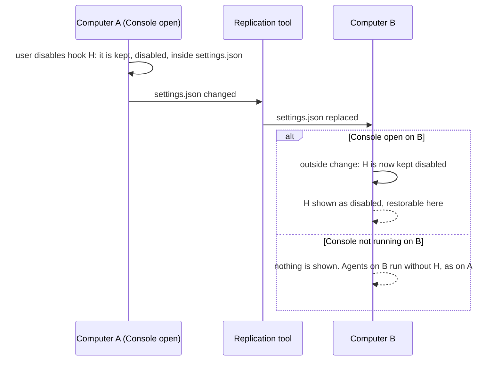
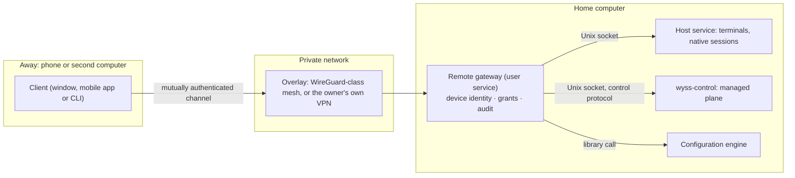

# 16 — Multi-device and remote

Domains M (several computers) and N (remote control) of [04](04-TARGET-ARCHITECTURE.md).
Section 2 is needed from F1 on, because the owner's configuration is already replicated between
two computers `[O]`. Sections 3 to 7 are the future remote architecture: part of the final
product, **not authorised**, and each step needs its own ADR. All `[P]` unless marked.

## 1. Two different things

| Topic                        | What it is                                                                     | Exists today                                                                                        |
| ---------------------------- | ------------------------------------------------------------------------------ | --------------------------------------------------------------------------------------------------- |
| **Replicated configuration** | Provider files copied between computers by a tool the Console does not control | Yes: the owner uses Syncthing on `~/.claude/` and other paths `[O]`                                 |
| **Remote control**           | Using one computer's terminals, sessions and approvals from another device     | No. The authority speaks only over a private Unix socket to the same user `[R]` (ADR 0011 `:13-14`) |

They are independent. The first has to be handled correctly now; the second is a later phase.

## 2. Replicated configuration (from F1)

### 2.1 What replication looks like to the Console

| Event from the replication tool                                    | Seen as                                                | Handling                                                                                          |
| ------------------------------------------------------------------ | ------------------------------------------------------ | ------------------------------------------------------------------------------------------------- |
| A file replaced by a newer copy                                    | An atomic replacement: a new inode under the same name | An outside change (07 §7)                                                                         |
| A file deleted on the other computer                               | A deletion                                             | Confirmed after a short delay, then reported                                                      |
| A conflict copy created (`<name>.sync-conflict-<date>-<id>.<ext>`) | A new file with a recognisable name                    | The source becomes `conflicted`; mutations blocked; both files named (FR-SYNC-02)                 |
| The tool's own temporary files                                     | Short-lived files with the tool's prefix               | Ignored by name pattern; the pattern list is configurable and not Syncthing-specific (FR-SYNC-04) |
| A burst of many files                                              | Many events                                            | Debounced; an overflow falls back to one rescan                                                   |

The Console does not know which tool is at work, or that any is. It recognises conflict copies
by a list of patterns shipped with defaults for common tools and extensible by the user `[N]`
for the exact patterns (OQ-13).

### 2.2 The case of the second computer

The Console's own state is per computer and must never be replicated (ADR 0028 §7) `[R]`; on
the owner's machines that directory is already excluded from replication `[O]`. On rungs 1 and
2 of ADR 0029 (proposed) that state holds no configuration content and nothing about a disabled
entry depends on it. On rung 3 it holds the entry, sealed in the protected vault
([27](27-PROTECTED-RESTORATION-VAULT.md)), and the two computers stop being symmetric.

The diagram is the case of rungs 1 and 2. On rung 3, B receives a file without H, shows it as
removed outside, and cannot restore it: only A can (27 §9.2).

| Case                                                    | What B can do                                                                                                                                                                                                                                                                                                                   |
| ------------------------------------------------------- | ------------------------------------------------------------------------------------------------------------------------------------------------------------------------------------------------------------------------------------------------------------------------------------------------------------------------------- |
| An entry disabled on A and kept in the file             | Restore it on B: the entry is in the file B received. Nothing has to be exported                                                                                                                                                                                                                                                |
| An entry disabled on A with a native switch             | The same: the switch is in the file                                                                                                                                                                                                                                                                                             |
| An entry disabled on A into A's vault (rung 3)          | Nothing: B sees it removed from outside and says it can be restored on the computer that disabled it. An encrypted export from A is designed and not offered at first (§2.3)                                                                                                                                                    |
| An entry removed on A by hand, in an editor             | B sees it removed from outside. It is not restorable from the Console, unless the user had chosen to keep a recovery copy of that entry: then the computer that holds the copy, and only that one, can recover it (27 §3.6)                                                                                                     |
| Restored on B                                           | The file changes on A through replication; A sees the entry enabled                                                                                                                                                                                                                                                             |
| Both computers changed the same file while disconnected | If the replication tool leaves a conflict copy that the Console recognises, the Console there blocks mutations of that file until the user resolves it, and says that this is done outside. A tool that settles the conflict by itself leaves nothing to recognise: the Console sees an outside change and nothing more (OQ-13) |
| A change made on A is replaced by B's older version     | A sees an outside change that undid its last operation and says so: "your change was replaced by a version from another computer"; applying it again is offered                                                                                                                                                                 |
| The user wants the hook off on A and on on B            | Not possible while the file is replicated: it is one file. The Console says so; a session profile (09) is the way to differ per session, and an exclusion in the replication tool is the way to differ per computer                                                                                                             |
| The provider on B is another version than on A          | The kept form must be tolerated by both: check V7 of ADR 0029 §5. The Console on A cannot see B's version; it reminds the user when the file is known to change from outside                                                                                                                                                    |

What the Console on A can never know: which sessions on B adopted a change. It says "this file
may be used on other computers; their sessions are not visible here" whenever it has seen a
conflict copy or an outside change it did not cause.

### 2.3 Export and import of held entries

On rungs 1 and 2 a disabled entry travels with its file and nothing needs exporting. On rung 3
it does not travel: the vault is per computer and is never replicated. What ADR 0028 §7 and
requirement FR-CFG-15 ask for, carrying a disabled entry to the other computer by an explicit
act, is designed as an encrypted export and import of vault records
([27 §9.3](27-PROTECTED-RESTORATION-VAULT.md)): a file sealed under a passphrase the user
types, authenticated as a whole, imported as untrusted executable content that is shown whole
before any restoration. It is **not offered in the first vault phase** (DN-29).

The replication tool's own history of versions, and filesystem snapshots, are not a recovery
mechanism of this design. They may hold an entry or not; the Console neither reads them nor
counts on them.

A remote device (§5) sees at most the metadata of what a host holds. Restoring, showing,
exporting and deleting held entries are not remote capabilities in the first remote design
(27 §9.4).

Session profiles keep their own export and import (09 §4.5); they hold references and no entry.

## 3. Remote control: what is wanted

The owner's scenario `[O]`: the desktop stays on at home; from the university, a phone or
another computer shows its projects and processes, gives objectives to agents, reads results,
approves or denies actions and reconnects later. The work belongs to the computer that runs
it, not to the screen that shows it.

Explicitly not wanted: a remote desktop. Controlling the graphical session is another problem
with other tools.

## 4. What has to change first

| Today `[R]`                                               | Needed for remote                                     | Phase |
| --------------------------------------------------------- | ----------------------------------------------------- | ----- |
| Terminals belong to the window and die with it (ADR 0005) | Terminals owned by a process that outlives the window | F9    |
| Native sessions die with the window                       | The same process supervises them                      | F9    |
| The authority trusts whoever connects as the same user    | Per-device identity and grants in front of it         | F10a  |
| One socket, local                                         | A transport reachable from another device             | F10a  |
| The configuration engine is a library in the desktop (D2) | The same library behind the host service              | F10a  |

### 4.1 The host service (F9)

A user service, like the authority, that owns PTYs and the native session registry. The window
becomes its client over a private Unix socket. ADR 0002 already allowed for this: terminal
resources "may temporarily live in-process during terminal-only sprints" (state table,
`0002:28-46`) `[R]`.

It is a separate process from `wyss-control` (AD-15): the authority's trusted base stays what
it is, and a fault in terminal handling cannot reach leases or approvals. Whether the two share
a binary with two roles or are two binaries is an ADR question (DN-05).

Consequences to design in that ADR: scrollback has to live in the host process (bounded) for a
client to attach later; resize follows the client that has focus, with a rule when two clients
differ; a terminal's output is no longer acknowledged by one page.

## 5. Remote architecture (F10)

### 5.1 Alternatives for reachability

| Option                                              | For                                                                                                                                                                                                                           | Against                                                                          |
| --------------------------------------------------- | ----------------------------------------------------------------------------------------------------------------------------------------------------------------------------------------------------------------------------- | -------------------------------------------------------------------------------- |
| A. SSH to the home computer, a CLI client there     | No new network surface; proven authentication                                                                                                                                                                                 | No phone client worth using; no approvals UI; needs an open port or a VPN anyway |
| B. A private overlay network plus a gateway service | Nothing is exposed to the Internet; the overlay gives encrypted reachability and device keys; the gateway adds per-device grants                                                                                              | Depends on an overlay being set up; two layers of identity to keep straight      |
| C. A relay in the cloud, end-to-end encrypted       | Works behind any NAT without a VPN                                                                                                                                                                                            | A third party in the path; a service to run and secure; cost                     |
| D. Reusing the original Wyss mobile bridge          | It exists: a LAN web client and an Android package paired by QR `[R]` (`wyss-agent-legacy/root-documents/README.md:33-55`; its design is in `wyss-agent-legacy/docs/mobile/WYSS_MOBILE_BRIDGE_MVP.md`, not read for this set) | Built for another product and another protocol; LAN as that README states        |

**Recommended: B**, with the overlay not built by this project, and the gateway bound only to
the overlay's interface. D is to be studied as a source of proven pieces (pairing flow, device
approval) and not adopted as a dependency between two products (FR-AGT-02, 17 §5). The choice
is DN-05 and belongs to the owner; it is not to be made for convenience.

### 5.2 Identity, pairing, authorisation

| Element           | Design                                                                                                                                                                                                     |
| ----------------- | ---------------------------------------------------------------------------------------------------------------------------------------------------------------------------------------------------------- |
| Device identity   | A key pair made on the device; the public key is what the host knows                                                                                                                                       |
| Pairing           | Started on the host, at its keyboard: a short code or QR shown in the window; the device presents it once; the host shows the device's name and fingerprint for confirmation in a native dialog            |
| Grants            | Per device, a set of scopes: `observe` (sessions, history), `terminal_read`, `terminal_write`, `approve`, `configure`. Default for a new device: `observe` only                                            |
| Session ownership | Sessions belong to the host user, not to a device. A device never "owns" a terminal                                                                                                                        |
| Revocation        | In the window; checked on every request, not only at connection (FR-REM-08)                                                                                                                                |
| Step-up           | `approve` and `configure` from a remote device need a fresh local authentication on that device (biometric or passcode) for each action; the gateway requires a signature made after the request was shown |
| Expiry            | A grant expires unless renewed at the host; a device unseen for a set time is disabled                                                                                                                     |

The gateway is a client of the authority like the desktop: it sends intents and the authority
decides (ADR 0002) `[R]`. A remote approval is the same `respond` intent, recorded by the
authority with nothing added, and recorded by the gateway with the device that sent it. The
authority learns nothing about devices unless a later ADR decides it should.

### 5.3 What each remote capability needs

| Capability               | Needs                                                         | Notes                                                                                                                                   |
| ------------------------ | ------------------------------------------------------------- | --------------------------------------------------------------------------------------------------------------------------------------- |
| Remote terminal access   | Host-owned PTYs; scope `terminal_read` or `terminal_write`    | A remote keyboard into a shell is full control of the account: the most dangerous grant, off by default                                 |
| Remote agent observation | Host registry; the authority's read methods                   | Read only                                                                                                                               |
| Remote approvals         | The authority's existing `respond`; step-up                   | The approval card must show on the phone exactly what the window shows                                                                  |
| Remote configuration     | The configuration engine behind the gateway; step-up          | The native dialog of 11 §4 has no equivalent on a phone: its role is taken by the step-up, which is why `configure` is a separate scope |
| Reconnection             | Server-held state; clients are views                          | A drop changes nothing (FR-REM-06), as ADR 0002 already requires of the window `[R]`                                                    |
| Network interruption     | Idempotent intents, as the control protocol already has `[R]` | A retried approval returns the original result                                                                                          |
| Audit across machines    | The gateway's own log: device, scope, request, outcome        | Separate from the authority's stream (AD-11); no secret                                                                                 |
| Session recovery         | F9                                                            | —                                                                                                                                       |
| Several home computers   | One gateway each; the client holds a list of hosts            | No host learns of another                                                                                                               |

### 5.4 Threats specific to remote

| Threat                                          | Control                                                                                                                |
| ----------------------------------------------- | ---------------------------------------------------------------------------------------------------------------------- |
| A stolen phone                                  | Step-up for anything but observation; revocation; grant expiry                                                         |
| A device paired by someone else at the keyboard | Pairing confirmation in a native dialog; a list of devices always visible                                              |
| A network attacker                              | The overlay's encryption and a mutually authenticated channel on top; the gateway listens on no public interface       |
| Replay of an approval                           | Intents carry an identifier the authority already deduplicates `[R]`; step-up signatures cover the request and a nonce |
| The gateway as a way around the authority       | It is a client; it holds no lease and can commit nothing                                                               |
| A remote terminal used to bypass everything     | It can: a terminal is the user's shell. That is why the scope exists and is off by default                             |

## 6. Conflict resolution across devices

Two clients of one host are two views; the host serialises what they ask. Two clients resizing
one terminal: the last focused wins, the other is told. Two clients answering one approval:
the first intent the authority commits wins; the second gets the recorded decision.

Configuration across hosts is replication, §2: the Console does not arbitrate between
computers.

## 7. Relation to the owner's other tools

| Tool `[O]`                                  | Relation                                                                |
| ------------------------------------------- | ----------------------------------------------------------------------- |
| The replication tool in use                 | Outside the Console; handled as §2                                      |
| The original Wyss assistant's mobile bridge | A source of ideas and possibly of code for pairing; no coupling (17 §5) |
| The owner's remote-desktop setup            | A different need; not replaced, not used                                |

## 8. Not decided

Every item of §4 and §5 is a proposal. The decisions are DN-05 (transport, service shape,
identity scheme) and belong to phases F9 and F10. Nothing in F1 to F8 may assume them, except
one rule that costs nothing now: the configuration engine's interface carries no window or
socket type (ADR 0028 §2) `[R]`, so that it can be called from a gateway later.
