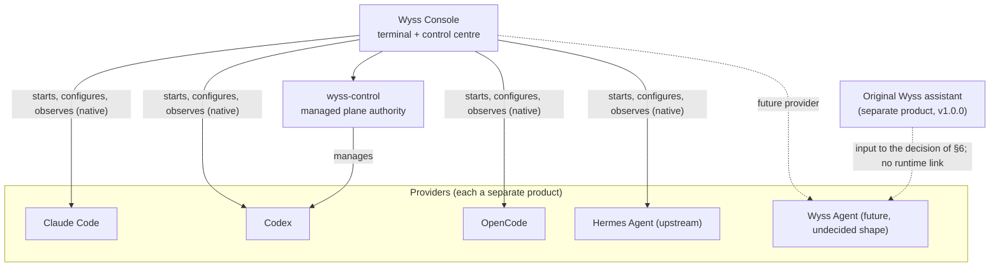

# 17 — Wyss Agent and Hermes

Domain O of [04](04-TARGET-ARCHITECTURE.md), plus the naming of the whole family. Hermes is not
installed `[O]` and was read only in one page of its documentation `[D]`; the original Wyss
assistant is known here from its archived documents `[R]` (`docs origins/`), not from its code
or from running it. Nothing in this document is to be built or forked now (decision D9).

## 1. Names

The word "Wyss" names several different things. This set uses them as follows.

| Name                                          | Is                                                                                                            | State                                                                                                  |
| --------------------------------------------- | ------------------------------------------------------------------------------------------------------------- | ------------------------------------------------------------------------------------------------------ |
| **Wyss Console**                              | This product: the terminal and control centre                                                                 | Built in part `[R]`                                                                                    |
| **`wyss-control`**                            | The authority of Wyss Console's managed plane; a user service                                                 | Built `[R]`                                                                                            |
| **The original Wyss** (also "Wyss assistant") | A separate product and repository (`SaintWyss/Wyss`): a personal operative assistant in Python, version 1.0.0 | Released 2026-07-20 `[R]` (`docs origins/root-documents/README.md:9`); archived here as documents only |
| **The owner's methodology**                   | His rules, hooks, routing and controls for working with agents, kept in his agents' configuration             | Exists `[O]`; it is what Wyss Console is meant to make visible                                         |
| **Hermes Agent**                              | An upstream open-source agent by a third party                                                                | Not installed `[O]`                                                                                    |
| **Wyss Agent**                                | A future personal assistant with the owner's identity                                                         | Not started; not decided                                                                               |
| A "Wyss CLI" or "Wyss Terminal"               | Names used in conversation `[O]`; no decision makes them products                                             | Undefined                                                                                              |

Proposal (DN-11): "Wyss Console" for this product only; "Wyss Agent" reserved for the future
assistant; the original Wyss referred to by its repository name until the decision of §6; no
other product name is introduced without a decision.

## 2. Hermes as a provider

Decision D9: Hermes enters as the original upstream agent, like any other provider. No fork,
no rebranding, no maintained patch.

| Aspect                | Design                                                                                                                                                                  | Evidence                                           |
| --------------------- | ----------------------------------------------------------------------------------------------------------------------------------------------------------------------- | -------------------------------------------------- |
| Installation          | By the owner, with his consent; never by the Console                                                                                                                    | Policy                                             |
| Native session        | Started from the catalogue like the others (05 §4)                                                                                                                      | `[P]`                                              |
| Configuration adapter | Read: `~/.hermes/config.yaml`, `SOUL.md`, `skills/`, `mcp_servers`; never `.env` or `auth.json`. Write: through `hermes config set` only                                | `[D]` for the files; the command's behaviour `[N]` |
| Profiles              | Hermes has profile-scoped state through `HERMES_HOME` `[D]`: a session profile maps onto it; whether it shares credentials `[N]`                                        | OQ-11                                              |
| Models                | Its own model configuration; nothing of the Console's model views applies until read                                                                                    | `[N]`                                              |
| Memory                | Hermes's own (`memories/`); the Console shows that it exists and its switches, never its content                                                                        | `[D]`                                              |
| Automations           | `cron/` and its gateway: **shown, not started by the Console**                                                                                                          | `[D]`                                              |
| Managed execution     | **None.** Hermes has tools, memory, scheduling and sub-agents of its own. Nothing of that passes through `wyss-control`. A managed Hermes would need the whole of 06 §5 | Policy                                             |
| Updates               | The upstream's own; a new version is unverified until its fixtures exist (06 §6)                                                                                        | `[P]`                                              |
| Licence               | To be read in its repository before anything is redistributed                                                                                                           | `[N]` (OQ-11)                                      |

Risk to keep in view: an agent that acts on a schedule and on messages from outside is a larger
surface than a coding CLI in a terminal. In the native plane the Console contains none of it
(T-18). That is said wherever Hermes appears.

## 3. The original Wyss assistant: inventory

From its own description `[R]` (`docs origins/root-documents/README.md:5-162`):

| Capability      | What it says it has                                                                                                                                                                                                                             |
| --------------- | ----------------------------------------------------------------------------------------------------------------------------------------------------------------------------------------------------------------------------------------------- |
| Core loop       | Instruction → plan → deterministic policy → confirmation → execution through adapters → verification and audit                                                                                                                                  |
| Risk policy     | Levels A (read, direct), B (normal change, simple confirmation), C (high impact, the user types a word), D (destructive or invalid, always refused). A built-in deny list that cannot be removed. The policy is evaluated again at confirmation |
| Models          | "Models help to interpret and propose. They do not assign the risk level": a deterministic orchestrator by default, an LLM mode tried with one local model                                                                                      |
| Daemon          | A persistent process on a Unix socket with JSON-RPC                                                                                                                                                                                             |
| Adapters        | Filesystem, shell, Git, with a second check and verification; Notion                                                                                                                                                                            |
| Undo            | For file operations; shell and Git pending                                                                                                                                                                                                      |
| Audit           | By CLI and a bounded RPC                                                                                                                                                                                                                        |
| Knowledge       | Indexing with full-text search, vectors and rank fusion over the owner's files                                                                                                                                                                  |
| Model gateway   | Several providers, budget, context minimisation                                                                                                                                                                                                 |
| Agents          | Configurable by file; one finance agent in use                                                                                                                                                                                                  |
| Routines        | A scheduler; routines go through the same policy and confirmation tray                                                                                                                                                                          |
| Memory          | Owner facts, kept apart from external content "to reduce prompt injection"                                                                                                                                                                      |
| Daily assistant | A digest                                                                                                                                                                                                                                        |
| Intake          | An opt-in webhook entry with its own bearer                                                                                                                                                                                                     |
| Web and mobile  | A local web interface, a LAN mode with TLS, an Android package paired by QR, tried on a real phone                                                                                                                                              |
| Team mode       | Out of scope                                                                                                                                                                                                                                    |

Its documents were archived into this repository on 2026-10-10 as history and nothing else:
"when they disagree with the code, the ADRs or the README, the code wins" (ADR 0026 `:29-31`)
`[R]`. This set treats them the same way: an inventory of what was claimed, not evidence of
what works today `[N]`.

## 4. Comparison, capability by capability

A first pass from documents on both sides. It decides nothing; it shows what the decision of
§6 has to weigh. "?" is not verified.

| Capability                                               | Original Wyss `[R]` (as documented)                | Hermes `[D]` / `[N]`                                               | Note                                       |
| -------------------------------------------------------- | -------------------------------------------------- | ------------------------------------------------------------------ | ------------------------------------------ |
| Deterministic risk policy with a non-removable deny list | Yes                                                | Command approval exists; no equivalent documented in what was read | Wyss's distinctive strength                |
| The model never assigns risk                             | Yes, by design                                     | ?                                                                  | A property worth keeping whatever the base |
| Persistent daemon                                        | Yes                                                | Yes (gateway)                                                      | —                                          |
| Memory                                                   | Owner facts apart from external content            | Memories, with optional write approval                             | Both; different models of trust            |
| Scheduled routines                                       | Yes, through the same policy                       | `cron/`                                                            | —                                          |
| Skills                                                   | Agents by configuration                            | Skills with auto-load                                              | —                                          |
| Tools for files, shell, Git                              | Yes, with verification                             | Toolsets                                                           | —                                          |
| Undo                                                     | Files only                                         | ?                                                                  | —                                          |
| Search over the owner's files                            | Yes                                                | ?                                                                  | —                                          |
| Several model providers                                  | Yes, with a budget                                 | Yes, by configuration                                              | —                                          |
| Mobile                                                   | An Android package of its own, paired, tried       | Messaging platforms through the gateway                            | Different approaches                       |
| Community and upstream maintenance                       | One person                                         | An open project                                                    | Hermes's distinctive strength              |
| Cost of keeping it current                               | All the owner's                                    | The upstream's, unless forked                                      | —                                          |
| Fit as a provider of Wyss Console                        | Would need a native CLI and readable configuration | Has both                                                           | —                                          |

Reading: they are not substitutes. The original Wyss is strongest exactly where the owner is
careful (policy, confirmation, audit, his own mobile client); Hermes brings an ecosystem and
someone else's maintenance. A fork of Hermes that lacked the policy model would be a step back
in the one area the owner has always insisted on.

## 5. What could be reused, and what must not be coupled

| From the original Wyss                | Possible use                                                                              | Condition                                                                            |
| ------------------------------------- | ----------------------------------------------------------------------------------------- | ------------------------------------------------------------------------------------ |
| The pairing flow of its mobile client | A model for device pairing (16 §5.2)                                                      | As a design reference; code only after reading it and by a decision                  |
| The A to D classification             | A vocabulary for risk in a future Wyss Agent                                              | Not for Wyss Console's managed plane, which has its own model (leases and approvals) |
| Its confirmation tray                 | A model for remote approvals                                                              | Same                                                                                 |
| Its daemon                            | Nothing in Wyss Console: `wyss-control` is a different authority (ADR 0004 `:9-21`) `[R]` | —                                                                                    |

ADR 0004 already ruled: the existing Wyss daemon is a "reference / future integration
candidate", and "neither is automatically the universal agent host for Console" (`0004:17-21`)
`[R]`. That stands.

## 6. The decision about Wyss Agent (F12, not now)

Three shapes, to be chosen after the comparison is redone with Hermes installed and the
original Wyss's code read:

| Option                                                                                                                   | For                                                      | Against                                                                            |
| ------------------------------------------------------------------------------------------------------------------------ | -------------------------------------------------------- | ---------------------------------------------------------------------------------- |
| A. Wyss Agent = Hermes, configured and extended from outside (no fork)                                                   | Upstream updates arrive by themselves; least maintenance | Limited to what Hermes lets be customised; the policy model has to live outside it |
| B. Wyss Agent = a fork of Hermes                                                                                         | Full control of behaviour and identity                   | Every upstream release is a merge; the owner asked not to carry this early         |
| C. Wyss Agent = the original Wyss, grown, taking ideas from Hermes                                                       | Keeps the policy model and what already works            | All maintenance is the owner's; no community                                       |
| D. Both, with a boundary: the original Wyss as the policy and confirmation layer, Hermes as one of the engines it drives | Keeps the strength of each                               | Two systems to integrate; the boundary must be designed                            |

No recommendation is made here: the evidence is two sets of documents. What is fixed now:
whichever is chosen enters Wyss Console as a provider behind the same contracts (FR-AGT-03),
and Wyss Console does not depend on that choice.

### 6.1 If a fork is ever made

| Topic             | Rule                                                                                                                                      |
| ----------------- | ----------------------------------------------------------------------------------------------------------------------------------------- |
| Upstream tracking | The original repository as a remote; releases and security advisories watched; changes brought in by merge or by picking, each one tested |
| Divergence        | Branding and additions in separate modules; original interfaces kept where possible; upstream tests kept running                          |
| Licence           | Its terms read and met before anything is published; notices kept                                                                         |
| State             | From the start, a written rule of what belongs to the engine (its memory, its sessions) and what to the owner's system                    |
| Cost              | Counted honestly: a fork is a product that needs a maintainer                                                                             |

## 7. Relation among the products

There is no runtime link between Wyss Console and the original Wyss, and none is introduced.

## 8. Not verified

Everything about Hermes beyond one documentation page; everything about the original Wyss
beyond its own description; the licence of both for redistribution. Verification: install
Hermes with consent and read its repository; read the original Wyss's code and run its suite in
its own repository; neither is part of this set.
