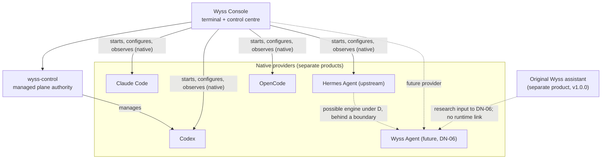

# 17 — Wyss Agent and Hermes

Domain O of [04](04-TARGET-ARCHITECTURE.md), plus the naming of the whole family.

**Revision of 2026-10-13 (sixth planning pass).** The first version was an inventory from two
sets of documents. This one rests on **read-only source research**, authorised by the owner for
this pass.

**Evidence base:**

| Source                | Repository                           | Pinned revision                                         | Read                                                                               | Run                                  |
| --------------------- | ------------------------------------ | ------------------------------------------------------- | ---------------------------------------------------------------------------------- | ------------------------------------ |
| W — the original Wyss | `SaintWyss/Wyss` (private)           | `0761dcdacdafa216c8afc25036e24685855d2228` (2026-09-17) | Entry points and the modules named in §3; its own audit and architecture documents | **Nothing.** No install, no test run |
| H — Hermes Agent      | `NousResearch/hermes-agent` (public) | `e06df9c2eae6901f4c88f464e0ae6e753c0428b8` (2026-10-13) | `website/docs` pages and the source files named in §4                              | **Nothing.** Not installed           |

**Marks used in this document:**

- `[S]` source read at the pinned revision. Code that exists is **not** behaviour that was
  observed. Tests present are counted; **tests executed: none**.
- `[D]` official documentation at the same revision.
- `[N]` needs a run to know.

**What was not read or used:**

- Credential files of either repository were not opened (`config/.env.example` included).
- No code of either repository is copied into Wyss Console.
- The original Wyss's web front end, Android sources beyond file names, and its 212 planning
  files were sampled only.
- Hermes is large: 18,556 files, 5,724 test files, changing daily. Only the areas of §4 were read.

It was written by the author of the set and is **unreviewed**. Nothing here is to be built,
forked or installed (decision D9). **DN-06 and DN-15 stay the owner's.**

## 1. Names and separation

Five things, never conflated:

| Name                  | Is                                                                                              | Relation to Wyss Console                                                                                                                  |
| --------------------- | ----------------------------------------------------------------------------------------------- | ----------------------------------------------------------------------------------------------------------------------------------------- |
| **Wyss Console**      | This product: the terminal and control centre                                                   | —                                                                                                                                         |
| **`wyss-control`**    | The authority of Wyss Console's managed plane                                                   | Part of this product. Manages Codex only (ADR 0012 to 0016) `[R]`                                                                         |
| **The original Wyss** | A separate product: a personal operative assistant in Python, v1.0.0 `[S]` (`pyproject.toml:3`) | **No runtime link**, and none is introduced. ADR 0004: a "reference / future integration candidate", not "the universal agent host" `[R]` |
| **Hermes Agent**      | An upstream open-source agent by Nous Research, MIT licence `[S]` (`LICENSE:1-3`)               | A **native provider** (FR-AGT-01), like Claude Code, Codex and OpenCode. Not managed                                                      |
| **Wyss Agent**        | A future personal assistant with the owner's identity                                           | Not started; its shape is DN-06. It will enter as a provider behind the same contracts (FR-AGT-03)                                        |

DN-11 is unchanged: "Wyss Console" names this product only, and "Wyss Agent" is reserved for the
future assistant.

## 2. What this research changes

Four findings carry the rest of the document:

1. **The original Wyss already designed option D.** Its daemon calls an `OrchestratorPort` whose
   contract reads: "Contrato vertical del daemon hacia Hermes … El nivel A/B/C/D siempre lo asigna
   `CognitivePolicyEngine.evaluate(plan)`, nunca este port" `[S]`
   (`packages/wyss-core/src/core/ports/orchestrator.py:10-13`).
   - The Hermes adapter (plan 05-05) was **blocked**: no published image, toolsets that could not
     be disabled by a known key, a firewall rule `[S]`
     (`.planning/phases/05-orquestador-daemon/05-EMPIRICAL.md:37-104`).
   - An `LLMOrchestrator` over Wyss's own model gateway was built instead `[S]`
     (`src/orchestrator/llm_orchestrator.py`).
   - The example configuration's default is still a deterministic fake orchestrator `[S]`
     (`config/config.example.toml:103-107`; `src/bootstrap/cli.py:227-257`).
2. **Hermes's own documentation says its controls are not a boundary.**
   - Write guards are "Defense-in-depth, not a hard boundary" `[D]`
     (`website/docs/user-guide/security.md:404`).
   - Managed scope is "a management-convenience boundary against a normal user, not an
     un-escapable sandbox" `[D]` (`website/docs/user-guide/managed-scope.md:137-152`).
   - Command approval matches a list of dangerous patterns, and is skipped in container backends
     `[D]` (`security.md:199-241`).
3. **Inside Hermes, every policy hook runs in Hermes's own process and configuration.**
   - Plugins and `pre_tool_call` hooks can block a tool call, and fail closed on timeout `[D]`
     (`features/hooks.md:396, 590`).
   - But Hermes's `config.yaml` is writable by its own file tools `[D]` (`security.md:363`).
   - `execute_code` runs arbitrary Python `[S]` (`tools/code_execution_tool.py`), which can act
     without calling any tool at all.
   - A Wyss policy placed **inside** Hermes therefore cannot contain Hermes.
4. **Hermes has a programmatic protocol with approval requests sent to the client.** Its TUI
   gateway is JSON-RPC over stdio, with `approval`, `clarify`, `sudo` and `secret` as requests from
   the agent to the host `[D]`
   (`website/docs/developer-guide/programmatic-integration.md:37-106`).
   - This is the kind of surface the managed Codex plane is built on.
   - It covers only what Hermes chooses to ask about: dangerous commands, not every tool call.

## 3. The original Wyss: code inventory

At `0761dcd`, 17,036 lines of Python in `src/` and `packages/` `[S]`, and 673 test functions
in 91 files `[S]`. Its CI runs, on each push:

- `ruff format`;
- `pytest`;
- `mypy` strict;
- `ruff check`;
- `import-linter` (hexagonal contracts);
- web and Android jobs

`[S]` (`.github/workflows/ci.yml`). Last commit 2026-09-17. **No test was executed in this pass.**

| #    | Capability                       | Documented claim                                                                  | Implementation evidence `[S]`                                                                                                                                                                                                                                                                                                                                           | Tests present                                | Missing or unverifiable                                                                                                                                                                                                                                    |
| ---- | -------------------------------- | --------------------------------------------------------------------------------- | ----------------------------------------------------------------------------------------------------------------------------------------------------------------------------------------------------------------------------------------------------------------------------------------------------------------------------------------------------------------------- | -------------------------------------------- | ---------------------------------------------------------------------------------------------------------------------------------------------------------------------------------------------------------------------------------------------------------- |
| OW1  | Architecture and boundaries      | Hexagonal; core without IO                                                        | `packages/wyss-core` (domain, ports, policy); adapters in `src/`; import contracts enforced by `import-linter` in CI                                                                                                                                                                                                                                                    | `tests/ports` 26, `tests/domain` 38          | Whether the contracts pass today `[N]`                                                                                                                                                                                                                     |
| OW2  | Orchestration and model routing  | "Models interpret and propose; they do not assign risk"                           | `OrchestratorPort` (classify intent, draft plan); `LLMOrchestrator` parses model output into a typed `Plan`, rejecting unknown keys; `ModelRouter` resolves a declared tier to a provider and model, no fallback (`src/gateway/router.py:1-25`); providers: Anthropic, LiteLLM, Ollama                                                                                  | `tests/orchestrator` 117, `tests/gateway` 75 | Planning quality with a real model `[N]`. Default mode is the deterministic fake                                                                                                                                                                           |
| OW3  | Deterministic risk policy        | A to D; the denylist cannot be removed; risk only rises                           | `CognitivePolicyEngine.evaluate(plan)`: denylist → D; per-action base level with unknown types failing to C; plan-wide aggregation (file counts, directories, deletes, sensitive paths); `max()` of all (`packages/wyss-core/src/core/policy/engine.py:40-73`); 13 built-in deny rules (`builtin_deny.py`)                                                              | `tests/policy` 16                            | Shell rules match **substrings and globs** (`"                                                                                                                                                                                                             | bash"`, `"rm -rf"`, `chmod 777`): an equivalent command written differently is not denied by them. They are a floor, not a parser |
| OW4  | Confirmation, approval, denial   | B: simple confirmation; C: a typed word; D: refused; re-evaluated at confirmation | Pending store with revision and TTL; at confirmation the plan is evaluated again before the word is checked (`src/orchestrator/daemon.py:528-600`); intake from outside forced to at least B (`:867-884`)                                                                                                                                                               | in `tests/orchestrator`                      | The confirmation is a word sent over the same socket as the request: it proves a client, not a person (as Wyss Console's 16 §5.3 distinguishes)                                                                                                            |
| OW5  | Tool execution and verification  | Second wall; argv only; undo; verify                                              | `DeterministicExecutionGuard` evaluates each action again before IO (`src/execution/guard.py:17-66`); `ShellAdapter` allowlist, fail-closed when empty, `create_subprocess_exec` (`shell.py:1-60`); filesystem and Git adapters; each adapter has `verify()`                                                                                                            | `tests/execution` 85                         | The guard runs **in the same Python process** as the planner and the adapters: a same-process fault or a malicious plugin is not contained. An allowed binary that interprets its arguments (an interpreter, `git` with hooks) is as strong as that binary |
| OW6  | Memory and knowledge             | Owner facts apart from external content; hybrid search                            | `memory_facts` with a `tier` (`owner`, `external`) (`src/memory/store.py:19-29`), injected into the planner as delimited data; knowledge: FTS5 plus vectors (ChromaDB) with rank fusion, and a secret filter that keeps chunks with secrets out of the index (`src/knowledge/secret_filter.py`)                                                                         | `tests/memory` 19, `tests/knowledge` 77      | Resistance to prompt injection beyond the fixtures `[N]`                                                                                                                                                                                                   |
| OW7  | Scheduling and routines          | Routines through the same policy; nothing B or C runs by itself                   | APScheduler; each fire rebuilds a `Plan` and passes the shared gate (`src/orchestrator/scheduler.py:1-6`); 24 h TTL; coalescing catch-up                                                                                                                                                                                                                                | in `tests/orchestrator`                      | Behaviour across suspend and clock changes `[N]`                                                                                                                                                                                                           |
| OW8  | Audit, history and undo          | Append-only audit; undo for files                                                 | SQLite triggers refuse UPDATE and DELETE on `audit_events` (`src/audit/schema.py:38-45`); undo builds an inverse plan and sends it through the **same** policy (`src/execution/undo.py:1-17`); shell and Git irreversible                                                                                                                                               | `tests/audit` 10, undo in `tests/execution`  | Triggers stop the application, not a same-user process that deletes the database file. A policy rule denies plans that touch `audit.db`                                                                                                                    |
| OW9  | Daemon and IPC                   | Persistent daemon, JSON-RPC on a Unix socket                                      | One request per connection, line JSON-RPC (`daemon.py:142-211`); main socket mode 0600 with **no peer-credential check**; a second "Home" socket 0660 with an `SO_PEERCRED` check of a dedicated peer UID and a rate limit (`:146-151`, `:952-965`); a system unit with hardening (`deploy/systemd/wyss.service.in`)                                                    | `tests/orchestrator`, `tests/home` 23        | —                                                                                                                                                                                                                                                          |
| OW10 | Web, mobile, remote              | LAN mode with TLS; Android paired by QR                                           | FastAPI with a host allowlist against DNS rebinding; cookie or bearer; `--lan --tls` with a self-signed certificate (`src/bootstrap/web.py:135-230`; `tls.py`); `/api/pair` returns the URL **and the long-lived token** (`web.py:296-310`); Capacitor app with certificate pinning on first use (`mobile/android/.../PinnedWebViewClient.kt`, `FingerprintMatcher.kt`) | `tests/cli` 41, Android unit tests 2         | A long-lived bearer, not a device key: the QR is permanent proof of authorisation. 16 §5.2 does not reuse this (RA5)                                                                                                                                       |
| OW11 | Configuration and credentials    | Secrets fail-closed in ingestion and the model gateway                            | Pydantic settings (`src/bootstrap/config.py`); a minimiser that stops a prompt containing a secret pattern **before** any egress (`src/gateway/gateway.py:1-20`; `secrets_patterns.py`); tokens in `data/` files                                                                                                                                                        | `tests/security` 20                          | The cost gate computes cost from **configured prices** (`src/gateway/cost.py:1-12`): incompatible with Wyss Console's rule of no price tables (12 §6, UR2) if ever reused here                                                                             |
| OW12 | Tests, dependencies, maintenance | "424 tests green" on 2026-07-02 (its own audit)                                   | Python ≥ 3.12; 16 runtime dependencies (APScheduler, ChromaDB, FastAPI, httpx, notion-client, PyMuPDF and others) (`pyproject.toml:5-24`); 673 test functions now; one maintainer                                                                                                                                                                                       | —                                            | That the suite passes at `0761dcd` `[N]`: **tests executed: none**                                                                                                                                                                                         |

**Unexamined:**

- `src/home/` (calendar, Spotify), `src/notion/`, `src/ledger/` (finance) beyond file names;
- `web/` front end;
- 59 Android files beyond the four named;
- `.planning/` beyond phase 05.

## 4. Hermes Agent: source and documentation at `e06df9c`

| Topic                        | Finding                                                                                                                                                                                                                                                                                                                                                                                                                            | Evidence                                                                                                   |
| ---------------------------- | ---------------------------------------------------------------------------------------------------------------------------------------------------------------------------------------------------------------------------------------------------------------------------------------------------------------------------------------------------------------------------------------------------------------------------------- | ---------------------------------------------------------------------------------------------------------- |
| Licence                      | MIT, Nous Research                                                                                                                                                                                                                                                                                                                                                                                                                 | `[S]` `LICENSE`                                                                                            |
| CLI and sessions             | `hermes`, `hermes chat`; `-m`, `--provider`, `-t/--toolsets`, `-s` skills, `-p/--profile`, `-r/--resume`, `-c/--continue`, `--in <dir>`, **`--yolo`**; sessions in a SQLite state database per home                                                                                                                                                                                                                                | `[D]` `reference/cli-commands.md:27-33, 122-137`                                                           |
| Homes and profiles           | A profile is a separate home (`HERMES_HOME`, default `~/.hermes`) with its own `config.yaml`, `.env`, `SOUL.md`, memories, sessions, skills, cron jobs and state; two processes must never share one home                                                                                                                                                                                                                          | `[D]` `user-guide/profiles.md:9-15`; `reference/environment-variables.md:127`                              |
| Configuration and its writer | YAML 1.1 through ruamel (`hermes_yaml.py`). `hermes config set`: dotted keys go to `config.yaml`; every `UPPER_SNAKE` name goes to **`.env`**; some names are refused (`HERMES_HOME`, `HERMES_YOLO_MODE`, `PATH`); values type-checked against a schema. `config get` masks credential-shaped values unless `--raw`                                                                                                                | `[S]` `hermes_yaml.py:1-25`; `[D]` `cli-commands.md:1348-1350`                                             |
| Administrator scope          | `/etc/hermes/config.yaml` and `.env` (relocatable by `HERMES_MANAGED_DIR`) pin keys a normal user cannot override; "Enforcement is filesystem permissions only"; "not an un-escapable sandbox"                                                                                                                                                                                                                                     | `[D]` `user-guide/managed-scope.md:28-48, 137-152`                                                         |
| Tools and toolsets           | Every tool belongs to one toolset; `--toolsets` per session; `agent.disabled_toolsets` removes a toolset everywhere, after per-platform settings. Toolsets include `terminal`, `file`, `code_execution`, `browser`, `delegation`, `cronjob`, `memory`, `web`, `connections`                                                                                                                                                        | `[D]` `reference/toolsets-reference.md:9-60`; `user-guide/configuration.md:934-949`                        |
| Approvals                    | Dangerous **shell commands** matched against a pattern list (`tools/approval.py`); modes `smart` (an auxiliary model judges), `manual`, `off`; `--yolo`, `/yolo` and `HERMES_YOLO_MODE` bypass prompts; a hardline blocklist below YOLO; `approvals.deny` user globs; `cron_mode`, `single_query_mode` and `unattended_mode` default to `deny`; **checks skipped** in docker, singularity, modal, daytona, vercel_sandbox backends | `[D]` `user-guide/security.md:24-241`                                                                      |
| File-write safety            | A protected-path denylist and an optional `HERMES_WRITE_SAFE_ROOT`, for `write_file` and `patch` only; `config.yaml` "read-denied but stay writable"; "Defense-in-depth, not a hard boundary"                                                                                                                                                                                                                                      | `[D]` `security.md:352-406`                                                                                |
| Hooks and plugins            | Gateway hooks (trusted by placement), plugin hooks (Python, in-process), shell hooks (`hooks:` in `config.yaml`), outbound webhooks. `pre_tool_call` can block; it fails closed on timeout or error. Called once per tool dispatch (`model_tools.py:766-786`), including tools called from `execute_code` (`tools/code_execution_rpc.py:29-30`)                                                                                    | `[D]` `features/hooks.md:7-18, 396, 451, 590`; `[S]` `model_tools.py`, `tools/code_execution_rpc.py`       |
| Code execution               | `execute_code` runs a Python script that may call seven tools by RPC (`SANDBOX_ALLOWED_TOOLS`), and may also do anything Python can                                                                                                                                                                                                                                                                                                | `[S]` `tools/code_execution_tool.py:43-45`                                                                 |
| Skills                       | `skills/` per home; bundled skills seeded on install and update unless opted out; `skills.disabled`; a hub                                                                                                                                                                                                                                                                                                                         | `[D]` `cli-commands.md:1417-1418`                                                                          |
| MCP                          | `mcp_servers.<name>` with `url` or command; `enabled: false` disables without removing; include and exclude filters for tools                                                                                                                                                                                                                                                                                                      | `[D]` `reference/mcp-config-reference.md:15-202`                                                           |
| Delegation and multi-agent   | `delegate_task` spawns child agents with **inherited tool access** and their own terminal sessions; a Kanban board in `~/.hermes/kanban.db` coordinates several profiles                                                                                                                                                                                                                                                           | `[D]` `features/delegation.md`; `features/kanban.md`                                                       |
| Memory                       | `MEMORY.md` (2,200 characters) and `USER.md` (1,375) in `memories/`, written by the agent through its `memory` tool, optionally gated by `write_approval`; external memory provider plugins                                                                                                                                                                                                                                        | `[D]` `features/memory.md`; `user-guide/which-file-does-what.md:15-19`                                     |
| Schedules and gateway        | `cronjob_manage` tool (the agent can create jobs itself); webhook-triggered jobs; a messaging gateway (Telegram, Discord, Slack and others) with platform allowlists and DM pairing                                                                                                                                                                                                                                                | `[D]` `features/cron.md`; `security.md:408-533`                                                            |
| Model providers              | Many providers and routes; `/model` switching on every surface; an optional runtime that hands turns to the **Codex app-server** and migrates Hermes's MCP servers into a managed block of `~/.codex/config.toml`                                                                                                                                                                                                                  | `[D]` `programmatic-integration.md:212-223`; `features/codex-app-server-runtime.md`; `cli-commands.md:623` |
| Secrets                      | `.env` per home; secret-manager backends (Bitwarden, 1Password, a command); sensitive variables stripped from `terminal` and `execute_code` children unless a skill declares them                                                                                                                                                                                                                                                  | `[D]` `user-guide/secrets/index.md`; `security.md:598-690`                                                 |
| Programmatic interfaces      | ACP over stdio; TUI gateway JSON-RPC over stdio or WebSocket (`session.*`, `prompt.submit`, `config.set`, `cli.exec`, `command.dispatch`; server→client `approval`, `clarify`, `sudo`, `secret`); an OpenAI-compatible HTTP API server with a bearer key                                                                                                                                                                           | `[D]` `developer-guide/programmatic-integration.md:7-225`; `features/api-server.md`                        |
| Upgrade model                | `hermes update` pulls the stable release or a selected channel, reinstalls dependencies and re-runs the installer; it also migrates gateways and seeds skills. The repository's package version reads `0.0.0` at this revision                                                                                                                                                                                                     | `[D]` `cli-commands.md:113, 339, 1742`; `[S]` `pyproject.toml:7`                                           |
| Size and pace                | 18,556 files; 5,724 test files; the pinned commit is from the day of reading                                                                                                                                                                                                                                                                                                                                                       | `[S]`                                                                                                      |

Everything above is what the code and documents state. How any of it behaves on the owner's
computers is `[N]`: OQ-11 stays open for that part.

## 5. Comparison, by architecture

| Dimension                 | Original Wyss                                                                           | Hermes                                                                                                                                     | What follows                                                                                                                       |
| ------------------------- | --------------------------------------------------------------------------------------- | ------------------------------------------------------------------------------------------------------------------------------------------ | ---------------------------------------------------------------------------------------------------------------------------------- |
| Who decides an action     | A pure function over a typed plan; the model only proposes (OW2, OW3)                   | The model calls tools directly; a check intervenes only for dangerous shell patterns, file-write paths and hooks the user configured       | Wyss's model is **plan, then decide, then act**. Hermes's is **act, unless stopped**. They are not two settings of one design      |
| Risk classification       | Every action typed and classified; unknown types fail to C; aggregation over the plan   | Pattern match on shell text; an auxiliary model in `smart` mode                                                                            | Wyss's is deterministic and covers its whole action vocabulary. Hermes's covers shell text, and `smart` makes it non-deterministic |
| Policy enforcement point  | In the daemon's process, before IO, twice (OW5)                                         | In Hermes's process, per tool call; hooks in-process or as subprocesses                                                                    | **Neither is an OS boundary.** Both are only as strong as the process they run in                                                  |
| Effect surface            | Typed adapters: files, an allowlisted shell, Git, Notion, finance, home                 | Terminal, Python execution, files, browser, computer use, delegation, cron, connectors, MCP                                                | Hermes's surface is far larger. Its `terminal` and `execute_code` cannot be constrained by inspecting arguments                    |
| Autonomy and scheduling   | Routines produce plans that pass the gate; B and C wait for the owner                   | Cron jobs, delegation, Kanban; unattended surfaces default to deny on dangerous commands; the agent can create its own jobs                | Hermes is designed for autonomy; Wyss for gated autonomy                                                                           |
| Reliability and recovery  | SQLite stores with revisions, idempotency, TTL reaper; undo for files                   | Session database with repair, checkpoints and rollback; gateway supervision                                                                | Both invest here; neither was run                                                                                                  |
| Memory                    | Trust tiers; delimited injection                                                        | Agent-written notes injected at session start; optional write approval                                                                     | Wyss treats memory as an injection surface; Hermes treats it as a feature                                                          |
| Model integration         | A gateway with tiers, a secret minimiser before egress, a budget from configured prices | Many providers; its own routing; can delegate turns to Codex                                                                               | Wyss's minimiser is a real strength. Its price table conflicts with Wyss Console's rule (OW11)                                     |
| Plugins and extensibility | Ports and adapters in code; no third-party plugin system                                | Plugins, skills hub, MCP, connectors, hooks                                                                                                | Hermes's ecosystem is its strength and its attack surface                                                                          |
| Maintainability           | One maintainer; strict CI; 17 k lines                                                   | An organisation; very fast churn; large surface                                                                                            | Wyss: the owner carries everything. Hermes: the owner carries every upgrade's re-verification                                      |
| Resource consumption      | A Python daemon with ChromaDB and PyMuPDF dependencies                                  | A Python agent, optional Node interfaces and gateways                                                                                      | Neither measured `[N]`                                                                                                             |
| Remote control            | Its own web bridge and Android app with a long-lived token (OW10)                       | Messaging platforms through a gateway; DM pairing; API server                                                                              | Neither matches 16 §5. Wyss Console's remote design stands on its own                                                              |
| Upgrade risk              | None from outside                                                                       | Every `hermes update` can change tools, defaults and file layout; it also writes into Codex's configuration when its Codex runtime is used | An upgrade of Hermes is an unverified version until fixtures exist (06 §6)                                                         |

**Incompatibilities:**

- **IC1.** Hermes's tool loop cannot be put under Wyss's plan-then-decide model **from inside
  Hermes**. The model acts by tool calls; to place Wyss's engine in front, every effect must
  become a Wyss-typed action.
- **IC2.** Hermes's `terminal` and `execute_code` are open-ended. Wyss's policy classifies typed
  actions and cannot classify arbitrary shell or Python. Under Wyss's policy they would be
  `shell.run` of an interpreter: level C at best, or denied.
- **IC3.** Both keep their own memory, sessions and audit. A combination must state who owns
  which.

## 6. Wyss Agent: the four options (DN-06)

### 6.1 The question every option must answer

**Can Hermes execute tools outside Wyss's policy?**

- Yes, whenever any Hermes toolset with an effect is enabled. A wrapper or in-process hook does
  not change that:
  - A plugin or hook lives in Hermes's process and configuration. The governed agent can rewrite
    `config.yaml` with its own file tools.
  - `terminal` and `execute_code` reach the OS without any further tool call.
  - Managed scope and write guards are, in Hermes's own words, not a hard boundary.
- **The only way** to keep every effect under Wyss's policy:
  - Hermes has **no effectful built-in toolset at all**.
  - Its only effectors are tools that Wyss exposes (for example by MCP).
  - It runs where it cannot change its own configuration or reach the OS by another path: another
    OS user, a container, or a sandbox whose rules it cannot write.
- Whether Hermes keeps functioning usefully when stripped that far is `[N]` (OQ-55).

### 6.2 The options

| Aspect                | A. Hermes configured and extended, no fork                                                                        | B. A maintained fork of Hermes                                                      | C. The original Wyss grown                                                             | D. Original Wyss as policy and control, Hermes as an engine behind a boundary                                                                                                                                |
| --------------------- | ----------------------------------------------------------------------------------------------------------------- | ----------------------------------------------------------------------------------- | -------------------------------------------------------------------------------------- | ------------------------------------------------------------------------------------------------------------------------------------------------------------------------------------------------------------ |
| Components            | Hermes; a profile; plugins, skills, MCP servers and hooks of the owner's                                          | A Hermes fork with the owner's changes                                              | The original Wyss: daemon, policy, adapters, gateway, clients                          | Wyss daemon (policy, confirmation, typed adapters, audit) and a Hermes process in its own OS boundary, whose only tools are Wyss's, exposed by MCP; Hermes's TUI gateway protocol for sessions and questions |
| Trust boundaries      | One: Hermes's process, as the user                                                                                | The same                                                                            | Wyss's daemon process, as the user (a dedicated user for the Home part)                | Two processes, **two OS users or a container**. Hermes is untrusted: it can only propose through Wyss's tools                                                                                                |
| Execution ownership   | Hermes                                                                                                            | The fork                                                                            | Wyss's adapters                                                                        | Wyss's adapters, for every effect                                                                                                                                                                            |
| Policy and approval   | Hermes's pattern approvals plus the owner's hooks; bypassable as §6.1 says                                        | Whatever the fork builds in; still in-process unless it also isolates               | Wyss's engine and confirmation (OW3, OW4)                                              | Wyss's engine on every tool call Hermes makes; Hermes's own approvals irrelevant because it has no effectful tools                                                                                           |
| Integration contracts | Hermes's CLI and files                                                                                            | The fork's own                                                                      | Wyss's JSON-RPC                                                                        | An MCP server of Wyss's (the A1 round trip of 05-EMPIRICAL was shown in a test in its time `[S]`); Hermes's TUI gateway JSON-RPC; a written list of the tools and their Wyss action types                    |
| Data and memory       | Hermes's                                                                                                          | The fork's                                                                          | Wyss's (tiered)                                                                        | Wyss owns memory, audit and confirmation. Hermes's memory and skills disabled, or held in its own sandboxed home and treated as untrusted content                                                            |
| Upgrades              | Upstream's; each an unverified version                                                                            | Every upstream release is a merge                                                   | All the owner's                                                                        | Hermes upgrades re-verified against the isolation (OQ-55 to OQ-57); Wyss's part the owner's                                                                                                                  |
| Performance           | One process                                                                                                       | One process                                                                         | One daemon                                                                             | A hop per tool call (MCP); two processes; a container if chosen `[N]`                                                                                                                                        |
| Security risks        | An agent acting on a schedule and outside messages with the user's rights; prompt injection drives tools directly | As A, plus the fork's own defects                                                   | Wyss's in-process guard; substring shell rules (OW3); a long-lived mobile token (OW10) | The boundary itself (MCP exposure, container or user setup); confused-deputy through Wyss's tools; what Hermes can still do in its sandbox (network, its own files)                                          |
| Reused                | Everything of Hermes                                                                                              | Everything of Hermes                                                                | Everything of Wyss                                                                     | Wyss's policy, confirmation, adapters, audit, minimiser; Hermes's planner, conversation, model routing, possibly its gateway for messaging                                                                   |
| To develop            | Profile, plugins, hooks                                                                                           | The fork's maintenance, forever                                                     | A conversational planner of quality (Wyss's open problem since 05-05); an ecosystem    | The MCP tool surface mapped to Wyss actions; the isolation; Hermes's configuration with no effectful toolset, pinned where Hermes cannot write it; tests of non-bypass                                       |
| Evidence to validate  | Runtime behaviour of approvals and hooks on the owner's computer                                                  | —                                                                                   | Wyss's suite at its pinned commit, and a real-model run                                | OQ-55 to OQ-57: Hermes works with every effectful toolset disabled; it cannot re-enable one from inside its boundary; MCP tool calls carry enough to classify                                                |
| Benefits              | Least work; upstream improvements arrive                                                                          | Full control                                                                        | The owner's policy model, already built and tested on paper                            | Keeps Wyss's distinctive strength and gains Hermes's planner and ecosystem where they are safe                                                                                                               |
| Disadvantages         | Policy cannot be enforced (§6.1)                                                                                  | The owner asked not to carry a fork early; a fork does not by itself add a boundary | No conversational planner of known quality; no community                               | Two systems and a boundary to maintain; Hermes's most useful tools (terminal, code) are given up or re-provided through Wyss's typed adapters                                                                |
| Residual risk         | High: whatever the model is persuaded to run, within the patterns it misses                                       | As A, unless the fork isolates                                                      | Wyss's in-process guard and its shell floor                                            | Whatever Wyss's own tools allow; anything Hermes can do inside its sandbox (for example network calls with data it was given)                                                                                |

### 6.3 Recommendation, as far as evidence allows

**Owner decision:** DN-06 stays open. This section does not decide it.

**What the evidence supports:**

1. **Option D is the only option in which Wyss's policy can control what is executed.** It needs:
   - no effectful Hermes toolset;
   - Wyss's tools as the only effectors;
   - an OS-level boundary that Hermes cannot rewrite.

   Option D without that boundary is option A with extra steps.

2. **Option A is acceptable only as what FR-AGT-01 already asks:** Hermes as a native provider in
   a terminal, with Wyss Console containing none of it (T-18). It is not acceptable as a Wyss
   Agent that claims the owner's policy model.
3. **Option C is viable** if the owner accepts building the planner. The original Wyss's
   remaining gap is the one its own audit names: a conversational planner tested with real models
   `[S]` (`docs/audit/WYSS_C_LEVEL_AUDIT.md:12-18`).
4. **Option B adds maintenance without adding a boundary.** Nothing found in this research makes
   it necessary.

**What would let the owner choose D with confidence:** the answers to OQ-55 to OQ-57, and a
prototype that is **not authorised** now (DN-16).

## 7. Wyss Console integration

| Entity            | What Wyss Console does with it                                                                                                               | What it never does                                                                                    |
| ----------------- | -------------------------------------------------------------------------------------------------------------------------------------------- | ----------------------------------------------------------------------------------------------------- |
| Wyss Console      | —                                                                                                                                            | —                                                                                                     |
| `wyss-control`    | Manages Codex                                                                                                                                | Manage Hermes, the original Wyss or Wyss Agent without its own ADR and safety contract (06 §5; DN-08) |
| The original Wyss | Nothing at runtime. It is research input to DN-06                                                                                            | Call its daemon, read its databases, start it, or share a socket with it                              |
| Hermes            | A native provider: started in a terminal (05 §17); its configuration read and, when writes are allowed, changed through its writer (06 §3.4) | Start its gateway, cron or API server; pass `--yolo`; read `.env` or `auth.json`; manage it           |
| Wyss Agent        | When it exists: a provider behind the same contracts (FR-AGT-03)                                                                             | Depend on which option of DN-06 is chosen                                                             |

**What a future Wyss Agent must offer** (the provider contract, FR-AGT-03):

| Contract                  | Requirement                                                                                                                                                                              |
| ------------------------- | ---------------------------------------------------------------------------------------------------------------------------------------------------------------------------------------- |
| Native CLI                | A program started in a terminal, with documented start flags; interactive in a PTY (05 §17)                                                                                              |
| Configuration             | Files documented as the user's, with a documented writer or format; secrets in files the adapter never opens (06 §4.2)                                                                   |
| Version                   | `--version` with a stable format, for evidence per version (06 §6)                                                                                                                       |
| Optional managed protocol | Only if it is to be managed: a supported protocol with approval requests sent to the host, an isolation attestation and a safety contract, as 06 §5 requires of any second managed agent |
| No coupling               | Wyss Console works the same whether or not it is installed                                                                                                                               |

## 8. Orchestration as a product requirement (DN-15)

31 §4 found that the owner's scope names "agent orchestration and handoff", while only handoff has
requirements. The levels below show what each would require. **None is decided.** The scope is
the owner's (DN-15, 31 §7 Q2), and nothing here reduces orchestration to manual handoff.

| Level | Capability                                                                                                       | Architecture needed                                                                                                                                           | Approval and security                                                                                                                                                                    | Tests needed                                                                         |
| ----- | ---------------------------------------------------------------------------------------------------------------- | ------------------------------------------------------------------------------------------------------------------------------------------------------------- | ---------------------------------------------------------------------------------------------------------------------------------------------------------------------------------------- | ------------------------------------------------------------------------------------ |
| OL0   | Manual session management: several sessions side by side, the user moves work                                    | Exists in design (05, 09 §6)                                                                                                                                  | None beyond each session's own                                                                                                                                                           | Existing                                                                             |
| OL1   | Structured handoff: a reviewed package starts a new session (FR-SES-04, 05)                                      | 09 §7.1; a package format and states (X2)                                                                                                                     | The package is untrusted quoted text (T-19); the user reviews it                                                                                                                         | TS-SES-03, 04                                                                        |
| OL2   | User-approved delegation: an agent proposes a task for another agent; the user approves each start               | A delegation request as a typed object; a queue in the Console; the same launch contract (05 §17) with the request shown in its confirmation                  | Each start confirmed by the user; the receiving session gets no authority from the request; a native agent's own delegation (Hermes `delegate_task`) is the agent's, not the Console's   | Request shown whole; refusal starts nothing; no authority carried                    |
| OL3   | Coordinated multi-agent execution: the Console runs a defined pipeline (builder then reviewer), with checkpoints | An orchestrator component with a plan, state machine, budgets and stop conditions; sessions it starts and observes; outputs it passes on as quoted text       | Each step's start approved, or the pipeline approved once with a bound on steps, time and spend; any managed step through `wyss-control`'s leases and approvals unchanged; a kill switch | State machine, failure and stop cases; nothing runs past a bound; audit of each step |
| OL4   | Policy-controlled autonomous workflows: scheduled or event-triggered pipelines without the user present          | OL3 plus a scheduler, a deterministic policy that classifies every step before it runs (as the original Wyss does for its routines, OW7), unattended defaults | Unattended steps limited to what the policy classifies as needing no confirmation; everything else waits; remote approval (16 §5.3) as the only way to answer while away                 | Policy fixtures for every step type; no unattended effect above its level            |

**Candidate requirements**, not in 02 until the owner decides DN-15:

- **FR-ORC-01:** a delegation proposed by an agent starts nothing without the user's approval (OL2).
- **FR-ORC-02:** a coordinated pipeline has a declared bound on steps, time and spend, and a stop
  that halts it (OL3).
- **FR-ORC-03:** no unattended step runs above the level a deterministic policy assigns it (OL4).

These candidates do not enter the score until they are in 02.

## 9. What could be reused from the original Wyss, and what must not be coupled

| From the original Wyss                             | Possible use                                                                       | Condition                                                                            |
| -------------------------------------------------- | ---------------------------------------------------------------------------------- | ------------------------------------------------------------------------------------ |
| The policy engine's algorithm (OW3)                | A model for OL4 and for a future Wyss Agent                                        | As a design reference; not for Wyss Console's managed plane, which has its own model |
| The secret minimiser before model egress (OW11)    | A model if the Console ever sends text to a model                                  | The same                                                                             |
| Confirmation with re-evaluation and revision (OW4) | Already matched by the authority's approvals and by 16 §5.2.5's stale-request rule | —                                                                                    |
| The pairing flow and mobile client (OW10)          | **Not reused**: a long-lived bearer, not device keys (16 §5.1, RA5)                | —                                                                                    |
| Its daemon                                         | Nothing in Wyss Console: `wyss-control` is a different authority (ADR 0004) `[R]`  | —                                                                                    |

No code is copied. A design reference is cited by path and commit.

## 10. If a fork is ever made

| Topic             | Rule                                                                                                                                      |
| ----------------- | ----------------------------------------------------------------------------------------------------------------------------------------- |
| Upstream tracking | The original repository as a remote; releases and security advisories watched; changes brought in by merge or by picking, each one tested |
| Divergence        | Branding and additions in separate modules; original interfaces kept where possible; upstream tests kept running                          |
| Licence           | MIT `[S]`: its notice kept in every copy                                                                                                  |
| State             | A written rule of what belongs to the engine (its memory, its sessions) and what to the owner's system                                    |
| Cost              | Counted honestly: a fork is a product that needs a maintainer. A fork does not by itself make a boundary (§6.1)                           |

## 11. Relation among the products

## 12. Tests, acceptance and what remains unverified

**Tests and acceptance**, specified in [20](20-VERIFICATION-AND-ACCEPTANCE.md):

- TS-HRM-01 to 10 (the Hermes adapter, by fixtures);
- TS-AGT-01 to 05 (the provider contract, and the non-bypass checks a chosen option D must pass);
- AC-F4b-01 to 04 and AC-F12-01 to 03.

None was run.

**Not verified:**

- every runtime behaviour of Hermes on the owner's computers (OQ-11, OQ-55 to OQ-57);
- whether the original Wyss's suite passes at `0761dcd`;
- the quality of either system's planning with a real model;
- the resource cost of either.
