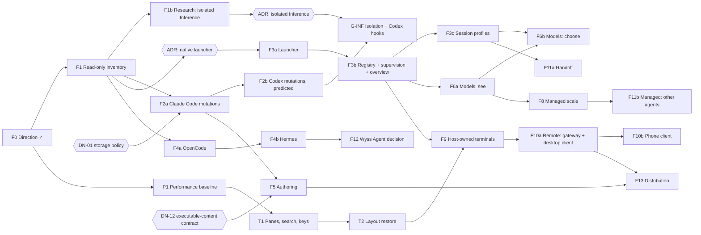

# 19 — Implementation roadmap

The whole product, broken into independently reviewable phases. **Nothing here is authorised
by being written.** A phase starts when the owner says so. Today: F0 is closed; F1 is
authorised and not started `[O]`; nothing else is authorised.

No dates are given: there is no evidence to estimate them from. **Size** is relative: S (days
of one person), M (one to three weeks), L (a month or more), XL (several months); they are
judgements.

## 1. From capability to phase

| Product capability                       | Epic         | Features                                                                   | Phases       |
| ---------------------------------------- | ------------ | -------------------------------------------------------------------------- | ------------ |
| A fast, comfortable terminal             | EP-TERM      | Measured baseline; panes; search; key map; layout restore                  | P1, T1, T2   |
| Seeing real configuration                | EP-CFG-READ  | Inventory of Claude Code and Codex; outside changes; managed compatibility | F1           |
| Changing real configuration              | EP-CFG-WRITE | Switch, park, restore; history and undo; Codex with prediction; authoring  | F2a, F2b, F5 |
| Hooks in Codex and managed Inference     | EP-INF       | Research; security ADR; isolation; unblock                                 | F1b, G-INF   |
| Agents started and seen from the Console | EP-NATIVE    | Launcher; registry; supervision; overview of both planes                   | F3a, F3b     |
| Working profiles                         | EP-PROFILE   | Session profiles; templates; versions; export                              | F3c          |
| More agents                              | EP-PROVIDERS | OpenCode; Hermes                                                           | F4a, F4b     |
| Knowing and choosing models              | EP-MODEL     | Catalogue and observed model; selection                                    | F6a, F6b     |
| Managed work at scale                    | EP-MANAGED   | Several runtimes or turns; other managed agents                            | F8, F11b     |
| Moving work between agents               | EP-HANDOFF   | Handoff package                                                            | F11a         |
| Sessions that outlive the window         | EP-HOST      | Host-owned terminals and native sessions                                   | F9           |
| Control from elsewhere                   | EP-REMOTE    | Gateway, pairing, desktop client; phone client                             | F10a, F10b   |
| A personal assistant                     | EP-AGENT     | Comparison; decision; provider                                             | F12          |
| A product for others                     | EP-DIST      | Licence, platforms, install, update                                        | F13          |

## 2. Dependencies

**Critical path to the owner's central goal** (visual, real control of hooks and rules):
F1 → DN-01 → F2a → F2b, with F1b → G-INF in parallel for Codex hooks. Everything else can
wait without blocking it.

**Parallel tracks**: P1 and T1 touch only the terminal and can run beside F1 and F2a. F1b is
research and runs beside F2a. F4a can start after F1.

**Minimum milestone versus product**: the first milestone that answers the owner's original
problem is F1 + F2a + F3a to F3c. It is not the product: sections F4 to F13 remain requirements.

## 3. Phases

Each phase has the same fields. Requirement identifiers are those of
[02](02-REQUIREMENTS.md); test identifiers those of [20](20-VERIFICATION-AND-ACCEPTANCE.md).

### F0 — Direction `[R]` done

`docs/PRODUCT.md`, ADR 0028 accepted, the compatibility matrix. Closed on 2026-10-12.

### P1 — Performance baseline

| Field                    | Content                                                                                                                  |
| ------------------------ | ------------------------------------------------------------------------------------------------------------------------ |
| Objective                | Replace every "to be replaced" of 15 §4 with a measured number, and compare with the reference terminal                  |
| Scope                    | The benchmark scripts and corpora; one run on each reference machine; a written baseline; restated budgets               |
| Exclusions               | Any optimisation; any change of renderer                                                                                 |
| Prerequisites            | The reference terminal installed, with consent                                                                           |
| Decisions required       | OQ-26 (timestamp hook in builds), OQ-27 (external latency method)                                                        |
| Deliverables             | `benchmarks/` with scripts; `docs/spec/performance-baseline.md` with raw numbers and conditions                          |
| Data, protocol           | None                                                                                                                     |
| Security                 | A debug-only timestamp must not ship in the package unless decided                                                       |
| Migration, compatibility | None                                                                                                                     |
| Tests to write           | TS-PERF-01 to 12 as scripts                                                                                              |
| Manual acceptance        | The owner reads the comparison and marks which gaps matter to him                                                        |
| Performance checks       | Itself                                                                                                                   |
| Failure, rollback        | Nothing to roll back; a procedure that cannot be made reproducible is dropped and said so                                |
| Risks                    | Numbers that vary too much to compare; conclusions drawn from one machine                                                |
| Definition of done       | Every metric of 15 §2 has a median and a 95th percentile on both machines, or a written reason why not; budgets restated |
| Review gate              | Owner: which budgets become requirements                                                                                 |
| Size                     | M                                                                                                                        |
| Parallel                 | Fully independent                                                                                                        |

### F1 — Read-only agent configuration inventory

| Field                  | Content                                                                                                                                                                                                                                                                                                                                                                                                                                                                                                                                                                                                   |
| ---------------------- | --------------------------------------------------------------------------------------------------------------------------------------------------------------------------------------------------------------------------------------------------------------------------------------------------------------------------------------------------------------------------------------------------------------------------------------------------------------------------------------------------------------------------------------------------------------------------------------------------------- |
| Objective              | The user sees, in the Console, the real configuration of Claude Code and Codex, with honest state, and sees it change when it changes outside. Nothing is written                                                                                                                                                                                                                                                                                                                                                                                                                                         |
| Scope                  | FR-CFG-01 to 04, 11 to 14, 16; FR-HRS-01, 05 (report), 06, 08 to 10 (inventory), 12; FR-ADP-01, 02, 04, 05; FR-SEC-03 to 06; FR-SYNC-01, 02 (show), 04; FR-UX-03, 05, 06; NFR-PERF-09; NFR-REL-04                                                                                                                                                                                                                                                                                                                                                                                                         |
| Exclusions             | Any mutation; any provider process started by the desktop; OpenCode and Hermes; profiles; native sessions; a live read of effective state                                                                                                                                                                                                                                                                                                                                                                                                                                                                 |
| Prerequisites          | ADR 0028 accepted `[R]`; the owner's "start"                                                                                                                                                                                                                                                                                                                                                                                                                                                                                                                                                              |
| Decisions required     | DN-10 (static only for Codex's effective state: recommended yes); bounds (OQ-22)                                                                                                                                                                                                                                                                                                                                                                                                                                                                                                                          |
| Deliverables           | `agentconfig/` (model, bounded reader, Claude Code and Codex adapters, redaction, round-trip check, watcher, inventory service); two commands (`inventory`, `changes`); the Configuration view, after its design contract; fixtures; `docs/spec/configuration-inventory.md`; README section                                                                                                                                                                                                                                                                                                               |
| Engineering tasks      | F1-01 model and errors · F1-02 bounded reader with path trust and link resolution · F1-03 Claude Code adapter · F1-04 Codex adapter, including system policy and the declared-state compatibility with managed Inference · F1-05 redaction and its corpus · F1-06 round-trip check · F1-07 watcher with debounce, overflow recovery and fallback rescan · F1-08 inventory service with revisions · F1-09 commands and capability list · F1-10 design contract, then the view · F1-11 fixtures per provider version · F1-12 specification and README · F1-13 rest-cost measurement · F1-14 external review |
| Data, protocol         | Two new window commands; the capability list grows by two reads; no control-protocol change; no store written (the last-seen index holds hashes only, in memory, until F2a)                                                                                                                                                                                                                                                                                                                                                                                                                               |
| Security               | The first code that reads user configuration: C-07, C-10, C-11 held by tests; `+security` review; the authority untouched (C-02)                                                                                                                                                                                                                                                                                                                                                                                                                                                                          |
| Migration              | None                                                                                                                                                                                                                                                                                                                                                                                                                                                                                                                                                                                                      |
| Backward compatibility | Every existing view and command unchanged; the terminal works with the engine failing (NFR-REL-03)                                                                                                                                                                                                                                                                                                                                                                                                                                                                                                        |
| Tests to write         | TS-CFG-01 to 09; TS-FS-01 to 05; TS-SEC-01, 03, 04; TS-UX-01, 04, 05; TS-REG-01 to 04                                                                                                                                                                                                                                                                                                                                                                                                                                                                                                                     |
| Manual acceptance      | AC-F1-01 the owner's nine Claude Code hooks, switched-off skills and MCP server names appear, with no value of any variable · AC-F1-02 editing a file in an editor shows within 2 s · AC-F1-03 a conflict copy marks its source · AC-F1-04 Codex hooks show the managed-Inference state · AC-F1-05 every control that would change something is absent or labelled "not available yet" · AC-F1-06 hashes of the owner's configuration files are identical before and after the acceptance session                                                                                                         |
| Performance checks     | M16, M19; M03 and M05 against the baseline if P1 is done                                                                                                                                                                                                                                                                                                                                                                                                                                                                                                                                                  |
| Failure, rollback      | The view can be removed without touching anything else; it writes nothing                                                                                                                                                                                                                                                                                                                                                                                                                                                                                                                                 |
| Risks                  | Misreading a format; a secret class missed; inotify limits; scope creep into mutation                                                                                                                                                                                                                                                                                                                                                                                                                                                                                                                     |
| Definition of done     | All tests pass; AC-F1-01 to 06 accepted by the owner; external review passed or its findings resolved; no file of any provider differs                                                                                                                                                                                                                                                                                                                                                                                                                                                                    |
| Review gate            | One external review (already approved by the owner `[O]`), then the owner                                                                                                                                                                                                                                                                                                                                                                                                                                                                                                                                 |
| Size                   | L                                                                                                                                                                                                                                                                                                                                                                                                                                                                                                                                                                                                         |
| Parallel               | F1-03 and F1-04 after F1-01 and F1-02; F1-07 independent; F1-10 after F1-08                                                                                                                                                                                                                                                                                                                                                                                                                                                                                                                               |

### F1b — Research: managed Inference independent of user hooks

| Field              | Content                                                                                                        |
| ------------------ | -------------------------------------------------------------------------------------------------------------- |
| Objective          | Decide, with evidence, whether and how Inference can be isolated (10 §5)                                       |
| Scope              | Experiments E1 to E8 on throwaway homes; a written contract; a draft ADR                                       |
| Exclusions         | **Any change to managed Inference**; any run on the owner's configuration                                      |
| Prerequisites      | The owner's authorisation to run the experiments                                                               |
| Decisions required | None to start; its output is DN-03                                                                             |
| Deliverables       | `docs/research/inference-isolation-<date>.md`; a draft ADR                                                     |
| Data, protocol     | None                                                                                                           |
| Security           | Experiments use a real provider binary and a test credential path: each is described and authorised beforehand |
| Tests to write     | The acceptance list AC-GINF-01 to 08, as specifications                                                        |
| Manual acceptance  | The owner reads the result and chooses among I1, I2, I4 or "not now"                                           |
| Failure, rollback  | If no design is safe: the block stays and 10 §5.8 applies                                                      |
| Risks              | Concluding from one provider version; an answer that depends on undocumented behaviour                         |
| Definition of done | Every experiment has a recorded result and its control; the contract covers the eight points of 10 §5.6        |
| Review gate        | Owner; an external security review is recommended                                                              |
| Size               | M                                                                                                              |
| Parallel           | Beside F2a                                                                                                     |

### F2a — Claude Code mutations

| Field                  | Content                                                                                                                                                                                                                                                                                                                                                                                                              |
| ---------------------- | -------------------------------------------------------------------------------------------------------------------------------------------------------------------------------------------------------------------------------------------------------------------------------------------------------------------------------------------------------------------------------------------------------------------- |
| Objective              | The owner turns existing Claude Code entries off and on from the Console, in the real file, with a way back                                                                                                                                                                                                                                                                                                          |
| Scope                  | FR-CFG-05 (Claude Code), 07 to 10, 15; FR-HRS-02, 03 (Claude Code), 07 (files), 08, 10; FR-SEC-01, 02, 08; FR-DAT-02, 04, 05; FR-OBS-02; FR-SYNC-02 (block), 03; NFR-REL-01                                                                                                                                                                                                                                          |
| Exclusions             | Codex; creating or editing anything; MCP changes (they need a provider process); profiles                                                                                                                                                                                                                                                                                                                            |
| Prerequisites          | F1; **DN-01 decided**; OQ-15 answered for skills                                                                                                                                                                                                                                                                                                                                                                     |
| Decisions required     | DN-01                                                                                                                                                                                                                                                                                                                                                                                                                |
| Deliverables           | `mutate.rs`, `journal.rs`, `restore.rs`; commands `plan`, `apply`, `history`, `undo`, `export`, `import`; the native confirmation dialog; plan and history screens; `docs/spec/configuration-changes.md`                                                                                                                                                                                                             |
| Engineering tasks      | F2a-01 planner per kind · F2a-02 risk classifier · F2a-03 native dialog · F2a-04 writer (beside, rename, verify) with per-target lock · F2a-05 journal and start-up repair · F2a-06 restoration store under the decided policy, with the secret classifier · F2a-07 last-seen data · F2a-08 undo · F2a-09 export and import · F2a-10 deletion of the engine's data · F2a-11 screens · F2a-12 fault-injection harness |
| Data, protocol         | New stores (14 §3); six new commands; the README's "Wyss never edits them" corrected to speak of the authority                                                                                                                                                                                                                                                                                                       |
| Security               | The first writes to user files: T-01 to T-10, T-16; `+security` review; a real run only on a copy first, then on the owner's files by his explicit authorisation                                                                                                                                                                                                                                                     |
| Migration              | Store formats at version 1                                                                                                                                                                                                                                                                                                                                                                                           |
| Backward compatibility | F1's reads unchanged                                                                                                                                                                                                                                                                                                                                                                                                 |
| Tests to write         | TS-CFG-10 to 14; TS-FS-06; TS-SEC-02, 05, 06; TS-REC-01 to 05                                                                                                                                                                                                                                                                                                                                                        |
| Manual acceptance      | AC-F2a-01 disable a hook, see it gone in Claude Code itself · AC-F2a-02 restore it, file byte-identical to the start · AC-F2a-03 change the file outside between plan and apply: nothing written · AC-F2a-04 a security hook asks in the native dialog · AC-F2a-05 the history shows both, with no content · AC-F2a-06 no store holds a seeded marker secret                                                         |
| Performance checks     | M03, M05, M16 unchanged against F1                                                                                                                                                                                                                                                                                                                                                                                   |
| Failure, rollback      | Every change is undoable or says why not; the feature can be disabled by removing the mutation commands from the capability list                                                                                                                                                                                                                                                                                     |
| Risks                  | A wrong edit of a real file; a secret kept; a race with Claude Code's own writes                                                                                                                                                                                                                                                                                                                                     |
| Definition of done     | Tests pass including fault injection at every step of 14 §4; AC accepted; external review                                                                                                                                                                                                                                                                                                                            |
| Review gate            | External security review, then the owner                                                                                                                                                                                                                                                                                                                                                                             |
| Size                   | L                                                                                                                                                                                                                                                                                                                                                                                                                    |
| Parallel               | F2a-01 to 03 in parallel; F2a-04 to 07 in sequence                                                                                                                                                                                                                                                                                                                                                                   |

### F2b — Codex mutations, with managed effect predicted

| Field              | Content                                                                                                                                                                                                     |
| ------------------ | ----------------------------------------------------------------------------------------------------------------------------------------------------------------------------------------------------------- |
| Objective          | Skills and MCP switches of Codex from the Console; hooks can be turned off; turning one on stays blocked, and the Console says why                                                                          |
| Scope              | FR-CFG-05 (Codex); FR-HRS-08, 09 (switch); ADR 0028 §6 points 2 to 4                                                                                                                                        |
| Exclusions         | Enabling a Codex hook; touching trust records; anything in the authority                                                                                                                                    |
| Prerequisites      | F2a; OQ-01 and OQ-03 answered                                                                                                                                                                               |
| Deliverables       | TOML planner; `managed_effect`; the cause shown when Inference is unavailable                                                                                                                               |
| Data, protocol     | None new                                                                                                                                                                                                    |
| Security           | C-08 and CTL-16 held by tests; the prediction uses the same fixtures as `zero_external_hooks`                                                                                                               |
| Tests to write     | TS-CFG-15, 16                                                                                                                                                                                               |
| Manual acceptance  | AC-F2b-01 a skill switched in Codex is seen by Codex itself · AC-F2b-02 "enable hook" is shown blocked with its sentence · AC-F2b-03 comments and layout of `config.toml` unchanged outside the touched key |
| Failure, rollback  | As F2a                                                                                                                                                                                                      |
| Risks              | Unknown storage of the hook switch; a comment lost                                                                                                                                                          |
| Definition of done | Tests; AC; review                                                                                                                                                                                           |
| Size               | M                                                                                                                                                                                                           |

### G-INF — Isolated Inference, then Codex hooks

| Field              | Content                                                                                 |
| ------------------ | --------------------------------------------------------------------------------------- |
| Objective          | Native Codex runs the owner's hooks and managed Inference works                         |
| Scope              | FR-MAN-07; then FR-HRS-02 for Codex                                                     |
| Exclusions         | Any fallback; any weakening of an attestation                                           |
| Prerequisites      | F1b; **an accepted ADR**; F2b                                                           |
| Deliverables       | The change inside the authority that the ADR specifies; the block lifted in the adapter |
| Data, protocol     | Per the ADR; possibly the handling of existing bindings (E7)                            |
| Security           | The highest of this roadmap: a change to an accepted security contract                  |
| Migration          | Existing Inference sessions, per the ADR                                                |
| Tests to write     | AC-GINF-01 to 08 as automated tests; the whole existing isolation suite unchanged       |
| Manual acceptance  | AC-GINF-01, 02 and 05 on the real machine                                               |
| Failure, rollback  | The previous authority build; the block returns                                         |
| Risks              | A provider behaviour that changes; a policy case not foreseen                           |
| Definition of done | All of 10 §5.7                                                                          |
| Review gate        | External security review; the owner                                                     |
| Size               | L                                                                                       |

### F3a — Native launcher

| Field              | Content                                                                                                                                            |
| ------------------ | -------------------------------------------------------------------------------------------------------------------------------------------------- |
| Objective          | Start an installed agent in a terminal without typing its command                                                                                  |
| Scope              | FR-NAT-01, 02, 04, 09, 11                                                                                                                          |
| Exclusions         | Profiles (F3c); observation beyond alive or exited (F3b)                                                                                           |
| Prerequisites      | F1; **an ADR extending 0005 to 0007** (DN-02); OQ-07                                                                                               |
| Deliverables       | Catalogue; start command; per-shell start recipes; the launcher sheet                                                                              |
| Data, protocol     | One new command that takes three identifiers                                                                                                       |
| Security           | C-01 kept: nothing free from the page; the session is labelled native (CTL-21)                                                                     |
| Tests to write     | TS-NAT-01 to 05                                                                                                                                    |
| Manual acceptance  | AC-F3a-01 `claude` starts with the same environment as when typed · AC-F3a-02 its global hooks run · AC-F3a-03 the session says it is not mediated |
| Failure, rollback  | The launcher removed; terminals unaffected                                                                                                         |
| Risks              | A shell recipe that mangles arguments; an environment that differs silently                                                                        |
| Definition of done | Tests for four shell families; AC                                                                                                                  |
| Size               | M                                                                                                                                                  |

### F3b — Registry, supervision, overview

| Field              | Content                                                                                                                 |
| ------------------ | ----------------------------------------------------------------------------------------------------------------------- |
| Objective          | The Console knows its native sessions and shows both planes in one place                                                |
| Scope              | FR-NAT-05 to 08, 10; FR-SES-01 to 03, 06; FR-OBS-03; FR-MOD-01                                                          |
| Prerequisites      | F3a                                                                                                                     |
| Deliverables       | Registry; resource sampling; the Sessions overview with plane badges; the native tab of History                         |
| Data, protocol     | Registry store; commands of IF-NATIVE                                                                                   |
| Security           | No PID is identity; nothing is signalled                                                                                |
| Tests to write     | TS-NAT-06 to 09; TS-SES-01, 02                                                                                          |
| Manual acceptance  | AC-F3b-01 two agents shown with their resources · AC-F3b-02 after killing the window, sessions are "lost", not "exited" |
| Performance checks | M17; no sampling while hidden                                                                                           |
| Size               | M                                                                                                                       |

### F3c — Session profiles

| Field             | Content                                                                                                                                                                     |
| ----------------- | --------------------------------------------------------------------------------------------------------------------------------------------------------------------------- |
| Objective         | Two sessions of one agent run with different configuration and no global file changes                                                                                       |
| Scope             | FR-PRF-01 to 08; FR-NAT-03; FR-HRS-11                                                                                                                                       |
| Prerequisites     | F3b; OQ-02, OQ-24                                                                                                                                                           |
| Deliverables      | Profile store; resolution; templates; the Profiles view; generated files per session                                                                                        |
| Security          | A profile holds no secret; an import grants nothing (T-16)                                                                                                                  |
| Tests to write    | TS-PRF-01 to 07                                                                                                                                                             |
| Manual acceptance | AC-F3c-01 two Claude Code sessions, one without a given global hook; the hashes of the global files unchanged · AC-F3c-02 a profile that cannot be applied refuses to start |
| Risks             | Promising independence a provider does not give                                                                                                                             |
| Size              | L                                                                                                                                                                           |

### Later phases

The same fields, more briefly: each of these is re-planned in full when it is next.

| Phase | Objective                                        | Scope                                   | Excludes                              | Needs first                            | Decisions                               | Deliverables                                            | Data or protocol                                            | Security                                    | Tests                        | Acceptance                                              | Rollback                                   | Main risk                                        | Done when                       | Gate            | Size |
| ----- | ------------------------------------------------ | --------------------------------------- | ------------------------------------- | -------------------------------------- | --------------------------------------- | ------------------------------------------------------- | ----------------------------------------------------------- | ------------------------------------------- | ---------------------------- | ------------------------------------------------------- | ------------------------------------------ | ------------------------------------------------ | ------------------------------- | --------------- | ---- |
| T1    | Panes, search, a key map                         | FR-TERM-03, 08; FR-UX-02                | Persistence                           | P1                                     | DN-04 (search add-on), OQ-14            | Split tree; search; palette                             | None                                                        | C-12                                        | TS-TERM-05 to 08             | A split, a search, every action from the keyboard       | Feature flags off                          | Key conflicts with programs and the input method | Tests; M08 and M05 not worse    | Owner           | M    |
| T2    | Layout restored at start                         | FR-TERM-10                              | Scrollback, processes                 | T1                                     | —                                       | Layout store                                            | A new file                                                  | Titles sanitised                            | TS-TERM-09                   | Reopen with the same tabs and folders                   | Delete the file                            | A stale folder                                   | Tests                           | Owner           | S    |
| F4a   | OpenCode inventory, then switches                | FR-ADP-01                               | Managed OpenCode                      | F1                                     | DN-04 (JSONC), OQ-04, OQ-12             | Adapter; fixtures                                       | None                                                        | As F1, F2a                                  | TS-CFG per provider          | As F1 for OpenCode                                      | As F1                                      | JSONC comments                                   | As F1                           | External review | M    |
| F4b   | Hermes as upstream                               | FR-AGT-01                               | Fork; managed Hermes                  | F4a; Hermes installed with consent     | DN-13, OQ-11                            | Adapter through its own writer                          | Running a provider command from the desktop                 | T-18                                        | TS-CFG per provider          | Inventory; a native start                               | As F1                                      | An agent with automations of its own             | As F1                           | Owner           | M    |
| F5    | Create, edit, delete; global profiles            | FR-CFG-06; FR-HRS-04, 07, 09; FR-PRF-09 | —                                     | F2a                                    | **DN-12**, DN-13                        | Native editing dialog; planners                         | Stores as F2a                                               | T-02: the highest of the configuration side | TS-CFG-17 to 20              | A hook authored and run by the provider                 | Undo                                       | Executable content from a compromised path       | Tests; external security review | Owner           | L    |
| F6a   | See models                                       | FR-MOD-01 to 04, 07 to 10               | Choosing                              | F3b                                    | **DN-09** (authority projection), OQ-10 | The observed model carried to the window                | A field in the authority's view; maybe the event vocabulary | SG-12 unchanged                             | TS-MOD-01 to 04              | The model of a managed turn, as reported                | Previous authority                         | A strict contract changed                        | Tests; ADR                      | Owner           | M    |
| F6b   | Choose models                                    | FR-MOD-05, 06; FR-NAT-03                | Typing provider commands for the user | F6a, F3c                               | An ADR if managed selection is wanted   | Profile field; start flags                              | Possibly activation                                         | SG-12's surface                             | TS-MOD-05, 06                | A session started with a chosen model, confirmed by F6a | —                                          | Entitlement confusion                            | Tests                           | Owner           | M    |
| F8    | Several managed runtimes or turns                | FR-MAN-08                               | —                                     | F6a                                    | **DN-08**                               | A redesign inside the authority                         | Schema migration                                            | Every attestation is per generation         | The existing suite extended  | Two managed turns at once                               | Previous schema is not restorable: back up | The core's invariants                            | ADR; suite; external review     | Owner           | XL   |
| F9    | Terminals and native sessions outlive the window | FR-TERM-11                              | Remote                                | F3b, T2                                | **DN-05** (host service)                | Host service; the window as its client                  | A new local protocol                                        | A new long-lived process with PTYs          | TS-HOST-01 to 06             | Close and reopen the window: the same shells            | The in-window terminal kept as fallback    | Scrollback and resize with several clients       | Tests; M05 of the service       | Owner           | XL   |
| F10a  | Remote from another computer                     | FR-REM-01 to 08; FR-SEC-09              | Phone                                 | F9                                     | **DN-05**                               | Gateway; pairing; grants; desktop client                | A network protocol                                          | 16 §5.4                                     | TS-REM-01 to 10              | Journey J14                                             | Gateway off                                | A remote shell is full control                   | Tests; external security review | Owner           | XL   |
| F10b  | Phone client                                     | FR-REM-09                               | —                                     | F10a                                   | Platform choice                         | A client                                                | —                                                           | Step-up on device                           | TS-REM-11 to 13              | Journey J15                                             | —                                          | Store policies                                   | Tests                           | Owner           | L    |
| F11a  | Handoff                                          | FR-SES-04, 05                           | Lossless claims                       | F3c                                    | —                                       | Package format; review screen                           | A file format                                               | T-19                                        | TS-SES-03, 04                | A reviewed package starts a second agent                | —                                          | Injection through quoted content                 | Tests                           | Owner           | M    |
| F11b  | A second managed agent                           | FR-MAN-09                               | —                                     | F8                                     | An ADR per agent                        | Execution adapter; isolation                            | Authority                                                   | 06 §5                                       | The managed suite, per agent | A managed turn of that agent                            | —                                          | No attestable protocol                           | ADR; suite                      | Owner           | XL   |
| F12   | Wyss Agent: decide                               | FR-AGT-02, 03                           | Building it                           | F4b                                    | **DN-06**, DN-11                        | The comparison redone on real installations; a decision | —                                                           | —                                           | —                            | The owner's choice among 17 §6                          | —                                          | Deciding from documents                          | A written decision              | Owner           | M    |
| F13   | Distribution                                     | FR-DIST-02 to 06; FR-OBS-05             | —                                     | The product accepted by its first user | **DN-07**                               | Per 18 §3                                               | Update and migration paths                                  | Provenance; supply chain                    | TS-DIST-01 to 06             | A stranger installs it                                  | —                                          | Platforms                                        | 18 §7                           | Owner           | XL   |

## 4. Review gates, in one place

| Gate                                  | Who                                  | Applies to                                                                                                           |
| ------------------------------------- | ------------------------------------ | -------------------------------------------------------------------------------------------------------------------- |
| Design contract before a view         | The owner                            | Every phase with a screen                                                                                            |
| ADR before the phase                  | The owner                            | F2a (DN-01), F3a, G-INF, F4b (DN-13), F5 (DN-12), F6a, F8, F9, F10a, F11b, F13; a small one for T1 (21 §1, row 0006) |
| External review, one pass             | A reviewer who did not build it      | F1, F2a, F2b, F4a                                                                                                    |
| External security review              | The same, on security                | F2a, G-INF, F5, F8, F10a                                                                                             |
| Real use on the owner's configuration | The owner's explicit word, per phase | F2a onward                                                                                                           |

## 5. What may not be done out of order

| Rule                                                    | Why               |
| ------------------------------------------------------- | ----------------- |
| No mutation before DN-01                                | ADR 0003          |
| No enabling of a Codex hook before G-INF                | ADR 0028 §6       |
| No agent started by the Console before the launcher ADR | ADRs 0005 to 0007 |
| No authoring before DN-12                               | T-02              |
| No remote before host-owned terminals                   | L6                |
| No change of terminal technology before P1              | AD-17             |
| No distribution work before DN-07                       | ADR 0027          |
