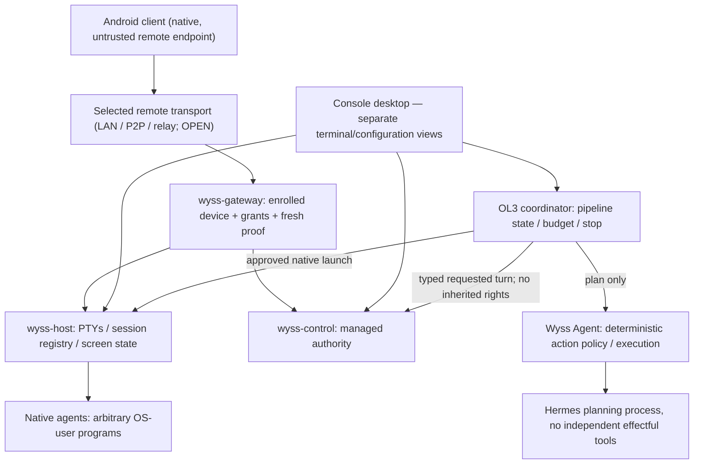

# 33 — Cross-domain reconciliation after owner decisions

Status: **planning proposal; unresolved blockers are not waived**. Read with
[32](32-OWNER-PRODUCT-DIRECTIONS-2026-10-13.md), [22](22-DECISIONS-AND-OPEN-QUESTIONS.md),
[31](31-PLANNING-COVERAGE-AUDIT.md), [25](25-INDEPENDENT-REVIEW.md) and
[30](30-TECHNICAL-VALIDATION-PLAN.md).
Nothing was implemented, executed or independently reviewed in this reconciliation.

## 1. Hard invariants

R1. A native terminal running as the host user is *capable of arbitrary actions by that user*.
Remote terminal input (DN-44=B) is therefore account-level trust, even if the remote gateway
exposes granular read/approval/configuration grants. If a device gets `terminal.write`, those
narrower grants are not an OS boundary. Do not assert otherwise.

R2. As a *design rule*, managed `wyss-control` must remain the sole intended owner
of managed turns, leases, attestations and approvals. **This rule is not
enforced against a compromised same-UID process by ADR 0011/0020**:
an unrestricted native agent or LP4 shell may contact local sockets
as the host user. Native OL3 auto-dispatch and claims that a native
confirmation cannot be forged are **BLOCKED_TRUST_BOUNDARY**
until an independently reviewed OS-principal/IPC separation is proven.
No gateway/GUI/typed request alone forms a same-UID security boundary.

R3. A model's output is untrusted **input that can steer a receiving
agent**. Calling a handoff "data only" or quoting it does not prevent
prompt injection against a native agent with full-account effects.
No automatically generated handoff may trigger an unattended native
step; reviewed bytes and per-launch native confirmation are required
even after a whole-DAG approval. A handoff never carries permission.

R4. A previous session, restored layout, whole-DAG approval,
saved confirmation, remote grant, notification or prompt must not
silently start a privileged process. A native/full-account step
always requires local per-attempt confirmation **plus** a proven
trust boundary: confirmation fields accessible to other
same-UID agents are not a proven security mechanism.

R5. The provider's real configuration remains the source of truth. A UI inference is not a
verified runtime value; provider-native writers preferred; filesystem direct writes prohibited
until proven safe for that exact operation and environment (DN-21, DN-31; L1/L2/L5).

R6. Personal data, recoverable configuration content and credentials must not enter durable
telemetry, logs or history. The dedicated protected vault's exemptions are **not yet
technically approved**. A notification or remote transport is a new disclosure surface.

R7. No time-out, memory pressure or storage quota automatically deletes user-held recovery
entries or silently destroys unsent tasks. Runtime *ephemeral scrollback* has separate,
visible boundedness, while history analytics may keep bounded metadata, not content.

R8. Close window, detach, KDE logout, host crash, agent crash, suspend, reboot and transport
drop are distinct events with distinct recovery semantics. No honest state named 'running'
survives the death of its corresponding OS process.

## 2. Conflict register

| Conflict | Impact if glossed over | Reconciled design requirement | Gate |
| --- | --- | --- | --- |
| RC-01 DN-44=B vs DN-45=B | Android's LP4 shell can directly edit config, bypassing the host-confirmation request flow | UI must explicitly label LP4 as **full host account access**. Only `config.request` is host-confirm-only. No promise that host confirmation constrains LP4. For truly bounded remote config rights, issue **no** `terminal.write`; optionally isolate a future remote shell under a different OS principal as a separately reviewed product proposal | External remote threat review; privilege exercise before LP4 |
| RC-02 DN-22=B vs same-user terminal | Separate web views stop a compromised config view calling terminal APIs but do not contain a compromised terminal | Design capability-separated views, IPC permissions, CSP and native confirmation, while displaying the correct same-UID residual risk | OQ-36; native-view isolation review and tests |
| RC-03 DN-08=A vs authority one-turn invariants (ADRs 0012/0015) | Starting a second runtime could reuse wrong attestations, approve wrong run, violate one-writer contract | Keep every managed runtime generation, catalog, thread, leases, state machine and event identity distinct; coordinator requests execution through the same authority API. Extend concurrency only via independent ADR and adversarial multi-runtime tests | Measurement of contention; security review of extended core |
| RC-04 DN-15=OL3 vs DN-06=D | Two orchestrators might both issue actions, leading to bypass or recursion | Console coordinator orders sessions and handles delegation. Wyss Agent policy controller decides its own actions; Hermes proposes only. Contracts declare exact owner of every execution, prohibit nested implicit subagents, and audit origin/correlation | OQ-55–57; orchestration contract review |
| RC-05 DN-42=C + DN-09=C + DN-43=D | Selected model could be presented as actual; provider may reroute; durable analytics risks leaking data | Store selected model separately from reported model, each with source/version/time and correct granularity. Events for observed reroutes, explicit unknowns. Usage recorded as provider-reported metadata, no fabricated prices | ADR 0031 review; provider observation tests OQ-50; new ADR for selected model |
| RC-06 DN-46=B + DN-36=D | Restoring saved layout could unexpectedly launch a stopped agent or duplicate a live one | Probe `wyss-host` registry first; attach by strong session identity and generation. On missing process restore only layout and editable *start proposals*; opt-in each launch, with fresh controls | Host lifetime/identity tests; linger consent |
| RC-07 DN-47=B + DN-40=C | Full-screen emulation plus scrollback may grow without bound, contrary to low-footprint goal | Separate minimal current screen state, terminal history ring, transport backlog and renderer cache; independently account and cap each; visible loss/snapshot resync, never unbounded growth | M12/M21/M24 plus malicious ANSI/escape corpus, long-running memory tests |
| RC-08 DN-05 hybrid + DN-48=A | Transport switching and phone reconnect could duplicate input or misattribute authority | E2E authenticated, device-bound session identity; monotonic input claim epoch/sequence; only one active writer; transport migration cannot enlarge grants; replay/timeout are idempotent and fail closed | Gateway ADR, transport comparative tests, threat review; DN-05 open |
| RC-09 DN-05/remote + Sarmiento | Existing RustDesk relay/control plane could be mistaken for a general-purpose Wyss transport or security approval | Sarmiento may optionally provide device discovery, never inherited Wyss shell permissions or silently claimed relay compatibility; independent credentials/protocol/lifecycle unless proven otherwise | Integration research; no deployment authorised |
| RC-10 DN-21 + DN-31 | Temporary plaintext on replicated/snapshotted home; atomic exchange fails across mounts; concurrent provider writes lose controls | Direct writes stay disabled. Provider-native commands only after evidence; alternative transaction locations must prove same filesystem, no replication and accepted snapshot policy before ADR | L1/L2/L5, B1, TV-29; DN-31 unresolved |
| RC-11 DN-20=B + DN-14=C | Attempting to isolate per-session controls may accidentally copy global authentication or drop system policies | Only documented provider-supported profile isolation; evaluate all exclusion diffs at launch; bind confirmation to provider+project+effective excluded set; no auth-copy fallbacks or hidden generated files | Provider-specific capability proof OQ-02/OQ-34 |
| RC-12 DN-12=A + DN-13=A | Arbitrary hook authoring or malformed command may enter unsafe API path | Hook command editor is native/backend-owned, and documented provider-native operations are a closed allowlist, with typed metadata not arbitrary shell fragments. Deny direct writes until transaction gates pass | DN-22 / security ADR + DN-21 |
| RC-13 DN-35=C + DN-43=D + DN-44=B | Sensitive model output, paths or usage data may leak in OS notifications or cloud push | Notification payloads: category, non-sensitive aggregate count, opaque reference; no command text, private paths, secrets, model output or prompt. Durable usage records: provider, model ID, scope, counters, time, observation source; deny content and secrets | Contract validation; privacy/lock-screen review |
| RC-14 DN-07=A vs previous F13 public release obligations | Documentation could claim personal finished product requires public signing server and multi-platform release | Separate *personal installation/upgrade/backup acceptance* from public distribution; mark DN-49/DN-51 and public marketing/support tests N/A conditionally. No implementation, no publishing and ADR 0027 stands | Rewrite phase/traceability and acceptance, review |
| RC-15 OL3 vs low-resource desktop | Unbounded agents could exhaust memory or cause two writers in a project | Explicit separate limits for managed runtimes, native PTYs, project write locks, process trees, queued work, clocks, tokens/usage where available; admission and graceful stop | M01–M33 measurement plan and concurrency evidence |
| RC-16 DN-15=OL3 + DN-46=B | A coordinator owned by the desktop window stops scheduling or mis-replays work at UI close/logout | Coordinator is a headless user service independent of UI, managed authority and terminal parsing; no auto-launch on restoring UI (34 §2.1) | Headless lifecycle/restart tests and explicit linger consent |

## 3. Boundary diagram (target, not installed)

Important: arrows show *candidate data and request paths*, not permission grants. The remote
`terminal.write` path to `Host` grants host-account power; the managed path to `Control`
remains distinct. The graph does not assert Hermes confinement has been achieved. **The
same-UID local sockets are not isolated from a compromised native agent.**
IR-01 and IR-03 of the [REJECT report](reviews/2026-10-13-independent-post-owner-review.md)
remain blocking; see [42](42-POST-REJECT-CORRECTIVE-PLAN.md).

## 4. Design precedence in case of conflict

1. Current *accepted* ADRs and mandatory safety restrictions apply until separately
   superseded by an independently reviewed and accepted ADR.
2. Owner final-product direction defines *what the product must eventually do*, but does
   not silently change the current code or installed state.
3. New design documents can propose how to satisfy a direction; they cannot declare
   the corresponding security property observed without evidence.
4. When meeting a product direction requires weakening a guarantee, record a blocker and
   a real alternative, and ask the owner **only when such an informed trade-off remains**.

## 5. Explicit exclusions

- No claim that native provider tools are mediated by the managed `wyss-control` boundary.
- No claim that biometric or device presence establishes the host's native physical consent.
- No automatic `model/rerouted` classifier relaxation without accepting ADR 0031.
- No OL4 unattended scheduling implied by OL3; a running OL3 plan that was explicitly approved
  can progress only inside that approved finite envelope.
- No terminal-content cloud storage, remote durable transcript or secret-bearing analytics.
- No silent shell command injection for native model switching.
- No raw server configuration or provider credential copying through remote device discovery.
- No public distribution scope inferred from the existence of a packaging design in document 18.

## 6. Required remediation in existing documents

- [02](02-REQUIREMENTS.md): add owner-specific OL3, screen restore, model select/actual
  distinction, Android, notifications, and personal deployment acceptance.
- [20](20-VERIFICATION-AND-ACCEPTANCE.md): detailed negative/positive test cases and
  explicit criterion IDs for the new obligations.
- [23](23-TRACEABILITY-MATRIX.md): ensure new IDs reach design, phase, test, acceptance.
- [16](16-MULTI-DEVICE-AND-REMOTE.md): the RA3 recommendation is superseded **as an
  owner decision** by DN-05's hybrid research preference; keep candidate designs.
- [17](17-WYSS-AGENT-AND-HERMES.md): OL3 and D now owner-selected; Hermes confinement unresolved.
- [31](31-PLANNING-COVERAGE-AUDIT.md): do not reuse 64.2% as a revised figure after these
  decisions; re-audit dimensions only after traceability/design/test gaps are reconciled.

Reviewed? **No**. Implemented? **No**. Validated in running code? **No**.
