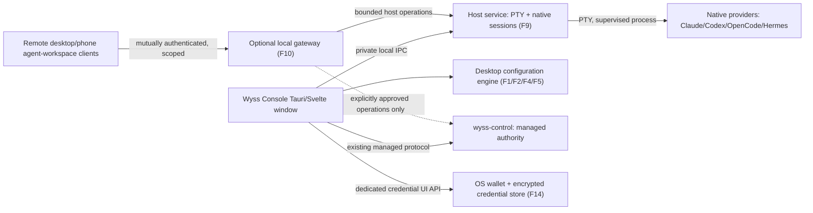

# Cross-phase interfaces, ownership and compatibility (implementation-ready proposal)

**Status:** Proposed extension of architecture 04–12, 14, 16 and 18. These are **contract sketches**, not observed Rust structs or approved protocols. Existing `IF-CONFIG`, `IF-NATIVE`, `IF-PROFILE`, authority control wire and ADR 0031 host protocol prevail. An implementer must map these fields to actual types and version them rather than create duplicate services.

## Ownership diagram



A broken terminal host must not compromise authority leases, approvals or isolation (ADR 0004/architecture 10). The gateway never receives the authority's raw socket or a blanket same-user claim. F10 is **remote agent/session control**, not graphical screen sharing (architecture 16 §3).

## Contract-wide rules

1. Every new event and durable object has `schema_version`, immutable ID, owner/host generation and an explicit source of authority.
2. UI-origin requests are typed commands with bounded validated fields, not free text shell instructions. Mutations use opaque request IDs and explicit confirmation semantics.
3. Avoid PID as session identity; verify host generation and its stable session ID. Distinguish `native` and `managed` in data and UI.
4. Provider-generated output, terminal text, imported content and model text are **untrusted data**.
5. Errors are a typed safe category plus optional bounded explanation, never raw provider stderr, credential, command argument or environment dump in a user-visible error.
6. A provider file is authoritative about **written configuration**, not necessarily live effect. Provider effective state and observed model require separate evidence.
7. A disconnected/unknown source never becomes `off`, `exited`, `verified` or `safe` by default.
8. All IPC endpoints bound to explicit peer identity and version. Sizes and streaming backpressure fixed from actual performance measurements; never unbounded.

## Candidate read models (illustrative, not binding Rust/TS)

```typescript
type Evidence = {
  level: 'observed' | 'documented' | 'predicted' | 'unverified';
  providerVersion?: string;
  checkedAt?: string;
  source?: 'provider' | 'file' | 'authority' | 'host';
};

type HostSessionView = {
  schemaVersion: number;
  hostId: string;
  hostGeneration: string;
  sessionId: string; // never PID alone
  plane: 'native' | 'managed';
  providerId?: string;
  profileId?: string;
  projectRef?: string; // sanitized path reference
  lifecycle:
    | 'starting'
    | 'active'
    | 'stopped'
    | 'failed'
    | 'ended_by_signal'
    | 'lost'
    | 'disconnected';
  reconnectable: boolean;
  reasonCode?: string;
  observedAt: string;
};

type ModelDisplay = {
  providerId: string;
  sessionId?: string;
  catalogueIds?: string[]; // list !== entitlement
  configuredId?: string;
  requestedId?: string;
  observedId?: string; // only provider report
  observedScope?: 'session' | 'turn';
  evidence: Evidence;
};

type OperationReceipt = {
  requestId: string;
  operation: string;
  resourceId?: string;
  result: 'applied' | 'no_change' | 'conflict' | 'failed' | 'unverified';
  safeErrorCode?: string;
  verifiedEffect?: boolean;
};

type RemoteGrant = {
  grantId: string;
  hostId: string;
  deviceId: string;
  capabilities: string[]; // closed, explicit enum in real schema
  validUntil: string;
  revokedAt?: string;
};
```

No raw prompts, PTY bytes, model output or credential value in metadata read models.

## Host attach and streaming (F9/T1/T2)

```text
Client HELLO(version, expected_host_id, capabilities)
Host WELCOME(version, actual_host_generation, bounded_limits)
Client ATTACH(session_id, prior_generation?, scrollback_offset?)
Host ATTACHED(pty_state, stream_epoch, replayed_range or gap)
Host OUTPUT(stream_epoch, monotonically_sequenced_chunk)
Client INPUT(session_id, explicit_input_owner, monotonically_sequenced_request)
Host INPUT_RESULT(accepted | stale | denied | disconnected)
Client RESIZE(session_id, policy_bound_dimensions)
```

This sequence is a **suggested review checklist** for the already implemented F9 protocol. Do not retrofit it wholesale without inspecting ADR 0031 and local implementation. The host owns scrollback and process lifecycle; layout is a window-side view reference. A retry must not duplicate input bytes.

## Configuration authoring and provider adapter (F4/F5)

Existing `IF-CONFIG` plan and apply flow remains source of truth. Candidate new authoring envelope: `provider_id`, `source_id`, `scope`, `entry_kind`, `expected_source_revision`, `operation`, validated typed payload, `intent_id`. The desktop constructs byte-preserving file patches or closed provider-writer operations; UI **cannot** pass arbitrary commands. Redacted preview and risky native confirmation precede apply.

An adapter declares `capability_status` per provider/version for `inventory`, `switch`, `author`, `restore`, `native_launch`, `list_models`, `report_used_model`. Capability inheritance across providers is forbidden.

## Remote protocol (F10)

A versioned authenticated gateway binds each request to `device_id`, `host_id`, `grant_id`, `capability`, expiry and unique mutating request ID. View-only and input/managing capabilities are separate. Revocation terminates active channels and blocks reconnect. Remote requests **do not** masquerade as a local same-user peer.

Streaming uses bounded windows, ring buffers and explicit gap markers. Restrict gateway to owner-approved interface; never bind `0.0.0.0` as convenience or claim a private network is authentication. Device identity must be verified at the application layer.

## F14 credential handles

Credentials are identified by opaque IDs. The webview receives only redacted metadata. Wallet and encrypted vault own bytes. A native UI action cannot grant a key to arbitrary child launches; provider-specific credential access is approved and validated. No `secret` or `token` field in generic IPC payloads, exportable profiles or diagnostic receipts.

## Versioning, faults and proof

- Unknown major wire version: refuse with safe upgrade instructions; unknown optional minor field: only if specified by schema.
- Replay across host generations: reject.
- Host disconnection: `disconnected`, not `ended`.
- Bad/stale provider file revision: `conflict`, not last-writer-wins.
- Provider not installed or unsupported version: `not_available`, not fake fallback.
- Locked wallet: `locked`, not plaintext store.
- Managed attestation unavailable: deny managed work; no native fallback silently.
- Observed model unavailable: unknown; do not infer from selected.
- Untrusted handoff artifact: preview and confirm; no implicit execution.

## Integration checklist

Before writing actual types, inspect committed schemas in local F9/ADR 0031, authority events/SG contracts and existing TypeScript/Rust code. Produce one real source-of-truth schema, golden serialization fixtures, schema migration tests, Rust/TS typing tests and negative IPC fuzz/bounds tests. Don't split the same state across the page, host, vault and authority without a single owner.
