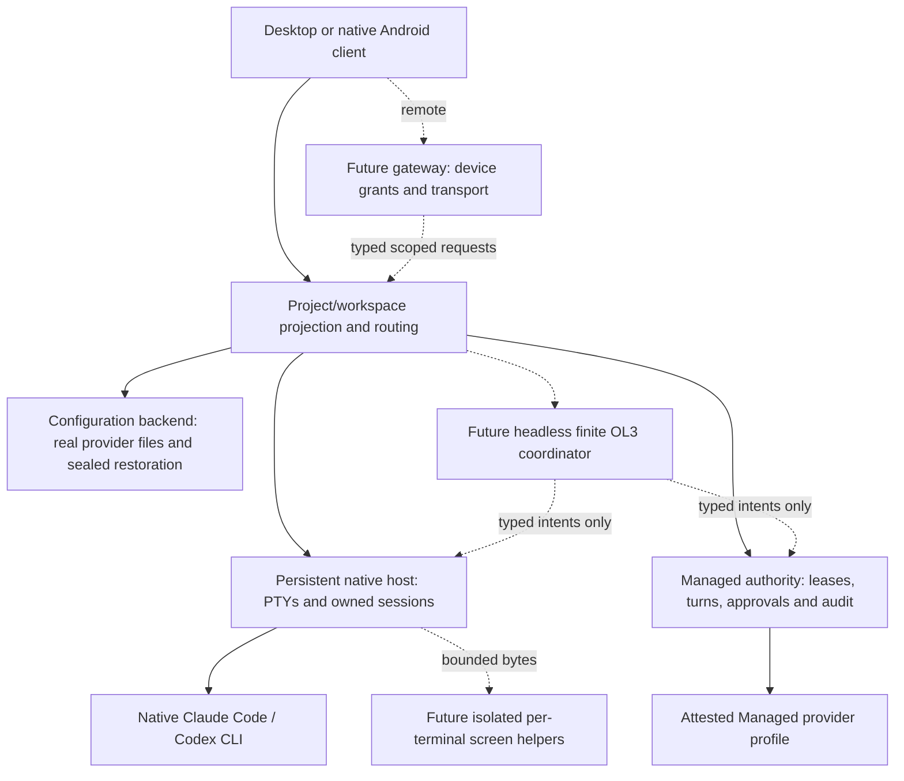

# Consolidated architecture and workflow model

Status: proposed target architecture with an explicitly bounded implemented baseline.
Read [functional specification](functional-specification.md), [status](implementation-status.md)
and accepted ADRs together. A diagram arrow is neither implementation nor proof of trust.

## 1. Baseline and architectural delta

Current implementation/acceptance is owned by the [status register](implementation-status.md).
The component model below specifies ownership and proposed changes, not another
capability checklist. In particular, separate authorities must never share a writer/store.

The redesign adds a **project/workspace identity and projection layer**, not a replacement
authority or terminal engine. Existing folder selection, project defaults, native grouping
and layout persistence are inputs to migrate. They do not already provide this model.
The owner-approved directions are WD-01/02 in [PRODUCT](../PRODUCT.md). Persistence and
interface changes are proposed in [ADR 0052](../adr/0052-project-centered-workspace-identities.md).
Claude Managed requires its own proposed
[ADR 0053](../adr/0053-claude-code-managed-integration-boundary.md), not a new name for Native.

Current implementations do not include Gateway, coordinator, faithful parser helpers
or Managed Claude. Project is a proposed application layer, not a security principal.
Native launch arrows do not authorize automated OL3 Native dispatch past its trust gate.

## 2. Identity and domain ownership

| Entity                     | Stable identity and scope                                               | Authority over state                             |
| -------------------------- | ----------------------------------------------------------------------- | ------------------------------------------------ |
| Client device              | DeviceId, host-specific enrollment/grants                               | Future gateway; desktop local client is distinct |
| Execution host             | HostId, installation identity; key rotation separate from display name  | Host enrollment/configuration owner              |
| Project                    | ProjectId with immutable identity, label and archived flag              | New local project store                          |
| Root binding               | ProjectId + HostId + BindingId/revision, validated root handle/identity | Backend project resolver                         |
| Workspace                  | WorkspaceId + ProjectId + HostId, layout revision                       | Workspace store, UI presentation projection      |
| Native session             | Existing native UUID + owning host generation                           | Native host/registry; never a provider thread    |
| Terminal                   | HostId + host instance + TerminalId                                     | Host's owned handle, not a PID found by scanning |
| Managed session            | Authority/store identity + ManagedSessionId                             | That authority's canonical SQLite writer         |
| Managed launch             | Authority instance + session + runtime instance + generation            | F8 allocator/registry and owned worker           |
| Provider conversation/turn | Opaque provider ID bound to one managed/native context                  | Provider; authority validates Managed bindings   |
| Workflow/step/attempt      | Distinct immutable IDs and plan revision/digest                         | Future coordinator; owns scheduling only         |

No identity derives from title, directory name, Git URL, PID or a frontend assertion.
Same local path on two PCs is not the same binding; the user links them explicitly.
Several workspaces may reference one session without owning it twice. Workspace duplication
copies preferences only; a new launch receives a new execution identity. Context captures
are immutable for in-flight operations. Store/session identity remains explicit even
when P1 and P2 histories originated from a migration copy.

### Project/workspace data contract (proposed version 1)

`ProjectV1`: schema, ProjectId, label, created/updated timestamps, revision, archived,
root bindings, default workspace ID and provider-specific default profile references.
`RootBindingV1`: BindingId, HostId, revision, canonical path (local private store only),
device/inode observation plus explicit relink history, checkout kind and state.
Identity observation must be revalidated through descriptors before scoped effects;
an inode is not everlasting identity and remote clients never supply trusted paths.
`WorkspaceV1`: schema, WorkspaceId, project/host IDs, revision, layout tree, focus,
pinned safe titles, session references and launch preferences. No prompt/output,
provider credential, lease, approval, generated overlay or PID is stored there.

Launch requests use project/binding/workspace IDs, expected revisions, provider/mode/
profile IDs and placement. Backend derives the actual directory and closed launch
parameters, invokes the existing owner and records association only after an unambiguous
receipt. If spawn may have happened without association commit, retain an ambiguous
association entry, reconcile by immutable request/session ID and do not spawn again.
Unknown schema/fields, wrong host/project, stale binding or deleted profile refuses.

Proposed admission ceilings: 256 project records, 32 workspaces per project, 16 root
bindings per project, 16 terminal leaves per workspace subject to the **existing global
host PTY cap of 16**, tree depth 8, labels 64 Unicode scalars, path 4096 UTF-8 bytes,
project/workspace file <=4 MiB. Validate counts/bytes/depth before parse allocation;
these are design limits to test, not performance measurements. Do not invent garbage
collection of user projects on reaching a ceiling; refuse new records and offer archive/
explicit removal. Archive itself does not free a live execution slot.

## 3. Component contracts and invariants

| Component            | Owns                                                                    | Interface delta / failure rule                                                                                                     |
| -------------------- | ----------------------------------------------------------------------- | ---------------------------------------------------------------------------------------------------------------------------------- |
| Workspace UI/backend | Selection, layout and opaque associations                               | Project list/get/register/relink/archive; workspace create/update/remove/attach; revision-checked intents; never runtime authority |
| Native host          | PTYs, native launches, lifecycle and profiles                           | Extend versioned feature negotiation for project association without accepting free argv; existing clients stay compatible         |
| Config engine        | Source discovery, plan/apply/Undo, native authoring, sealed restoration | Bind every plan to root/context revision; existing source/ACL/transaction checks remain authoritative                              |
| Managed authority    | Leases/turns/approvals, attestation, durable control/audit              | Existing narrow APIs; project association outside authority cannot change its workspace binding                                    |
| Execution adapter    | Provider protocol normalization and isolation proof                     | Closed profile/method/event allowlists; unknown external action contains runtime                                                   |
| Coordinator          | Finite DAG, bounded scheduling, attempts and metadata journal           | Uses normal host/authority requests; no direct provider effect or approval shortcut                                                |
| Gateway              | Device authentication, scoped grants, anti-replay and routing           | Typed application operations only; never expose Unix control protocol directly                                                     |
| Screen helper        | Untrusted escape parsing and volatile checkpoint state                  | Isolated restartable per-terminal helper, bounded IPC/resources; no PTY master or authority capability                             |

Do not merge configuration adapters with execution adapters: read/write support for a
provider's files proves nothing about Managed mediation. Do not move terminal parsing
into the Managed authority. Do not route Native provider prompts through Wyss approvals.
Global/admin configuration remains separately accessible and shows cross-project impact.

### Event and intent discipline

Use versioned closed DTOs, explicit host/store/session/generation, expected revision and
idempotency key where there is a side effect. Unknown fields reject. Read/list/subscribe
does not start work. Preserve existing receipt semantics and original intent retry;
never map a transport reconnect to a fresh action. Cross-owner association/event updates
are not a distributed atomic transaction: model `pending/committed/ambiguous` and reconcile.
Authority audit is canonical history, not a source from which execution is reconstructed.

Each stream retains its own cursor. Cross-stream timelines may sort observed timestamps
but must disclose that this is not a global causal sequence. Transient terminal/provider
content is not serialized into the metadata bus to simplify correlation.

## 4. Provider and mode model

| Lane                          | Provider capability                                               | Security/operational contract                                                   |
| ----------------------------- | ----------------------------------------------------------------- | ------------------------------------------------------------------------------- |
| Native unrestricted (U)       | Original Claude/Codex CLI; own hooks/MCP/skills/plugins/subagents | Full host-user rights; provider controls, not Wyss mediation                    |
| Managed Inference (M)         | Text-only under a qualified provider profile                      | Attested no-tool surface and scoped authority admission                         |
| Managed Local Tools (M)       | Exact reviewed subset of tools                                    | Per-action authority mediation; no implicit extension to plugins/network/hooks  |
| Restricted staged worker (B1) | Proposed useful workflow with quarantined result                  | Different future contract from U and M; pure types/fixtures only today          |
| Planner (P)                   | Proposes a bounded plan as untrusted data                         | No direct effects; OS denial and policy controller required                     |
| Approval authority (A)        | Human approval integrity against defined attackers                | Distinct principal/path required for strong claims; same-UID UI is insufficient |

Preserving original capabilities means an honest Native path plus a visible per-mode
capability matrix. It does not mean relaxing Managed containment until it looks like
Native. Any required Managed function still unsupported remains an explicit final-product
gap. Claude SDK callbacks/headless streaming are integration candidates, not proof of
no hidden tools, complete tool mediation or secure authentication/refresh isolation.

Protocol 2 cannot currently express model/effort selection. A new versioned request
extension needs catalogue binding, attestation and independent review; do not add loose
`options`/`config` JSON. A provider's internal subagents are not Wyss OL3 steps; exposing
them in Managed also requires a separate mediated, bounded profile.

## 5. Security model and unresolved technical gates

The current product protects against narrow IPC misuse, malformed provider messages,
stale/replayed intents and unsafe admitted effects under the accepted profile. It does
not protect its same-UID approval socket against every unrestricted account process.
Accepted ADR 0018 residual risks remain. In the accepted Codex Local Tools
profile, an explicitly approved command can read the narrowly bound provider credential
and can exploit a pre-existing workspace hardlink for effects outside the apparent root.
File-change path/nlink checks do not confine an arbitrary approved command absolutely. F8 changes session/generation routing, not that
trust model. GUI/native dialogs are safeguards for the page, not proof against an account
compromise or privileged Docker delegation.

Retain [42](../architecture/42-POST-REJECT-CORRECTIVE-PLAN.md)–
[52](../architecture/52-B1-TYPED-PROTOCOL-AND-FAIL-CLOSED-LIFECYCLE.md) safety obligations:
no full-account automated Native handoff/OL3 until the boundary is proven; no B1 claim
without useful positive tests plus escape denials; no parser co-location that lets its
crash kill PTYs; no token copying to manufacture provider compatibility. B1's FX-H01
auth/egress contract remains open. No B1 methods are grafted onto Managed protocol 2.

For stronger A/OL3/remote guarantees, recommend restricted effectful workers plus a
separately protected approval path, retaining ordinary unrestricted Native as an honestly
labelled manual lane. A distinct UID alone is insufficient if attackers retain rootful
Docker/admin delegation. Alternative is explicitly accepting a narrower account-trusting
threat model; only the owner may accept that trade-off. This PR selects neither an OS
privilege migration nor absent-host LP4 permission.

## 6. Persistence, privacy and recovery

| Store/data                           | Owner and storage                                                                                                                    | Restart/export rules                                                            |
| ------------------------------------ | ------------------------------------------------------------------------------------------------------------------------------------ | ------------------------------------------------------------------------------- |
| Managed canonical state/audit        | Authority; validated P1/V7 or P2/V8 SQLite, one writer each                                                                          | Existing migrations/receipts; consistent backup; no downgrade/replay            |
| Project/workspace registry           | Proposed backend private versioned metadata files                                                                                    | Atomic replacement, preserve old/newer/corrupt data, explicit migration/relink  |
| Native registry/profiles/layout      | Existing native host/local stores                                                                                                    | Associate/migrate IDs without assuming surviving process; never restore consent |
| Provider history/authentication      | Provider's legitimate stores                                                                                                         | Not copied, exported or silently re-homed by project switch or handoff          |
| Configuration content                | Real provider file                                                                                                                   | Approved version-specific writer; file success != consumption                   |
| Restoration/templates/credentials    | Kind-specific accepted custody; secret-bearing/instruction/template data sealed; disclosed0034 secret-free fallback remains baseline | Explicit encrypted import/export where implemented; locked keys fail closed     |
| Terminal screen/output/draft handoff | Volatile bounded owner/helper/client memory                                                                                          | Gaps disclosed; no durable transcript by default                                |
| Workflow journal                     | Future bounded metadata-only store                                                                                                   | Recover/reconcile attempts, pause ambiguity; never persist prompt/tool bodies   |
| Metrics history                      | Future separate opt-in typed metadata store                                                                                          | Proposed retention in FP-MOD-02; accepted policy required before persistence    |
| Remote grants/device keys            | Future gateway registry and platform keystore                                                                                        | Device revoke/expiry checked every request; no replayed input after crash       |

Project paths, labels and associations are private metadata, not ordinary public telemetry.
They may live in the dedicated private store; authority/workflow/remote journals must
not acquire raw paths or titles just to implement project navigation. Replication/snapshot
exclusion is environment-specific evidence, never inferred from mode 0700 or encryption
of only one file. No automated purge of protected recovery material.

### Project migration protocol (future implementation)

1. Read the existing native projects/profiles/layout with their actual version validators;
   snapshot metadata and retain matching application version. Do not read provider auth.
2. Produce a deterministic migration preview: stable IDs per canonical known folder,
   explicit Scratch/orphan mapping and conflicts. Existing session IDs stay unchanged.
3. Prepare a new versioned store, validate all references/counts/checksums, then atomically
   commit its manifest. Interrupted preparation leaves legacy files authoritative.
4. Reconcile live host session IDs by feature-negotiated read; no reconnect launches.
   Missing roots and ambiguous duplicates require relink, not inferred reassignment.
5. First successful new-store open records migration ID; a retry returns the same mapping.
   Newer stores remain read-only/refused by older versions. Rollback selects the saved
   old metadata with explicit warning about post-snapshot changes; never downgrade SQL
   or stop the host as an incidental documentation/UI migration.

Schema/serializer/Rust/TypeScript fixtures and failure-at-every-step tests are prerequisites
of implementation release, not artifacts already present in this PR. ADR 0052 remains Proposed.

## 7. Workflow and degraded-mode routing

| Trigger                 | Route                                                                                 | Failure response                                                |
| ----------------------- | ------------------------------------------------------------------------------------- | --------------------------------------------------------------- |
| Open/choose context     | UI → project resolver → store/host/authority reads                                    | Partial unavailable regions; no permission changes              |
| Start Native            | Context snapshot → capability/profile preview → native confirmation → host            | No partial profile/start; reconcile possible spawn before retry |
| Start Managed/turn/tool | Context → explicit authority intent → runtime/lease/attestation checks                | Fixed refusal; no Native fallback or inferred scope             |
| Config change           | Scoped source → native editor → plan → current-context verification → approved writer | Stale/conflict/vault failure, exact applicable Undo only        |
| Handoff                 | Reviewed volatile payload → recipient's own launcher/admission                        | Changed digest/unknown delivery prevents automatic resend       |
| OL3                     | Reviewed finite DAG → resource/write arbitration → ordinary typed owner APIs          | Pause/block ambiguity; no implicit native dispatch              |
| Remote attach/input     | Authenticated device/grant → host generation → claim/sequence → bounded PTY           | Lost ACK = unknown; never replay bytes                          |

Authority down does not disable Native/Scratch. Host down does not imply Managed down.
Config parser failure disables that source. Wallet locked disables dependent writes,
not terminal use. Gateway unavailable leaves local work running. Coordinator failure
does not invent completion or restart live agents. Power-off is unavailable/lost, not
continued remote execution. Each degraded region says who owns recovery.
